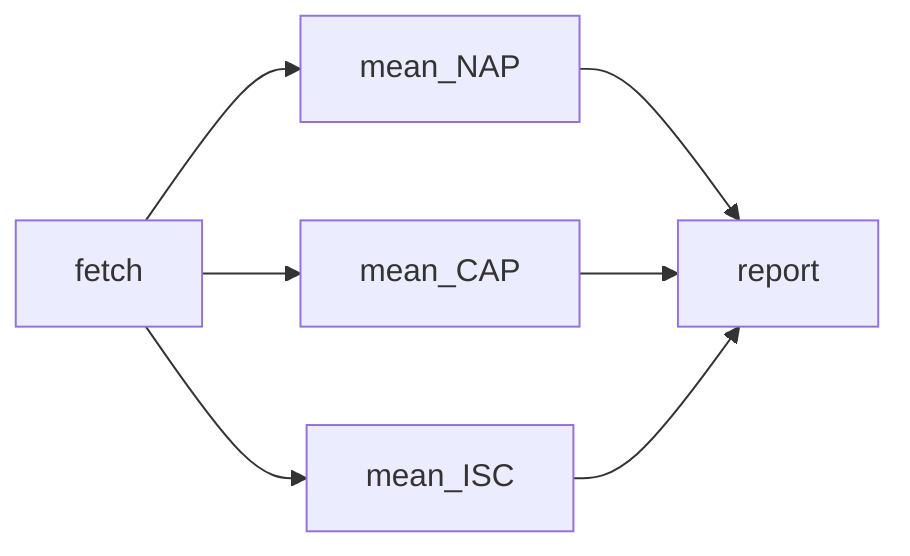

# 01. Scientific workflows for AI–HPC

*Why science runs as graphs of tasks, what DAGonStar adds, and how the 48 lectures fit together*

DAGonStar in Practice - Part 1: Foundations of scientific workflows. Slides: [01-DAGonStar-Scientific_workflows_for_AI_HPC.pptx](../lectures/01-DAGonStar-Scientific_workflows_for_AI_HPC.pptx). Examples: [examples/01-hello](../../examples/01-hello/).

## 2. Today's lecture

**Outline**

1. Why workflows: from scripts to graphs
2. What a workflow management system does
3. The computing continuum: laptop to supercomputer
4. DAGonStar in one picture
5. The course path and the running example
6. Your first workflow, run end to end

**After this lecture you can**

- Define task, dependency and workflow
- Say what DAGonStar does for you and what it does not
- Run the first example and read its output

## 3. Why workflows

*Science is rarely one program. It is a chain of steps, each with its own inputs, outputs, software and computer.*

## 4. A typical computational experiment

- **Fetch** download observations or a forecast from a data service
- **Prepare** clean, regrid, convert units, split by region or station
- **Compute** run a model, a simulation or a training job, often many times
- **Analyse** reduce the results: means, maxima, ensembles, skill scores
- **Publish** store products with metadata so that others can reuse them
- **Repeat** every hour, every day, for every new scenario

> **6** - *Steps, each a different tool*
>
> The hard part is not one step: it is chaining them reliably, again and again, on several machines.

## 5. What goes wrong with plain scripts

- **Order is implicit** - A bash script runs line by line; nothing says which steps could run together.
- **Paths are hard-coded** - Moving to a cluster means editing every cp and every cd.
- **Failure is total** - One error halfway and the whole run starts again from the first line.
- **No provenance** - Months later nobody knows which inputs produced which figure.
- **One machine** - A script cannot send one step to a GPU node and another to a web service.
- **No reuse** - Copy and paste is the only way to share a pipeline with a colleague.

## 6. A workflow is a graph of tasks

- **Task** one unit of work: a command, a function, a request, a container
- **Dependency** task B uses something task A produced, so A runs first
- **DAG** directed acyclic graph: arrows go one way and never loop back
- **Independent tasks** tasks with no path between them can run in parallel
- **Engine** the program that reads the graph and runs every task when it can

> **DAG** - *Directed acyclic graph*
>
> No cycles means there is always an order in which every task can run once.

## 7. The station analysis as a DAG



Solid arrows: data dependencies (`workflow://`); dotted arrows: control dependencies.

- One fetch, three independent means, one report
- The three means run at the same time
- The report waits for all three: fan-in
- We build exactly this graph in lecture 02

## 8. Workflow management systems

*An engine that turns a graph description into processes, files and logs, on whatever computers you have.*

## 9. What a workflow engine does for you

| Concern | Without an engine | With an engine |
|---|---|---|
| Ordering | You sort the steps by hand | Derived from the dependencies |
| Parallelism | Background jobs and wait | Independent tasks run together |
| Data movement | cp, scp, rsync in the script | Staging from task to task |
| Isolation | Shared folder, name clashes | One working directory per task |
| Recovery | Restart from the beginning | Checkpoints: skip finished tasks |
| Portability | Rewrite for each machine | Change the task type or the config |

## 10. A crowded landscape

- **Make, Snakemake** - Rule-based: files and recipes; strong in bioinformatics.
- **Nextflow** - Dataflow channels and containers; Groovy-based language.
- **Airflow, Prefect** - Scheduled data pipelines in industry; Python DAGs.
- **Pegasus, Parsl** - Large-scale science on grids, clusters and clouds.
- **CWL** - A standard to describe workflows, independent of the engine.
- **DAGonStar** - Python API, many task types, from laptop to HPC, AI and IoT.

> **No engine wins everywhere** this course uses DAGonStar to learn the ideas, and lecture 46 exports to CWL to share them.

## 11. The computing continuum

*Today one experiment can touch a sensor, a cloud function, a language model and a supercomputer.*

## 12. From the edge to the supercomputer

1. **Edge and IoT** - Sensors observe; actuators act. Lectures 31-32.
2. **Web and FaaS** - Data services and cloud functions. Lectures 25-30.
3. **AI services** - LLMs and agents with contracts. Lectures 27-35.
4. **Containers** - Docker, Apptainer, Nomad, K8s. 37-39.
5. **HPC** - Slurm jobs, BeeOND, staging. 41-43.

> **One workflow, many places** DAGonStar lets each task say where and how it runs, while the dependencies stay the same.

## 13. DAGonStar in one paragraph

- **Origin** DAGon* began at the University of Naples “Parthenope” for environmental modelling
- **Python API** you build the workflow in Python, or load it from JSON
- **Task types** batch, Slurm, cloud, containers, web, LLM, FaaS, IoT, agentic, native
- **Data model** tasks reference each other's files with workflow:// URLs
- **Robustness** checkpoints, resume, dry runs, portable emulation
- **Openness** Apache-2.0 licence, exports to JSON and CWL

> **2.9** - *The version used in this course*
>
> Every example is tested with DAGonStar 2.9.4, pinned in examples/requirements.txt.

## 14. Fourteen task types

| Family | TaskType values | Lectures |
|---|---|---|
| Local and HPC | `BATCH  SLURM  NATIVE` | 06, 18, 41 |
| Containers | `DOCKER  APPTAINER  KUBERNETES  NOMAD` | 37-39 |
| Remote | `CLOUD (and BATCH over SSH)` | 40 |
| Services | `WEB  FAAS` | 25-26, 29-30 |
| AI | `LLM  AGENTIC` | 27-28, 33-35 |
| Physical world | `IOT` | 31-32 |
| Recovery | `CHECKPOINT` | 15 |

## 15. The course

*Forty-eight lectures in four parts. Every lecture mixes concepts and a runnable example.*

## 16. Four parts, forty-eight lectures

| Part | Lectures | Topic |
|---|---|---|
| 1 | 01-12 | Foundations: tasks, dependencies, workflow://, scratch, inspection |
| 2 | 13-24 | Execution, data and recovery: staging, checkpoints, native tasks, ensembles |
| 3 | 25-36 | Task models for AI-HPC: web, LLM, FaaS, IoT, agentic, the continuum |
| 4 | 37-48 | Infrastructure, FAIR and applications: containers, Slurm, BeeOND, CWL, capstone |
| A | A1 | Appendix: DAGonFS, an in-memory file system for workflows |

## 17. The running example

- **Data** synthetic observations from three stations in the Gulf of Naples
- **Stations** NAP Naples, CAP Capri, ISC Ischia: four hourly records each
- **Columns** station, time_utc, temperature_c, wind_m_s
- **Questions** mean temperature per station, windiest station, ensembles
- **Why synthetic** small, versioned, the same on every laptop: outputs are reproducible

> **12** - *Records in examples/data*
>
> The same file feeds every lecture, so the numbers on the slides can be checked by hand.

## 18. The dataset

[`examples/data/gulf_of_naples.csv`](../../examples/data/gulf_of_naples.csv)

```text
station,time_utc,temperature_c,wind_m_s
NAP,2026-11-02T00:00:00Z,14.0,3.0
NAP,2026-11-02T01:00:00Z,15.0,4.0
NAP,2026-11-02T02:00:00Z,16.0,5.0
NAP,2026-11-02T03:00:00Z,17.0,4.0
CAP,2026-11-02T00:00:00Z,16.0,6.0
CAP,2026-11-02T01:00:00Z,16.5,7.0
CAP,2026-11-02T02:00:00Z,17.0,8.0
CAP,2026-11-02T03:00:00Z,17.5,7.0
ISC,2026-11-02T00:00:00Z,15.0,5.0
ISC,2026-11-02T01:00:00Z,15.5,5.0
ISC,2026-11-02T02:00:00Z,16.0,6.0
ISC,2026-11-02T03:00:00Z,16.5,6.0
```

- One header and twelve records
- Means: NAP 15.50, CAP 16.75, ISC 15.75 °C
- Windiest: CAP, 8 m/s at 02:00
- Every example reads this file

## 19. How every example is built

- **Self-contained** - No external server, credential or cluster: services are local mocks.
- **Temporary scratch** - Each run uses a fresh temporary directory and removes it.
- **Checked** - Each script ends with check() calls: wrong results fail loudly.
- **Recorded** - The output on the slides is the real output, saved in output/.

> **Run them all** python tools/run_examples.py compares every output with the recorded one.

## 20. Hands-on: the first workflow

*One task that copies the dataset into its own working directory, run by DAGonStar.*

## 21. Set up and run

**Steps**

1. Clone the repository and create a virtual environment
2. Install the pinned requirements
3. Run the first example from the repository root
4. Read the three lines it prints

**Run it**

```bash
python3 -m venv .venv
. .venv/bin/activate
pip install -r \
  examples/requirements.txt
python examples/01-hello/\
  hello_workflow.py
```

**Watch for:** status FINISHED and 12 records: the task ran in its own folder and found the file it copied.

## 22. Hello, workflow

[`examples/01-hello/hello_workflow.py`](../../examples/01-hello/hello_workflow.py)

```python
from dagon.task import DagonTask, TaskType
from common.course import check, fetch_observations, scratch, text, workflow

with scratch("01") as base:
    wf = workflow("Hello01", base)
    fetch = DagonTask(TaskType.BATCH, "fetch", fetch_observations())
    wf.add_task(fetch)
    wf.run()

    lines = text(fetch, "outputs/observations.csv").splitlines()
    print("status:", fetch.status.name)
    print("records fetched:", len(lines) - 1)
    print("header:", lines[0])
    check(fetch.status.name == "FINISHED", "the task must finish")
    check(len(lines) == 13, "12 records and a header")
```

- DagonTask(TaskType.BATCH, name, command)
- workflow() builds a Workflow on a temporary scratch
- add_task, then run()
- The task's files are in task.working_dir

## 23. The helper behind workflow()

[`examples/common/course.py`](../../examples/common/course.py)

```python
def config(scratch, extra=None, remove_dir=False):
    """The configuration dictionary of a local workflow whose scratch is *scratch*."""
    value = {
        "batch": {"scratch_dir_base": str(scratch), "run_base": "", "threads": "2",
                  "remove_dir": str(remove_dir)},
        "dagon_service": {"use": "False"},
        "ftp_pub": {"ip": "localhost"},
        "slurm": {"partition": ""},
```

- A configuration dictionary instead of a dagon.ini
- scratch_dir_base: where task folders go
- dagon_service off: no external service
- Lecture 05 covers every option

## 24. What it prints

Recorded output of `python examples/01-hello/hello_workflow.py`:

```text
status: FINISHED
records fetched: 12
header: station,time_utc,temperature_c,wind_m_s
```

- The task finished
- Twelve records were copied
- The header matches the CSV
- A second run gives the same output

## 25. What happened behind the scenes

- **Workflow** created a scratch folder and a logger
- **Task** got its own working directory: <timestamp>-fetch
- **Launcher** the command was written into .dagon/launcher.sh and run with bash
- **Status** READY, then RUNNING, then FINISHED
- **Clean-up** the scratch context removed everything at the end

> *The life of a task*
>
> Lecture 10 opens the task folder and reads the launcher.

```
READY
RUNNING
FINISHED
```

## 26. The first run in numbers

- **1** - Task in the workflow
- **12** - Records copied into the task folder
- **0** - Files left behind after the run

> **Small on purpose** every later lecture adds one idea to this script, so you always know what changed.

## 27. What DAGonStar does and does not do

**It does**

- Order tasks by their dependencies
- Run independent tasks in parallel
- Give each task a clean working directory
- Stage files between tasks
- Remember finished tasks with checkpoints

**It does not**

- Make a slow model fast by itself
- Fix a wrong command
- Guess dependencies you did not declare
- Replace the scheduler of a cluster
- Decide whether your science is right

## 28. Exercise

A. Run 01-hello and compare with output/hello_workflow.txt
B. Change the task name to download and run again
C. Add a second BATCH task that counts lines with wc -l
D. Run tools/run_examples.py 01 and read its report

**Deliverable:** A copy of hello_workflow.py with two tasks; the run must still finish with status FINISHED.

## 29. Check your understanding

1. What makes a graph of tasks a DAG?
2. Which two tasks of the station analysis can run at the same time, and why?
3. Name three things a workflow engine does that a plain script does not.
4. Where does DAGonStar run the command of a BATCH task?

<details><summary>Answers</summary>

1. Its edges are directed and there is no cycle.
2. Any two of the three station means: there is no path between them.
3. Ordering by dependencies, parallelism, per-task directories, staging, checkpoints.
4. In the task's own working directory under the scratch base, through .dagon/launcher.sh.

</details>

## 30. Key takeaways

1. A workflow is a DAG of tasks linked by dependencies
2. An engine derives order, parallelism, staging and recovery
3. DAGonStar spans batch, HPC, containers, web, AI and IoT tasks
4. Every example of the course runs locally and checks itself

*Next: the same analysis as a script and as a DAG*

---

Raffaele Montella. CC0 1.0. Generated from `src/lectures/01.js`.
