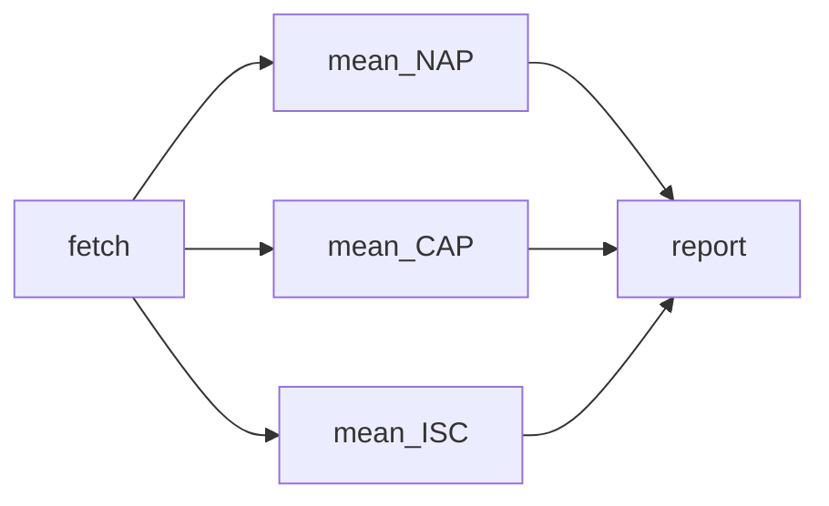

# 02. From scripts to workflows

*The station analysis written twice, as a bash script and as a DAG of tasks, with the same result*

DAGonStar in Practice - Part 1: Foundations of scientific workflows. Slides: [02-DAGonStar-From_scripts_to_workflows.pptx](../lectures/02-DAGonStar-From_scripts_to_workflows.pptx). Examples: [examples/02-script-vs-dag](../../examples/02-script-vs-dag/).

## 2. Today's lecture

**Outline**

1. The analysis we want
2. Version 1: one bash script
3. What the script hides
4. Version 2: five tasks and their references
5. Running both and comparing
6. When a script is enough

**After this lecture you can**

- Turn a sequential script into a task graph
- Explain fan-out and fan-in
- Show that the two versions agree byte for byte

## 3. The analysis

*Mean temperature of each station, then one report with the three means.*

## 4. The question

- **Input** examples/data/gulf_of_naples.csv, twelve hourly records
- **Step 1** copy the observations into a working folder
- **Step 2** mean temperature of NAP, CAP and ISC, one at a time
- **Step 3** concatenate the three results into report.txt
- **Expected** NAP 15.50, CAP 16.75, ISC 15.75

> **3** - *Independent computations*
>
> The three means read the same file and write different files: nothing forces an order between them.

## 5. awk computes one mean

```
awk -F, -v s=NAP \
  '$1==s {t+=$3; n++}
   END {printf "%s %.2f\n", s, t/n}' \
  observations.csv > mean_NAP.txt
```

- -F, splits on commas
- Column 1 is the station, column 3 the temperature
- END prints once, after the last line
- The header never matches a station name

## 6. Version 1: a script

*Every step in order, in one folder, the way most pipelines start.*

## 7. pipeline.sh

[`examples/02-script-vs-dag/pipeline.sh`](../../examples/02-script-vs-dag/pipeline.sh)

```bash
#!/usr/bin/env bash
# The station analysis as one script: every step in order, in one folder.
set -euo pipefail
DATA="$(cd "$(dirname "$0")/../data" && pwd)/gulf_of_naples.csv"
WORK="${1:?usage: pipeline.sh WORKDIR}"
mkdir -p "$WORK" && cd "$WORK"
cp "$DATA" observations.csv
for s in NAP CAP ISC; do
  awk -F, -v s="$s" '$1==s{t+=$3;n++}END{printf "%s %.2f\n", s, t/n}' \
    observations.csv > "mean_$s.txt"
done
cat mean_NAP.txt mean_CAP.txt mean_ISC.txt > report.txt
```

- set -euo pipefail: stop at the first error
- One working folder for every step
- The loop runs the stations one after the other
- The report concatenates three files

## 8. What the script hides

- **Hidden order** - The for loop is sequential although the stations are independent.
- **Shared folder** - All files live together: two runs in the same folder clash.
- **Implicit inputs** - Nothing says that report.txt needs exactly the three means.
- **All or nothing** - If ISC fails, NAP and CAP are recomputed on the next run.

## 9. Reading the dependencies off the script

| Step | Reads | Writes |
|---|---|---|
| fetch | `gulf_of_naples.csv` | `observations.csv` |
| mean NAP | `observations.csv` | `mean_NAP.txt` |
| mean CAP | `observations.csv` | `mean_CAP.txt` |
| mean ISC | `observations.csv` | `mean_ISC.txt` |
| report | `mean_*.txt` | `report.txt` |

> **A dependency is a file** a step depends on the step that writes a file it reads. That is the whole graph.

## 10. Version 2: a DAG

*Five tasks, each in its own folder, linked by workflow:// references.*

## 11. Fan-out and fan-in



Solid arrows: data dependencies (`workflow://`); dotted arrows: control dependencies.

- **Fan-out** one producer, many consumers
- **Fan-in** many producers, one consumer
- **Width 3** up to three tasks run at once
- **Depth 3** the critical path has three tasks

## 12. workflow:// references

- **Form** workflow:///<task>/<path inside the task folder>
- **Meaning** the file that task produced, wherever it ran
- **Dependency** DAGonStar adds an edge from that task to the one using the URL
- **Staging** before running, the file is made available in the consumer's folder
- **Lecture 08** the full syntax, including other workflows

> *Three slashes*
>
> An empty workflow name means this workflow.

```
workflow:///fetch/
  outputs/
  observations.csv
```

## 13. The DAG version

[`examples/02-script-vs-dag/as_dag.py`](../../examples/02-script-vs-dag/as_dag.py)

```python
wf = workflow("Stations02", base)
wf.add_task(DagonTask(TaskType.BATCH, "fetch", fetch_observations()))
for s in STATIONS:
    wf.add_task(DagonTask(TaskType.BATCH, "mean_" + s,
                          station_mean(s, SOURCE, "outputs/mean.txt")))
inputs = " ".join("workflow:///mean_%s/outputs/mean.txt" % s
                  for s in STATIONS)
report = DagonTask(TaskType.BATCH, "report", "cat %s > report.txt" % inputs)
wf.add_task(report)
wf.run()
```

- SOURCE points at fetch's output
- One task per station, in a loop
- The report reads three references
- No explicit edge: they come from the URLs

## 14. The helpers used

[`examples/common/course.py`](../../examples/common/course.py)

```python
def fetch_observations(target="outputs/observations.csv"):
    """Shell command that copies the course dataset into a task's working directory."""
    folder = str(Path(target).parent)
    return "mkdir -p %s && cp %s %s" % (folder, shlex.quote(str(DATA)), target)


def station_mean(station, source, target):
    """Shell command: mean temperature of one station with awk."""
    return ("mkdir -p outputs && awk -F, -v s=%s '$1==s{t+=$3;n++}END{printf \"%%s %%.2f\\n\", s, t/n}' %s > %s"
            % (station, source, target))
```

- fetch_observations: mkdir and cp into outputs/
- station_mean: the same awk as the script

## 15. Hands-on: both versions

*Run the script, run the DAG, compare the two reports.*

## 16. Run the comparison

**Steps**

1. Run the example from the repository root
2. The script runs first, in <scratch>/script
3. Then the workflow runs its five tasks
4. The example compares the two report.txt files

**Run it**

```bash
python examples/\
  02-script-vs-dag/\
  as_dag.py
```

**Watch for:** script and DAG agree: True. The DAG found the order on its own and ran the means in parallel.

## 17. Running the script from Python

[`examples/02-script-vs-dag/as_dag.py`](../../examples/02-script-vs-dag/as_dag.py)

```python
HERE = Path(__file__).resolve().parent
SOURCE = "workflow:///fetch/outputs/observations.csv"

with scratch("02") as base:
    subprocess.run(["bash", str(HERE / "pipeline.sh"), str(base / "script")],
                   check=True)
    script_report = (base / "script" / "report.txt").read_text()
```

- The script runs in <scratch>/script
- check=True: a failing script stops the example
- Its report is kept for the comparison

## 18. Checking the result

[`examples/02-script-vs-dag/as_dag.py`](../../examples/02-script-vs-dag/as_dag.py)

```python
dag_report = text(report, "report.txt")
print(dag_report, end="")
print("tasks:", len(wf.tasks))
print("report waits for:", sorted(t.name for t in report.prevs))
print("script and DAG agree:", dag_report == script_report)
check(dag_report == script_report, "the two versions must agree")
```

- Same content, byte for byte
- 5 tasks in wf.tasks
- report.prevs: the tasks it waits for
- check() turns the claim into a test

## 19. Recorded output

Recorded output of `python examples/02-script-vs-dag/as_dag.py`:

```text
NAP 15.50
CAP 16.75
ISC 15.75
tasks: 5
report waits for: ['mean_CAP', 'mean_ISC', 'mean_NAP']
script and DAG agree: True
```

- Three means, in report order
- Five tasks
- The report waits for the three means
- The two versions agree

## 20. prevs and nexts

- **prevs** the tasks a task waits for: its incoming edges
- **nexts** the tasks that wait for it: its outgoing edges
- **Built by** make_dependencies(), called by run(), from the workflow:// URLs
- **Symmetric** if A is in B.prevs then B is in A.nexts
- **Use** inspect the graph before running it

> *Edges as Python sets*
>
> Sorted here because sets have no order.

```
report.prevs
  mean_CAP
  mean_ISC
  mean_NAP
```

## 21. Scripts or workflows?

*A workflow engine has a cost: learn when it pays back.*

## 22. When to use which

**A script is enough when**

- It runs in seconds on one machine
- It has a handful of steps
- Nobody else will reuse it
- Restarting from scratch is cheap

**A workflow pays back when**

- Steps are slow, many or parallel
- Steps run on different machines
- Failures must not restart everything
- Others must reuse, audit or cite it

## 23. If the ISC step fails

**The script**

- set -e stops at the failing line
- NAP and CAP results stay in the shared folder, unlabelled
- The report is never written
- Next run: everything again from cp

**The DAG**

- mean_ISC becomes FAILED
- mean_NAP and mean_CAP still finish
- report becomes FAILED without running
- With checkpoints only ISC and report rerun (lecture 15)

## 24. The same analysis, two shapes

- **1** - Folder used by the script for every step
- **5** - Task folders used by the DAG, one per task
- **3** - Means the DAG can compute at the same time

> **Same result, different properties** isolation, parallelism and explicit inputs are what we bought.

## 25. Common mistakes when converting

- **Relative paths** a task runs in its own folder: ../observations.csv does not exist there
- **Forgotten producer** a file read without a workflow:// URL creates no edge
- **Shared output names** two tasks writing /tmp/out.txt overwrite each other
- **Hidden state** environment variables set by one step do not reach the next
- **Side effects** steps that modify their inputs break re-runs and checkpoints

> **1** - *Rule of thumb*
>
> Everything a task needs comes from its command or from a workflow:// URL.

## 26. A conversion recipe

1. **List steps** - One line of the script, one candidate task.
2. **Find files** - What each step reads and writes.
3. **Name tasks** - Short, unique names: they appear in URLs.
4. **Replace paths** - Inputs become workflow:// URLs.
5. **Run and compare** - The result must match the script.

## 27. What we gained

- **Parallel means** - The three stations no longer wait for each other.
- **Explicit inputs** - The report states the three files it needs.
- **Isolation** - Each task writes only into its own folder.
- **A graph to inspect** - prevs, nexts and the JSON form of lecture 11.

## 28. Exercise

A. Add a max_wind task per station with awk on column 4
B. Make the report concatenate means and maxima
C. Check that the report has six lines
D. Count the tasks and the edges of your graph

**Deliverable:** An as_dag.py with eight tasks; the report lists CAP as the windiest station, at 8.0 m/s.

## 29. Check your understanding

1. Which steps of pipeline.sh are independent, and how do you see it?
2. What does workflow:///mean_NAP/outputs/mean.txt refer to?
3. Why does the DAG need no explicit add_dependency_to call?
4. Give two situations where the script is the better choice.

<details><summary>Answers</summary>

1. The three station means: they read the same file and write different files.
2. The file outputs/mean.txt inside the working directory of task mean_NAP of this workflow.
3. make_dependencies() derives the edges from the workflow:// URLs in the commands.
4. A short, fast, single-machine, single-user analysis; a one-off exploration.

</details>

## 30. Key takeaways

1. A dependency is a file written by one step and read by another
2. Fan-out spreads work; fan-in collects it
3. workflow:// URLs create both the edge and the staging
4. The DAG and the script give the same report, byte for byte

*Next: the architecture of DAGonStar*

---

Raffaele Montella. CC0 1.0. Generated from `src/lectures/02.js`.
