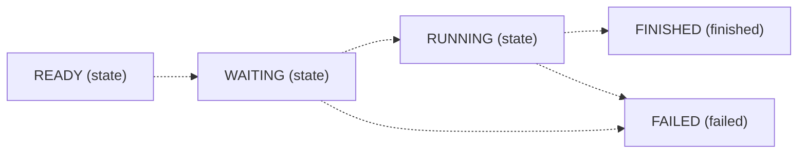

# 03. DAGonStar architecture

*Workflow, tasks, the factory, statuses, stagers and the reference schema, read from the running library*

DAGonStar in Practice - Part 1: Foundations of scientific workflows. Slides: [03-DAGonStar-DAGonStar_architecture.pptx](../lectures/03-DAGonStar-DAGonStar_architecture.pptx). Examples: [examples/03-architecture](../../examples/03-architecture/).

## 2. Today's lecture

**Outline**

1. The pieces: Workflow, Task, stager
2. The DagonTask factory and the sixteen types
3. Tasks are threads
4. Statuses and the life of a task
5. Stagers and data movers
6. Inspecting all of it from Python

**After this lecture you can**

- Draw the main classes of DAGonStar
- Explain how DagonTask picks a class
- Describe the life cycle of a task

## 3. The big picture

*A Workflow owns tasks; each task is a thread that waits for its predecessors, stages its inputs and executes.*

## 4. Main components

- **Workflow** - Holds the tasks, the configuration, the scratch base, the logger, events and checkpoints.
- **Task** - One unit of work: a thread with a command, a working directory and a status.
- **DagonTask** - A factory: TaskType.X plus arguments gives the right Task subclass.
- **Stager** - Moves the files named by workflow:// URLs into the consumer's folder.
- **Launcher** - A bash script in .dagon/ that sets the context and runs the command.
- **DAG_TPS** - A meta-workflow that connects several workflows (lecture 22).

## 5. From Python to processes

1. **Build** - Create the Workflow, add the tasks.
2. **Link** - Edges come from the URLs in the commands.
3. **Start** - run() starts one thread per task.
4. **Wait** - Each thread waits for its prevs.
5. **Execute** - Stage inputs, run the launcher, set the status.

## 6. Where things live in the package

| Module | Contents |
|---|---|
| `dagon/__init__.py` | Workflow, Status, events, run, launch, CWL export |
| `dagon/task.py` | Task, TaskType, DagonTask, staging plan, checkpoints |
| `dagon/batch.py` | Batch (local or SSH) and Slurm |
| `dagon/stager/` | DataMover, StagerMover and the movers |
| `dagon/native.py, llm.py, faas.py` | Native, LLM and FaaS tasks |
| `dagon/web/, iot/, agentic/` | Web, IoT and agentic tasks |
| `dagon/meta/, volume.py, adhoc.py` | Meta-tasks, volume tasks, ad-hoc file systems |
| `dagon/dag_tps.py` | Meta-workflows |

## 7. The Workflow constructor

| Argument | Purpose |
|---|---|
| `name` | Unique name: used in URLs and checkpoint keys |
| `config / config_file` | A dictionary or a dagon.ini (lecture 05) |
| `max_threads` | Semaphore on concurrently running tasks (default 10) |
| `jsonload` | Build the workflow from its JSON form (lecture 11) |
| `checkpoint_file` | Where finished tasks are recorded (lecture 15) |
| `portable_emulation` | Run every task type locally (lecture 23) |
| `pre_stage` | Stage inputs before HPC allocation (lecture 43) |

## 8. The task factory

*DagonTask is not a class you subclass: it maps a TaskType to the class that implements it.*

## 9. Asking the factory

[`examples/03-architecture/factory.py`](../../examples/03-architecture/factory.py)

```python
for kind in TaskType:
    module, name = tasks_types[kind]
    print("%-10s -> %s.%s" % (kind.value, module, name))

batch = DagonTask(TaskType.BATCH, "a", "true")
slurm = DagonTask(TaskType.SLURM, "b", "true", partition="debug")
print("DagonTask(BATCH) builds", type(batch).__name__)
print("DagonTask(SLURM) builds", type(slurm).__name__)
print("every task is a Task and a thread:",
      isinstance(slurm, Task) and isinstance(slurm, threading.Thread))
```

- tasks_types maps each TaskType to a module and a class
- DagonTask(TaskType.BATCH, ...) returns a Batch
- Extra keyword arguments go to that class
- Every task is a Task and a Thread

## 10. The sixteen types

Recorded output of `python examples/03-architecture/factory.py`:

```text
checkpoint -> dagon.checkpoint.Checkpoint
batch      -> dagon.batch.Batch
slurm      -> dagon.batch.Slurm
cloud      -> dagon.remote.CloudTask
docker     -> dagon.docker_task.DockerTask
kubernetes -> dagon.kubernetes_task.KubernetesTask
apptainer  -> dagon.apptainer_task.ApptainerTask
nomad      -> dagon.nomad_task.NomadTask
llm        -> dagon.llm.LLMTask
native     -> dagon.native.NativeTask
web        -> dagon.web.WebTask
faas       -> dagon.faas.FaaSTask
iot        -> dagon.iot.IoTTask
agentic    -> dagon.agentic.task.AgenticTask
meta       -> dagon.meta.task.MetaTask
volume     -> dagon.volume.VolumeTask
```

- Imported lazily: optional dependencies load only when used
- Same constructor shape: name, then type-specific arguments
- meta and volume: Appendices A2 and A3
- Lecture 48 uses every one of them

## 11. Why a factory

- **One entry point** users write DagonTask(TaskType.X, ...) for every kind of task
- **Lazy imports** Docker or Kubernetes clients load only if a task needs them
- **Swap the type** the same command can move from BATCH to SLURM by changing one word
- **Extensible** a new task type is one entry in tasks_types plus one class

> *Type-specific options*
>
> partition is a keyword of Slurm, not of Task.

```
DagonTask(
  TaskType.SLURM,
  "b", "true",
  partition="debug")
```

## 12. Tasks are threads

*Concurrency in DAGonStar is a thread per task, each blocking on the tasks it depends on.*

## 13. One thread per task

- **Task extends threading.Thread** run() is what the thread executes
- **Workflow.run()** starts every task, then joins every task
- **Waiting** a task loops until each of its prevs is FINISHED or FAILED
- **Parallelism** tasks whose prevs are done run at the same time
- **Cost** threads mostly wait on processes and I/O, so the GIL is not a bottleneck

> **1:1** - *Task to thread*
>
> The real work happens in child processes started by the launcher.

## 14. Statuses

| Status | Meaning | Set when |
|---|---|---|
| `READY` | Created, not started | The task object is built |
| `WAITING` | Started, waiting for prevs | Its thread starts |
| `RUNNING` | Executing its command | All prevs FINISHED |
| `FINISHED` | Done, outputs available | execute() returned |
| `FAILED` | Error here or upstream | An exception, or a FAILED prev |

## 15. The life of a task



Solid arrows: data dependencies (`workflow://`); dotted arrows: control dependencies.

- **WAITING to FAILED** a predecessor failed: the task never runs
- **RUNNING to FAILED** its own command failed
- Events fire at each step (lecture 17)

## 16. Reading the enumerations

[`examples/03-architecture/factory.py`](../../examples/03-architecture/factory.py)

```python
print("DagonTask(BATCH) builds", type(batch).__name__)
print("DagonTask(SLURM) builds", type(slurm).__name__)
print("every task is a Task and a thread:",
      isinstance(slurm, Task) and isinstance(slurm, threading.Thread))
print("a new task is", batch.status.name)
print("statuses:", " ".join(s.name for s in Status))
print("data movers:", " ".join(m.name for m in DataMover))
print("stager modes:", " ".join(m.name for m in StagerMover))
print("reference schema:", Workflow.SCHEMA)
```

- status of a new task
- Status, DataMover and StagerMover are Enums
- Workflow.SCHEMA is the URL prefix

## 17. Factory, statuses, movers

Recorded output of `python examples/03-architecture/factory.py`:

```text
DagonTask(BATCH) builds Batch
DagonTask(SLURM) builds Slurm
every task is a Task and a thread: True
a new task is READY
statuses: READY WAITING RUNNING FINISHED FAILED
data movers: DONTMOVE LINK COPY SCP HTTP HTTPS FTP SFTP GRIDFTP SKYCDS DYNOSTORE
stager modes: NORMAL PARALLEL SLURM
reference schema: workflow://
```

- Batch and Slurm are separate classes
- A new task is READY
- Eleven data movers, three stager modes
- workflow:// is the schema

## 18. Staging

*Before a task runs, every workflow:// file it names is brought into its folder.*

## 19. Data movers

- **LINK, COPY** - Same machine: symbolic link or copy. The local default.
- **SCP, SFTP, FTP** - Between hosts over SSH or FTP (lecture 40).
- **HTTP, HTTPS** - Download from a published task folder.
- **GRIDFTP** - Globus transfers between endpoints (lecture 44).
- **SKYCDS, DYNOSTORE** - Research data services and stores.
- **DONTMOVE** - Rewrite the path only: the file must already be there.

> **The mover is chosen per workflow or per task** set_data_mover(DataMover.COPY).

## 20. Stager modes

| StagerMover | How the inputs are moved |
|---|---|
| `NORMAL (0)` | One input after the other, inside the launcher |
| `PARALLEL (1)` | Inputs moved concurrently |
| `SLURM (2)` | Transfers submitted as Slurm jobs on the cluster |

> Lecture 13 compares the movers on the station data; lecture 43 adds pre-staging on HPC.

## 21. Inside a task folder

- **<timestamp>-<task>** the working directory, under scratch_dir_base
- **outputs/** a convention of this course for produced files
- **.dagon/launcher.sh** the generated bash script
- **.dagon/context.sh** environment and paths for the launcher
- **.dagon/stdout.txt** what the command printed
- **.dagon/inputs/** where staged inputs land before being linked

> *Lecture 10*
>
> We open every one of these files and read them line by line.

## 22. Hands-on

*Run the factory example and match its output with the architecture.*

## 23. Introspect the library

**Steps**

1. Run factory.py: no workflow is executed
2. Find the class built for each TaskType
3. Check that a fresh task is READY
4. List the movers available on this install

**Run it**

```bash
python examples/\
  03-architecture/\
  factory.py
```

**Watch for:** Sixteen lines of mapping, then the statuses: READY WAITING RUNNING FINISHED FAILED.

## 24. The assertion

[`examples/03-architecture/factory.py`](../../examples/03-architecture/factory.py)

```python
check(len(TaskType) == 16, "DAGonStar registers 16 task types")
```

- If a future version adds a type, this example fails
- Then the slides are updated with it

## 25. Two layers

**The model**

- Workflow, tasks, edges
- Statuses and events
- Checkpoints keyed by name
- Independent of where tasks run

**The executors**

- bash, Slurm, Docker, HTTP, functions
- One class per TaskType
- Each knows how to stage and run
- Chosen by the factory

## 26. Design choices worth noticing

- **Python first** workflows are programs: loops, functions and tests are free
- **Files as the contract** tasks exchange files, not Python objects
- **Explicit scratch** every task folder is visible and inspectable
- **Optional extras** docker, kubernetes, libcloud are imported only on demand
- **Same graph, many runtimes** the task type is a detail of each node

> **Files** - *The universal interface*
>
> Any program that reads and writes files can be a task.

## 27. The library in numbers

- **16** - Task types in TaskType
- **5** - Statuses of a task
- **11** - Data movers

> **All read at run time** the numbers on this slide come from examples/03-architecture/output/factory.txt.

## 28. Exercise

A. Print the module of each task class with type(task).__module__
B. Build a NATIVE task with DagonTask and print its class
C. List the attributes of a Batch task with vars()
D. Find where Status is defined in the dagon package

**Deliverable:** A short script and a sketch of the classes Workflow, Task, Batch and Slurm with their relations.

## 29. Check your understanding

1. What does DagonTask(TaskType.SLURM, ...) return?
2. Which status does a task have while it waits for a predecessor?
3. When does a task go from WAITING directly to FAILED?
4. What is the job of the stager?

<details><summary>Answers</summary>

1. An instance of dagon.batch.Slurm, a subclass of Task and of threading.Thread.
2. WAITING.
3. When one of its predecessors is FAILED: it never runs its own command.
4. To make the files named by workflow:// URLs available in the consumer's working directory.

</details>

## 30. Key takeaways

1. A Workflow owns tasks; a Task is a thread
2. DagonTask maps sixteen TaskTypes to classes
3. READY, WAITING, RUNNING, then FINISHED or FAILED
4. Stagers move workflow:// inputs with a chosen mover

*Next: installing DAGonStar and checking the environment*

---

Raffaele Montella. CC0 1.0. Generated from `src/lectures/03.js`.
