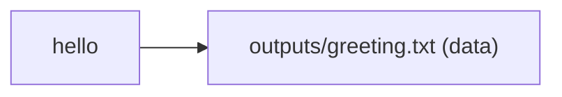

# 06. The first local task

*A BATCH task from construction to FINISHED: its command, its working directory, its status and its output*

DAGonStar in Practice - Part 1: Foundations of scientific workflows. Slides: [06-DAGonStar-The_first_local_task.pptx](../lectures/06-DAGonStar-The_first_local_task.pptx). Examples: [examples/06-first-task](../../examples/06-first-task/).

## 2. Today's lecture

**Outline**

1. Anatomy of a BATCH task
2. The command string
3. Before the run: READY and no folder
4. During the run: the working directory
5. After the run: reading the outputs
6. Task names and errors

**After this lecture you can**

- Write a BATCH task with a correct command
- Find its working directory and output files
- Explain what changes before and after run()

## 3. Anatomy of a BATCH task

*A name, a shell command, and the machine it runs on: the local one unless told otherwise.*

## 4. The constructor

```
DagonTask(TaskType.BATCH,
          name,          # unique in the workflow
          command,       # a bash command line
          working_dir=None)

# with ip=..., ssh_username=..., keypath=...
# Batch.__new__ returns a RemoteBatch (lecture 40)
```

- **name** appears in folders, URLs and checkpoints
- **command** run by bash in the task folder
- **ip** given: a RemoteBatch over SSH
- **working_dir** normally chosen by DAGonStar

## 5. Rules for task names

- **Unique** two tasks with the same name in a workflow are an error
- **Stable** checkpoints and references use the name (lecture 15)
- **URL-safe** letters, digits, underscore, dash: they go into workflow:// URLs
- **Meaningful** mean_NAP says more than task3
- **Short** they appear in every folder name and log line

> *The folder name*
>
> The name follows a 13-digit timestamp.

```
<timestamp>-hello
```

## 6. The command string

- **A bash command line** pipes, &&, redirections and quotes all work
- **Runs in the task folder** relative paths are relative to it
- **Create what you write** mkdir -p outputs before writing outputs/x
- **Exit code** non-zero means the task FAILED
- **References** workflow:// URLs inside the command are staged and rewritten

> *This lecture's command*
>
> Quotes protect the spaces.

```
mkdir -p outputs &&
echo 'Ciao from
  the Gulf' >
  outputs/greeting.txt
```

## 7. Commands that work and commands that bite

- **Good: relative output** - echo ok > outputs/ok.txt writes inside the task folder.
- **Bad: absolute output** - echo ok > /tmp/ok.txt is invisible to other tasks and clashes between runs.
- **Good: && chain** - mkdir -p a && cmd > a/x stops at the first failure.
- **Bad: ; chain** - mkdir a ; cmd hides an earlier failure behind a later success.

## 8. Before the run

*Building a task does not run it and does not create any folder.*

## 9. first_task.py

[`examples/06-first-task/first_task.py`](../../examples/06-first-task/first_task.py)

```python
with scratch("06") as base:
    wf = workflow("FirstTask06", base)
    hello = DagonTask(TaskType.BATCH, "hello",
                      "mkdir -p outputs && echo 'Ciao from the Gulf' "
                      "> outputs/greeting.txt")
    print("before run:", hello.status.name, "| working dir:", hello.working_dir)
    wf.add_task(hello)
    wf.run()
```

- The command makes a folder and writes a file; status and working_dir are printed before run()
- add_task attaches the task; run() blocks until it ends

## 10. READY and working_dir None

- **READY** the object exists, its thread has not started
- **working_dir None** the folder is created only when the task executes
- **Why late** a resumed workflow may reuse an old folder instead (lecture 15)
- **Why it matters** code that reads task.working_dir must wait for the run

> *First line of the output*
>
> Nothing on disk yet.

```
before run: READY
| working dir: None
```

## 11. During the run

*The thread creates the folder, writes the launcher and runs the command with bash.*

## 12. What run() does for this task

1. **Start** - The task thread starts: WAITING.
2. **Prevs** - None to wait for: RUNNING.
3. **Folder** - Create the task folder, with a timestamp.
4. **Launcher** - Write the bash launcher in .dagon.
5. **Execute** - bash runs it; exit code 0.
6. **Finish** - Status FINISHED.

## 13. One task, one folder



Solid arrows: data dependencies (`workflow://`); dotted arrows: control dependencies.

- The output stays in the task folder
- Another task would read it as workflow:///hello/outputs/greeting.txt
- Lecture 08 does exactly that

## 14. Local execution in detail

- **Batch.execute_command** runs the launcher with subprocess and bash
- **Result** output, exit code and error text are collected
- **Exit code 0** the task is FINISHED
- **Otherwise** an exception is raised inside the thread: FAILED
- **stdout** also saved to .dagon/stdout.txt

> *What really runs*
>
> Every BATCH task becomes exactly this process.

```
bash .dagon/launcher.sh
```

## 15. After the run

*The status is FINISHED and the output is in the task's working directory.*

## 16. Reading the result

[`examples/06-first-task/first_task.py`](../../examples/06-first-task/first_task.py)

```python
folder = Path(hello.working_dir)
print("after run:", hello.status.name)
print("directory: <timestamp>-" + where(hello))
print("timestamp digits:", len(folder.name.split("-")[0]))
print("greeting:", text(hello, "outputs/greeting.txt").strip())
check(hello.status.name == "FINISHED", "the task finished")
check(folder.parent == base, "the task runs inside the scratch base")
```

- where() strips the timestamp
- 13 digits: milliseconds since 1970
- text() reads a file of the task
- The folder is a direct child of the base

## 17. Recorded output

Recorded output of `python examples/06-first-task/first_task.py`:

```text
before run: READY | working dir: None
after run: FINISHED
directory: <timestamp>-hello
timestamp digits: 13
greeting: Ciao from the Gulf
```

- READY and None before run()
- FINISHED after
- Folder named after the task
- The greeting was written

## 18. Helpers to read task files

[`examples/common/course.py`](../../examples/common/course.py)

```python
def text(task, relative):
    """Content of a file in a task's working directory."""
    return Path(task.working_dir, relative).read_text(encoding="utf-8")


def load(task, relative):
    """JSON content of a file in a task's working directory."""
    return json.loads(text(task, relative))


def where(task):
    """The task directory name without its timestamp: <timestamp>-<name> becomes <name>."""
    return Path(task.working_dir).name.split("-", 1)[1]
```

- text and load read files relative to working_dir
- where gives the folder name without the timestamp

## 19. Run and look

**Steps**

1. Run the example
2. Change the greeting and run again
3. Replace the scratch context with a fixed folder
4. List the folder and open .dagon/

**Run it**

```bash
python examples/\
  06-first-task/\
  first_task.py
```

**Watch for:** The folder contains outputs/greeting.txt and a .dagon folder with the launcher and stdout.

## 20. When things go wrong

*A non-zero exit code makes the task FAILED; the workflow does not raise.*

## 21. Typical failures of a first task

| Mistake | What you see | Fix |
|---|---|---|
| No mkdir -p outputs | No such file or directory | Create the folder first |
| Typo in the command | command not found, FAILED | Run the command by hand in bash |
| Unquoted spaces | Wrong file name or extra files | Quote the argument |
| Absolute output path | File not in working_dir | Write relative paths |
| Duplicate task name | Error when adding the task | Choose unique names |

## 22. Where to look after a failure

- **task.status** FAILED
- **.dagon/stdout.txt** what the command printed, errors included
- **.dagon/launcher.sh** the exact script that ran
- **Run it yourself** cd into the folder and bash .dagon/launcher.sh
- **The logger** the traceback, at WARNING or above

> *Lecture 16*
>
> Failures, propagation and resume, with a task that fails on purpose.

## 23. run() returns, but did it work?

**run() tells you**

- The workflow ended
- Every task thread was joined
- Checkpoint file written, if any

**You must check**

- task.status of the tasks you care about
- That expected files exist
- That their content is right: check()

## 24. Statuses you can test

- **task.status** a Status enum member
- **task.status.name** its name as a string
- **Comparisons** task.status == Status.FINISHED
- **In examples** check(hello.status.name == 'FINISHED', ...)
- **In production** fail the job if any important task is not FINISHED

> *Import*
>
> The enum lives in the top-level package.

```
from dagon import Status
```

## 25. Task attributes worth knowing

| Attribute | Content |
|---|---|
| `name` | The task name |
| `command` | The command as written |
| `status` | A Status member |
| `working_dir` | The task folder, None before execution |
| `prevs, nexts` | Predecessors and successors |
| `workflow` | The Workflow the task belongs to |

## 26. The first task in numbers

- **1** - Command run by bash
- **13** - Digits of the folder timestamp
- **2** - Statuses printed: READY, then FINISHED

## 27. From one task to a workflow

- **Add a consumer** - A second task that reads greeting.txt: lecture 07.
- **Add a reference** - workflow:///hello/outputs/greeting.txt: lecture 08.
- **Look inside** - The launcher and context: lecture 10.
- **Serialise** - The task as JSON: lecture 11.

## 28. Exercise

A. Write the greeting in Italian and in English, two lines
B. Add a second file outputs/date.txt with the date command
C. Break the command on purpose and print the status
D. Read .dagon/stdout.txt of the failed run

**Deliverable:** A first_task.py that prints FINISHED for the good command and FAILED for the broken one.

## 29. Check your understanding

1. When is the working directory of a task created?
2. What does a non-zero exit code of the command do?
3. Why should outputs be written to relative paths?
4. How do you check that a task really produced its file?

<details><summary>Answers</summary>

1. When the task executes, not when it is built: working_dir is None before.
2. The task becomes FAILED; run() still returns normally.
3. So that they land in the task folder, where other tasks and references can find them.
4. Test task.status and read the file, for example with text() and a check().

</details>

## 30. Key takeaways

1. A BATCH task is a name and a bash command
2. Its folder is created at run time under the scratch base
3. READY before, FINISHED or FAILED after
4. Outputs live in the task folder: read them with relative paths

*Next: several tasks and control dependencies*

---

Raffaele Montella. CC0 1.0. Generated from `src/lectures/06.js`.
