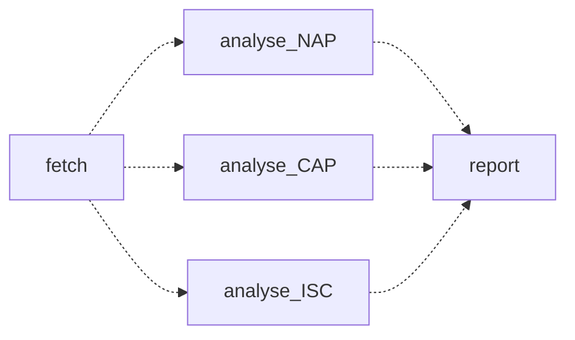

# 07. Control dependencies

*Explicit edges with add_dependency_to, fan-out and fan-in, and the order DAGonStar guarantees*

DAGonStar in Practice - Part 1: Foundations of scientific workflows. Slides: [07-DAGonStar-Control_dependencies.pptx](../lectures/07-DAGonStar-Control_dependencies.pptx). Examples: [examples/07-dag](../../examples/07-dag/).

## 2. Today's lecture

**Outline**

1. Control versus data dependencies
2. add_dependency_to and its direction
3. Fan-out and fan-in
4. What order is guaranteed, and what is not
5. prevs, nexts and Validate_WF
6. Hands-on: an order log

**After this lecture you can**

- Add explicit edges between tasks
- Predict which orders a DAG allows
- Read prevs and nexts after building the graph

## 3. Two kinds of dependency

*Some steps must wait for others even when no file passes between them.*

## 4. Control or data

**Control dependency**

- B must start after A ends
- No file is passed
- Declared with add_dependency_to
- Examples: create a database, then load it; notify after all runs

**Data dependency**

- B reads a file A wrote
- The file is staged into B's folder
- Declared with a workflow:// URL
- Examples: fetch then analyse; members then statistics

## 5. When control edges are right

- **Side effects outside the scratch** a table created in a database, a message sent
- **Shared resources** a licence or a GPU that only one task may use at a time
- **Ordering for humans** start an expensive run only after a cheap sanity check
- **External state** a service that must be configured before it is queried

> **→** - *Prefer data edges*
>
> If a file passes between tasks, a workflow:// URL documents both the order and the input.

## 6. add_dependency_to

*consumer.add_dependency_to(producer): read it as the consumer depends on the producer.*

## 7. The direction of an edge

```
analyse.add_dependency_to(fetch)

# fetch.nexts   gets  analyse
# analyse.prevs gets  fetch
# analyse waits until fetch is FINISHED

analyse.remove_dependency_to(fetch)
# removes the same edge
```

- Called on the task that waits
- The argument is the task it waits for
- Both lists are updated
- remove_dependency_to undoes it

## 8. Explicit edges survive rebuilding

- **run() calls make_dependencies()** if it has not been called yet
- **make_dependencies clears prevs and nexts** then rediscovers the workflow:// edges
- **Explicit edges** added with add_dependency_to are remembered in explicit_prevs
- **Restored** after discovery, so order of calls does not matter
- **Then** Validate_WF() checks the result for cycles

> *Where they are kept*
>
> An attribute of the consuming task.

```
explicit_prevs
```

## 9. Fan-out and fan-in

*One task feeding many, many feeding one: the two shapes of almost every scientific workflow.*

## 10. The graph of this lecture



Solid arrows: data dependencies (`workflow://`); dotted arrows: control dependencies.

- Dashed: control edges only
- fetch has three nexts
- report has three prevs
- No file passes: each task appends to one log

## 11. Building it

[`examples/07-dag/fan_out_fan_in.py`](../../examples/07-dag/fan_out_fan_in.py)

```python
wf = workflow("Stations07", base)
fetch, report = step("fetch"), step("report")
analyses = [step("analyse_" + s) for s in ("NAP", "CAP", "ISC")]
for task in [fetch, *analyses, report]:
    wf.add_task(task)
for task in analyses:
    task.add_dependency_to(fetch)    # fetch -> analyse_*
    report.add_dependency_to(task)   # analyse_* -> report
wf.Validate_WF()
wf.run()
```

- Five tasks added
- Two edges per analysis task
- Validate_WF() before running
- run() starts all five threads

## 12. The step() helper

[`examples/07-dag/fan_out_fan_in.py`](../../examples/07-dag/fan_out_fan_in.py)

```python
with scratch("07") as base:
    log = base / "order.log"
    def step(name):
        return DagonTask(TaskType.BATCH, name, "echo %s >> '%s'" % (name, log))
```

- step() builds a task that appends its name to order.log
- Quoted path: the scratch may contain spaces

## 13. Why order.log is outside the scratch

- **Shared file** every task appends to <scratch>/order.log
- **Absolute path** so all five task folders write the same file
- **Only for teaching** it records the order in which tasks ran
- **In real workflows** tasks never share a file this way
- **Appending** >> lines are small and atomic enough for this demo

> *One line per task*
>
> The order of the lines is the order of execution.

```
echo fetch >>
  '<scratch>/order.log'
```

## 14. Which order?

*A DAG fixes a partial order: some pairs of tasks are ordered, others are not.*

## 15. What the DAG guarantees

| Pair | Ordered? | Why |
|---|---|---|
| fetch, analyse_X | Yes | Edge fetch → analyse_X |
| analyse_X, report | Yes | Edge analyse_X → report |
| fetch, report | Yes | Path through any analysis |
| analyse_NAP, analyse_CAP | No | No path between them |
| analyse_CAP, analyse_ISC | No | They may run in any order or together |

> **Never rely on the order of unordered tasks** the log may list the analyses in a different order on every run.

## 16. Recorded output

Recorded output of `python examples/07-dag/fan_out_fan_in.py`:

```text
fetch feeds: ['analyse_CAP', 'analyse_ISC', 'analyse_NAP']
report waits for: ['analyse_CAP', 'analyse_ISC', 'analyse_NAP']
first: fetch | last: report | ran: 5
```

- fetch feeds the three analyses
- report waits for the same three
- First and last are fixed
- The middle three are printed sorted, not in run order

## 17. Topological orders

- **Definition** an ordering of the tasks where every edge goes forward
- **This graph** fetch, then the three analyses in any of 3! = 6 orders, then report
- **Engine view** DAGonStar does not compute one order: each thread waits for its prevs
- **Effect** the same as running any topological order, with the parallelism for free

> **6** - *Valid sequential orders*
>
> All of them give the same result if the tasks do not share state.

## 18. Validation

*A graph with a cycle has no valid order; Validate_WF finds it before anything runs.*

## 19. Validate_WF

```
def visit(task, visited, stack):
    if task in stack:
        raise Exception("A cycle has been found "
                        "involving task " + task.name)
    if task in visited:
        return
    visited.add(task); stack.append(task)
    for next_task in task.nexts:
        visit(next_task, visited, stack)
    stack.pop()
```

- Depth-first search on nexts
- stack holds the current path
- A task already on the path: a cycle
- Lecture 09 triggers it

## 20. Run it

**Steps**

1. Run the example
2. Open the code and swap the two add_dependency_to arguments
3. Run again and observe the error
4. Restore the right direction

**Run it**

```bash
python examples/\
  07-dag/\
  fan_out_fan_in.py
```

**Watch for:** first: fetch | last: report | ran: 5. With the arguments swapped, report runs first and the check fails.

## 21. Patterns built from edges

- **Chain** - A → B → C: strict sequence.
- **Fan-out** - One input, many analyses.
- **Fan-in** - Many results, one report.
- **Diamond** - Fan-out then fan-in: this lecture.
- **Barrier** - A task that waits for all of a stage.
- **Independent** - Two chains with no edge: full parallelism.

## 22. Parallelism and max_threads

- **Ready tasks** start as soon as their prevs end
- **The limit** Workflow(max_threads=10) is a semaphore on running tasks
- **Width** three analyses here: they run together on any laptop
- **Large fan-outs** a sweep of 500 members runs 10 at a time by default
- **HPC** SLURM tasks only submit jobs: the cluster scheduler decides

> *Bound the parallelism*
>
> Protects a laptop from 500 simultaneous processes.

```
Workflow(name,
  max_threads=4)
```

## 23. Makespan: why the shape matters

- **5 s** - Sequential: five tasks of 1 s each, one after the other
- **3 s** - DAG: fetch, then the three analyses together, then report
- **40%** - Time saved, from the width of the graph alone

> **The critical path sets the minimum** fetch, one analysis and report: three tasks deep.

## 24. Graph vocabulary

| Term | Meaning here |
|---|---|
| Source | A task with no prevs: fetch |
| Sink | A task with no nexts: report |
| Width | Most tasks that can run together: 3 |
| Depth | Length of the longest path in tasks: 3 |
| Critical path | The longest chain by run time: it sets the makespan |

## 25. This graph

- **5** - Tasks
- **6** - Edges
- **3** - Width: analyses at the same time

## 26. Mistakes with explicit edges

- **Reversed call** fetch.add_dependency_to(analyse) makes fetch wait for analyse
- **Missing edge** two tasks that share a resource run together and clash
- **Redundant edges** A → C when A → B → C already exists: harmless but noisy
- **Edges instead of URLs** a file passes, but nothing stages it

> *Check with prevs*
>
> Print sorted names of prevs and nexts after building: it costs one line.

## 27. Edges in loops

```
stations = ["NAP", "CAP", "ISC"]
analyses = [step("analyse_" + s) for s in stations]
for task in analyses:
    task.add_dependency_to(fetch)
    report.add_dependency_to(task)

# 3 stations: 6 edges; 300 stations: 600 edges
# the code does not change
```

- Python builds the graph
- The number of stations is data
- Lecture 20 does the same with parameter sweeps

## 28. Exercise

A. Add a validate task between fetch and the analyses
B. Make each analysis wait for validate instead of fetch
C. Print the new prevs of every task
D. Check that validate is the second line of the log

**Deliverable:** A fan_out_fan_in.py with six tasks whose log starts fetch, validate and ends with report.

## 29. Check your understanding

1. After b.add_dependency_to(a), which task waits?
2. Which pairs of tasks of this lecture have no guaranteed order?
3. What does make_dependencies do with explicit edges?
4. What limits how many tasks run at the same time?

<details><summary>Answers</summary>

1. b waits for a: a is in b.prevs.
2. Any two of the three analyse tasks.
3. It remembers them, rediscovers the workflow:// edges and then restores them.
4. The max_threads semaphore of the Workflow (10 by default).

</details>

## 30. Key takeaways

1. add_dependency_to adds a control edge: the caller waits
2. Fan-out and fan-in give the diamond shape
3. A DAG fixes a partial order: unordered tasks may run together
4. Validate_WF rejects cycles before running

*Next: data dependencies with workflow:// references*

---

Raffaele Montella. CC0 1.0. Generated from `src/lectures/07.js`.
