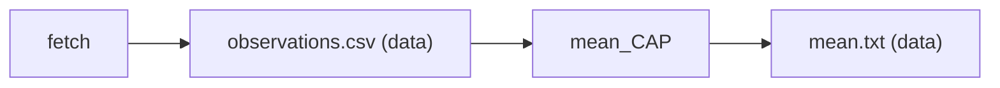

# 08. Data dependencies with workflow://

*How a reference in a command becomes an edge, a staged copy and a rewritten path*

DAGonStar in Practice - Part 1: Foundations of scientific workflows. Slides: [08-DAGonStar-Data_dependencies_with_workflow.pptx](../lectures/08-DAGonStar-Data_dependencies_with_workflow.pptx). Examples: [examples/08-dataflow](../../examples/08-dataflow/).

## 2. Today's lecture

**Outline**

1. The syntax of a reference
2. From reference to edge: make_dependencies
3. Staging: the copy in .dagon/inputs
4. Rewriting the command
5. Reference counts
6. Rules and pitfalls

**After this lecture you can**

- Write correct workflow:// references
- Explain the three effects of a reference
- Find the staged copy in the consumer's folder

## 3. The syntax

*workflow://<workflow>/<task>/<path>: an empty workflow name means the current workflow.*

## 4. Anatomy of a reference

| Part | Example | Meaning |
|---|---|---|
| Schema | `workflow://` | Workflow.SCHEMA: marks a reference |
| Workflow | `(empty) or Stations08` | Empty: this workflow |
| Task | `fetch` | Name of the producing task |
| Path | `outputs/observations.csv` | Relative to the producer's folder |
| End | `first space` | A reference ends at whitespace |

## 5. Three equivalent spellings

```
# in workflow Stations08
workflow:///fetch/outputs/observations.csv
workflow://Stations08/fetch/outputs/observations.csv

# from another workflow of a meta-workflow
workflow://Stations08/fetch/outputs/observations.csv
```

- Three slashes: empty workflow name
- Naming the workflow is explicit
- Required across workflows (lecture 22)

## 6. How the parser reads a command

- **Scan** find every occurrence of workflow:// in the command
- **Cut** the reference ends at the next space, or at the end
- **Split** on /: first the workflow, then the task, then the path
- **Resolve** find the task by workflow and task name
- **Unknown task** without a DAGon service: ConnectionError

> *No spaces inside*
>
> A path with spaces cannot be referenced: quote nothing, rename the file.

## 7. Reference to edge

*make_dependencies() turns every resolved reference into a dependency.*

## 8. workflow_references.py

[`examples/08-dataflow/workflow_references.py`](../../examples/08-dataflow/workflow_references.py)

```python
with scratch("08") as base:
    wf = workflow("Stations08", base)
    fetch = DagonTask(TaskType.BATCH, "fetch", fetch_observations())
    mean = DagonTask(TaskType.BATCH, "mean_CAP", station_mean(
        "CAP", "workflow:///fetch/outputs/observations.csv", "outputs/mean.txt"))
    wf.add_task(fetch)
    wf.add_task(mean)
    print("prevs before make_dependencies:", mean.prevs)
    wf.make_dependencies()
    print("prevs after make_dependencies:", [t.name for t in mean.prevs])
    wf.run()
```

- station_mean reads a workflow:// URL; no add_dependency_to anywhere
- prevs is empty before make_dependencies; run() would call it anyway

## 9. Three effects of one reference

1. **Edge** - mean_CAP waits for fetch.
2. **Count** - fetch's reference count grows by one.
3. **Stage** - The file is copied into the consumer's .dagon/inputs.
4. **Rewrite** - The URL in the command becomes that local path.

## 10. Data edge



Solid arrows: data dependencies (`workflow://`); dotted arrows: control dependencies.

- Files are the interface
- The edge exists because of the file
- CAP 16.75 is the expected result

## 11. Staging and rewriting

*Before the consumer runs, its launcher copies or links each input and rewrites the command.*

## 12. Where the copy goes

[`examples/08-dataflow/workflow_references.py`](../../examples/08-dataflow/workflow_references.py)

```python
staged = next(Path(mean.working_dir, ".dagon", "inputs").rglob("*.csv"))
print("staged copy:", staged.relative_to(mean.working_dir).as_posix())
print("result:", text(mean, "outputs/mean.txt").strip())
check(text(mean, "outputs/mean.txt").strip() == "CAP 16.75", "Capri mean")
```

- rglob finds the staged CSV
- The path mirrors workflow/task/path
- The awk reads the local copy

## 13. Recorded output

Recorded output of `python examples/08-dataflow/workflow_references.py`:

```text
prevs before make_dependencies: []
prevs after make_dependencies: ['fetch']
staged copy: .dagon/inputs/Stations08/fetch/outputs/observations.csv
result: CAP 16.75
```

- No edge before make_dependencies
- fetch after
- The staged copy under .dagon/inputs
- The Capri mean

## 14. Staged path layout

| Reference | Staged at |
|---|---|
| `workflow:///fetch/outputs/observations.csv` | `.dagon/inputs/Stations08/fetch/outputs/observations.csv` |
| `workflow:///mean_NAP/outputs/mean.txt` | `.dagon/inputs/<wf>/mean_NAP/outputs/mean.txt` |

> **Unique by construction** workflow, task and path are all part of the staged path, so two inputs never collide.

## 15. The rewritten command

- **Before** awk ... workflow:///fetch/outputs/observations.csv > outputs/mean.txt
- **After** awk ... <task>/.dagon/inputs/Stations08/fetch//outputs/observations.csv > ...
- **The double slash** harmless: POSIX treats // inside a path as /
- **Kept** the rewritten command is in .dagon/launcher.sh
- **Lecture 10** we read that line from the launcher

> *The command you wrote is not the command that ran*
>
> Debug with the launcher, not with your source code.

## 16. How the file arrives

- **LINK** - A symbolic link to the producer's file. Fast; same machine.
- **COPY** - A real copy: the consumer can modify it safely.
- **SCP / SFTP** - The producer ran on another host (lecture 40).
- **DONTMOVE** - Only the path is rewritten: nothing is copied (lecture 13).

> **The default local mover copies the file** lecture 13 compares the movers on the same graph.

## 17. The station_mean command

[`examples/common/course.py`](../../examples/common/course.py)

```python
def station_mean(station, source, target):
    """Shell command: mean temperature of one station with awk."""
    return ("mkdir -p outputs && awk -F, -v s=%s '$1==s{t+=$3;n++}END{printf \"%%s %%.2f\\n\", s, t/n}' %s > %s"
            % (station, source, target))
```

- source is the workflow:// URL, target a relative path
- The command is a plain string: DAGonStar only scans it for the schema

## 18. Reference counts

*Each reference to a task increments its count: when all consumers are done, its folder can go.*

## 19. Counting consumers

- **increment_reference_count** called once per reference found in a consumer
- **decrement_reference_count** after each consumer has executed
- **Zero** on_garbage: the producer's folder may be removed
- **Only if** remove_dir is True in [batch]; sinks are removed too
- **Lecture 14** garbage collection in action

> **3** - *References to fetch in lecture 02*
>
> One per station mean; fetch's folder is removable after the third.

## 20. Rules and pitfalls

*References are simple strings: a few rules avoid most errors.*

## 21. Pitfalls

| Mistake | Effect | Fix |
|---|---|---|
| Typo in the task name | ConnectionError: no service | Copy names from one variable |
| Path with spaces | Reference cut at the space | Avoid spaces in output names |
| Reference inside quotes | Quotes end up in the path | Leave references unquoted |
| Absolute path to a sibling | No edge, no staging | Always use workflow:// |
| Producer never writes the file | Consumer fails at staging | Check the producer's outputs |

## 22. Building references in Python

- **Constants** SOURCE = 'workflow:///fetch/outputs/observations.csv'
- **Formatting** 'workflow:///mean_%s/outputs/mean.txt' % station
- **Join** ' '.join(...) for many inputs, as the report of lecture 02
- **Helper** a function ref(task, path) avoids typos
- **Name from the object** fetch.name rather than a repeated literal

> *A two-line helper*
>
> The name comes from the task itself.

```
def ref(task, path):
  return ("workflow:///"
    + task.name + "/"
    + path)
```

## 23. Run and inspect

**Steps**

1. Run the example
2. Read the staged path it prints
3. Change the station to ISC and rerun
4. Break the task name in the URL and observe the error

**Run it**

```bash
python examples/\
  08-dataflow/\
  workflow_references.py
```

**Watch for:** result: CAP 16.75. With a wrong task name, make_dependencies raises: Dagon service is not available.

## 24. workflow:// versus explicit edges

**workflow:// reference**

- Edge and staging in one
- Documents the input file
- Works across hosts and workflows
- Counted for garbage collection

**add_dependency_to**

- Edge only
- Nothing is staged
- For side effects and resources
- Not counted as a reference

## 25. One reference, four effects

- **1** - Edge fetch → mean_CAP
- **1** - Staged copy in .dagon/inputs
- **1** - Increment of fetch's reference count

> **And one rewritten command** the fourth effect is visible only in the launcher.

## 26. Several inputs, several producers

- **One command, many URLs** each is resolved, staged and rewritten
- **Same producer twice** two references: two increments, two entries in prevs
- **Different workflows** a transversal point instead of a local edge (lecture 22)
- **Order of staging** NORMAL mode stages one after the other
- **Fan-in** the report of lecture 02 reads three URLs

> *Two producers*
>
> Two edges, two staged files.

```
cat workflow:///a/x
    workflow:///b/y
    > z
```

## 27. The check

[`examples/08-dataflow/workflow_references.py`](../../examples/08-dataflow/workflow_references.py)

```python
print("result:", text(mean, "outputs/mean.txt").strip())
check(text(mean, "outputs/mean.txt").strip() == "CAP 16.75", "Capri mean")
```

- The result is tested, not only printed
- 16.75: the mean of 16.0, 16.5, 17.0, 17.5

## 28. Exercise

A. Add a mean_NAP task that reads the same reference
B. Add a compare task that reads both means
C. Print the prevs of compare
D. Check that compare outputs CAP warmer than NAP

**Deliverable:** A four-task workflow with only workflow:// references and no add_dependency_to.

## 29. Check your understanding

1. What does workflow:///fetch/outputs/observations.csv mean?
2. List the effects of a reference in a command.
3. Where is the staged copy of a reference placed?
4. Why does a reference to a misspelled task raise ConnectionError?

<details><summary>Answers</summary>

1. The file outputs/observations.csv in the folder of task fetch of the current workflow.
2. An edge, a reference-count increment, a staged copy and a rewritten command.
3. Under .dagon/inputs/<workflow>/<task>/<path> in the consumer's working directory.
4. An unknown task is looked up in the DAGon service, which is disabled in the configuration.

</details>

## 30. Key takeaways

1. workflow://<wf>/<task>/<path>; empty wf means this one
2. A reference creates an edge and increments a count
3. The input is staged in .dagon/inputs and the command rewritten
4. Prefer references to explicit edges when files pass

*Next: validating graphs and dealing with cycles*

---

Raffaele Montella. CC0 1.0. Generated from `src/lectures/08.js`.
