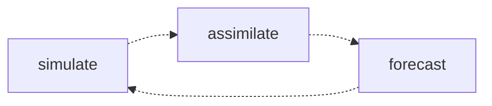
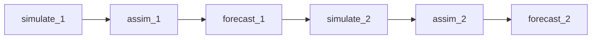

# 09. Validating graphs and cycles

*Why a workflow cannot loop, how Validate_WF finds a cycle, and how iterative science is unrolled into a DAG*

Workflows in Practice with DAGonStar - Part 1: Foundations of scientific workflows. Slides: [09-DAGonStar-Validating_graphs_and_cycles.pptx](../lectures/09-DAGonStar-Validating_graphs_and_cycles.pptx). Examples: [examples/09-cycles](../../examples/09-cycles/).

## 2. Today's lecture

**Outline**

1. Cycles in scientific computing
2. Why an engine rejects them
3. Depth-first search in Validate_WF
4. Hands-on: a forecast cycle
5. Breaking the back edge
6. Unrolling iterations

**After this lecture you can**

- Recognise a cycle in a task graph
- Explain the algorithm Validate_WF uses
- Turn an iterative process into a DAG

## 3. Cycles in science

*Forecast systems are cycles: the forecast of today is the first guess of tomorrow.*

## 4. A data assimilation cycle

1. **Simulate** - Run the model from the current state.
2. **Assimilate** - Blend in new observations.
3. **Forecast** - Run ahead from the analysis.
4. **Next cycle** - The forecast becomes the next initial state.

> **In time this is a loop** in a workflow engine every cycle becomes a separate run, or a separate group of tasks.

## 5. Why a DAG cannot contain a cycle

- **Waiting** each task waits for all its prevs
- **On a cycle** every task waits for another task on the same cycle
- **Deadlock** no task can ever start: the run would hang
- **No order** there is no topological order of a cyclic graph
- **So** DAGonStar refuses the graph before anything runs

> **∞** - *Waiting time on a cycle*
>
> Rejecting early is far better than hanging on a cluster for hours.

## 6. The cyclic graph



Solid arrows: data dependencies (`workflow://`); dotted arrows: control dependencies.

- simulate → assimilate → forecast
- forecast → simulate closes the loop
- The back edge is drawn right to left

## 7. Finding cycles

*A depth-first search that remembers the current path finds a cycle in linear time.*

## 8. Validate_WF

```
def visit(task, visited, stack):
    if task in stack:
        raise Exception("A cycle has been found "
                        "involving task " + task.name)
    if task in visited:
        return
    visited.add(task)
    stack.append(task)
    for next_task in task.nexts:
        visit(next_task, visited, stack)
    stack.pop()

for task in self.tasks:
    if task not in visited:
        visit(task, visited, stack)
```

- visited: tasks fully explored
- stack: the path from the root
- A task on the stack again: a back edge
- O(tasks + edges)

## 9. Tracing the search

| Step | Visit | stack | Result |
|---|---|---|---|
| 1 | simulate | `[simulate]` | go on |
| 2 | assimilate | `[simulate, assimilate]` | go on |
| 3 | forecast | `[simulate, assimilate, forecast]` | go on |
| 4 | simulate | `simulate already on stack` | cycle! |

## 10. When validation runs

- **make_dependencies()** calls Validate_WF() at its end
- **run()** calls make_dependencies() if needed, so it validates too
- **Explicitly** wf.Validate_WF() any time after building the graph
- **Before submission** validate on the login node before a large run
- **Cost** negligible even for thousands of tasks

> *One line*
>
> Raises Exception with the name of a task on the cycle.

```
wf.Validate_WF()
```

## 11. Hands-on

*Build the cycle, see it rejected, remove the back edge, run.*

## 12. cycles.py: the cycle

[`examples/09-cycles/cycles.py`](../../examples/09-cycles/cycles.py)

```python
with scratch("09") as base:
    wf = workflow("Cycle09", base)
    simulate = DagonTask(TaskType.BATCH, "simulate", "echo sim > sim.txt")
    assimilate = DagonTask(TaskType.BATCH, "assimilate", "echo da > da.txt")
    forecast = DagonTask(TaskType.BATCH, "forecast", "echo fc > fc.txt")
    for task in (simulate, assimilate, forecast):
        wf.add_task(task)
    assimilate.add_dependency_to(simulate)
    forecast.add_dependency_to(assimilate)
    simulate.add_dependency_to(forecast)        # the next cycle's initial state
```

- Three tasks, three explicit edges
- The third edge closes the loop: the next cycle's initial state

## 13. cycles.py: rejected

[`examples/09-cycles/cycles.py`](../../examples/09-cycles/cycles.py)

```python
try:
    wf.Validate_WF()
except Exception as error:
    print("rejected:", error)
    rejected = True
else:
    rejected = False
check(rejected, "a cycle must be rejected")
```

- Validate_WF raises Exception
- The message is printed
- check(): it must be rejected
- Nothing has run yet

## 14. cycles.py: the repair

[`examples/09-cycles/cycles.py`](../../examples/09-cycles/cycles.py)

```python
simulate.remove_dependency_to(forecast)     # break the back edge
wf.Validate_WF()
wf.run()
print("repaired; ran:", [t.name for t in wf.tasks if t.status.name == "FINISHED"])
check(all(t.status.name == "FINISHED" for t in wf.tasks), "all tasks ran")
```

- remove_dependency_to removes the back edge; validation now passes
- All three tasks finish

## 15. Recorded output

Recorded output of `python examples/09-cycles/cycles.py`:

```text
rejected: A cycle has been found involving task simulate
repaired; ran: ['simulate', 'assimilate', 'forecast']
```

- The message names a task on the cycle
- After the repair: three FINISHED tasks, in order

## 16. Try other cycles

**Steps**

1. Run the example
2. Add a self edge: simulate.add_dependency_to(simulate)
3. Run again and read the message
4. Remove it and add forecast → assimilate instead

**Run it**

```bash
python examples/\
  09-cycles/\
  cycles.py
```

**Watch for:** A self edge is the smallest cycle; it is rejected with the same message.

## 17. Cycles you may meet

- **Self edge** - t.add_dependency_to(t): the smallest cycle.
- **Two-task loop** - A waits for B and B waits for A.
- **Long loop** - A path of many tasks that comes back to the start.
- **Via references** - Two tasks that reference each other's outputs.

> **All are found the same way** the stack-based search does not care how long the cycle is.

## 18. Unrolling

*An iterative process becomes a DAG by giving each iteration its own tasks.*

## 19. Three cycles, unrolled



Solid arrows: data dependencies (`workflow://`); dotted arrows: control dependencies.

> **Still acyclic** each cycle has its own tasks and forecast_1 feeds simulate_2: time only moves forward.

## 20. Unrolling in Python

```
previous = None
for day in range(1, 4):
    sim = DagonTask(TaskType.BATCH, "simulate_%d" % day,
        "model --init %s > state.nc" % (
            "workflow:///forecast_%d/state.nc" % (day - 1)
            if previous else "cold_start.nc"))
    fc = DagonTask(TaskType.BATCH, "forecast_%d" % day,
        "model --from workflow:///simulate_%d/state.nc"
        " > state.nc" % day)
    wf.add_task(sim); wf.add_task(fc)
    previous = fc
```

- Names carry the iteration number
- References link iteration d to d-1
- The loop runs in Python, not in the engine

## 21. Two ways to iterate

**Unroll inside one workflow**

- All iterations in one graph
- Known number of iterations
- One checkpoint file for all
- Good for re-analysis of a past period

**One workflow per cycle**

- A new run every 6 hours or every day
- Driven by cron or a scheduler
- The previous run's output is the input
- Good for operational forecasting

## 22. Loops that depend on results

- **Unknown iteration count** for example, iterate until convergence
- **Inside a task** the loop runs in the program, the workflow sees one task
- **Between runs** a driver script inspects the result and builds the next workflow
- **Agentic tasks** decide, under a contract, what to do next (lecture 33)
- **Never** a back edge in the graph

> *The graph is static*
>
> Decisions that depend on data happen inside tasks or between runs.

## 23. Other checks worth doing

| Check | How |
|---|---|
| No cycles | wf.Validate_WF() |
| Unique task names | len(set(names)) == len(names) |
| Every reference resolves | make_dependencies() raises otherwise |
| Expected sources and sinks | tasks with no prevs, tasks with no nexts |
| Expected width | count tasks with the same prevs |

## 24. Sources and sinks

```
sources = [t.name for t in wf.tasks if not t.prevs]
sinks   = [t.name for t in wf.tasks if not t.nexts]
print("sources:", sources)   # ['simulate']
print("sinks:", sinks)       # ['forecast']
```

- One source, one sink: a chain
- A cycle would have no source at all

## 25. Reference cycles

- **Two commands** A reads workflow:///B/x, B reads workflow:///A/y
- **make_dependencies** adds both edges, then validates
- **Raises** the same exception, before any staging
- **Fix** one of the two files must come from somewhere else
- **Often** it means one task should be split in two

> *Data cannot flow backwards*
>
> A file cannot be both an input and an output of the same chain.

## 26. This lecture's graph

- **3** - Tasks
- **3** - Edges with the cycle
- **2** - Edges after the repair

## 27. Reading the error

- **Message** A cycle has been found involving task simulate
- **Which task** the first task found again on the stack
- **Not necessarily the culprit** any task on the cycle may be named
- **Debug** print each task's nexts and follow them by hand
- **Typical cause** a reversed add_dependency_to call

> *Most cycles are typos*
>
> A swapped producer and consumer creates a cycle as soon as the graph has a path back.

## 28. Exercise

A. Unroll three days of simulate, assimilate, forecast
B. Use workflow:// references between days
C. Validate and run the nine tasks
D. Print sources and sinks

**Deliverable:** A script whose run finishes nine tasks, with one source simulate_1 and one sink forecast_3.

## 29. Check your understanding

1. Why would a cycle make a workflow hang?
2. What does the stack in Validate_WF contain?
3. How do you express a daily forecast cycle with DAGonStar?
4. Which method removes an explicit edge?

<details><summary>Answers</summary>

1. Every task on the cycle waits for another task on the cycle, so none can start.
2. The tasks on the path currently being explored from the root of the search.
3. Unroll iterations into separate tasks, or run one workflow per cycle.
4. remove_dependency_to, called on the consuming task.

</details>

## 30. Key takeaways

1. A cycle means no task on it can ever start
2. Validate_WF uses depth-first search with a path stack
3. make_dependencies and run() validate automatically
4. Iterations are unrolled, or run as separate workflows

*Next: scratch, launchers and logs*

---

Raffaele Montella. CC0 1.0. Generated from `src/lectures/09.js`.
