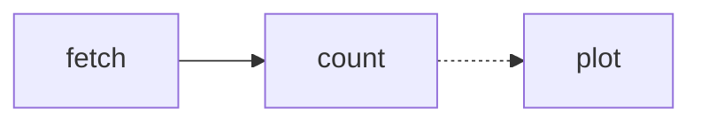

# 11. Serialising and inspecting workflows

*The JSON form of a workflow, reloading it, task times and a first look at events*

DAGonStar in Practice - Part 1: Foundations of scientific workflows. Slides: [11-DAGonStar-Serialising_and_inspecting_workflows.pptx](../lectures/11-DAGonStar-Serialising_and_inspecting_workflows.pptx). Examples: [examples/11-inspect](../../examples/11-inspect/).

## 2. Today's lecture

**Outline**

1. Why serialise a workflow
2. as_json: the workflow as a document
3. The task document
4. Reloading with jsonload
5. Timing tasks
6. Listening to task events

**After this lecture you can**

- Export a workflow to JSON and read it
- Rebuild the same workflow from its JSON
- Measure how long each task took

## 3. Why serialise

*A workflow that exists only as Python objects cannot be stored, sent, compared or audited.*

## 4. Uses of the JSON form

- **Archive** - Keep the exact graph that produced a result next to the result.
- **Transfer** - Send the workflow to a service or another machine.
- **Diff** - Compare two versions of a pipeline with a text diff.
- **Generate** - Build workflows in another language and load them in DAGonStar.
- **Inspect** - Read statuses and folders after a run.
- **Convert** - CWL export follows the same model (lecture 46).

## 5. as_json

*A plain dictionary: name, id, host and one entry per task.*

## 6. A three-task workflow

[`examples/11-inspect/inspect_workflow.py`](../../examples/11-inspect/inspect_workflow.py)

```python
with scratch("11") as base:
    wf = workflow("Inspect11", base)
    fetch = DagonTask(TaskType.BATCH, "fetch", fetch_observations())
    count = DagonTask(TaskType.BATCH, "count",
                      "wc -l < workflow:///fetch/outputs/observations.csv > n.txt")
    plot = DagonTask(TaskType.BATCH, "plot", "echo placeholder > plot.txt")
    for task in (fetch, count, plot):
        wf.add_task(task)
    plot.add_dependency_to(count)            # explicit edge, no file passed
```

- count reads fetch's output: a data edge
- plot waits for count: an explicit edge, no file passed

## 7. The graph



Solid arrows: data dependencies (`workflow://`); dotted arrows: control dependencies.

- One edge of each kind
- Both must survive the JSON round trip
- plot's command is a placeholder

## 8. Exporting

[`examples/11-inspect/inspect_workflow.py`](../../examples/11-inspect/inspect_workflow.py)

```python
document = wf.as_json()
(base / "workflow.json").write_text(json.dumps(document, indent=2))
print("JSON keys:", sorted(document), "| tasks:", list(document["tasks"]))
print("count as JSON:", {k: document["tasks"]["count"][k]
                          for k in ("name", "type")})
```

- as_json returns a dict
- json.dumps writes it as text
- Keys of the workflow and of one task

## 9. The workflow document

| Key | Content |
|---|---|
| `name` | Workflow name |
| `id` | Workflow id (from the DAGon service, if any) |
| `host` | Host published for remote movers, from [ftp_pub] |
| `tasks` | Dictionary: task name → task document |
| `pre_stage` | Present only when pre-staging is enabled (lecture 43) |

## 10. The task document

| Key | Content |
|---|---|
| `name, type` | Task name and TaskType value, e.g. batch |
| `command` | The command as written, with workflow:// URLs |
| `status` | Status name at the time of export |
| `working_dir` | Task folder, or null before the run |
| `prevs, nexts` | Names of predecessors and successors |
| `explicit_prevs` | Edges added with add_dependency_to |

> **Type-specific keys** native, web, faas, llm and agentic tasks add their own specifications.

## 11. workflow.json, abridged

```
{
  "name": "Inspect11", "id": null, "host": "localhost",
  "tasks": {
    "fetch": {"name": "fetch", "type": "batch",
              "command": "mkdir -p outputs && cp ...",
              "status": "READY", "working_dir": null,
              "prevs": [], "nexts": [], "explicit_prevs": []},
    "count": {"command": "wc -l < workflow:///fetch/...", ...},
    "plot":  {"explicit_prevs": ["count"], ...}
  }
}
```

- Exported before run(): READY, no folders
- Data edges are not yet discovered
- explicit_prevs keeps the control edge

## 12. Export before or after linking

- **Before make_dependencies** prevs and nexts hold only explicit edges
- **After** prevs and nexts hold every edge, data edges included
- **explicit_prevs** the same in both cases
- **Reloading** either document gives the same graph
- **Recommendation** export after run() for a complete record

> *Complete edges*
>
> Call it first if you need prevs and nexts in the file.

```
wf.make_dependencies()
wf.as_json()
```

## 13. Reloading

*Workflow(..., jsonload=document) rebuilds tasks and explicit edges; references rebuild the rest.*

## 14. Round trip

[`examples/11-inspect/inspect_workflow.py`](../../examples/11-inspect/inspect_workflow.py)

```python
copy = Workflow("placeholder", config=config(base),
                jsonload=json.loads((base / "workflow.json").read_text()))
copy.make_dependencies()
print("reloaded:", copy.name, [t.name for t in copy.tasks],
      "| plot after:", [t.name for t in copy.tasks[2].prevs])
```

- The name in the JSON wins over the argument
- make_dependencies rediscovers data edges
- explicit_prevs restores the control edge
- Same three tasks

## 15. What load_json does

- **Name and id** taken from the document
- **Each task** rebuilt with DagonTask from its type and command
- **Type-specific** native, web, faas, llm, agentic, slurm options
- **Explicit edges** restored from explicit_prevs
- **Data edges** rediscovered from workflow:// URLs by make_dependencies

> *Commands are the source of truth*
>
> prevs and nexts in the JSON are informative: the edges are rebuilt.

## 16. Recorded output

Recorded output of `python examples/11-inspect/inspect_workflow.py`:

```text
JSON keys: ['host', 'id', 'name', 'tasks'] | tasks: ['fetch', 'count', 'plot']
count as JSON: {'name': 'count', 'type': 'batch'}
reloaded: Inspect11 ['fetch', 'count', 'plot'] | plot after: ['count']
ended: 3 tasks | timed: ['count', 'fetch', 'plot']
```

- Four top-level keys
- Tasks in insertion order
- The reloaded copy has the same edges
- Three tasks ended and were timed

## 17. Timing and events

*After a run, each task knows how long it took; during a run, listeners hear every change.*

## 18. Listeners and times

[`examples/11-inspect/inspect_workflow.py`](../../examples/11-inspect/inspect_workflow.py)

```python
ended = []
wf.add_listener("on_task_end", lambda task: ended.append(task.name))
wf.run()
times = wf.get_task_times()
print("ended:", len(ended), "tasks | timed:", sorted(times))
check(all(t >= 0 for t in times.values()), "every task has a duration")
```

- on_task_end fires once per task
- The listener gets the task
- get_task_times: name → seconds
- Every duration is non-negative

## 19. get_task_times()

- **Returns** a dict from task name to completion time in seconds
- **Measured** around the run of the launcher
- **Includes** staging in and the command, not the time spent waiting
- **Use** find the slowest task: the candidate to optimise
- **Course output** only the names are printed: times vary per run

> *The slowest task*
>
> One line of Python.

```
times = wf.get_task_times()
max(times, key=times.get)
```

## 20. Events you can listen to

| Event | Fires when |
|---|---|
| `on_workflow_start / _end` | run() begins / ends |
| `on_task_start / _end` | A task thread starts / ends |
| `on_task_wait` | A task starts waiting for prevs |
| `on_task_staging_in_start / _end` | Input staging brackets |
| `on_task_execute_start` | The launcher is about to run |
| `on_dependencies_made` | make_dependencies finished |

> **Lecture 17** asynchronous runs with launch() and wait(), driven by these events.

## 21. A summary of a run

```
for task in wf.tasks:
    print("%-8s %-9s %6.2fs %s" % (
        task.name, task.status.name,
        task.completetion_time,
        [t.name for t in task.prevs]))
```

- One line per task
- Status, seconds, predecessors
- completetion_time: the attribute behind get_task_times (spelling as in the library)

## 22. Inspect before or after run()

**Before run()**

- Graph shape: prevs, nexts
- JSON with READY statuses
- Validation of cycles
- No folders yet

**After run()**

- Statuses FINISHED or FAILED
- working_dir of every task
- Task times
- JSON as a run record

## 23. Inspect your own run

**Steps**

1. Run the example
2. Change it to write the JSON after run()
3. Open the file and find the working_dir values
4. Diff the two JSON files

**Run it**

```bash
python examples/\
  11-inspect/\
  inspect_workflow.py
```

**Watch for:** After run(), every status is FINISHED and every working_dir is a real folder.

## 24. JSON as provenance

- **Store it** next to the products of the run
- **Add** the pinned DAGonStar version and the config
- **Compare** which commands changed between two campaigns
- **Limits** it records the plan and the statuses, not file checksums
- **Lecture 45** FAIR metadata adds identifiers and checksums

> *Cheap and useful*
>
> One json.dumps call per run gives you an auditable record.

## 25. This lecture's example

- **3** - Tasks, two edges
- **4** - Keys in the workflow document
- **1** - Round trip: export, reload, same graph

## 26. Generating workflows from JSON

- **Any language** write the JSON from R, Julia, a web form
- **Templates** a JSON file with placeholders filled per campaign
- **Validation** load it and call Validate_WF before running
- **Version control** commit the JSON: it is the experiment design
- **Caution** load only documents you trust: they contain commands

> **!** - *Commands are code*
>
> A JSON workflow runs whatever its commands say.

## 27. Finding things in a workflow

| Need | Call |
|---|---|
| A task by name | `wf.find_task_by_name(wf.name, "count")` |
| All tasks | `wf.tasks` |
| The scratch base | `wf.get_scratch_dir_base()` |
| The graph as a dict | `wf.as_json()` |
| Durations | `wf.get_task_times()` |

## 28. Exercise

A. Export the workflow of lecture 02 to JSON
B. Edit the JSON: rename the report task
C. Reload it and run it
D. Print get_task_times sorted by duration

**Deliverable:** The edited JSON and the output of the reloaded run, with the slowest task first.

## 29. Check your understanding

1. Which keys does the workflow document have?
2. How are data edges restored when a workflow is reloaded?
3. What is explicit_prevs for?
4. What does get_task_times return?

<details><summary>Answers</summary>

1. name, id, host, tasks (and pre_stage when enabled).
2. make_dependencies rediscovers them from the workflow:// URLs in the commands.
3. It records edges added with add_dependency_to, which cannot be rediscovered from commands.
4. A dictionary from task name to completion time in seconds.

</details>

## 30. Key takeaways

1. as_json turns a workflow into a plain document
2. jsonload rebuilds tasks; references rebuild data edges
3. explicit_prevs preserves control edges
4. Listeners and get_task_times observe the run

*Next: the station pipeline, end to end*

---

Raffaele Montella. CC0 1.0. Generated from `src/lectures/11.js`.
