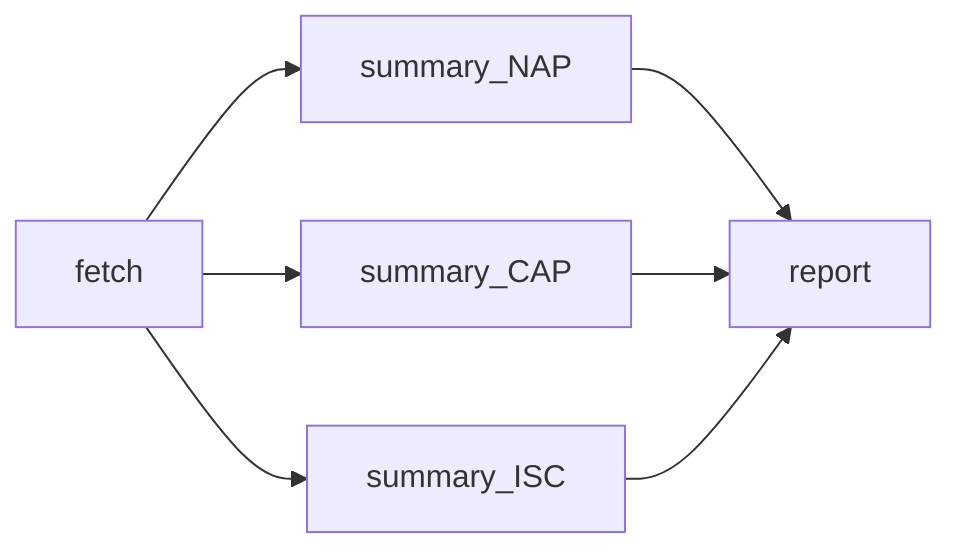

# 12. The station pipeline

*Part 1 put together: fetch, three station summaries and a sorted report, validated, observed and exported*

Workflows in Practice with DAGonStar - Part 1: Foundations of scientific workflows. Slides: [12-DAGonStar-The_station_pipeline.pptx](../lectures/12-DAGonStar-The_station_pipeline.pptx). Examples: [examples/12-station-pipeline](../../examples/12-station-pipeline/).

## 2. Today's lecture

**Outline**

1. The problem: which station is the windiest?
2. Designing the graph
3. The summary command
4. Building, validating and running
5. Reading and checking the report
6. Part 1 in review

**After this lecture you can**

- Design a small workflow from a question
- Combine everything from lectures 01-11
- Check the result against a hand calculation

## 3. The problem

*For each station: mean temperature and maximum wind. Then rank the stations by wind.*

## 4. The answer, by hand

| Station | Temperatures (°C) | Mean | Winds (m/s) | Max |
|---|---|---|---|---|
| NAP | 14.0 15.0 16.0 17.0 | 15.50 | 3 4 5 4 | 5.0 |
| CAP | 16.0 16.5 17.0 17.5 | 16.75 | 6 7 8 7 | 8.0 |
| ISC | 15.0 15.5 16.0 16.5 | 15.75 | 5 5 6 6 | 6.0 |

> **Expected ranking by wind** CAP 8.0, ISC 6.0, NAP 5.0. The workflow must reproduce exactly this table.

## 5. From question to graph

1. **Inputs** - One CSV with all stations.
2. **Units of work** - One summary per station.
3. **Combine** - Sort the summaries by wind.
4. **Edges** - References between them.
5. **Checks** - Compare with the hand table.

## 6. The pipeline



Solid arrows: data dependencies (`workflow://`); dotted arrows: control dependencies.

- The shape of lecture 02, with richer tasks
- Every edge comes from a reference
- Five tasks, six edges

## 7. Naming the tasks

- **fetch** one source task
- **summary_<station>** one per station: the station is in the name
- **report** the sink
- **Why it matters** names appear in references, folders, checkpoints
- **Generated** 'summary_' + s inside the loop

> *A name in a URL*
>
> Rename a task and every reference to it must change.

```
workflow:///summary_CAP/
  outputs/summary.txt
```

## 8. The summary command

*One awk program computes the mean temperature and the maximum wind in a single pass.*

## 9. SUMMARY

[`examples/12-station-pipeline/station_pipeline.py`](../../examples/12-station-pipeline/station_pipeline.py)

```python
SOURCE = "workflow:///fetch/outputs/observations.csv"
SUMMARY = ("mkdir -p outputs && awk -F, -v s=%s '$1==s{t+=$3;n++;"
           "if($4>w)w=$4}END{printf \"%%s %%.2f %%.1f\\n\", s, t/n, w}' "
           "%s > outputs/summary.txt")
```

- %%s escapes: the template is filled twice (Python, then awk)
- if($4>w) w=$4 keeps the running maximum

## 10. Two levels of formatting

- **Python** SUMMARY % (s, SOURCE) fills the station and the reference
- **%% in Python** becomes % in the command, for awk's printf
- **awk** printf "%s %.2f %.1f\n" formats one output line
- **Output** one line per station: name, mean, max wind
- **Test it** print the command and paste it into a shell

> *One summary.txt*
>
> Three fields separated by spaces.

```
CAP 16.75 8.0
```

## 11. The report

- **cat** concatenates the three summary files
- **sort -k3 -n -r** by the third field, numerically, descending
- **Result** the windiest station first
- **Fan-in** three references in one command, three edges
- **Deterministic** ties would be broken by sort's own rules

> *One line of shell*
>
> The whole fan-in step.

```
cat <3 refs> |
  sort -k3 -n -r
  > report.txt
```

## 12. Building and running

*Build the graph in a loop, validate it, attach a listener, run.*

## 13. Building the graph

[`examples/12-station-pipeline/station_pipeline.py`](../../examples/12-station-pipeline/station_pipeline.py)

```python
with scratch("12") as base:
    wf = workflow("GulfOfNaples12", base)
    wf.add_task(DagonTask(TaskType.BATCH, "fetch", fetch_observations()))
    for s in STATIONS:
        wf.add_task(DagonTask(TaskType.BATCH, "summary_" + s,
                              SUMMARY % (s, SOURCE)))
    parts = " ".join("workflow:///summary_%s/outputs/summary.txt" % s
                     for s in STATIONS)
    report = DagonTask(TaskType.BATCH, "report",
                       "cat %s | sort -k3 -n -r > report.txt" % parts)
    wf.add_task(report)
    wf.make_dependencies()
    wf.Validate_WF()
```

- One summary task per station, from STATIONS
- make_dependencies and Validate_WF before running: fail early

## 14. Running and reading

[`examples/12-station-pipeline/station_pipeline.py`](../../examples/12-station-pipeline/station_pipeline.py)

```python
events = []
wf.add_listener("on_task_end", lambda task: events.append(task.name))
wf.run()

rows = [line.split() for line in text(report, "report.txt").splitlines()]
print("station  mean_c  max_wind")
for station, mean, wind in rows:
    print("%-8s %6s %9s" % (station, mean, wind))
print("windiest:", rows[0][0], "| tasks ended:", len(events))
```

- A listener counts finished tasks
- The report is parsed into rows and printed as a table

## 15. Recorded output

Recorded output of `python examples/12-station-pipeline/station_pipeline.py`:

```text
station  mean_c  max_wind
CAP       16.75       8.0
ISC       15.75       6.0
NAP       15.50       5.0
windiest: CAP | tasks ended: 5
```

- The same numbers as the hand table
- Sorted by wind
- Five tasks ended

## 16. Reading the report back

- **text(report, 'report.txt')** reads the file from the task folder
- **splitlines and split** three rows of three fields
- **Strings** values stay strings: '16.75', '8.0'
- **Exact comparison** rows[0] == ['CAP', '16.75', '8.0']
- **Formatting** %-8s %6s %9s aligns the printed table

> *Compare text, not floats*
>
> The report is text: comparing strings avoids rounding questions.

## 17. Checks and export

[`examples/12-station-pipeline/station_pipeline.py`](../../examples/12-station-pipeline/station_pipeline.py)

```python
(base / "pipeline.json").write_text(json.dumps(wf.as_json()))
check(rows[0] == ["CAP", "16.75", "8.0"], "Capri is the windiest")
check(len(events) == 5, "five tasks ran")
```

- The JSON record of the run
- The windiest row, exactly
- The number of tasks

## 18. Run the pipeline

**Steps**

1. Run the example
2. Change the data: make NAP windier than CAP
3. Rerun: the check fails, as it should
4. Restore the data with git checkout

**Run it**

```bash
python examples/\
  12-station-pipeline/\
  station_pipeline.py
```

**Watch for:** windiest: CAP | tasks ended: 5. A failed check is the pipeline telling you the result changed.

## 19. Part 1 in review

*Every concept of the first twelve lectures appears in this one script.*

## 20. Where each idea appears

| Lecture | Idea | In station_pipeline.py |
|---|---|---|
| 02 | Script to DAG | Five tasks instead of a loop |
| 05 | Configuration | workflow(name, base) with a dict |
| 06 | BATCH tasks | Every task is a shell command |
| 07 | Fan-out, fan-in | fetch → 3 summaries → report |
| 08 | workflow:// | SOURCE and the three parts |
| 09 | Validation | wf.Validate_WF() |
| 10 | Scratch | report.txt read from the task folder |
| 11 | Events, JSON | on_task_end listener, pipeline.json |

## 21. Design choices

- **One task per station** - Parallel, and a failure in one station does not hide the others.
- **awk, not Python** - Each task is a plain command anyone can run in a shell.
- **Sorting in the report** - The ranking is a separate, cheap step after the heavy ones.
- **Checks at the end** - The script is also its own test.

## 22. Strengths and limits

**What works**

- Clear graph, easy to extend
- Parallel summaries
- Self-checking
- Recorded and reproducible

**What is missing**

- A failure restarts everything: checkpoints, lecture 15
- Shell quoting is fragile: native tasks, lecture 18
- Data copied, never removed: lecture 14
- Only local: Part 4

## 23. If a station fails

| Failed task | Then | Report |
|---|---|---|
| fetch | All three summaries FAILED, never run | FAILED |
| summary_ISC | NAP and CAP still FINISHED | FAILED |
| report | All summaries FINISHED | FAILED |

> **run() returns in every case** the checks at the end are what turn a failure into an error.

## 24. The pipeline in numbers

- **5** - Tasks
- **6** - Data edges
- **8.0** - m/s at Capri, the maximum

## 25. Scaling the same design

- **300 stations** the loop over STATIONS grows, the code does not
- **Many days** one fetch per day, unrolled as in lecture 09
- **Big files** staging mode and mover matter (lecture 13)
- **Heavy summaries** SLURM tasks on a cluster (lecture 41)
- **Many users** export the JSON and share it

> **O(n)** - *Tasks for n stations*
>
> n + 2: fetch, the summaries and the report.

## 26. Testing a workflow

- **Small data** a dataset you can check by hand
- **Exact checks** compare values, not just exit codes
- **Structure checks** number of tasks, edges, sources, sinks
- **Regression** recorded outputs compared on every change
- **Fast** the whole Part 1 runs in under a minute

> *tools/run_examples.py*
>
> Runs the twelve lectures of Part 1 and compares their outputs.

## 27. What Part 2 adds

1. **Staging** - Movers and modes.
2. **Recovery** - Checkpoints, failures, resume.
3. **Native** - Python functions as tasks.
4. **Scale** - Sweeps and ensembles.
5. **Compose** - Meta and dry runs.

## 28. Exercise

A. Add the minimum temperature to each summary
B. Rank by mean temperature instead of wind
C. Add a fourth station to the CSV in a copy of the data
D. Update the checks to the new expected values

**Deliverable:** A pipeline with four stations, ranked by mean temperature, whose checks pass.

## 29. Check your understanding

1. Why is %% used in the SUMMARY template?
2. What does sort -k3 -n -r do on the report?
3. Which lecture's ideas does the on_task_end listener come from?
4. Name two limits of this pipeline that Part 2 addresses.

<details><summary>Answers</summary>

1. Python's % formatting turns %% into %, which awk's printf needs.
2. Sorts lines by the third field, numerically, in descending order: windiest first.
3. Lecture 11 (events and inspection).
4. No checkpoints or resume, fragile shell quoting, no clean-up of copies.

</details>

## 30. Key takeaways

1. A question becomes tasks, references and checks
2. Five tasks reproduce the hand-computed table
3. Validation, events and JSON make the run inspectable
4. Part 2: staging, recovery, native tasks and scale

*Next, Part 2: staging modes and data movers*

---

Raffaele Montella. CC0 1.0. Generated from `src/lectures/12.js`.
