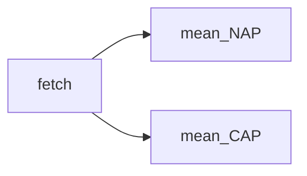

# 14. Garbage collection

*Reference counting on task folders, remove_dir, and what the collector really does to the scratch*

DAGonStar in Practice - Part 2: Execution, data and recovery. Slides: [14-DAGonStar-Garbage_collection.pptx](../lectures/14-DAGonStar-Garbage_collection.pptx). Examples: [examples/14-garbage](../../examples/14-garbage/).

## 2. Today's lecture

**Outline**

1. Why scratch grows
2. Reference counting
3. When a folder is collected
4. remove_dir in the configuration
5. Hands-on: the same run with and without collection
6. Collection, checkpoints and links

**After this lecture you can**

- Predict when a task folder is collected
- Explain the *-removed suffix
- Choose remove_dir for development and production

## 3. Scratch grows

*Every task leaves a folder; every reference leaves a copy. Big workflows fill disks.*

## 4. A back-of-the-envelope estimate

- **500** - Ensemble members, each staging a 2 GB input
- **1 TB** - Of copies, plus the outputs
- **0** - Of it needed once the statistics are computed

> **Intermediate data are temporary by nature** a collector releases them as soon as no task needs them any more.

## 5. Three kinds of data in a run

- **Inputs** - Fetched or staged copies: reproducible from the source.
- **Intermediates** - Outputs consumed by later tasks only.
- **Products** - Final results: must be kept, published, described (lecture 45).

## 6. Reference counting

*A task's folder is needed as long as some consumer has not executed yet.*

## 7. The life of a count

1. **Discover** - Each reference found: count +1.
2. **Consume** - A consumer executes.
3. **Release** - After it: count −1.
4. **Zero** - No consumer left.
5. **Collect** - If remove_dir: on_garbage.

## 8. decrement_reference_count

```
def decrement_reference_count(self):
    self.reference_count = self.reference_count - 1
    if self.reference_count == 0 and \
            self.remove_scratch_dir is True:
        self.on_garbage()

def on_garbage(self):
    shutil.move(self.working_dir,
                self.working_dir + "-removed")
    self.working_dir = self.working_dir + "-removed"
    # the checkpoint records the new folder
```

- Zero and remove_dir: collect
- Collection is a rename, not a delete
- The checkpoint follows the rename

## 9. Sinks are collected too

- **After executing** a task releases the references it holds
- **No nexts** a task with no consumers is collected after it runs
- **Effect** with remove_dir every folder of the run ends with -removed
- **Products** copy final results out before relying on remove_dir
- **Or** keep remove_dir False and archive by hand

> *The sink rule*
>
> In remove_reference_workflow, after execution.

```
len(self.nexts) == 0
and remove_scratch_dir
```

## 10. Reading the count

- **task.reference_count** an integer attribute
- **Before make_dependencies** 0: nothing discovered yet
- **After** one per reference to the task
- **After run()** 0 again: every consumer released it
- **Use** find producers with many consumers: they stay longest on disk

> *In this lecture*
>
> Printed by the example in both runs.

```
fetch.reference_count
# 2 before run()
# 0 after
```

## 11. Hands-on

*Fetch feeds two means; run it with remove_dir False, then True.*

## 12. The graph



Solid arrows: data dependencies (`workflow://`); dotted arrows: control dependencies.

- Two references to fetch
- fetch.reference_count is 2 before the run
- Both means are sinks

## 13. garbage_collection.py

[`examples/14-garbage/garbage_collection.py`](../../examples/14-garbage/garbage_collection.py)

```python
def run(remove_dir):
    with scratch("14") as base:
        wf = workflow("Garbage14", base, remove_dir=remove_dir)
        fetch = DagonTask(TaskType.BATCH, "fetch", fetch_observations())
        wf.add_task(fetch)
        for s in ("NAP", "CAP"):
            wf.add_task(DagonTask(TaskType.BATCH, "mean_" + s, station_mean(
                s, SOURCE, "outputs/mean.txt")))
        wf.make_dependencies()
        print("remove_dir=%s: references to fetch before run: %d"
              % (remove_dir, fetch.reference_count))
        wf.run()
        names = sorted(p.name.split("-", 1)[1] for p in base.iterdir())
        print("  after run: references=%d, folders=%s"
              % (fetch.reference_count, names))
        return names
```

- remove_dir is passed to the configuration helper
- Folder names are listed without timestamps after the run

## 14. Recorded output

Recorded output of `python examples/14-garbage/garbage_collection.py`:

```text
remove_dir=False: references to fetch before run: 2
  after run: references=0, folders=['fetch', 'mean_CAP', 'mean_NAP']
remove_dir=True: references to fetch before run: 2
  after run: references=0, folders=['fetch-removed', 'mean_CAP-removed', 'mean_NAP-removed']
```

- 2 references before, 0 after, in both runs
- False: three folders kept
- True: three folders renamed *-removed

## 15. The checks

[`examples/14-garbage/garbage_collection.py`](../../examples/14-garbage/garbage_collection.py)

```python
kept = run(False)
collected = run(True)
check(kept == ["fetch", "mean_CAP", "mean_NAP"], "nothing is collected")
check(all(name.endswith("-removed") for name in collected),
      "with remove_dir every consumed folder is renamed *-removed")
```

- Nothing collected without remove_dir
- Everything consumed or final is renamed with it

## 16. Why rename instead of delete

- **Safety** a bug in counting cannot destroy data by itself
- **Inspection** you can still open a -removed folder after the run
- **Policy** deleting is left to you: rm -rf <scratch>/*-removed
- **Checkpoints** record the renamed folder, so resume still finds it
- **Trade-off** disk is not freed until you delete

> *Free the space*
>
> Run it after checking the products.

```
find <scratch> -maxdepth 1
  -name '*-removed'
  -exec rm -rf {} +
```

## 17. Configuration

*remove_dir lives in the [batch] section: a site or workflow policy, not a per-task choice.*

## 18. Setting remove_dir

```
[batch]
scratch_dir_base = /scratch/me/dagon
remove_dir = True

# or, in the course helper
workflow("Garbage14", base, remove_dir=True)

# read it back
wf.get_remove_dir_op()   # True
```

- A string in the ini
- get_remove_dir_op() parses it
- The course helper passes it into the dict

## 19. Development or production

| Setting | Good for | Watch out |
|---|---|---|
| remove_dir False | Debugging, teaching, small runs | Disk grows with every run |
| remove_dir True | Large ensembles, operational chains | Products renamed: copy them out |

## 20. Interactions

*Collection meets links, checkpoints and remote tasks.*

## 21. Collection and other features

- **LINK mover** - Links point at the old path: after the rename they dangle.
- **Checkpoints** - The record follows the rename, so resume reuses the -removed folder.
- **Remote tasks** - Collection runs where the folder is, through the task's own method.
- **Containers, cloud** - Subclasses may also remove containers or instances.

## 22. LINK and remove_dir

- **Consumer** holds a symlink to fetch/outputs/observations.csv
- **Producer collected** its folder becomes fetch-removed
- **Symlink** now points at a path that no longer exists
- **Safe order** consumers finished reading before the count reached zero
- **Unsafe** reading the link again later, for example from a resumed task

> *Prefer COPY with remove_dir*
>
> Or keep links and leave remove_dir off.

## 23. What is freed

**Freed by remove_dir**

- Nothing immediately: folders are renamed
- Space after you delete *-removed
- Clear marking of what is no longer needed

**Never touched**

- Files outside the scratch
- The checkpoint file
- Folders of tasks still referenced

## 24. Watch it happen

**Steps**

1. Keep the scratch of the remove_dir True run
2. List it after the run
3. Open fetch-removed: the files are still there
4. Delete the -removed folders and list again

**Run it**

```bash
python examples/\
  14-garbage/\
  garbage_collection.py
```

**Watch for:** All three folders end with -removed; the means are still readable inside them.

## 25. Counts during the run

| Moment | fetch count | fetch folder |
|---|---|---|
| After make_dependencies | 2 | not yet created |
| fetch FINISHED | 2 | <ts>-fetch |
| mean_NAP executed | 1 | <ts>-fetch |
| mean_CAP executed | 0 | <ts>-fetch-removed (if remove_dir) |

## 26. This lecture's example

- **2** - References to fetch
- **3** - Folders in each run
- **3** - Renamed with remove_dir True

## 27. A clean-up policy

- **During the run** remove_dir True for large intermediate data
- **Products** a final task copies results to a products folder outside scratch
- **After the run** delete *-removed once products are verified
- **Retention** keep the JSON and checkpoint as the record
- **Never** collect while another workflow references these folders

> *Products leave the scratch*
>
> Scratch is for work in progress, not for results.

## 28. Exercise

A. Add a report task that reads both means
B. Predict the reference counts of fetch and of each mean
C. Run with remove_dir True and list the folders
D. Add a final copy of the report outside the scratch

**Deliverable:** A table of predicted and observed counts, and a report that survives the clean-up.

## 29. Check your understanding

1. When does a producer's reference count reach zero?
2. What does on_garbage do to the folder?
3. Why are sinks collected?
4. Why is LINK risky with remove_dir True?

<details><summary>Answers</summary>

1. When every consumer that referenced it has executed.
2. Renames it to <folder>-removed and updates the checkpoint record.
3. A task with no nexts releases its own folder after executing when remove_dir is True.
4. The consumer's symlinks point at the old path, which disappears after the rename.

</details>

## 30. Key takeaways

1. Each reference increments the producer's count
2. A count of zero with remove_dir True collects the folder
3. Collection renames to *-removed; you delete later
4. Copy products out of the scratch

*Next: checkpointing and resume*

---

Raffaele Montella. CC0 1.0. Generated from `src/lectures/14.js`.
