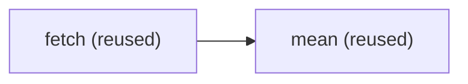

# 15. Checkpointing

*Recording finished tasks in a checkpoint file and resuming a workflow without running them again*

Workflows in Practice with DAGonStar - Part 2: Execution, data and recovery. Slides: [15-DAGonStar-Checkpointing.pptx](../lectures/15-DAGonStar-Checkpointing.pptx). Examples: [examples/15-checkpoint](../../examples/15-checkpoint/).

## 2. Today's lecture

**Outline**

1. Why checkpoints
2. The checkpoint file
3. Keys, records and the reuse rule
4. Hands-on: run, then resume
5. The explicit CHECKPOINT task
6. What checkpoints do not check

**After this lecture you can**

- Enable checkpoints on a workflow
- Read a checkpoint record
- State exactly when a task is reused

## 3. Why checkpoints

*Long workflows fail late. Restarting from the first task wastes hours of finished work.*

## 4. The cost of starting over

- **8 h** - A chain of eight one-hour simulations
- **7 h** - Lost if the last task fails and everything reruns
- **1 h** - With checkpoints: only the failed task reruns

## 5. The idea

- **Record** each task that finishes is written down, with its folder and exit code
- **Resume** a new run reads the record and skips finished tasks
- **Reuse** a skipped task points at its old folder, so consumers find its outputs
- **Where** one JSON file per workflow, chosen by you
- **Granularity** the task: a task half done reruns from the start

> *One argument*
>
> Everything else is automatic.

```
Workflow(name, ...,
  checkpoint_file=
    "checkpoint.json")
```

## 6. The checkpoint file

*A JSON document written at the end of run(), keyed by <workflow>.<task>.*

## 7. checkpoint_resume.py: build

[`examples/15-checkpoint/checkpoint_resume.py`](../../examples/15-checkpoint/checkpoint_resume.py)

```python
with scratch("15") as base:
    checkpoint = str(base / "checkpoint.json")
    runs = base / "executions.log"

    def build():
        wf = workflow("Checkpoint15", base, checkpoint_file=checkpoint)
        wf.add_task(DagonTask(TaskType.BATCH, "fetch", fetch_observations()
                              + " && echo fetch >> '%s'" % runs))
        wf.add_task(DagonTask(TaskType.BATCH, "mean", station_mean(
            "NAP", SOURCE, "outputs/mean.txt") + " && echo mean >> '%s'" % runs))
        return wf
```

- build() makes the same workflow every time: same names, same keys
- Each task appends its name to executions.log when it really runs

## 8. First run and the record

[`examples/15-checkpoint/checkpoint_resume.py`](../../examples/15-checkpoint/checkpoint_resume.py)

```python
first = build()
first.run()
record = json.loads(Path(checkpoint).read_text())
print("checkpoint keys:", sorted(record))
print("fetch record:", {k: record["Checkpoint15.fetch"][k]
                        for k in ("name", "workflow", "code")})
```

- run() writes the file at the end
- One key per task
- _scratch_dir: the base used

## 9. A checkpoint record

| Field | Example | Meaning |
|---|---|---|
| `key` | `Checkpoint15.fetch` | <workflow>.<task> |
| `name` | `fetch` | Task name |
| `workflow` | `Checkpoint15` | Workflow name |
| `working_dir` | `<scratch>/<ts>-fetch` | Folder to reuse |
| `code` | `0` | Exit code of the launcher |
| `_scratch_dir` | `<scratch>` | Top-level: the scratch base |

## 10. When the file is written

- **At the end of run()** after every task thread has been joined
- **Records** created when a task's folder is made, completed with its code
- **Failed tasks** recorded with a non-zero code: never reused
- **Interrupted run** if the process is killed, the file may not be written
- **Same file** pass the same path to checkpoint_file and resume_checkpoint_file

> *Resume*
>
> Reads the file at the start of run().

```
run(resume_checkpoint_file=
    checkpoint)
```

## 11. The reuse rule

*A task is skipped only if its record says it succeeded and its folder still exists.*

## 12. reuse_checkpoint

```
def reuse_checkpoint(self):
    checkpoint = self.workflow.checkpoints.get(
        self.checkpoint_key(), {})
    if checkpoint.get("code") != 0:
        return False
    working_dir = checkpoint.get("working_dir")
    if not working_dir or not path.isdir(working_dir):
        return False               # (remote: exists_dir)
    ...                            # pre-staged: verify inputs
    self.working_dir = working_dir
    return True
```

- Success: code 0
- The folder must exist
- Then the old folder is adopted
- No command runs

## 13. Resume, step by step

1. **Load** - Read the file passed to run().
2. **Restore** - Records and the scratch base.
3. **Per task** - Key found, code 0, folder there?
4. **Skip** - Adopt the old working_dir.
5. **Or run** - Execute as usual.

## 14. Second run: resume

[`examples/15-checkpoint/checkpoint_resume.py`](../../examples/15-checkpoint/checkpoint_resume.py)

```python
second = build()
second.run(resume_checkpoint_file=checkpoint)
same = [a.working_dir == b.working_dir
        for a, b in zip(first.tasks, second.tasks)]
print("executions:", runs.read_text().split())
print("second run reused the folders:", same)
check(runs.read_text().split() == ["fetch", "mean"], "each ran once")
```

- A new Workflow object
- resume_checkpoint_file: the record
- Same folders as the first run
- executions.log: each task once

## 15. Recorded output

Recorded output of `python examples/15-checkpoint/checkpoint_resume.py`:

```text
checkpoint keys: ['Checkpoint15.fetch', 'Checkpoint15.mean', '_scratch_dir']
fetch record: {'name': 'fetch', 'workflow': 'Checkpoint15', 'code': 0}
executions: ['fetch', 'mean']
second run reused the folders: [True, True]
```

- Three keys: two tasks and _scratch_dir
- code 0 for fetch
- Only the first run executed commands
- Both folders reused

## 16. Resume by hand

**Steps**

1. Run the example and keep the scratch
2. Open checkpoint.json
3. Delete the mean folder
4. Resume again: mean reruns, fetch does not

**Run it**

```bash
python examples/\
  15-checkpoint/\
  checkpoint_resume.py
```

**Watch for:** A missing folder makes reuse_checkpoint return False: the task simply runs again.

## 17. What a resume runs



Solid arrows: data dependencies (`workflow://`); dotted arrows: control dependencies.

- Grey: taken from the checkpoint
- No command runs
- Consumers of mean would find its folder

## 18. What is not checked

*Checkpoints are keyed by name. They trust you not to change a task under the same name.*

## 19. Checked and not checked

**Checked**

- The record exists for <workflow>.<task>
- Its exit code was 0
- Its folder still exists
- For pre-staged inputs: their content (lecture 43)

**Not checked**

- Whether the command changed
- Whether inputs changed
- Whether the data on disk were edited
- Whether the software version changed

## 20. Stale checkpoints

- **Symptom** you change a command, resume, and the old result is reused
- **Cause** same workflow and task name, so the same key
- **Fix 1** delete the record of that task from the JSON
- **Fix 2** rename the task, or the workflow, when its meaning changes
- **Fix 3** start without resume_checkpoint_file
- **Lecture 24** the stale-checkpoint trap in a resumable ensemble

> **!** - *Keyed by name*
>
> Not by content: a changed task under an old name is not rerun.

## 21. Naming for safe resumes

- **Version in the name** - fetch_v2 when the fetch command changes.
- **Parameters in the name** - member_03, sweep_f1.94: one key per parameter set.
- **Workflow per campaign** - Forecast_2026_11_02: a new day, a new key space.

## 22. The CHECKPOINT task

*An explicit task type that gathers named inputs into one folder you can resume from.*

## 23. TaskType.CHECKPOINT

- **Command** a list of workflow:// references
- **Execution** each file must exist, otherwise the task fails
- **Effect** the staged inputs are moved to the root of its folder
- **Use** a single, compact point to restart a long chain from
- **Remote** with ip=..., a RemoteCheckpoint over SSH

> *A gather point*
>
> Its outputs are the files it checked.

```
DagonTask(
  TaskType.CHECKPOINT,
  "keep",
  "workflow:///a/x.nc "
  "workflow:///b/y.nc")
```

## 24. Where checkpoints apply

| Task kind | Reuse rule |
|---|---|
| BATCH, SLURM | Record with code 0 and folder present |
| Remote (SSH) | Folder checked with exists_dir on the remote host |
| Native, web, LLM, FaaS | Same contract, folder holds the structured outputs |
| Agentic | Also compares contract and input content (lecture 35) |
| Pre-staged SLURM | Also re-verifies input content (lecture 43) |

## 25. Good practice

- **Always set checkpoint_file** for anything longer than a few minutes
- **Keep the file with the scratch** it records folders of that scratch
- **Never edit outputs in place** a reused folder must be what the task produced
- **Resume deliberately** pass resume_checkpoint_file only when you mean it
- **Archive** the checkpoint is part of the run record, with the JSON

> *Cheap insurance*
>
> Writing the checkpoint costs one small JSON file per run.

## 26. Resume decisions

| Record | Folder | Decision |
|---|---|---|
| missing | any | Run |
| code non-zero | any | Run |
| code 0 | deleted | Run |
| code 0 | present | Reuse |
| code 0, renamed *-removed | present | Reuse the renamed folder |

## 27. This lecture's example

- **2** - Tasks, run once each
- **2** - Runs of the workflow
- **3** - Keys in the checkpoint

## 28. Exercise

A. Change the mean station to CAP and resume
B. Explain why the result is still NAP
C. Rename the task to mean_CAP and resume again
D. Delete fetch's record and resume once more

**Deliverable:** The executions.log after each of the three resumes, with one sentence per resume explaining it.

## 29. Check your understanding

1. What is the key of a checkpoint record?
2. List the conditions for a task to be reused.
3. Why can a resume reuse a stale result?
4. What does a CHECKPOINT task do with its inputs?

<details><summary>Answers</summary>

1. <workflow name>.<task name>, for example Checkpoint15.fetch.
2. A record with code 0 and an existing working directory (plus content checks for pre-staged and agentic tasks).
3. Records are keyed by name, not by command or input content.
4. Checks that each referenced file exists and moves the staged inputs to the root of its folder.

</details>

## 30. Key takeaways

1. checkpoint_file records every finished task
2. resume_checkpoint_file skips tasks with code 0 and a folder
3. Keys are names: rename tasks whose meaning changes
4. CHECKPOINT tasks gather inputs into a resumable folder

*Next: failures, propagation and resume*

---

Raffaele Montella. CC0 1.0. Generated from `src/lectures/15.js`.
