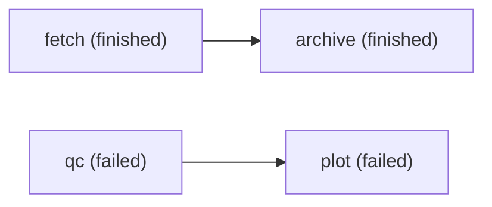

# 16. Failures

*What a failing task stops, what it does not, and how a fixed workflow resumes from where it broke*

DAGonStar in Practice - Part 2: Execution, data and recovery. Slides: [16-DAGonStar-Failures.pptx](../lectures/16-DAGonStar-Failures.pptx). Examples: [examples/16-failures](../../examples/16-failures/).

## 2. Today's lecture

**Outline**

1. Kinds of failure
2. How a failure propagates
3. What keeps running
4. Hands-on: a broken quality check
5. Fix and resume
6. Designing for failure

**After this lecture you can**

- Predict which tasks a failure stops
- Detect failures after run()
- Fix a task and resume without rerunning the rest

## 3. Kinds of failure

*Commands fail, inputs go missing, machines disappear. A workflow engine must make failures visible and local.*

## 4. Where failures come from

- **The command** - Non-zero exit: a bug, a missing file, a wrong option.
- **The data** - An input that is empty, malformed or late.
- **Staging** - A copy that cannot be made, a mover that is unavailable.
- **The platform** - A node that dies, a queue limit, a full disk.
- **A service** - A web API that returns 503, a timeout (lecture 26).
- **Upstream** - A predecessor that failed: the task never runs.

## 5. What DAGonStar does with a failure

- **Marks the task** status FAILED
- **Logs it** a traceback on the dagon logger
- **Propagates** every task downstream becomes FAILED without running
- **Continues** tasks not downstream still run to completion
- **Returns** run() does not raise: you inspect the statuses

> **0** - *Exceptions raised by run()*
>
> A failure is data: read it from the tasks.

## 6. Propagation

*A task waiting for a FAILED predecessor becomes FAILED itself and never starts its command.*

## 7. The rule in Task.run

```
# after waiting for every predecessor
for task in self.prevs:
    if task.status == dagon.Status.FAILED:
        self.set_status(dagon.Status.FAILED)
        return                      # never executes

self.set_status(dagon.Status.RUNNING)
self.execute()
```

- Checked after all prevs ended
- One FAILED prev is enough
- No folder is created
- Its own dependents follow

## 8. This lecture's graph



Solid arrows: data dependencies (`workflow://`); dotted arrows: control dependencies.

- Two independent chains
- qc fails: its test needs a missing file
- plot needs qc's output: FAILED, never run
- archive needs only fetch: FINISHED

## 9. The workflow

[`examples/16-failures/fail_and_resume.py`](../../examples/16-failures/fail_and_resume.py)

```python
BROKEN = "test -f calibration.txt && echo calibrated > outputs/qc.txt"
FIXED = "mkdir -p outputs && echo calibrated > outputs/qc.txt"


def build(base, checkpoint, qc_command):
    wf = workflow("Failures16", base, checkpoint_file=checkpoint)
    wf.add_task(DagonTask(TaskType.BATCH, "fetch", fetch_observations()))
    wf.add_task(DagonTask(TaskType.BATCH, "qc", qc_command))
    wf.add_task(DagonTask(TaskType.BATCH, "plot",
                          "cat workflow:///qc/outputs/qc.txt > plot.txt"))
    wf.add_task(DagonTask(TaskType.BATCH, "archive",
                          "cp workflow:///fetch/outputs/observations.csv ."))
    return wf
```

- qc fails while calibration.txt is missing; the FIXED command creates its output directly
- plot depends on qc; archive depends only on fetch

## 10. Propagation in general

| Task | Relation to the failed task | Outcome |
|---|---|---|
| Descendant | A path leads from the failed task to it | FAILED, never runs |
| Ancestor | A path leads from it to the failed task | Unaffected |
| Sibling | Shares an ancestor, no path between them | Unaffected |
| Unrelated | No path either way | Unaffected |

## 11. Hands-on: run 1

*Run with the broken command and read the statuses.*

## 12. Running the broken version

[`examples/16-failures/fail_and_resume.py`](../../examples/16-failures/fail_and_resume.py)

```python
with scratch("16") as base:
    checkpoint = str(base / "checkpoint.json")
    first = build(base, checkpoint, BROKEN)
    first.run()                                   # returns: no exception
    print("run 1:", {t.name: t.status.name for t in first.tasks})
    print("plot never started:", first.tasks[2].working_dir is None)
```

- run() returns normally
- Statuses are collected in a dict; plot's working_dir is None

## 13. Recorded output

Recorded output of `python examples/16-failures/fail_and_resume.py`:

```text
run 1: {'fetch': 'FINISHED', 'qc': 'FAILED', 'plot': 'FAILED', 'archive': 'FINISHED'}
plot never started: True
run 2: {'fetch': 'FINISHED', 'qc': 'FINISHED', 'plot': 'FINISHED', 'archive': 'FINISHED'}
reused from run 1: ['fetch', 'archive']
```

- Run 1: qc and plot FAILED
- plot never got a folder
- Run 2: all FINISHED
- fetch and archive reused

## 14. Why fetch stays and archive runs

- **fetch** independent of qc: unaffected
- **archive** its only prev is fetch: it runs and finishes
- **qc** exit code 1 from test -f: FAILED
- **plot** waits for qc, sees FAILED, never runs
- **Checkpoint** records fetch and archive with code 0, qc with code 1

> *The failing step*
>
> && stops the echo from running.

```
test -f calibration.txt
# exit 1: no such file
```

## 15. Fix and resume

*Change the broken command and resume from the checkpoint written by run 1.*

## 16. Run 2

[`examples/16-failures/fail_and_resume.py`](../../examples/16-failures/fail_and_resume.py)

```python
second = build(base, checkpoint, FIXED)
second.run(resume_checkpoint_file=checkpoint)
print("run 2:", {t.name: t.status.name for t in second.tasks})
reused = [b.name for a, b in zip(first.tasks, second.tasks)
          if a.working_dir and a.working_dir == b.working_dir]
print("reused from run 1:", reused)
check(all(t.status.name == "FINISHED" for t in second.tasks), "all done")
check(reused == ["fetch", "archive"], "only successful tasks are reused")
```

- Same names, FIXED command for qc
- Only tasks reused from run 1 keep the same folder: fetch and archive

## 17. What run 2 did

| Task | Run 1 | Checkpoint | Run 2 |
|---|---|---|---|
| fetch | FINISHED | code 0, folder | reused |
| qc | FAILED | code 1 | executed (fixed) |
| plot | FAILED, no folder | no record | executed |
| archive | FINISHED | code 0, folder | reused |

## 18. A recovery loop

1. **Run** - With a checkpoint file.
2. **Inspect** - Statuses and stdout.
3. **Fix** - The command or the data.
4. **Resume** - Same names, same file.
5. **Verify** - All FINISHED, checks pass.

## 19. Break it yourself

**Steps**

1. Run the example
2. Make archive fail instead of qc
3. Predict the statuses of run 1
4. Run and compare with your prediction

**Run it**

```bash
python examples/\
  16-failures/\
  fail_and_resume.py
```

**Watch for:** Failures only travel downstream: siblings and ancestors of the failed task are never affected.

## 20. Designing for failure

*Small tasks, explicit checks, and reruns that are safe.*

## 21. Habits that help

- **Fail fast** - Validate inputs in a cheap early task, not in the expensive one.
- **Small tasks** - A failure costs at most one small unit of work.
- **Idempotent commands** - Running a task twice gives the same result.
- **Explicit checks** - test -s file, a schema, a row count: turn bad data into an exit code.
- **Checkpoint always** - Resume is free once the file exists.
- **Check statuses** - Your driver script decides what a failure means.

## 22. Detecting failures after run()

```
wf.run()
failed = [t.name for t in wf.tasks
          if t.status == Status.FAILED]
if failed:
    print("failed:", failed)
    sys.exit(1)       # make the job fail visibly
```

- run() never raises for task failures
- A cron job or CI must exit non-zero
- Print which tasks failed

## 23. Reading a failure

- **Which task** the first FAILED task whose prevs all FINISHED
- **Why** its .dagon/stdout.txt and the logger traceback
- **What it ran** the Invoke section of its launcher
- **Reproduce** bash .dagon/launcher.sh in its folder (lecture 10)
- **Downstream** FAILED tasks without a folder are only consequences

> *Find the root*
>
> Many FAILED tasks usually mean one real failure.

## 24. Retry or fix

**Retry is right when**

- The cause is transient: network, busy service
- The command is idempotent
- A limit on attempts exists
- Web and FaaS tasks have retry policies (lectures 26, 30)

**Fix is right when**

- The command or data is wrong
- The same input fails every time
- The error message is deterministic
- This lecture's qc task

## 25. Silencing expected failures

- **In this example** logging.disable(logging.CRITICAL) hides the traceback
- **Why** the failure is the point of the demo, not noise
- **In real workflows** never silence the logger globally
- **Better** a handler that writes tracebacks to a file per run
- **And** check statuses explicitly, as the example does

> *Visible by default*
>
> Silence only what you have decided to expect.

## 26. Finding the root failures

```
roots = [t.name for t in wf.tasks
         if t.status == Status.FAILED
         and all(p.status == Status.FINISHED
                 for p in t.prevs)]
print("root failures:", roots)   # ['qc']
```

- FAILED with no FAILED prev: a root
- Consequences are filtered out

## 27. This lecture's example

- **4** - Tasks
- **2** - FAILED in run 1
- **2** - Reused in run 2

## 28. Exercise

A. Add a second consumer of qc called stats
B. Predict the statuses of run 1 and run 2
C. Make fetch fail instead and predict again
D. Write a driver that exits 1 when any task failed

**Deliverable:** Your predictions, the observed statuses, and the driver code.

## 29. Check your understanding

1. What happens to a task whose predecessor FAILED?
2. Why did archive finish in run 1?
3. Which tasks ran their commands in run 2, and why?
4. How does a cron job notice that a workflow failed?

<details><summary>Answers</summary>

1. It becomes FAILED without running its command or creating a folder.
2. Its only predecessor, fetch, finished; it does not depend on qc.
3. qc and plot: qc's record has a non-zero code and plot has no record.
4. The driver checks task statuses after run() and exits with a non-zero code.

</details>

## 30. Key takeaways

1. A failed task makes its descendants FAILED without running them
2. Independent tasks keep running; run() does not raise
3. Fix, keep the names, resume from the checkpoint
4. Small tasks, early checks and explicit status checks

*Next: asynchronous runs and events*

---

Raffaele Montella. CC0 1.0. Generated from `src/lectures/16.js`.
