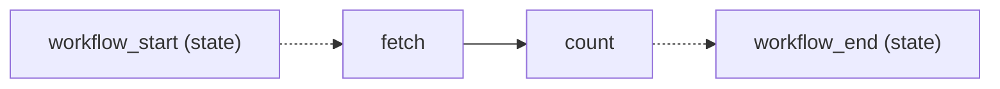

# 17. Asynchronous runs and events

*launch() and wait() to keep the caller free, and listeners that observe every step of every task*

Workflows in Practice with DAGonStar - Part 2: Execution, data and recovery. Slides: [17-DAGonStar-Asynchronous_runs_and_events.pptx](../lectures/17-DAGonStar-Asynchronous_runs_and_events.pptx). Examples: [examples/17-async](../../examples/17-async/).

## 2. Today's lecture

**Outline**

1. Blocking and non-blocking runs
2. launch() and wait()
3. The event model
4. The events of a task's life
5. Hands-on: an event log
6. Uses of events

**After this lecture you can**

- Run a workflow in the background
- Attach listeners to workflow and task events
- Read the order of events for a task

## 3. Blocking or not

*run() holds the caller until every task ends. Often the caller has better things to do.*

## 4. run() and launch()

**wf.run()**

- Runs in the current thread
- Returns when every task has ended
- Simple scripts, batch jobs
- What most examples use

**wf.launch()**

- Starts run() in a background thread
- Returns that thread immediately
- Notebooks, services, dashboards
- Pair it with wf.wait()

## 5. launch and wait in the library

```
def launch(self, resume_checkpoint_file=None):
    if self._execution_thread is not None and \
            self._execution_thread.is_alive():
        raise RuntimeError("Workflow %s is already running")
    self._prepare_run()
    self._execution_thread = threading.Thread(
        target=self.run, args=(resume_checkpoint_file,))
    self._execution_thread.start()
    return self._execution_thread

def wait(self, timeout=None):
    thread.join(timeout)
    return not thread.is_alive()   # True if it ended
```

- One execution at a time
- resume works the same
- wait returns a boolean
- timeout in seconds

## 6. What the caller can do meanwhile

- **Poll statuses** read task.status of any task
- **React to events** listeners run as tasks progress
- **Serve** a web page or API that shows the run
- **Launch more** another, independent workflow
- **Give up** wait(timeout) returns False if the run is still going

> *The pattern*
>
> ok is False on timeout: the run continues.

```
thread = wf.launch()
...
ok = wf.wait(timeout=30)
```

## 7. Events

*Named hooks fired by the workflow and its tasks; listeners are plain Python callables.*

## 8. Workflow and task events

| Event | Subject | When |
|---|---|---|
| `on_workflow_start` | workflow | run() begins |
| `on_dependencies_made` | workflow | Edges rebuilt and validated |
| `on_task_start` | task | The task thread starts |
| `on_task_wait` | task | It starts waiting for prevs |
| `on_task_staging_in_start/_end` | task | Around input staging |
| `on_task_execute_start` | task | The launcher is about to run |
| `on_task_staging_out_start/_end` | task | Around reference release |
| `on_task_end` | task | Finished or failed |
| `on_workflow_end` | workflow | run() ends, always |

## 9. EventHook

```
wf.add_listener("on_task_end", callback)
wf.remove_listener("on_task_end", callback)

# the hook itself supports += and -=
# fire(subject) calls every listener with the subject

def callback(task):
    print(task.name, task.status.name)
```

- One hook per event name
- Listeners get the subject: a task or the workflow
- Unknown names raise an error

## 10. Two ways to attach

```
# by name
wf.add_listener("on_task_end", callback)

# each hook is also an attribute of the workflow
wf.on_task_end += callback
wf.on_task_end -= callback

# eleven hooks, created in Workflow.__init__
wf.add_listener("on_task_finish", cb)
# ValueError: Unknown workflow event: on_task_finish
```

- Same hook either way
- Typos fail loudly
- Several listeners per event

## 11. Listeners run in task threads

- **Thread** a task event fires in that task's thread
- **Concurrency** two tasks may call your listener at the same time
- **Protect shared state** a threading.Lock around lists and counters
- **Keep them short** a slow listener slows the task down
- **Exceptions** caught and logged by the hook: the task goes on

> *This lecture's listener*
>
> A lock keeps the event list consistent.

```
with lock:
    events.append(...)
```

## 12. Events along the graph



Solid arrows: data dependencies (`workflow://`); dotted arrows: control dependencies.

- Workflow events bracket the run
- Each task fires its own four events
- count's events start after fetch's end

## 13. Hands-on

*Two tasks, six events, a background launch and a lock-protected log.*

## 14. Building and listening

[`examples/17-async/async_events.py`](../../examples/17-async/async_events.py)

```python
wf = workflow("Async17", base)
wf.add_task(DagonTask(TaskType.BATCH, "fetch",
                      fetch_observations() + " && sleep 0.2"))
wf.add_task(DagonTask(TaskType.BATCH, "count",
                      "wc -l < workflow:///fetch/outputs/observations.csv > n"))
events, lock = [], threading.Lock()

def record(name):
    def listener(subject):
        with lock:
            events.append((name, getattr(subject, "name", "?")))
    return listener

for name in ("on_workflow_start", "on_task_start", "on_task_staging_in_start",
             "on_task_execute_start", "on_task_end", "on_workflow_end"):
    wf.add_listener(name, record(name))
```

- sleep 0.2 in fetch makes the run last long enough to observe
- record(name) builds one listener per event: a closure over the event name

## 15. Launch, wait, report

[`examples/17-async/async_events.py`](../../examples/17-async/async_events.py)

```python
thread = wf.launch()                     # returns immediately
print("launched; caller is free:", thread.is_alive())
finished = wf.wait(timeout=30)
print("finished:", finished)
for name, subject in events:
    if name in ("on_workflow_start", "on_workflow_end"):
        print("  %-26s %s" % (name, subject))
for task in ("fetch", "count"):
    mine = [n for n, s in events if s == task]
    print("  %-5s %s" % (task, " > ".join(n[3:] for n in mine)))
check(events[0][0] == "on_workflow_start", "start comes first")
check(events[-1][0] == "on_workflow_end", "end comes last")
```

- launch returns while the workflow is still running
- Each task's events are printed in the order they fired

## 16. Recorded output

Recorded output of `python examples/17-async/async_events.py`:

```text
launched; caller is free: True
finished: True
  on_workflow_start          Async17
  on_workflow_end            Async17
  fetch task_start > task_staging_in_start > task_execute_start > task_end
  count task_start > task_staging_in_start > task_execute_start > task_end
```

- The caller is free after launch
- wait returns True
- Workflow start and end bracket everything
- Every task: start, staging, execute, end

## 17. The life of a task, as events

1. **task_start** - Thread started.
2. **staging_in** - Inputs staged.
3. **execute** - Launcher runs.
4. **staging out** - References released.
5. **task_end** - Status set.

## 18. Watch it live

**Steps**

1. Run the example
2. Add on_task_wait to the list of events
3. Make fetch sleep 2 seconds
4. Print task statuses in a loop until wait returns True

**Run it**

```bash
python examples/\
  17-async/\
  async_events.py
```

**Watch for:** count shows WAITING while fetch sleeps, then RUNNING and FINISHED.

## 19. Uses of events

*Progress bars, notifications, provenance and policy: all without touching the tasks.*

## 20. What people build with events

- **Progress** - Count on_task_end against len(wf.tasks).
- **Notifications** - Send a message when a long run ends or a task fails.
- **Provenance** - Record start and end times, hosts and folders.
- **Dashboards** - Push statuses to a web page (lecture 47).
- **Policies** - Stop launching new work when a quota is hit.
- **Testing** - Assert the order of events, as this example does.

## 21. A progress listener

```
done = []
lock = threading.Lock()

def progress(task):
    with lock:
        done.append(task.name)
        print("[%d/%d] %s %s" % (len(done), len(wf.tasks),
              task.name, task.status.name))

wf.add_listener("on_task_end", progress)
```

- One line per finished task
- Thread-safe
- Works with run() and launch()

## 22. on_workflow_end always fires

- **Inside finally** it fires even when something raises inside run()
- **Use it** for clean-up: close files, release resources
- **Statuses** read them in the listener to report success or failure
- **After it** wait() returns True

> *A reliable end signal*
>
> The last event of every run.

## 23. Async pitfalls

| Pitfall | Effect | Fix |
|---|---|---|
| Exiting the script after launch() | Run killed or orphaned | Always wait() before exit |
| Calling launch() twice | RuntimeError: already running | Wait, or use another Workflow |
| Unprotected shared list | Lost or garbled entries | threading.Lock |
| Slow listener | Tasks slow down | Hand work to a queue |
| Scratch removed early | Tasks fail mid-run | Keep the scratch until wait() returns |

## 24. Polling instead of listening

```
thread = wf.launch()
while not wf.wait(timeout=1):
    states = {t.name: t.status.name for t in wf.tasks}
    print(states)
# {'fetch': 'RUNNING', 'count': 'WAITING'}
# {'fetch': 'FINISHED', 'count': 'RUNNING'}
```

- wait(1) doubles as a sleep
- Simple, but samples only once a second
- Listeners see every change

## 25. Listen or poll

**Listeners**

- Every change, as it happens
- Run inside task threads
- Need care with shared state
- Best for logs and provenance

**Polling**

- Snapshots at your pace
- Run in the caller's thread
- No locking needed for reading statuses
- Best for dashboards and progress bars

## 26. This lecture's example

- **6** - Event names listened to
- **2** - Tasks, four events each
- **1** - Background thread

## 27. Events and the DAGon service

- **dagon_service** an optional REST service that can track workflows
- **use = False** everything in this course runs without it
- **Events** a local alternative: your listener can call any API
- **Meta-workflows** tasks of different workflows wait on each other (lecture 22)

> *Local first*
>
> Listeners give you the same information in-process.

## 28. Exercise

A. Write a listener that prints elapsed seconds per task
B. Listen to on_task_wait as well
C. Launch the workflow of lecture 12 in the background
D. Print a progress line for each finished task

**Deliverable:** A script with a progress listener and its output for the five tasks of the station pipeline.

## 29. Check your understanding

1. What does wf.launch() return?
2. What does wf.wait(timeout=30) return if the run is still going?
3. In which thread does an on_task_end listener run?
4. Which event always fires last?

<details><summary>Answers</summary>

1. The background thread running wf.run().
2. False; the run continues in the background.
3. In the thread of the task that ended.
4. on_workflow_end, fired in a finally block.

</details>

## 30. Key takeaways

1. launch() runs in the background; wait() joins it
2. Listeners attach to named workflow and task events
3. Task events fire in task threads: protect shared state
4. Events power progress, notifications and provenance

*Next: native Python tasks*

---

Raffaele Montella. CC0 1.0. Generated from `src/lectures/17.js`.
