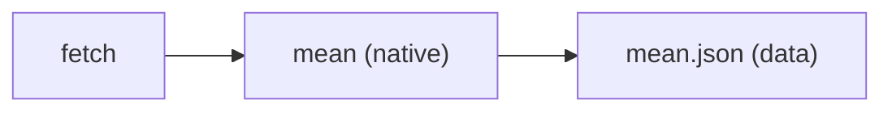

# 18. Native tasks

*Python functions as tasks: bindings instead of shell strings, declared outputs and JSON return values*

Workflows in Practice with DAGonStar - Part 2: Execution, data and recovery. Slides: [18-DAGonStar-Native_tasks.pptx](../lectures/18-DAGonStar-Native_tasks.pptx). Examples: [examples/18-native](../../examples/18-native/).

## 2. Today's lecture

**Outline**

1. Why not only shell commands
2. A function as a task
3. Inputs and outputs as bindings
4. What happens in the task folder
5. Hands-on: the mean as a function
6. Native or batch?

**After this lecture you can**

- Turn an importable function into a NATIVE task
- Bind files and outputs to its parameters
- Read the spec, the outputs and the return value

## 3. Beyond shell strings

*awk one-liners are fragile: quoting, escaping, %% and no types. Most science code is Python already.*

## 4. BATCH command or NATIVE function

**BATCH**

- A shell string
- Inputs inside the string as URLs
- Quoting and escaping by hand
- Any program in any language

**NATIVE**

- module:function
- Inputs as a dictionary of bindings
- No quoting: values are JSON
- Python only, but testable as Python

## 5. The function

[`examples/common/weather.py`](../../examples/common/weather.py)

```python
def mean_temperature(observations, result):
    """Mean temperature of every record; returns the number of records."""
    values = [float(row["temperature_c"]) for row in _rows(observations)]
    with open(result, "w", encoding="utf-8") as stream:
        json.dump({"mean_temperature_c": round(sum(values) / len(values), 2)}, stream, sort_keys=True)
    return {"count": len(values)}
```

- An ordinary function: observations is a path to read, result a path to write
- The return value must be JSON-serialisable

## 6. Requirements on the function

- **Importable** named as package.module:function, or passed as a module-level callable
- **Parameters** one per input and per output binding
- **Files** received as path strings
- **Outputs** the function must create every declared output file
- **Return** anything json.dumps accepts, or None

> *The function name*
>
> Module path, colon, function.

```
"common.weather:
mean_temperature"
```

## 7. Bindings

*inputs maps parameter names to files, references or scalars; outputs maps parameter names to relative paths.*

## 8. The NATIVE task

[`examples/18-native/native_task.py`](../../examples/18-native/native_task.py)

```python
mean = DagonTask(
    TaskType.NATIVE, "mean", "common.weather:mean_temperature",
    inputs={"observations": "workflow:///fetch/outputs/observations.csv"},
    outputs={"result": "mean.json"})
```

- The function as a string
- observations: a workflow:// reference
- result: a file name below outputs/
- The reference creates the edge to fetch

## 9. Kinds of binding

| Value | Kind | Passed to the function as |
|---|---|---|
| `"workflow:///fetch/..."` | file | Path of the staged copy |
| `"/data/local.csv" (exists)` | file | Path of the staged copy |
| `1.943844, "kn", [1, 2]` | value | The JSON value itself |
| `outputs: {"result": "mean.json"}` | file | Path below outputs/ |

## 10. Checked when the task is built

- **Signature** inputs and outputs must match the function's parameters
- **Outputs** relative paths only: no .. and no absolute paths
- **References** must name a workflow, a task and a path
- **Scalars** must be JSON-serialisable
- **Failure** ValueError at construction, before any run (lecture 19)

> **0** - *Tasks run with wrong bindings*
>
> Mistakes are caught in Python, on your laptop.

## 11. The graph



Solid arrows: data dependencies (`workflow://`); dotted arrows: control dependencies.

- fetch is BATCH, mean is NATIVE
- Mixed types in one graph
- The reference in inputs makes the edge

## 12. In the task folder

*The task writes a spec, runs a small runner in a separate Python process, and stores the result.*

## 13. How a native task runs

1. **Spec** - Write the native spec in .dagon.
2. **Stage** - Copy file inputs into inputs/<name>/.
3. **Runner** - Start the native runner module.
4. **Call** - Import, bind, call the function.
5. **Store** - Save the return value as JSON.

## 14. The runner

```
function = getattr(importlib.import_module(spec["module"]),
                   spec["function"])
kwargs = {}
for name, b in spec["inputs"].items():
    kwargs[name] = str(root / b["path"]) if b["kind"] == "file" \
                   else b["value"]
for name, b in spec["outputs"].items():
    kwargs[name] = str(root / b["path"])   # parent created
result = function(**kwargs)
# every declared output must now exist
# result -> .dagon/native_result.json
```

- A fresh Python process
- Paths are inside the task folder
- Missing outputs are an error

## 15. Reading it back

[`examples/18-native/native_task.py`](../../examples/18-native/native_task.py)

```python
print("type:", type(mean).__name__, "| after:", [t.name for t in mean.prevs])
spec = load(mean, ".dagon/native_spec.json")
print("bindings:", json.dumps(spec["inputs"]), json.dumps(spec["outputs"]))
print("outputs/mean.json:", load(mean, "outputs/mean.json"))
print("return value:", load(mean, ".dagon/native_result.json"))
check(load(mean, "outputs/mean.json") == {"mean_temperature_c": 16.0},
      "the mean of the twelve records is 16.0")
```

- The spec shows how each parameter was bound
- outputs/mean.json is the file; native_result.json the return value

## 16. Recorded output

Recorded output of `python examples/18-native/native_task.py`:

```text
type: NativeTask | after: ['fetch']
bindings: {"observations": {"kind": "file", "path": "inputs/observations/observations.csv"}} {"result": {"kind": "file", "path": "outputs/mean.json"}}
outputs/mean.json: {'mean_temperature_c': 16.0}
return value: {'count': 12}
```

- A NativeTask after fetch
- Bindings resolved to paths in the folder
- 16.0: the mean of all twelve records
- count 12: the return value

## 17. Files of a native task

| File | Content |
|---|---|
| `.dagon/native_spec.json` | Module, function, bindings, result path |
| `inputs/<name>/<file>` | Staged file inputs |
| `outputs/<file>` | Declared outputs |
| `.dagon/native_result.json` | The return value as JSON |
| `.dagon/native_stderr.txt` | The function's stderr and traceback |

## 18. Hands-on

*The mean of lecture 02, as a Python function bound to a reference.*

## 19. Run it

**Steps**

1. Run the example
2. Open common/weather.py and read mean_temperature
3. Call it directly in a Python shell on the CSV
4. Compare with outputs/mean.json

**Run it**

```bash
python examples/\
  18-native/\
  native_task.py
```

**Watch for:** The same function, called by hand or by DAGonStar, gives 16.0: it is testable without a workflow.

## 20. The spec, as written

```
{
  "module": "common.weather",
  "function": "mean_temperature",
  "inputs": {"observations": {"kind": "file",
      "path": "inputs/observations/observations.csv"}},
  "outputs": {"result": {"kind": "file",
      "path": "outputs/mean.json"}},
  "result_path": ".dagon/native_result.json",
  ...
}
```

- Everything the runner needs
- Paths relative to the task folder
- Readable: debug by reading it

## 21. Testing the function alone

- **Unit test** - Call mean_temperature on a small CSV in pytest.
- **No workflow** - No scratch, no threads: plain Python.
- **Then wire it** - The workflow only adds bindings and staging.

## 22. Native or batch?

*Use NATIVE for Python logic, BATCH for existing programs and pipelines of tools.*

## 23. Choosing

| Situation | Task type |
|---|---|
| Existing executable: a model, a converter | BATCH |
| Python analysis you write yourself | NATIVE |
| Values to pass: factors, units, station ids | NATIVE |
| Shell pipeline of standard tools | BATCH |
| Function on a cluster node | NATIVE with executor="slurm" |

## 24. The executor option

- **executor='local'** the runner runs on this machine: the default
- **executor='slurm'** the runner is submitted with Slurm
- **resources** passed to the Slurm task: partition, cpus, memory
- **python** the interpreter to use: a cluster's own Python
- **environment** variables set for the runner (lecture 19)

> *Same function, a cluster*
>
> Lecture 41 covers Slurm options.

```
DagonTask(TaskType.NATIVE,
  "m", "pkg.mod:f",
  executor="slurm",
  resources={...})
```

## 25. The command of a native task

- **Command field** the JSON of the inputs, sorted
- **Why** it keeps a stable command for JSON export and checkpoints
- **References** found in that JSON, so edges are discovered as usual
- **Not run by bash** the launcher runs the native runner instead
- **Export** as_json adds function, inputs and outputs

> *Same model*
>
> A native task is still a task: edges, staging, checkpoints.

## 26. Where the module comes from

- **Import path** the runner imports the module in the task folder's process
- **module_search_path** DAGonStar records where the module was found
- **Course examples** common/ is importable because examples/ is on sys.path
- **Your projects** install your package in the environment, or keep it on PYTHONPATH
- **Clusters** the same package must exist where the runner runs

> *Importable everywhere*
>
> The function must be importable on the machine that runs the task.

## 27. This lecture's example

- **2** - Tasks: BATCH fetch, NATIVE mean
- **16.0** - Mean temperature of all records, °C
- **12** - Records counted by the return value

## 28. Exercise

A. Write max_wind(observations, result) in a module of yours
B. Make it a NATIVE task after fetch
C. Return the station of the maximum
D. Check that it returns CAP and 8.0

**Deliverable:** Your function, the task, and a check on outputs and return value.

## 29. Check your understanding

1. How is the function of a NATIVE task named?
2. How does a native task receive a workflow:// input?
3. Where is the return value stored?
4. What happens if the function does not create a declared output?

<details><summary>Answers</summary>

1. As module:function, for example common.weather:mean_temperature.
2. As the path of the staged copy inside its folder, under inputs/<name>/.
3. In .dagon/native_result.json, as JSON.
4. The runner raises FileNotFoundError and the task fails.

</details>

## 30. Key takeaways

1. NATIVE tasks call module:function in a separate process
2. Bindings map parameters to files, references and values
3. Outputs are declared and checked; results are JSON
4. Test the function alone, then wire it into the workflow

*Next: scalar bindings, environments and failing functions*

---

Raffaele Montella. CC0 1.0. Generated from `src/lectures/18.js`.
