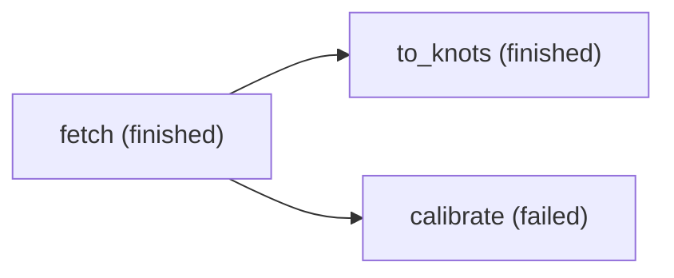

# 19. Native bindings

*Scalar inputs, environment variables, a function that raises, and bindings rejected before the run*

DAGonStar in Practice - Part 2: Execution, data and recovery. Slides: [19-DAGonStar-Native_bindings.pptx](../lectures/19-DAGonStar-Native_bindings.pptx). Examples: [examples/19-native-bindings](../../examples/19-native-bindings/).

## 2. Today's lecture

**Outline**

1. Scalar values as inputs
2. Environment variables for a function
3. When the function raises
4. Reading native_stderr.txt
5. Validation at construction
6. Good native APIs

**After this lecture you can**

- Pass numbers and strings to a native task
- Set environment variables for its process
- Diagnose a failing native function

## 3. Scalar inputs

*Not every input is a file: factors, units and station ids are values.*

## 4. scale_wind

[`examples/common/weather.py`](../../examples/common/weather.py)

```python
def scale_wind(observations, factor, unit, scaled):
    """Scalar inputs: multiply wind speeds by *factor* and label them with *unit*."""
    rows = _rows(observations)
    with open(scaled, "w", newline="", encoding="utf-8") as stream:
        writer = csv.writer(stream)
        writer.writerow(["station", "time_utc", "wind_" + unit])
        for row in rows:
            writer.writerow([row["station"], row["time_utc"], round(float(row["wind_m_s"]) * factor, 2)])
    return {"factor": factor, "unit": unit, "rows": len(rows), "label": os.environ.get("COURSE_LABEL", "unset")}
```

- factor and unit are plain values; observations and scaled are paths
- COURSE_LABEL is read from the environment of the process

## 5. The task with scalars

[`examples/19-native-bindings/native_bindings.py`](../../examples/19-native-bindings/native_bindings.py)

```python
knots = DagonTask(TaskType.NATIVE, "to_knots", "common.weather:scale_wind",
                  inputs={"observations": SOURCE, "factor": 1.943844,
                          "unit": "kn"},
                  outputs={"scaled": "wind_kn.csv"},
                  environment={"COURSE_LABEL": "lecture-19"})
```

- 1.943844 converts m/s to knots; "kn" names the column
- environment sets variables for the runner process only

## 6. How values travel

| In Python | In native_spec.json | In the function |
|---|---|---|
| `1.943844` | `{"kind": "value", "value": 1.943844}` | `1.943844` |
| `"kn"` | `{"kind": "value", "value": "kn"}` | `'kn'` |
| `["NAP", "CAP"]` | `{"kind": "value", ...}` | `['NAP', 'CAP']` |
| `workflow:///fetch/...` | `{"kind": "file", "path": ...}` | `'<task>/inputs/...'` |

> **JSON in, JSON out** values survive the trip to a separate process because they are JSON.

## 7. Strings that look like paths

- **A string** that names an existing file is treated as a file and staged
- **Other strings** are values
- **workflow://** always a file reference
- **Surprise** a value equal to a file name in the current directory becomes a file
- **Avoid** give values that cannot be confused with files

> *Rule in _validate_bindings*
>
> Reference, existing file, or JSON value: in that order.

## 8. The first rows

```
station,time_utc,wind_kn
NAP,2026-11-02T00:00:00Z,5.83     # 3.0 m/s
NAP,2026-11-02T01:00:00Z,7.78     # 4.0 m/s
NAP,2026-11-02T02:00:00Z,9.72     # 5.0 m/s
...
CAP,2026-11-02T02:00:00Z,15.55    # 8.0 m/s, the maximum
```

- One row per record
- Rounded to two decimals
- The header carries the unit

## 9. Environment variables

*Some code reads its configuration from the environment: native tasks set it for the runner only.*

## 10. environment={...}

- **Scope** only the runner process of that task
- **Not inherited** by other tasks or by your Python session
- **Typical uses** threads (OMP_NUM_THREADS), library options, labels
- **Not for secrets** it is part of the task's JSON export
- **Shown here** COURSE_LABEL comes back in the return value

> *Proof it arrived*
>
> scale_wind returns the variable's value.

```
'label': 'lecture-19'
```

## 11. A function that raises

*Exceptions in the function make the task FAILED; the traceback is saved in the task folder.*

## 12. always_fails

[`examples/common/weather.py`](../../examples/common/weather.py)

```python
def always_fails(observations):
    """Used by the failure lecture: a native function that raises."""
    raise RuntimeError("calibration table missing for %s" % os.path.basename(observations))
```

- A realistic error: a missing calibration table
- The runner lets the exception propagate: non-zero exit

## 13. Running both

[`examples/19-native-bindings/native_bindings.py`](../../examples/19-native-bindings/native_bindings.py)

```python
broken = DagonTask(TaskType.NATIVE, "calibrate",
                   "common.weather:always_fails",
                   inputs={"observations": SOURCE})
wf.add_task(knots)
wf.add_task(broken)
wf.run()

print("returned:", load(knots, ".dagon/native_result.json"))
print("first rows:", text(knots, "outputs/wind_kn.csv").splitlines()[:2])
print("calibrate:", broken.status.name)
error = text(broken, ".dagon/native_stderr.txt").strip().splitlines()[-1]
print("its stderr ends with:", error)
```

- Both tasks depend only on fetch: they run in parallel
- The last line of native_stderr.txt is the exception message

## 14. Recorded output

Recorded output of `python examples/19-native-bindings/native_bindings.py`:

```text
returned: {'factor': 1.943844, 'label': 'lecture-19', 'rows': 12, 'unit': 'kn'}
first rows: ['station,time_utc,wind_kn', 'NAP,2026-11-02T00:00:00Z,5.83']
calibrate: FAILED
its stderr ends with: RuntimeError: calibration table missing for observations.csv
rejected at construction: Native function bindings are incompatible: missing a require
```

- Values and environment arrived
- 3.0 m/s is 5.83 knots
- calibrate FAILED
- The traceback's last line

## 15. The graph



Solid arrows: data dependencies (`workflow://`); dotted arrows: control dependencies.

- Siblings: one fails, one finishes
- fetch is unaffected
- No descendants of calibrate to stop

## 16. What the runner does on an exception

- **The exception** propagates out of the function
- **The runner** exits with a non-zero code
- **stderr** captured in .dagon/native_stderr.txt
- **The task** FAILED, its checkpoint record has a non-zero code
- **native_result.json** not written

> *Last line of stderr*
>
> The message names the input: easy to act on.

```
RuntimeError: calibration
  table missing for
  observations.csv
```

## 17. Rejected at construction

*A misspelt parameter is caught when the task is built, not hours later on a cluster.*

## 18. A typo

[`examples/19-native-bindings/native_bindings.py`](../../examples/19-native-bindings/native_bindings.py)

```python
try:
    DagonTask(TaskType.NATIVE, "typo", "common.weather:scale_wind",
              inputs={"observations": SOURCE, "factr": 2})
except ValueError as exc:
    print("rejected at construction:", str(exc)[:60])
```

- factr instead of factor, and the outputs are missing
- inspect.signature(...).bind raises: DAGonStar turns it into ValueError

## 19. What is validated when the task is built

| Check | Error |
|---|---|
| module:function importable and callable | ValueError: not importable |
| Bindings match the signature | ValueError: bindings are incompatible |
| Outputs are relative, inside the folder | ValueError on the output path |
| References have workflow, task and path | ValueError: invalid reference |
| Scalars are JSON-serialisable | ValueError: must be JSON-serializable |
| executor is local or slurm | ValueError on the executor |

## 20. Fail early, fail late

**At construction**

- Wrong names, missing parameters
- Unimportable module
- Non-JSON values
- Cost: nothing ran

**At run time**

- The function raises
- An output is not written
- The return value is not JSON
- Cost: the task, and its descendants

## 21. Good native APIs

*Write functions that are easy to bind, test and rerun.*

## 22. Design rules

- **Paths in, paths out** - Take file paths as parameters; write only to output paths.
- **Plain values** - Numbers, strings, lists: JSON types only.
- **Small return values** - Summaries and counts; big data go in files.
- **Raise clearly** - A specific exception with a message that names the input.
- **No hidden state** - No globals, no current directory assumptions.
- **Pure where possible** - Same inputs, same outputs: safe to resume.

## 23. Experiment

**Steps**

1. Run the example
2. Change factor to 3.6 and unit to kmh
3. Remove the environment argument
4. Read the label in the return value

**Run it**

```bash
python examples/\
  19-native-bindings/\
  native_bindings.py
```

**Watch for:** label becomes unset without the environment argument: the variable is per task.

## 24. Debugging a native task

- **native_spec.json** did the bindings resolve as you expected?
- **inputs/** did the files arrive?
- **native_stderr.txt** the traceback
- **Run the runner by hand** python -m dagon.native_runner .dagon/native_spec.json
- **Call the function** directly, with the same paths

> *Reproduce*
>
> The same call DAGonStar made.

```
cd <task>
python -m dagon.native_runner \
  .dagon/native_spec.json
```

## 25. Three outcomes in one run

| Task | Outcome | Where you see it |
|---|---|---|
| to_knots | FINISHED | native_result.json, outputs/wind_kn.csv |
| calibrate | FAILED at run time | native_stderr.txt, status |
| typo | Never built | ValueError in your script |

## 26. This lecture's example

- **2** - Scalar inputs and one variable
- **1** - Function that raises
- **1** - Task rejected before running

## 27. Units, the scientific way

- **Factor** 1 m/s = 1.943844 knots
- **Label the column** wind_kn, not wind
- **Return metadata** factor and unit in the return value
- **Check** 3.0 m/s × 1.943844 = 5.83 kn, rounded to 2 decimals
- **Lecture 45** units become part of FAIR metadata

> **5.83** - *Knots for 3.0 m/s*
>
> First NAP record, checked by hand.

## 28. Exercise

A. Add a stations input: a list of station ids
B. Filter the rows to those stations in scale_wind
C. Pass OMP_NUM_THREADS=1 through environment
D. Add a task with a wrong binding and catch the ValueError

**Deliverable:** A modified function and task; the output lists only the selected stations.

## 29. Check your understanding

1. How is a scalar input stored in the native spec?
2. Which process sees the environment of a native task?
3. Where do you find the traceback of a failing function?
4. When is a misspelt parameter name detected?

<details><summary>Answers</summary>

1. As {"kind": "value", "value": ...} with the JSON value.
2. Only the runner process of that task.
3. In .dagon/native_stderr.txt of the task folder.
4. When the task is constructed, by binding the names to the function's signature.

</details>

## 30. Key takeaways

1. Scalars travel as JSON values; files as staged paths
2. environment sets variables for one task's process
3. A raising function makes the task FAILED; read native_stderr.txt
4. Bad bindings are rejected when the task is built

*Next: parameter sweeps*

---

Raffaele Montella. CC0 1.0. Generated from `src/lectures/19.js`.
