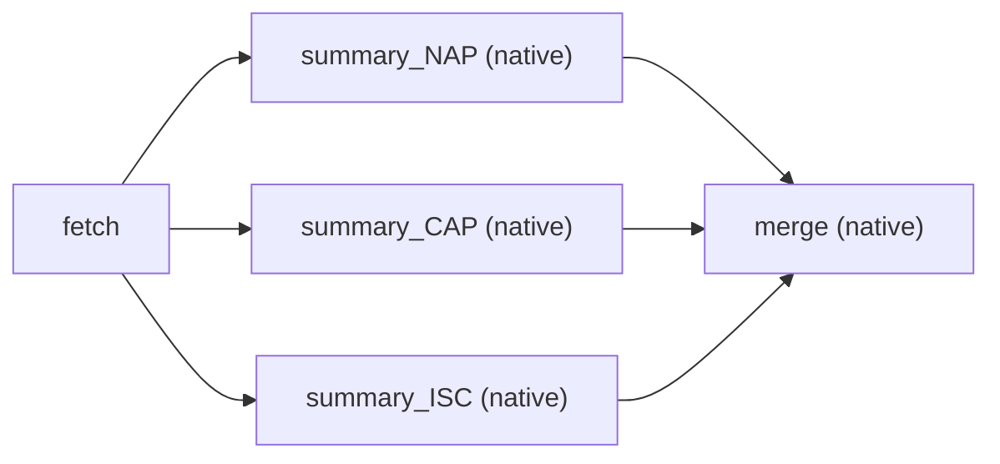
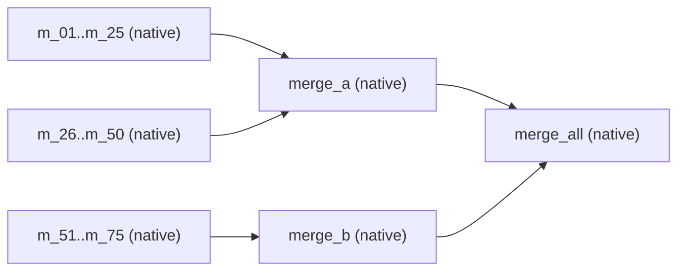

# 20. Parameter sweeps

*Generating tasks from parameters: one native summary per station, merged by a fan-in function*

DAGonStar in Practice - Part 2: Execution, data and recovery. Slides: [20-DAGonStar-Parameter_sweeps.pptx](../lectures/20-DAGonStar-Parameter_sweeps.pptx). Examples: [examples/20-sweep](../../examples/20-sweep/).

## 2. Today's lecture

**Outline**

1. What a parameter sweep is
2. Generating tasks in a loop
3. Naming generated tasks
4. Fan-in with a fixed signature
5. Hands-on: the station sweep
6. Sweeps at scale

**After this lecture you can**

- Generate a task per parameter value
- Merge sweep results with a native fan-in
- Plan the size of a sweep

## 3. Sweeps

*The same computation over many values of a parameter: stations, dates, model settings.*

## 4. Sweeps in science

- **Space** - One task per station, region or grid tile.
- **Time** - One task per day, month or forecast cycle.
- **Settings** - One run per value of a model parameter.
- **Scenarios** - One run per emission scenario or boundary condition.

> **Embarrassingly parallel** sweep members never talk to each other: the width of the graph is the number of values.

## 5. The pattern

- **Source** one task produces the shared input
- **Loop** for each value, add a task with that value bound
- **Names** the value is part of the task name
- **Merge** one task reads every member's output
- **Graph** a fan-out of width N and a fan-in

> **N+2** - *Tasks for N values*
>
> fetch, the members, merge.

## 6. Generating tasks

*Python builds the graph: a loop is all it takes.*

## 7. The members

[`examples/20-sweep/parameter_sweep.py`](../../examples/20-sweep/parameter_sweep.py)

```python
wf = workflow("Sweep20", base)
wf.add_task(DagonTask(TaskType.BATCH, "fetch", fetch_observations()))
for station in STATIONS:                              # fan-out
    wf.add_task(DagonTask(
        TaskType.NATIVE, "summary_" + station,
        "common.weather:station_summary",
        inputs={"observations": SOURCE, "station": station},
        outputs={"summary": "summary.json"}))
```

- One NATIVE task per station; the station is a scalar input
- Every member reads the same reference and writes its own summary.json

## 8. station_summary

[`examples/common/weather.py`](../../examples/common/weather.py)

```python
def station_summary(observations, station, summary):
    """Mean temperature and maximum wind of one station."""
    rows = [row for row in _rows(observations) if row["station"] == station]
    if not rows:
        raise ValueError("no records for station %s" % station)
    data = {"station": station,
            "mean_temperature_c": round(statistics.mean(float(r["temperature_c"]) for r in rows), 2),
            "max_wind_m_s": max(float(r["wind_m_s"]) for r in rows),
            "records": len(rows)}
    with open(summary, "w", encoding="utf-8") as stream:
        json.dump(data, stream, sort_keys=True)
    return data
```

- Filters by station, raises if there are no rows
- Writes and returns the same summary

## 9. Naming generated tasks

- **Include the value** summary_NAP, member_03, day_2026-11-02
- **Valid in URLs** no spaces or slashes in values used as names
- **Unique** two values must never give the same name
- **Stable** the same value gives the same name: checkpoints work
- **Padded** member_03 sorts before member_10

> *This lecture*
>
> Station ids are short, unique and URL-safe.

```
"summary_" + station
```

## 10. Sweeping in two dimensions

```
for station in STATIONS:
    for factor, unit in [(1.943844, "kn"), (3.6, "kmh")]:
        wf.add_task(DagonTask(
            TaskType.NATIVE,
            "wind_%s_%s" % (station, unit),
            "common.weather:scale_wind",
            inputs={"observations": SOURCE,
                    "factor": factor, "unit": unit},
            outputs={"scaled": "wind.csv"}))
# 3 stations x 2 units = 6 members
```

- Nested loops: the cartesian product
- Both values in the name
- Width grows multiplicatively

## 11. Fan-in

*A native function with one parameter per member: the signature fixes the width.*

## 12. merge_summaries

[`examples/common/weather.py`](../../examples/common/weather.py)

```python
def merge_summaries(nap, cap, isc, report):
    """Fan-in: merge three station summaries into one report."""
    stations = []
    for path in (nap, cap, isc):
        with open(path, encoding="utf-8") as stream:
            stations.append(json.load(stream))
    windiest = max(stations, key=lambda s: s["max_wind_m_s"])
    data = {"stations": sorted(s["station"] for s in stations), "windiest": windiest["station"],
            "max_wind_m_s": windiest["max_wind_m_s"]}
    with open(report, "w", encoding="utf-8") as stream:
        json.dump(data, stream, sort_keys=True)
    return data
```

- Three named inputs: nap, cap, isc
- windiest: the station with the largest maximum wind

## 13. Binding the fan-in

[`examples/20-sweep/parameter_sweep.py`](../../examples/20-sweep/parameter_sweep.py)

```python
merge = DagonTask(                                    # fan-in
    TaskType.NATIVE, "merge", "common.weather:merge_summaries",
    inputs={key.lower(): "workflow:///summary_%s/outputs/summary.json" % key
            for key in STATIONS},
    outputs={"report": "report.json"})
```

- A dict comprehension builds three references, one per member
- Parameter names are the lower-case station ids

## 14. The sweep



Solid arrows: data dependencies (`workflow://`); dotted arrows: control dependencies.

- Width 3
- Members are independent
- merge waits for all three

## 15. Recorded output

Recorded output of `python examples/20-sweep/parameter_sweep.py`:

```text
generated: ['fetch', 'summary_NAP', 'summary_CAP', 'summary_ISC', 'merge']
  {'max_wind_m_s': 5.0, 'mean_temperature_c': 15.5, 'records': 4, 'station': 'NAP'}
  {'max_wind_m_s': 8.0, 'mean_temperature_c': 16.75, 'records': 4, 'station': 'CAP'}
  {'max_wind_m_s': 6.0, 'mean_temperature_c': 15.75, 'records': 4, 'station': 'ISC'}
report: {'max_wind_m_s': 8.0, 'stations': ['CAP', 'ISC', 'NAP'], 'windiest': 'CAP'}
```

- Five generated tasks
- One summary per station
- CAP is the windiest at 8.0 m/s

## 16. Fixed or variable fan-in

**Fixed signature**

- merge(nap, cap, isc, report)
- Clear, checked at construction
- Width fixed by the function
- This lecture

**Variable width**

- A BATCH merge: cat ref1 ref2 ... refN
- Or a CHECKPOINT task gathering N files
- Or a native merge over a folder
- Lecture 21 uses five named members

## 17. The signature as a contract

- **merge_summaries(nap, cap, isc, report)** four parameters
- **inputs** three keys built from STATIONS, lower-cased
- **outputs** one key: report
- **Mismatch** a fourth station adds a key the function lacks
- **Result** ValueError when merge is constructed, before any run

> *With four stations*
>
> Caught in Python, not on the cluster.

```
ValueError: Native
function bindings are
incompatible
```

## 18. Hands-on

*Run the sweep and compare with the hand table of lecture 12.*

## 19. Run the sweep

**Steps**

1. Run the example
2. Compare the three summaries with lecture 12
3. Add a fourth station to STATIONS in a copy
4. Observe the error: the merge signature has three inputs

**Run it**

```bash
python examples/\
  20-sweep/\
  parameter_sweep.py
```

**Watch for:** The fan-in signature is a contract: a fourth member needs a fourth parameter, or a variable-width merge.

## 20. Lecture 12 and lecture 20

| Aspect | Lecture 12 | Lecture 20 |
|---|---|---|
| Members | BATCH awk | NATIVE station_summary |
| Output | Text line | JSON document |
| Merge | sort -k3 -n -r | merge_summaries |
| Result | CAP 16.75 8.0 | windiest CAP, 8.0 |

> **Same graph, same numbers** only the task types changed.

## 21. Sweeps at scale

*Hundreds or thousands of members: threads, disk and the scheduler set the limits.*

## 22. Limits to plan for

| Resource | Limit | Mitigation |
|---|---|---|
| Threads | max_threads running at once (10) | Raise it, or submit SLURM members |
| Disk | N copies of the input | LINK, remove_dir, BeeOND |
| Scheduler | Jobs per user in the queue | Batch members into fewer tasks |
| Merge | N inputs in one task | Hierarchical merge |
| Failures | More members, more failures | Checkpoints and resume |

## 23. A hierarchical merge



Solid arrows: data dependencies (`workflow://`); dotted arrows: control dependencies.

- Merge in groups, then merge the groups
- Each merge reads few files
- Same idea as a reduction tree

## 24. Sweeps and checkpoints

- **Stable names** summary_NAP is the same key on every run
- **Resume** only failed or missing members rerun
- **Adding values** new members run, old ones are reused
- **Changing the function** rename the members or drop the checkpoint
- **Lecture 24** a resumable ensemble, stale records included

> *Names are keys*
>
> Generated names must depend only on the parameter.

## 25. Reading the members

[`examples/20-sweep/parameter_sweep.py`](../../examples/20-sweep/parameter_sweep.py)

```python
print("generated:", [t.name for t in wf.tasks])
for station in STATIONS:
    task = next(t for t in wf.tasks if t.name == "summary_" + station)
    print(" ", load(task, "outputs/summary.json"))
print("report:", load(merge, "outputs/report.json"))
check(load(merge, "outputs/report.json")["windiest"] == "CAP", "Capri")
```

- Members are found by name among wf.tasks
- The report is a JSON document: compare keys, not text

## 26. This lecture's example

- **3** - Members
- **5** - Tasks in all
- **8.0** - m/s, maximum wind at CAP

## 27. Sweep or ensemble?

- **Sweep** different inputs or settings; results compared or combined
- **Ensemble** perturbed copies of one run; statistics of the spread
- **Both** generated in a loop, merged by a fan-in
- **Next lecture** five ensemble members and their spread

> *Same shape, different question*
>
> Sweeps explore; ensembles quantify uncertainty.

## 28. Exercise

A. Write merge_any(folder, report) that merges every JSON in a folder
B. Make the merge a BATCH task that copies the three summaries into one folder
C. Run the sweep with four stations
D. Check the windiest station again

**Deliverable:** A variable-width version of the sweep whose merge does not change when a station is added.

## 29. Check your understanding

1. What makes a parameter sweep embarrassingly parallel?
2. Why should the parameter value be part of the task name?
3. What limits the width of the merge_summaries fan-in?
4. Name two ways to keep a large sweep within disk limits.

<details><summary>Answers</summary>

1. Members do not depend on each other; they share only the input.
2. Names must be unique and stable for references and checkpoints.
3. Its signature: three named parameters.
4. LINK instead of COPY, remove_dir True, BeeOND or a hierarchical merge with clean-up.

</details>

## 30. Key takeaways

1. A loop generates one task per parameter value
2. Names carry the value: unique, URL-safe, stable
3. A native fan-in has a width fixed by its signature
4. Plan threads, disk and merge shape for large sweeps

*Next: ensembles*

---

Raffaele Montella. CC0 1.0. Generated from `src/lectures/20.js`.
