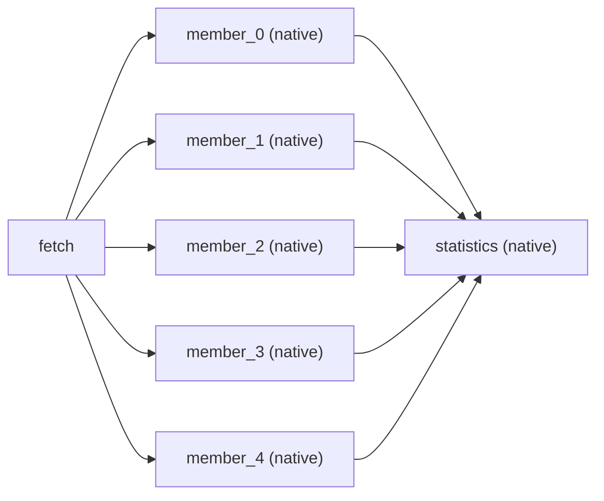

# 21. Ensembles

*Perturbed members, an ensemble mean and a spread: uncertainty as a workflow*

DAGonStar in Practice - Part 2: Execution, data and recovery. Slides: [21-DAGonStar-Ensembles.pptx](../lectures/21-DAGonStar-Ensembles.pptx). Examples: [examples/21-ensemble](../../examples/21-ensemble/).

## 2. Today's lecture

**Outline**

1. Why ensembles
2. Perturbing a run
3. Members as native tasks
4. Statistics as a fan-in
5. Hands-on: five members
6. Ensembles at scale

**After this lecture you can**

- Build an ensemble of perturbed members
- Compute ensemble mean and spread in a fan-in
- Check the statistics by hand

## 3. Why ensembles

*One forecast is one possible future. Many perturbed forecasts show how certain it is.*

## 4. Uncertainty in models

- **Initial state** observations have errors; the model starts from an estimate
- **Parameters** physical constants and closures are uncertain
- **Forcing** boundary conditions and scenarios differ
- **Chaos** small differences grow with time
- **Ensemble** run many members, each slightly different, and look at the distribution

> **σ** - *Spread*
>
> The standard deviation of the members: a measure of confidence.

## 5. Ensembles you know

- **Weather** - Operational centres run 50 or more members twice a day.
- **Ocean and waves** - Members forced by different winds for the Gulf of Naples.
- **Climate** - Scenario ensembles across models and pathways.
- **Machine learning** - Several models or seeds averaged for robust predictions.

## 6. Perturbing a run

*In this lecture a member shifts every temperature by an offset; a real model would perturb its initial state.*

## 7. ensemble_member

[`examples/common/weather.py`](../../examples/common/weather.py)

```python
def ensemble_member(observations, offset, member):
    """One ensemble member: perturb every temperature by *offset* and return the mean."""
    values = [float(row["temperature_c"]) + offset for row in _rows(observations)]
    mean = round(sum(values) / len(values), 3)
    with open(member, "w", encoding="utf-8") as stream:
        json.dump({"offset": offset, "mean_temperature_c": mean}, stream, sort_keys=True)
    return {"mean_temperature_c": mean}
```

- offset: a scalar binding, different for every member
- The member's mean is written to a file and returned

## 8. Five members

| Member | Offset (°C) | Mean (°C) |
|---|---|---|
| member_0 | -1.0 | 15.0 |
| member_1 | -0.5 | 15.5 |
| member_2 | 0.0 | 16.0 |
| member_3 | +0.5 | 16.5 |
| member_4 | +1.0 | 17.0 |

> **16.0 is the mean of all twelve records** each member shifts it by its offset.

## 9. From one run to an ensemble

1. **One run** - A model with one initial state.
2. **Perturb** - N slightly different inputs.
3. **Run all** - N independent members.
4. **Reduce** - Mean, spread, probabilities.
5. **Decide** - Act on the uncertainty.

## 10. The workflow

*fetch, five native members, one native statistics task.*

## 11. Members in a loop

[`examples/21-ensemble/ensemble.py`](../../examples/21-ensemble/ensemble.py)

```python
wf = workflow("Ensemble21", base)
wf.add_task(DagonTask(TaskType.BATCH, "fetch", fetch_observations()))
for index, offset in enumerate(OFFSETS):
    wf.add_task(DagonTask(
        TaskType.NATIVE, "member_%d" % index, "common.weather:ensemble_member",
        inputs={"observations": SOURCE, "offset": offset},
        outputs={"member": "member.json"}))
```

- enumerate gives the index for the name and the offset for the binding
- member_0 ... member_4: stable, unique names

## 12. The statistics task

[`examples/21-ensemble/ensemble.py`](../../examples/21-ensemble/ensemble.py)

```python
stats = DagonTask(
    TaskType.NATIVE, "statistics", "common.weather:ensemble_statistics",
    inputs={"m%d" % i: "workflow:///member_%d/outputs/member.json" % i
            for i in range(len(OFFSETS))},
    outputs={"statistics_file": "statistics.json"})
wf.add_task(stats)
wf.run()
```

- m0 ... m4: five references built in a comprehension
- statistics_file: the declared output

## 13. The ensemble



Solid arrows: data dependencies (`workflow://`); dotted arrows: control dependencies.

- Width five
- Statistics waits for every member
- Seven tasks, ten edges

## 14. ensemble_statistics

[`examples/common/weather.py`](../../examples/common/weather.py)

```python
def ensemble_statistics(m0, m1, m2, m3, m4, statistics_file):
    """Fan-in over five members: ensemble mean and spread."""
    means = []
    for path in (m0, m1, m2, m3, m4):
        with open(path, encoding="utf-8") as stream:
            means.append(json.load(stream)["mean_temperature_c"])
    data = {"members": len(means), "ensemble_mean_c": round(statistics.mean(means), 3),
            "spread_c": round(statistics.pstdev(means), 3)}
    with open(statistics_file, "w", encoding="utf-8") as stream:
        json.dump(data, stream, sort_keys=True)
    return data
```

- Population standard deviation (pstdev): the members are the whole ensemble
- Rounded to three decimals

## 15. Recorded output

Recorded output of `python examples/21-ensemble/ensemble.py`:

```text
  member_0 {'mean_temperature_c': 15.0, 'offset': -1.0}
  member_1 {'mean_temperature_c': 15.5, 'offset': -0.5}
  member_2 {'mean_temperature_c': 16.0, 'offset': 0.0}
  member_3 {'mean_temperature_c': 16.5, 'offset': 0.5}
  member_4 {'mean_temperature_c': 17.0, 'offset': 1.0}
statistics waits for 5 members: {'ensemble_mean_c': 16.0, 'members': 5, 'spread_c': 0.707}
```

- Five members, five means
- Mean 16.0
- Spread 0.707
- Five prevs for statistics

## 16. Checking the spread by hand

- **Deviations** -1, -0.5, 0, +0.5, +1
- **Squares** 1, 0.25, 0, 0.25, 1
- **Mean of squares** 2.5 / 5 = 0.5
- **Spread** √0.5 = 0.707
- **The check** compares exactly 16.0 and 0.707

> **0.707** - *√0.5*
>
> Lecture 24 doubles the offsets: the spread becomes 1.414.

## 17. Hands-on

*Run the ensemble and change the perturbations.*

## 18. Run the ensemble

**Steps**

1. Run the example
2. Change OFFSETS to (-2, -1, 0, 1, 2)
3. Predict the new spread
4. Update the check and run again

**Run it**

```bash
python examples/\
  21-ensemble/\
  ensemble.py
```

**Watch for:** Doubling every offset doubles the spread: 1.414. The mean stays 16.0 because the offsets are symmetric.

## 19. pstdev or stdev

**Population (pstdev)**

- Divides by N
- The members are all there is
- Used here: 0.707
- Common for ensemble spread

**Sample (stdev)**

- Divides by N-1
- Members are a sample of a larger population
- Would give 0.791 here
- Common for statistics of observations

## 20. Ensembles at scale

*Fifty members of a real model: hours each, on a cluster, with failures.*

## 21. From the course to production

| Concern | Course | Production |
|---|---|---|
| Member | Native function, milliseconds | SLURM job, hours |
| Members | 5 | 50-500 |
| Input | One CSV | Initial and boundary files, GB |
| Failures | None | A few per run: resume |
| Statistics | Mean and spread | Probabilities, percentiles, maps |

## 22. What else matters at scale

- **Checkpoints** - A failed member reruns alone (lecture 24).
- **Movers** - LINK or BeeOND for shared inputs (lectures 13, 42).
- **Scheduler** - SLURM members, arrays of jobs (lecture 41).
- **Merge shape** - Hierarchical statistics (lecture 20).

## 23. Reproducible perturbations

- **Deterministic offsets** this lecture: fixed list, same result every run
- **Random perturbations** use a seed per member: seed = base + index
- **Record** the seed or offset in the member's output and return value
- **Name** member_03 keeps the same key and the same seed
- **Never** draw random numbers without recording the seed

> *Same member, same numbers*
>
> Otherwise resume would mix members of different runs.

## 24. Reading an ensemble

- **Small spread** members agree: high confidence in the mean
- **Large spread** members disagree: report a range, not a number
- **Probability** fraction of members above a threshold
- **Skill** compare spread with the actual error over many cases
- **Here** 0.707 °C, by construction of the offsets

> *A probability from 5 members*
>
> member_3 and member_4 exceed it.

```
P(T > 16.2) =
  2/5 = 40%
```

## 25. This lecture's ensemble

- **5** - Members
- **16.0** - Ensemble mean, °C
- **0.707** - Spread, °C

## 26. The check

[`examples/21-ensemble/ensemble.py`](../../examples/21-ensemble/ensemble.py)

```python
check(result == {"members": 5, "ensemble_mean_c": 16.0, "spread_c": 0.707},
      "mean 16.0, spread sqrt(0.5)")
```

- A dict comparison: all three values at once
- An exact expected spread, computed by hand

## 27. Members as other task types

- **NATIVE** this lecture: a Python function
- **BATCH** a model executable with -offset on its command line
- **SLURM** the same command submitted to a cluster
- **DOCKER, APPTAINER** a containerised model (lectures 37-38)
- **Same graph** only the member task type changes

> *The structure is portable*
>
> Fan-out of members, fan-in of statistics, whatever runs them.

## 28. Exercise

A. Add a 90th percentile to ensemble_statistics
B. Use seven members with offsets from -1.5 to 1.5
C. Write a variable-width statistics task
D. Check the new mean and spread by hand

**Deliverable:** An ensemble with seven members and statistics including the percentile, checked against your hand computation.

## 29. Check your understanding

1. What does the spread of an ensemble measure?
2. Why are the member names member_0 to member_4 important?
3. What is the spread for offsets -1, -0.5, 0, 0.5, 1?
4. Why should random perturbations use a recorded seed?

<details><summary>Answers</summary>

1. How much the members disagree: the uncertainty of the result.
2. They are unique, stable keys for references and checkpoints.
3. 0.707, the square root of 0.5.
4. So that a member gives the same result when rerun or resumed.

</details>

## 30. Key takeaways

1. An ensemble runs perturbed copies of one computation
2. Members are generated in a loop with stable names
3. A fan-in computes mean and spread
4. Seeds, checkpoints and movers matter at scale

*Next: meta-workflows*

---

Raffaele Montella. CC0 1.0. Generated from `src/lectures/21.js`.
