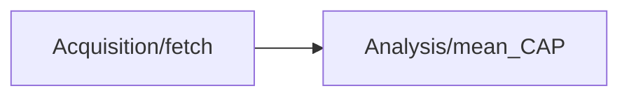

# 22. Meta-workflows

*Composing workflows with DAG_TPS: cross-workflow references, transversal points and one run for all*

Workflows in Practice with DAGonStar - Part 2: Execution, data and recovery. Slides: [22-DAGonStar-Meta_workflows.pptx](../lectures/22-DAGonStar-Meta_workflows.pptx). Examples: [examples/22-meta](../../examples/22-meta/).

## 2. Today's lecture

**Outline**

1. Why split a campaign into workflows
2. DAG_TPS: a workflow of workflows
3. Cross-workflow references
4. Transversal points
5. Hands-on: acquisition and analysis
6. Limits and alternatives

**After this lecture you can**

- Compose two workflows in a DAG_TPS
- Reference a task of another workflow
- Explain how a transversal point waits

## 3. Why several workflows

*Different teams, schedules and machines own different parts of a campaign.*

## 4. Natural boundaries

- **Acquisition** - Data teams fetch and quality-control observations.
- **Modelling** - Modellers run simulations on HPC.
- **Analysis** - Scientists compute products and figures.
- **Publication** - Data managers describe and publish results.

> **One workflow per part** each can be developed, tested and reused alone, then composed.

## 5. What DAG_TPS gives you

- **A container** DAG_TPS(name, config=...) holds several workflows
- **Resolution** workflow://<other>/<task>/<path> finds the task in a sibling workflow
- **Validation** cycles across workflows are rejected
- **One run** every workflow runs in its own thread, started together
- **Dry runs** set_dry applies to all workflows

> *A meta-workflow*
>
> Same config styles as Workflow.

```
campaign = DAG_TPS(
  "Campaign22",
  config=config(base))
```

## 6. Cross-workflow references

*The workflow part of the URL is no longer empty: it names the producing workflow.*

## 7. Two workflows

[`examples/22-meta/meta_workflow.py`](../../examples/22-meta/meta_workflow.py)

```python
campaign = DAG_TPS("Campaign22", config=config(base))
acquisition = workflow("Acquisition", base)
analysis = workflow("Analysis", base)
fetch = DagonTask(TaskType.BATCH, "fetch", fetch_observations())
mean = DagonTask(TaskType.BATCH, "mean_CAP", station_mean(
    "CAP", "workflow://Acquisition/fetch/outputs/observations.csv",
    "outputs/mean.txt"))
acquisition.add_task(fetch)
analysis.add_task(mean)
campaign.add_workflow(acquisition)
campaign.add_workflow(analysis)
```

- mean_CAP lives in Analysis and reads a file of Acquisition
- add_workflow attaches each workflow to the meta-workflow

## 8. The campaign



Solid arrows: data dependencies (`workflow://`); dotted arrows: control dependencies.

- Two workflows, one edge between them
- The URL names Acquisition
- Analysis alone could not resolve it

## 9. Resolving a reference

1. **Parse** - workflow://Acquisition/fetch/...
2. **Different** - Not the consumer's workflow.
3. **Search** - Every workflow of the DAG_TPS.
4. **Link** - Add a transversal point.
5. **Count** - Increment fetch's references.

## 10. Local edge or transversal point

| Aspect | Same workflow | Other workflow |
|---|---|---|
| Added by | add_dependency_to | add_transversal_point |
| Producer's nexts | Updated | Not updated |
| Waiting | join on the producer thread | Poll its status every 0.5 s |
| Staging | Same stager, same rules | Same stager, same rules |
| Failure | Propagates | Propagates |

## 11. Transversal points

*An edge between workflows: the consumer waits for a task it does not own.*

## 12. How a transversal point waits

- **add_transversal_point** appends the producer to the consumer's prevs
- **Not in nexts** the producer's workflow does not know the consumer
- **Waiting** the consumer polls the producer's status every 0.5 s
- **Ends** when the producer is FINISHED or FAILED
- **Then** the usual rule: a FAILED producer fails the consumer

> *Printed by the example*
>
> The prev belongs to another workflow.

```
Analysis.mean_CAP
  waits for:
  [('Acquisition',
    'fetch')]
```

## 13. Linking and running

[`examples/22-meta/meta_workflow.py`](../../examples/22-meta/meta_workflow.py)

```python
campaign.make_dependencies()
print("Analysis.mean_CAP waits for:",
      [(t.workflow.name, t.name) for t in mean.prevs])
campaign.run()
print("result:", text(mean, "outputs/mean.txt").strip())
```

- make_dependencies runs each workflow's discovery, then validates across them
- run() starts one thread per workflow and joins them

## 14. DAG_TPS.run

```
def run(self):
    workflows = []
    for wf in self.workflows:
        workflows.append(threading.Thread(target=wf.run))
    for wf in workflows: wf.start()
    for wf in workflows: wf.join()
```

- All workflows start together
- Ordering comes from the transversal points
- Each workflow keeps its own scratch and checkpoints

## 15. Recorded output

Recorded output of `python examples/22-meta/meta_workflow.py`:

```text
Analysis.mean_CAP waits for: [('Acquisition', 'fetch')]
result: CAP 16.75
unresolved without DAG_TPS or the service: Dagon service is not available
```

- The prev is in Acquisition
- Capri mean 16.75
- Without DAG_TPS the reference cannot be resolved

## 16. Without a meta-workflow

*A reference to an unknown workflow falls back to the DAGon service, which is off in this course.*

## 17. An orphan reference

[`examples/22-meta/meta_workflow.py`](../../examples/22-meta/meta_workflow.py)

```python
alone = workflow("Alone", base)
alone.add_task(DagonTask(TaskType.BATCH, "orphan",
                         "cat workflow://Missing/fetch/out.csv"))
try:
    alone.make_dependencies()
except ConnectionError as error:
    print("unresolved without DAG_TPS or the service:", error)
```

- Missing is not a known workflow and no DAG_TPS is attached
- The lookup goes to the service: ConnectionError

## 18. DAG_TPS or the DAGon service

**DAG_TPS**

- In one Python process
- Workflows known in advance
- Status read from task objects
- Used in this course

**DAGon service**

- A REST service tracking workflows
- Workflows started separately, even elsewhere
- Status read through the API
- dagon_service.use = True

## 19. Run the campaign

**Steps**

1. Run the example
2. Add a Publication workflow that copies Analysis's mean
3. Add it to the DAG_TPS and run
4. Print every task's workflow and status

**Run it**

```bash
python examples/\
  22-meta/\
  meta_workflow.py
```

**Watch for:** Three workflows, three threads; Publication waits for Analysis, which waits for Acquisition.

## 20. Scratch and configuration per workflow

- **Own config** each Workflow has its own configuration dict or file
- **Own scratch** task folders go under each workflow's scratch base
- **Staging** the consumer copies from the producer's folder, wherever it is
- **Own checkpoints** checkpoint_file per workflow
- **Shared here** the example uses the same base for both, for simplicity

> *Independent parts*
>
> A meta-workflow composes, it does not merge.

## 21. Design

*Split by ownership and reuse, not by size.*

## 22. One workflow or a meta-workflow

| Situation | Choose |
|---|---|
| One team, one script | One workflow |
| Reusable acquisition used by several analyses | Meta-workflow |
| Parts with different configurations or hosts | Meta-workflow |
| Need one checkpoint file for everything | One workflow |
| Parts started at different times | Separate runs, or the service |

## 23. Names across workflows

- **Workflow names** must be unique inside a DAG_TPS
- **Task names** unique per workflow; mean in two workflows is fine
- **URLs** always name the workflow when crossing
- **Checkpoint keys** <workflow>.<task>, so no clashes
- **Renaming a workflow** breaks every reference to it

> *Explicit*
>
> Readable months later.

```
workflow://Acquisition/
  fetch/outputs/
  observations.csv
```

## 24. Limits to know

- **Polling** - Transversal waits poll every 0.5 s: fine for long tasks.
- **One process** - A DAG_TPS runs in one Python process.
- **Garbage** - Reference counts cross workflows: plan remove_dir carefully.
- **Validation** - Cross-workflow cycles are checked; keep the graph simple anyway.

## 25. The meta-workflow as JSON

```
campaign.as_json()
# {"name": "Campaign22", "id": 0,
#  "tasks": {...every task of every workflow...}}

# each part can still be exported alone
acquisition.as_json()
analysis.as_json()
```

- One document for the campaign
- Or one per workflow
- Archive both with the results

## 26. This lecture's campaign

- **2** - Workflows
- **1** - Transversal point
- **16.75** - °C, the Capri mean

## 27. Testing the parts

- **Acquisition alone** run it as a normal workflow and check its output
- **Analysis alone** point it at a local copy of the data for unit tests
- **Together** the DAG_TPS run is the integration test
- **Recorded outputs** one example per part, one for the campaign
- **Same pattern** as unit and integration tests in software

> *Composable means testable*
>
> Each workflow has its own checks.

## 28. Exercise

A. Move the three station means into an Analysis workflow
B. Keep fetch in Acquisition
C. Add a Report workflow that merges the means
D. Run all three in one DAG_TPS

**Deliverable:** A three-workflow campaign whose report matches lecture 02: NAP 15.50, CAP 16.75, ISC 15.75.

## 29. Check your understanding

1. What does the workflow part of workflow://Acquisition/fetch/x mean?
2. How does a consumer wait for a task of another workflow?
3. Why does the orphan reference raise ConnectionError?
4. How does DAG_TPS.run execute its workflows?

<details><summary>Answers</summary>

1. The producing task fetch belongs to the workflow named Acquisition.
2. Through a transversal point: it polls the producer's status until FINISHED or FAILED.
3. The task is not found locally or in a DAG_TPS, so the DAGon service is asked, and it is disabled.
4. One thread per workflow, all started, then all joined.

</details>

## 30. Key takeaways

1. DAG_TPS composes workflows into one campaign
2. Cross-workflow URLs name the producing workflow
3. Transversal points wait by polling the producer
4. Split workflows by ownership and reuse

*Next: dry runs and portable emulation*

---

Raffaele Montella. CC0 1.0. Generated from `src/lectures/22.js`.
