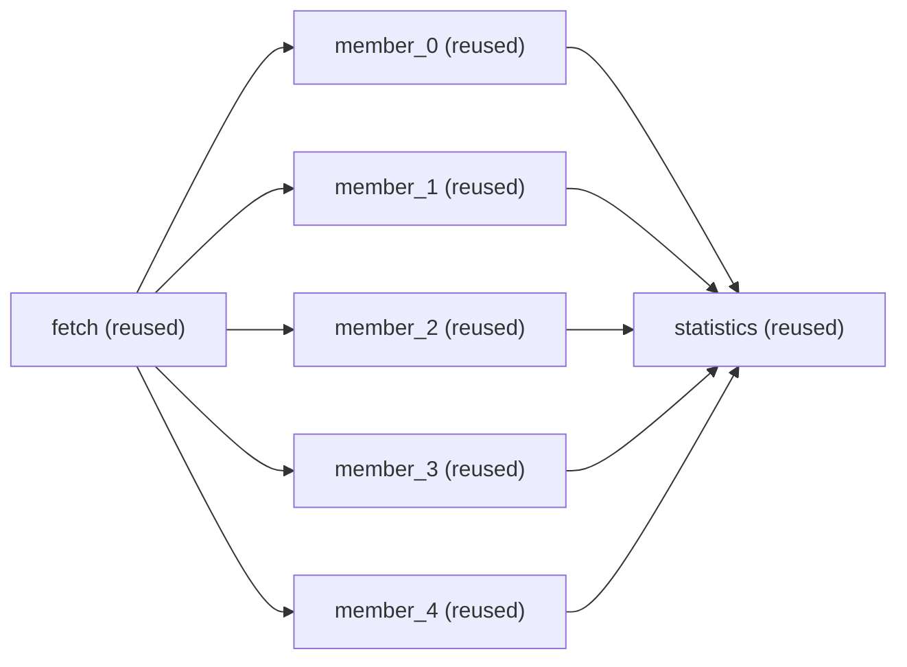

# 24. A resumable ensemble

*Part 2 put together: an ensemble with checkpoints, a resume that reruns nothing, and the stale-checkpoint trap*

Workflows in Practice with DAGonStar - Part 2: Execution, data and recovery. Slides: [24-DAGonStar-A_resumable_ensemble.pptx](../lectures/24-DAGonStar-A_resumable_ensemble.pptx). Examples: [examples/24-resumable-ensemble](../../examples/24-resumable-ensemble/).

## 2. Today's lecture

**Outline**

1. The goal: an ensemble that survives failures
2. Building it with checkpoints
3. Run, resume, change
4. The stale-checkpoint trap
5. Safe ways to change an ensemble
6. Part 2 in review

**After this lecture you can**

- Combine ensembles and checkpoints
- Explain why a changed ensemble may reuse stale members
- Choose a safe way to rerun after a change

## 3. The goal

*Fifty members of hours each: a failure must cost one member, not the ensemble.*

## 4. Requirements

- **Members** independent, generated from a list of offsets
- **Statistics** a fan-in over all members
- **Checkpoint** every finished member recorded
- **Resume** a second run reruns only what is missing or failed
- **Correctness** a resumed result must equal a fresh one

> **1** - *Member lost per failure*
>
> At most, with checkpoints and stable names.

## 5. The workflow

*Lecture 21's ensemble with a checkpoint file and run(resume_checkpoint_file=...).*

## 6. build()

[`examples/24-resumable-ensemble/resumable_ensemble.py`](../../examples/24-resumable-ensemble/resumable_ensemble.py)

```python
def build(base, offsets):
    wf = workflow("Resumable24", base, checkpoint_file=str(base / "ck.json"))
    wf.add_task(DagonTask(TaskType.BATCH, "fetch", fetch_observations()))
    for i, offset in enumerate(offsets):
        wf.add_task(DagonTask(TaskType.NATIVE, "member_%d" % i,
                              "common.weather:ensemble_member",
                              inputs={"observations": SOURCE, "offset": offset},
                              outputs={"member": "member.json"}))
    wf.add_task(DagonTask(TaskType.NATIVE, "statistics",
                          "common.weather:ensemble_statistics",
                          inputs={"m%d" % i: "workflow:///member_%d/outputs/"
                                  "member.json" % i for i in range(5)},
                          outputs={"statistics_file": "statistics.json"}))
    wf.run(resume_checkpoint_file=str(base / "ck.json"))
    return load(wf.tasks[-1], "outputs/statistics.json")
```

- Every run passes the same checkpoint file to both arguments
- Members are named by index only: member_0 ... member_4

## 7. The ensemble, resumed



Solid arrows: data dependencies (`workflow://`); dotted arrows: control dependencies.

- Run 2: every record has code 0
- Every folder still exists
- Nothing executes

## 8. Resume on the first run

- **First call** the checkpoint file does not exist yet
- **run()** ignores a missing or empty resume file
- **So** the same build() works for the first run and every resume
- **End of run** the file is written with all seven records
- **Pattern** always pass resume_checkpoint_file in production drivers

> *Idempotent driver*
>
> Run it again and again: only missing work runs.

```
wf.run(resume_checkpoint_file=
  str(base / "ck.json"))
```

## 9. The four calls

| Call | Scratch | Offsets | Checkpoint |
|---|---|---|---|
| Run 1 | A | ±1, ±0.5, 0 | missing: run all |
| Run 2 | A | ±1, ±0.5, 0 | all reused |
| Run 3 | A | ±2, ±1, 0 | all reused (stale) |
| Fresh | B | ±2, ±1, 0 | missing: run all |

## 10. Run, resume, change

*Three calls of build() on the same scratch and checkpoint.*

## 11. The three runs

[`examples/24-resumable-ensemble/resumable_ensemble.py`](../../examples/24-resumable-ensemble/resumable_ensemble.py)

```python
with scratch("24") as base:
    first = build(base, (-1.0, -0.5, 0.0, 0.5, 1.0))
    print("run 1:", first)
    again = build(base, (-1.0, -0.5, 0.0, 0.5, 1.0))
    print("run 2 (resumed, nothing re-runs):", again)
    changed = build(base, (-2.0, -1.0, 0.0, 1.0, 2.0))   # same task names!
    print("run 3 (new offsets, same names):", changed)
    check(changed == first, "the checkpoint trusts names, not content")
```

- Run 2 resumes the same ensemble; run 3 doubles the offsets
- Run 3 keeps the same task names: member_0 ... member_4

## 12. Recorded output

Recorded output of `python examples/24-resumable-ensemble/resumable_ensemble.py`:

```text
run 1: {'ensemble_mean_c': 16.0, 'members': 5, 'spread_c': 0.707}
run 2 (resumed, nothing re-runs): {'ensemble_mean_c': 16.0, 'members': 5, 'spread_c': 0.707}
run 3 (new offsets, same names): {'ensemble_mean_c': 16.0, 'members': 5, 'spread_c': 0.707}
fresh checkpoint with the new offsets: {'ensemble_mean_c': 16.0, 'members': 5, 'spread_c': 1.414}
```

- Run 1: spread 0.707
- Run 2: identical, nothing reran
- Run 3: still 0.707, although the offsets doubled
- Fresh checkpoint: 1.414

## 13. The stale-checkpoint trap

*Run 3 asked for a different ensemble and got the old one.*

## 14. Why run 3 is wrong

| Check made by reuse_checkpoint | Run 3 |
|---|---|
| Record Resumable24.member_0 exists | yes |
| Its code is 0 | yes |
| Its folder exists | yes |
| Its offset is the one requested now | not checked |
| Decision | reuse: offset -1.0 instead of -2.0 |

> **Keyed by name, not by content** lecture 15 warned about it; this is what it looks like in practice.

## 15. Expected and obtained

**Expected for offsets ±2, ±1, 0**

- Member means 14, 15, 16, 17, 18
- Ensemble mean 16.0
- Spread √2 = 1.414

**Obtained after resume**

- Member means 15, 15.5, 16, 16.5, 17
- Ensemble mean 16.0
- Spread 0.707: the old ensemble

## 16. Why the mean does not warn you

- **Symmetric offsets** both ensembles have mean 16.0
- **Only the spread changed** and the spread was reused
- **Silent** no error, no warning, statuses FINISHED
- **Detectable** only by checking the result against the request
- **The example** asserts changed == first to document the trap

> **16.0** - *Same mean in both*
>
> A check on the mean alone would pass.

## 17. Safe changes

*Make the task names, or the checkpoint, depend on what the tasks compute.*

## 18. Four safe options

- **Fresh checkpoint** - A new file or a new scratch: what the example does last.
- **Names with parameters** - member_m2.0 instead of member_0: a new offset is a new key.
- **Campaign in the workflow name** - Resumable24_offsets_x2: a new key space.
- **Delete records** - Remove the members' keys from the JSON before resuming.

## 19. Names that carry the parameter

```
for offset in offsets:
    name = "member_%+.1f" % offset       # member_-2.0
    name = name.replace(".", "p")        # member_-2p0
    wf.add_task(DagonTask(TaskType.NATIVE, name,
        "common.weather:ensemble_member",
        inputs={"observations": SOURCE,
                "offset": offset},
        outputs={"member": "member.json"}))
```

- The offset becomes part of the key
- Dots replaced: names stay URL-friendly
- The statistics task must use the same names

## 20. A fingerprint in the name

- **Hash** a short hash of the parameters: member_3f9a
- **Include** offsets, model version, input dataset id
- **Effect** any change gives new names, so nothing stale is reused
- **Cost** old members are never reused after a change, even if valid
- **Record** the parameters themselves in the member output

> *Eight hex digits*
>
> Enough for any course-size campaign.

```
hashlib.sha256(
  json.dumps(params)
  .encode()).hexdigest()[:8]
```

## 21. Which tasks may be reused

- **fetch** its command did not change: reuse is correct
- **members** their offsets changed: reuse is wrong
- **statistics** its inputs changed: reuse is wrong
- **Rule** a task is stale if its command, bindings or inputs changed
- DAGonStar checks inputs only for pre-staged and agentic tasks

> *Stale spreads downstream*
>
> A changed member makes every consumer stale too.

## 22. The fresh run

[`examples/24-resumable-ensemble/resumable_ensemble.py`](../../examples/24-resumable-ensemble/resumable_ensemble.py)

```python
fresh = build(base, (-2.0, -1.0, 0.0, 1.0, 2.0))
print("fresh checkpoint with the new offsets:", fresh)
check(fresh["spread_c"] == 1.414, "a fresh run sees the new spread")
```

- A new scratch, so a new checkpoint file
- The doubled offsets give the doubled spread

## 23. Fix the trap

**Steps**

1. Run the example
2. Change build() to name members by offset
3. Rerun: run 3 now computes new members
4. Update the check: run 3 must give 1.414

**Run it**

```bash
python examples/\
  24-resumable-ensemble/\
  resumable_ensemble.py
```

**Watch for:** With parameter names, run 3 reuses fetch and reruns only the members whose offset changed.

## 24. Part 2 in review

*Staging, collection, recovery, native tasks and composition, all in one ensemble.*

## 25. Where each idea appears

| Lecture | Idea | In this ensemble |
|---|---|---|
| 13-14 | Staging, collection | Members stage one CSV; remove_dir optional |
| 15-16 | Checkpoints, failures | Resume reruns only missing work |
| 17 | Events | A listener could count members |
| 18-19 | Native tasks | ensemble_member, ensemble_statistics |
| 20-21 | Sweeps, ensembles | Members from a list of offsets |
| 23 | Dry and portable | Plan the ensemble before the cluster |

## 26. Part 2 in numbers

- **12** - Lectures
- **0.707** - Spread of the reference ensemble
- **1.414** - Spread with doubled offsets

## 27. What Part 3 adds

1. **Web** - Data services.
2. **LLM** - Language models.
3. **FaaS** - Cloud functions.
4. **IoT** - Sensors, actuators.
5. **Agents** - Contracts, guardrails.

## 28. Exercise

A. Name members by offset as in the pattern
B. Run with offsets ±1 and ±0.5, then resume with ±2 and ±1
C. Count which members reran
D. Check every spread against your hand computation

**Deliverable:** A build() that never reuses stale members, with the list of reran members for each resume.

## 29. Check your understanding

1. Why did run 3 return the old spread?
2. Why does a check on the ensemble mean not detect the problem?
3. Name two ways to make a changed ensemble rerun.
4. Why is passing resume_checkpoint_file on the first run harmless?

<details><summary>Answers</summary>

1. Records are keyed by task name; member_0 ... member_4 had code 0 and existing folders.
2. Both ensembles have symmetric offsets and the same mean, 16.0.
3. A fresh checkpoint or scratch; names that include the parameters or a fingerprint.
4. run() ignores a missing or empty checkpoint file and runs everything.

</details>

## 30. Key takeaways

1. Checkpoints make an ensemble resumable member by member
2. Reuse is decided by name, exit code and folder
3. A changed parameter under an old name returns stale results
4. Put parameters or a fingerprint in task names

*Next, Part 3: web tasks*

---

Raffaele Montella. CC0 1.0. Generated from `src/lectures/24.js`.
