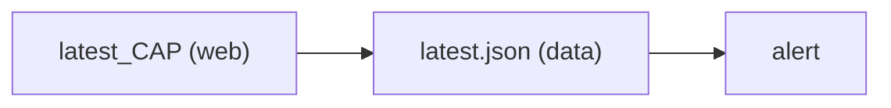

# 25. Web tasks

*A declarative HTTP request as a task: method, URL, query, headers, expected status and outputs*

DAGonStar in Practice - Part 3: Task models for AI–HPC. Slides: [25-DAGonStar-Web_tasks.pptx](../lectures/25-DAGonStar-Web_tasks.pptx). Examples: [examples/25-web-get](../../examples/25-web-get/).

## 2. Today's lecture

**Outline**

1. Data services in scientific workflows
2. The WEB task: a request as a specification
3. Outputs and the result record
4. Hands-on: the latest Capri observation
5. Web outputs feeding batch tasks
6. Testing against local services

**After this lecture you can**

- Write a WEB task specification
- Find the body, headers and metadata of a response
- Chain a web request into downstream tasks

## 3. Data services

*Observations, forecasts and catalogues are served over HTTP: a workflow must call them reliably.*

## 4. HTTP in science

- **Observation APIs** - Latest values from stations, buoys and satellites.
- **Data catalogues** - THREDDS, ERDDAP, STAC: search, then download.
- **Model services** - Forecasts published as files or JSON.
- **Repositories** - Zenodo, institutional stores: upload products (lecture 26).

## 5. curl in a BATCH task or a WEB task

**curl in BATCH**

- Any request curl can do
- Status check by hand (-f, -w)
- Secrets easily end up in the command
- Output and metadata as you script them

**WEB task**

- A JSON specification
- Expected status checked for you
- Auth only from environment variables
- Body, headers and metadata recorded

## 6. The specification

*A dictionary that says what to request and what to keep; no code runs in the workflow process.*

## 7. A GET request

[`examples/25-web-get/web_get.py`](../../examples/25-web-get/web_get.py)

```python
latest = DagonTask(TaskType.WEB, "latest_CAP", {
    "method": "GET",
    "url": url + "/stations/CAP/latest",
    "query": {"units": "nautical"},
    "headers": {"Accept": "application/json"},
    "timeout": 10,
    "expected_status": [200],
    "outputs": {"body": "latest.json", "headers": "headers.json",
                "metadata": "request.json"}})
```

- method and url
- query becomes ?units=nautical
- Accept header
- Only 200 is accepted
- Three outputs to keep

## 8. Specification keys

| Key | Meaning |
|---|---|
| `method` | GET (default), POST, PUT, PATCH, DELETE, HEAD |
| `url` | http:// or https:// only |
| `query, headers` | Dictionaries added to the request |
| `json, data, multipart` | Request body: JSON, form or files (lecture 26) |
| `timeout` | Seconds before giving up on a connection |
| `expected_status` | An int or a list; default any 2xx |
| `auth` | bearer, basic, api_key_header, api_key_query (lecture 26) |
| `retries, retry_backoff, retry_on` | Retry policy (lecture 26) |
| `outputs` | body, headers, metadata: relative file names |

## 9. Validated when the task is built

- **JSON-serialisable** the specification must survive json.dumps
- **Method** one of the six supported
- **URL** must start with http:// or https://
- **Outputs** relative, never .. or absolute
- **Secrets** token, password, value or secret keys are refused in auth

> **0** - *Secrets in the spec*
>
> Credentials come from environment variables, never from the workflow.

## 10. How a web task runs

1. **Validate** - The spec, when built.
2. **Resolve** - References become staged files.
3. **Write** - The request JSON in .dagon.
4. **Runner** - A Python process sends it.
5. **Record** - Body, headers, metadata.

## 11. Outputs

*The body, the headers and a metadata record, each a file you name.*

## 12. What a web task writes

| File | Content |
|---|---|
| `outputs/latest.json` | The response body, byte for byte |
| `outputs/headers.json` | Response headers as JSON |
| `outputs/request.json` | Metadata: method, url, status, timing, sha256 |
| `.dagon/web_result.json` | The same metadata, always written |
| `.dagon/web_request.json` | The request specification as run |

## 13. The metadata record

- **method, url** what was requested
- **status_code** what came back
- **elapsed_seconds** including retries
- **content_type** from the response headers
- **sha256** a checksum of the body: provenance for free
- **auth** type and source of the credential, never its value

> *From the recorded run*
>
> The checksum identifies the exact body.

```
status: 200
type: application/json
sha256: 62ebf6b5ecc9
```

## 14. Hands-on

*A local station service, the latest Capri observation, and a gale warning computed from it.*

## 15. The station service

[`examples/common/services.py`](../../examples/common/services.py)

```python
class StationService(_Handler):
    """GET /stations/<id>/latest, GET /private, POST /uploads, GET /busy."""

    def do_GET(self):
        self.calls.append(("GET", self.path))
        url = urlparse(self.path)
        parts = url.path.strip("/").split("/")
        if parts[:1] == ["stations"] and len(parts) == 3 and parts[2] == "latest":
            rows = [r for r in _rows() if r["station"] == parts[1]]
            if not rows:
                return self.reply(404, {"error": "unknown station"})
            row = rows[-1]
            units = parse_qs(url.query).get("units", ["metric"])[0]
            wind = float(row["wind_m_s"]) * (1.943844 if units == "nautical" else 1)
            return self.reply(200, {"station": row["station"], "time_utc": row["time_utc"],
                                    "temperature_c": float(row["temperature_c"]),
                                    "wind": round(wind, 2), "units": units})
```

- Runs on 127.0.0.1, on a free port, only during the example
- Latest record of a station; nautical units multiply by 1.943844

## 16. Web output into a batch task

[`examples/25-web-get/web_get.py`](../../examples/25-web-get/web_get.py)

```python
alert = DagonTask(TaskType.BATCH, "alert",
                  "grep -q '\"wind\": 13' workflow:///latest_CAP/outputs/"
                  "latest.json && echo 'gale warning' > alert.txt")
wf.add_task(latest)
wf.add_task(alert)
wf.run()
```

- The reference to latest_CAP's body creates the edge
- grep finds 13.61 knots: a gale warning is written

## 17. The graph



Solid arrows: data dependencies (`workflow://`); dotted arrows: control dependencies.

- A WEB producer
- A BATCH consumer
- The file is the interface, as always

## 18. Recorded output

Recorded output of `python examples/25-web-get/web_get.py`:

```text
type: WebTask | alert after: ['latest_CAP']
body: {'station': 'CAP', 'time_utc': '2026-11-02T03:00:00Z', 'temperature_c': 17.5, 'wind': 13.61, 'units': 'nautical'}
status: 200 | type: application/json | sha256: 62ebf6b5ecc9
alert: gale warning
```

- A WebTask, and alert after it
- The CAP record of 03:00
- 7.0 m/s = 13.61 kn
- A gale warning

## 19. The check

[`examples/25-web-get/web_get.py`](../../examples/25-web-get/web_get.py)

```python
check(body["wind"] == 13.61 and body["units"] == "nautical", "8 m/s in knots")
```

- Value and units both checked
- 13.61 = 7.0 × 1.943844, rounded

## 20. Run and vary

**Steps**

1. Run the example
2. Request NAP instead of CAP
3. Remove units=nautical: wind is now in m/s
4. Ask for an unknown station: status 404

**Run it**

```bash
python examples/\
  25-web-get/\
  web_get.py
```

**Watch for:** With an unknown station the service answers 404, outside expected_status: latest_CAP and alert become FAILED.

## 21. Practice

*Requests are cheap to write and easy to get subtly wrong.*

## 22. Reliable requests

- **Expected status** say exactly what success is: [200], 201
- **Timeouts** always set one: a stuck server must not stall the workflow
- **Content type** ask for JSON with Accept; check content_type in metadata
- **Checksums** store sha256 to detect changed data on the next run
- **Idempotent GETs** safe to retry (lecture 26)

> *A request is an input*
>
> Its URL, parameters and checksum belong in the provenance.

## 23. Web data and checkpoints

- **Same name, new data** - A resumed WEB task is reused: the old body, not today's.
- **Daily data** - Put the date in the task or workflow name.
- **Checksums** - Compare sha256 across runs to see if the service changed.

## 24. Why local services in the course

- **Deterministic** the same answer on every run: recorded outputs stay valid
- **Offline** no network, no rate limits, no accounts
- **Safe** no real credentials are ever needed
- **Inspectable** StationService.calls lists every request served
- **Real services** change only the url in the specification

> *A context manager*
>
> The server stops when the block ends.

```
with serve(StationService)
    as url:
```

## 25. Statuses and outcomes

| Response | Default (2xx) | expected_status [200] |
|---|---|---|
| 200 OK | FINISHED | FINISHED |
| 201 Created | FINISHED | FAILED |
| 404 Not Found | FAILED | FAILED |
| 503 Unavailable | FAILED (after retries) | FAILED (after retries) |

> **The body is written before the status check** a failed task still keeps the error body for debugging.

## 26. Reading the outputs

[`examples/25-web-get/web_get.py`](../../examples/25-web-get/web_get.py)

```python
body = load(latest, "outputs/latest.json")
meta = load(latest, ".dagon/web_result.json")
print("type:", type(latest).__name__, "| alert after:", [t.name for t in alert.prevs])
print("body:", body)
print("status:", meta["status_code"], "| type:", meta["content_type"],
      "| sha256:", meta["sha256"][:12])
print("alert:", Path(alert.working_dir, "alert.txt").read_text().strip())
```

- load() parses JSON files of the task
- The metadata is read from .dagon/web_result.json

## 27. This lecture's example

- **1** - HTTP request
- **13.61** - Knots at Capri, 03:00
- **3** - Output files named in the spec

## 28. Exercise

A. Request the latest record of all three stations
B. Write a native task that picks the windiest
C. Make the alert depend on that task
D. Check that CAP is still chosen

**Deliverable:** A workflow with three WEB tasks, one native selector and the alert.

## 29. Check your understanding

1. Where does a web task get credentials from?
2. What does expected_status [200] do with a 201 response?
3. Which file records the sha256 of the body?
4. How does a BATCH task use the body of a WEB task?

<details><summary>Answers</summary>

1. From environment variables named in auth; secrets in the spec are refused.
2. Marks the task FAILED: 201 is not in the accepted set.
3. .dagon/web_result.json, and the metadata output if requested.
4. Through a workflow:// reference to the WEB task's output file.

</details>

## 30. Key takeaways

1. A WEB task is a validated JSON specification
2. Body, headers and metadata become files
3. expected_status turns unexpected responses into failures
4. Web outputs feed other tasks through workflow://

*Next: uploads, authentication and failing services*

---

Raffaele Montella. CC0 1.0. Generated from `src/lectures/25.js`.
