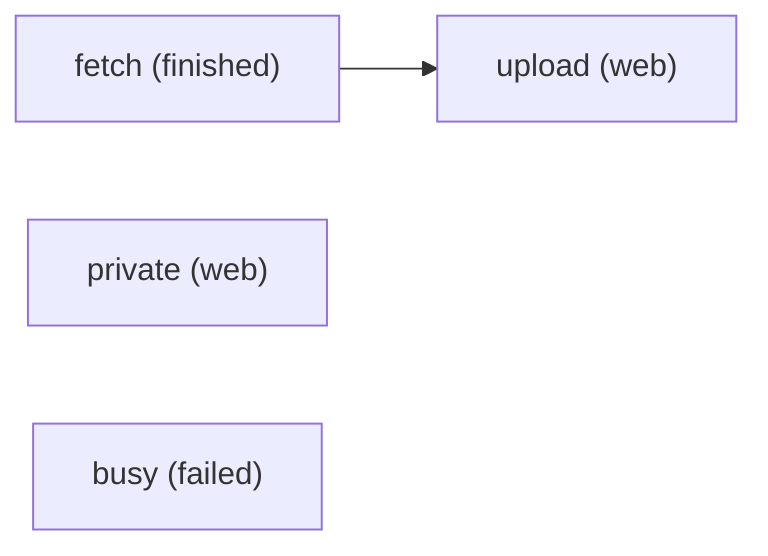

# 26. Uploads, authentication and failures

*Posting workflow artifacts, credentials taken from the environment, and retries that end in a clear failure*

DAGonStar in Practice - Part 3: Task models for AI–HPC. Slides: [26-DAGonStar-Uploads_authentication_and_failures.pptx](../lectures/26-DAGonStar-Uploads_authentication_and_failures.pptx). Examples: [examples/26-web-upload](../../examples/26-web-upload/).

## 2. Today's lecture

**Outline**

1. Sending data: json, data, multipart
2. Uploading a workflow artifact
3. Authentication without secrets in the workflow
4. Retries and idempotency
5. Hands-on: upload, private, busy
6. Designing for unreliable services

**After this lecture you can**

- Upload a file produced by another task
- Authenticate with a token from the environment
- Predict how many attempts a request makes

## 3. Sending data

*Three body types: JSON documents, form fields and multipart uploads with files.*

## 4. Request bodies

| Key | Content-Type | Typical use |
|---|---|---|
| `json` | `application/json` | APIs that take JSON documents |
| `data` | `application/x-www-form-urlencoded` | Simple forms, OAuth token endpoints |
| `multipart` | `multipart/form-data; boundary=...` | Files plus fields: repository uploads |

> **One body per request** the runner uses multipart first, then json, then data.

## 5. Uploading a workflow artifact

[`examples/26-web-upload/web_upload.py`](../../examples/26-web-upload/web_upload.py)

```python
upload = DagonTask(TaskType.WEB, "upload", {
    "method": "POST", "url": url + "/uploads",
    "multipart": {
        "dataset": {"file": "workflow:///fetch/outputs/observations.csv",
                    "content_type": "text/csv"},
        "description": {"value": "Gulf of Naples, 2 Nov 2026"}},
    "expected_status": 201,
    "outputs": {"body": "receipt.json"}})
```

- POST to /uploads
- dataset: a file from fetch
- description: a plain field
- 201 Created is the success

## 6. Files in a multipart body

- **file** a workflow:// reference or a local path
- **Staging** the referenced file is staged like any input
- **Edge** the upload waits for fetch
- **Content type** declared per part: text/csv here
- **Field** value parts carry text or JSON

> *The receipt*
>
> The service saw the CSV inside a multipart body.

```
{'stored': True,
 'bytes': 801,
 'multipart': True}
```

## 7. The upload endpoint

[`examples/common/services.py`](../../examples/common/services.py)

```python
def do_POST(self):
    self.calls.append(("POST", self.path))
    data = self.body()
    if self.path == "/uploads":
        text = data.decode("utf-8", errors="replace")
        return self.reply(201, {"stored": "NAP,2026" in text, "bytes": len(data),
                                "multipart": "multipart/form-data" in
                                self.headers.get("Content-Type", "")})
```

- 201 Created with a receipt: stored is True if the CSV content arrived
- multipart is True when the request used multipart/form-data

## 8. Authentication

*The workflow names an environment variable; the value never appears in the specification or the records.*

## 9. Supported schemes

| type | Keys | Sends |
|---|---|---|
| `bearer` | `token_env` | Authorization: Bearer <token> |
| `basic` | `username_env, password_env` | Authorization: Basic <base64> |
| `api_key_header` | `header, value_env` | <header>: <key> |
| `api_key_query` | `parameter, value_env` | ?<parameter>=<key> |

> **token, password, value and secret are refused as keys** a literal secret makes the task invalid when it is built.

## 10. A bearer token

[`examples/26-web-upload/web_upload.py`](../../examples/26-web-upload/web_upload.py)

```python
private = DagonTask(TaskType.WEB, "private", {
    "url": url + "/private",
    "auth": {"type": "bearer", "token_env": "STATION_TOKEN"},
    "outputs": {"body": "access.json"}})
```

- token_env names the variable
- The value is read when the request is sent
- Not stored in the task

## 11. Setting the variable

[`examples/26-web-upload/web_upload.py`](../../examples/26-web-upload/web_upload.py)

```python
logging.disable(logging.CRITICAL)        # the "busy" request fails on purpose
os.environ["STATION_TOKEN"] = COURSE_TOKEN   # in real life: set by the job
```

- In the example: a test value for the local service only
- In production: set by the job, a secret store or the scheduler, never in code

## 12. What is recorded

- **web_request.json** the specification: token_env, not the token
- **web_result.json** auth: {type: bearer, source: env:STATION_TOKEN}
- **Logs and launchers** no secret, because none was ever in the task
- **Check** the example searches the request record for the token
- **Result** token in the request record: False

> *Provenance without leaks*
>
> You know which credential was used, not its value.

## 13. Where secrets should live

- **Laptop** exported in the shell session, or a .env file outside git
- **Cluster** a file readable only by you, sourced by the job script
- **CI** the platform's secret store, injected as variables
- **Containers** secrets mounted at run time, never baked into images
- **Never** in dagon.ini, in task commands, in the workflow JSON

> **env** - *One interface*
>
> Every platform can set an environment variable.

## 14. Retries

*Transient errors deserve another try; permanent ones deserve a clear failure.*

## 15. The retry loop

```
retry_on = set(spec.get("retry_on", [429, 500, 502, 503, 504]))
retries = spec["retries"] if spec["method"] in \
    {"GET", "HEAD", "PUT", "DELETE"} or spec.get("retry_unsafe") \
    else 0
for attempt in range(retries + 1):
    status = send()
    if status in retry_on and attempt < retries:
        time.sleep(spec["retry_backoff"] * (attempt + 1))
        continue
    break
```

- Retry only transient statuses
- Only idempotent methods by default
- Linear back-off: 1x, 2x, 3x...

## 16. Safe and unsafe retries

**Retried by default**

- GET, HEAD: read only
- PUT, DELETE: same result if repeated
- 429, 500, 502, 503, 504

**Not retried by default**

- POST: may create a second upload
- PATCH: may apply twice
- Override with retry_unsafe: true
- Only if the service deduplicates

## 17. A busy service

[`examples/26-web-upload/web_upload.py`](../../examples/26-web-upload/web_upload.py)

```python
busy = DagonTask(TaskType.WEB, "busy", {
    "url": url + "/busy", "retries": 2, "retry_backoff": 0.01,
    "outputs": {"body": "busy.json"}})
```

- Always answers 503
- retries 2: three attempts
- Back-off 0.01 s for the demo

## 18. Hands-on

*Three web tasks: an upload, a private resource, a service that is always busy.*

## 19. The graph



Solid arrows: data dependencies (`workflow://`); dotted arrows: control dependencies.

- upload waits for fetch
- private and busy are independent
- busy fails; nothing depends on it

## 20. Recorded output

Recorded output of `python examples/26-web-upload/web_upload.py`:

```text
upload: FINISHED {'stored': True, 'bytes': 801, 'multipart': True}
private: FINISHED {'access': 'granted'}
auth recorded as: {'source': 'env:STATION_TOKEN', 'type': 'bearer'}
token in the request record: False
busy: FAILED after 3 attempts
```

- Upload stored, 801 bytes
- Access granted with the token
- The source of the credential, not its value
- busy FAILED after 3 attempts

## 21. Break the token

**Steps**

1. Run the example
2. Change STATION_TOKEN to a wrong value
3. Run again: private gets 401 and FAILED
4. Remove the variable: the runner raises KeyError

**Run it**

```bash
python examples/\
  26-web-upload/\
  web_upload.py
```

**Watch for:** 401 is not retried: a wrong credential is permanent, so retrying would only hide it.

## 22. Unreliable services

*Decide in advance what counts as success, how long to wait and how often to retry.*

## 23. A policy per service

- **Timeout** - Seconds per attempt: a slow service fails instead of hanging.
- **Retries** - How many, on which statuses, for which methods.
- **Back-off** - Wait longer each time; respect 429 Too Many Requests.
- **Success** - expected_status: 200 for reads, 201 for creates.
- **Fallback** - A second task with a mirror URL, chosen by your driver.
- **Alerting** - A listener on on_task_end for FAILED web tasks.

## 24. Attempts for this lecture's tasks

| Task | Method | retries | Attempts | Outcome |
|---|---|---|---|---|
| upload | POST | 0 | 1 | 201, FINISHED |
| private | GET | 0 | 1 | 200, FINISHED |
| busy | GET | 2 | 3 | 503, FAILED |

## 25. Uploads and checkpoints

- **Reuse** a resumed upload task is not sent again: good, no duplicates
- **Changed data** the old receipt is reused: rename the task per version
- **Receipts** keep the service's identifier in the body output
- **FAIR** lecture 45 adds identifiers and checksums to products

> *Uploads are side effects*
>
> Checkpoints prevent duplicates; names decide what is new.

## 26. This lecture's example

- **3** - Web tasks
- **0** - Secrets in specs, logs or records
- **3** - Attempts before busy failed

## 27. Counting attempts

[`examples/26-web-upload/web_upload.py`](../../examples/26-web-upload/web_upload.py)

```python
print("busy:", busy.status.name, "after",
      sum(1 for c in StationService.calls if c[1] == "/busy"), "attempts")
check(busy.status.name == "FAILED", "503 is not an accepted status")
```

- StationService.calls lists every request the local service answered
- The final check: 503 is not an accepted status

## 28. Exercise

A. Upload the report of lecture 12 instead of the raw data
B. Use api_key_header with X-API-Key from the environment
C. Give busy retry_on [503] and a 0.1 s back-off
D. Measure elapsed_seconds of busy from its metadata

**Deliverable:** The modified example, its output, and the elapsed time explained from the back-off formula.

## 29. Check your understanding

1. Why is a POST not retried by default?
2. Where must the value of a bearer token come from?
3. How many attempts does a GET with retries 2 make against a 503 service?
4. What does the request record contain about authentication?

<details><summary>Answers</summary>

1. Repeating it may create duplicates: POST is not idempotent.
2. From the environment variable named by token_env.
3. Three: the first and two retries.
4. The scheme and the name of the variable, never the secret value.

</details>

## 30. Key takeaways

1. json, data and multipart send bodies; files come from references
2. Credentials come from environment variables, never the spec
3. Retries cover transient statuses of idempotent methods
4. Unexpected statuses become clear, recorded failures

*Next: LLM tasks*

---

Raffaele Montella. CC0 1.0. Generated from `src/lectures/26.js`.
