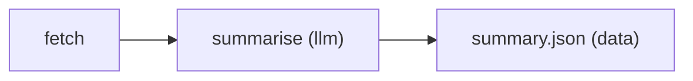

# 27. LLM tasks

*Calling an OpenAI-compatible chat model from a workflow: prompt templates, staged inputs, providers and replies*

Workflows in Practice with DAGonStar - Part 3: Task models for AI–HPC. Slides: [27-DAGonStar-LLM_tasks.pptx](../lectures/27-DAGonStar-LLM_tasks.pptx). Examples: [examples/27-llm](../../examples/27-llm/).

## 2. Today's lecture

**Outline**

1. Language models as workflow steps
2. The LLM task: prompt, provider, inputs
3. Providers in the configuration
4. Rendering: params and input files
5. Hands-on: summarising the observations
6. What the reply contains

**After this lecture you can**

- Write an LLM task with a prompt template
- Configure a provider without putting the key in code
- Feed a workflow file into a prompt

## 3. LLMs in workflows

*A model call is one more step: inputs in, a reply out, recorded like any other task.*

## 4. Where an LLM step fits

- **Summaries** - A readable paragraph from a table of observations.
- **Classification** - Label records, reports or images described as text.
- **Extraction** - Turn free text into fields of a JSON document.
- **Review** - Flag suspicious values for a human (lecture 28).

> **Never the only check** LLM output is a draft: numbers stay computed by code, as in lectures 12-24.

## 5. Why a task type and not a script

- **Same graph** LLM steps get edges, staging, checkpoints and events
- **Templates** the prompt is data with placeholders, not code
- **Provider-independent** the provider name maps to a config section
- **Secrets** the key is read from the environment at run time
- **Rehearsal** portable emulation runs without any provider (lecture 28)

> *An OpenAI-compatible client*
>
> POST /v1/chat/completions on any compatible server.

```
TaskType.LLM
```

## 6. The LLM task

*A Chat Completions request as a JSON object, plus the names needed to fill it.*

## 7. summarise

[`examples/27-llm/llm_task.py`](../../examples/27-llm/llm_task.py)

```python
summarise = DagonTask(
    TaskType.LLM, "summarise",
    {"messages": [
        {"role": "system", "content": "You are a careful meteorologist."},
        {"role": "user", "content": "Summarise {region}.\n{table}"}]},
    provider="course",
    params={"region": "the Gulf of Naples"},
    input_files={"table": "workflow:///fetch/outputs/observations.csv"},
    output_file="outputs/summary.json")
```

- prompt: a messages array
- {region} and {table}: placeholders
- params fills region
- input_files fills table from a file

## 8. Constructor arguments

| Argument | Meaning |
|---|---|
| `prompt` | A Chat Completions request: dict or JSON string |
| `provider` | Name of the [llm.<provider>] configuration section |
| `params` | Values for {placeholders} |
| `input_files` | Placeholder → workflow:// reference; the file text fills it |
| `output_file` | Where the reply is saved; default response.json |
| `timeout` | Seconds for the HTTP call; default 120 |

## 9. Choosing a model and settings

- **model** in the prompt, or the provider's default model
- **temperature** in the prompt: 0 for repeatable answers
- **max_tokens** bound the cost of each reply
- **System message** state the role and the rules
- **Everything else** passed to the API as written

> *The prompt is the request*
>
> Any Chat Completions field can go in it.

```
{"model": "...",
 "temperature": 0,
 "messages": [...]}
```

## 10. Providers

*The workflow names a provider; the configuration says where it is and which variable holds the key.*

## 11. Configuring the provider

[`examples/27-llm/llm_task.py`](../../examples/27-llm/llm_task.py)

```python
os.environ["COURSE_LLM_KEY"] = "example-key-not-a-secret"   # localhost only

with serve(ChatService) as url, scratch("27") as base:
    wf = workflow("LLM27", base, extra={"llm.course": {
        "endpoint": url, "api_key_env": "COURSE_LLM_KEY", "model": "course-chat"}})
```

- [llm.course]: endpoint, api_key_env and model
- The example key is a test value accepted only by the local mock

## 12. The same in dagon.ini

```
[llm.course]
endpoint = http://127.0.0.1:8000
api_key_env = COURSE_LLM_KEY
model = course-chat

[llm.lab]
endpoint = https://llm.example.org
api_key_env = LAB_LLM_KEY
model = some-model
```

- One section per provider
- api_key_env, not the key
- model used if the prompt has none
- Switch provider: change one word

## 13. How the key is found

- **api_key_env** the name of an environment variable, read at run time
- **api_key** a literal key in the config: possible, not recommended
- **Missing** ValueError: provider requires api_key or api_key_env
- **Header** Authorization: Bearer <key> on the request
- **Never written** not in the spec, not in the reply file, not in the JSON export

> *Same rule as web tasks*
>
> Workflows name variables; the environment holds values.

## 14. Rendering

*Before the call, placeholders are filled from params and from the text of staged files.*

## 15. From template to request

1. **Stage** - Copy each referenced file into .dagon/inputs.
2. **Read** - The file as UTF-8 text.
3. **Fill** - {table} and {region} by format_map.
4. **Model** - Add the model from the config.
5. **Send** - POST to the endpoint.

## 16. Rendering rules

- **Every string** in the prompt, at any depth, is rendered
- **Placeholders** Python str.format: {name}
- **Missing value** ValueError: Prompt parameter 'x' was not provided
- **Literal braces** write {{ and }} in the template
- **Files** must be UTF-8 text: binary inputs are refused

> *The user message*
>
> Two placeholders, two sources.

```
"Summarise {region}.\n
 {table}"
```

## 17. Hands-on

*The local ChatService counts the records it receives and echoes the first line of the prompt.*

## 18. The mock model

[`examples/common/services.py`](../../examples/common/services.py)

```python
request = json.loads(self.body())
prompt = request["messages"][-1]["content"]
records = [l for l in prompt.splitlines() if l[:1].isupper() and l.count(",") == 3]
answer = "Summary of %d records for model %s: %s" % (
    len(records), request.get("model"), prompt.splitlines()[0][:48])
```

- A deterministic subset of the Chat Completions API: no real model
- Counts CSV records in the prompt, so we can check the file arrived

## 19. The graph



Solid arrows: data dependencies (`workflow://`); dotted arrows: control dependencies.

- The reference in input_files creates the edge
- The CSV is staged and read as text
- The reply is a file

## 20. Recorded output

Recorded output of `python examples/27-llm/llm_task.py`:

```text
type: LLMTask | after: ['fetch']
model: course-chat | usage: {'completion_tokens': 12, 'prompt_tokens': 18}
answer: Summary of 12 records for model course-chat: Summarise the Gulf of Naples.
```

- An LLMTask after fetch
- The model name from the config
- 12 records reached the prompt
- The first prompt line, echoed

## 21. Reading the reply

[`examples/27-llm/llm_task.py`](../../examples/27-llm/llm_task.py)

```python
reply = load(summarise, "outputs/summary.json")
print("type:", type(summarise).__name__, "| after:", [t.name for t in summarise.prevs])
print("model:", reply["model"], "| usage:", reply["usage"])
print("answer:", reply["choices"][0]["message"]["content"])
check("12 records" in reply["choices"][0]["message"]["content"],
      "the staged CSV reached the prompt")
```

- The reply is the provider's JSON, saved as returned
- choices[0].message.content holds the text; usage holds token counts

## 22. The reply document

| Field | Content |
|---|---|
| `id, object` | Identifiers from the provider |
| `model` | The model that answered |
| `choices[0].message` | role assistant, content: the text |
| `usage` | prompt_tokens, completion_tokens |

> **Tokens are cost** record usage per task to budget large runs.

## 23. Run and vary

**Steps**

1. Run the example
2. Change region to the Bay of Pozzuoli
3. Remove params: observe the missing-parameter error
4. Unset COURSE_LLM_KEY and run again

**Run it**

```bash
python examples/\
  27-llm/\
  llm_task.py
```

**Watch for:** Without params the task fails before any call; without the key it fails with requires api_key or api_key_env.

## 24. Errors you will meet

- **No [llm.<provider>] section** provider is not configured
- **No endpoint** provider requires an endpoint
- **No key** requires api_key or api_key_env
- **HTTP error** LLM provider returned HTTP <code>: <detail>
- **Unreachable** Unable to contact LLM provider

> *All are task failures*
>
> The task is FAILED, its consumers do not run, the message names the cause.

## 25. Files of an LLM task

| File | Content |
|---|---|
| `.dagon/inputs/<wf>/<task>/...` | Staged input files |
| `outputs/summary.json` | The reply (output_file) |
| `Not written` | The rendered prompt and the key |

> **Lecture 28** what is recorded, what is not, and how to keep an audit trail.

## 26. LLM task or web task

**LLM task**

- Knows Chat Completions
- Prompt templates and file inputs
- Provider sections and model defaults
- Portable rehearsal built in

**Web task**

- Any HTTP request
- No templating of the body
- Generic auth schemes
- Use it for non-chat model APIs

## 27. This lecture's example

- **12** - Records sent in the prompt
- **18** - Prompt tokens counted by the mock
- **0** - Keys written to disk

## 28. Exercise

A. Add a second LLM task that translates the summary into Italian
B. Feed it the first reply with a workflow:// reference
C. Use params for the target language
D. Check that both replies are FINISHED

**Deliverable:** A three-task chain fetch → summarise → translate, with the reply of the second task printed.

## 29. Check your understanding

1. Where does an LLM task find the endpoint and key of its provider?
2. How does a CSV file get into the prompt?
3. What happens if a placeholder has no value?
4. Where is the model's reply saved?

<details><summary>Answers</summary>

1. In the [llm.<provider>] section; the key from the variable named by api_key_env.
2. input_files maps a placeholder to a reference; the staged file's text replaces it.
3. Rendering raises ValueError before any request is sent.
4. In output_file inside the task folder, response.json by default.

</details>

## 30. Key takeaways

1. An LLM task is a Chat Completions request with placeholders
2. Providers live in [llm.<name>]; keys in the environment
3. Files reach prompts through staged workflow:// references
4. The reply is saved as JSON, with token usage

*Next: responsible use and auditing of LLM tasks*

---

Raffaele Montella. CC0 1.0. Generated from `src/lectures/27.js`.
