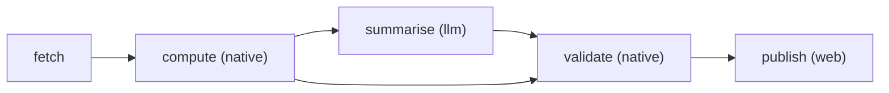

# 28. Responsible LLM tasks

*What an LLM task records and never records, provider-free rehearsals, and the rules for using model output in science*

DAGonStar in Practice - Part 3: Task models for AI–HPC. Slides: [28-DAGonStar-Responsible_LLM_tasks.pptx](../lectures/28-DAGonStar-Responsible_LLM_tasks.pptx). Examples: [examples/28-llm-audit](../../examples/28-llm-audit/).

## 2. Today's lecture

**Outline**

1. Risks of model calls in a pipeline
2. What is written to the scratch
3. Keys never leave the environment
4. The serialised task
5. Rehearsal with portable emulation
6. Rules for using model output

**After this lecture you can**

- Audit the files an LLM task writes
- Rehearse an LLM workflow without a provider
- State where model output may and may not be trusted

## 3. Risks

*A model call sends data out, costs money, and returns text that may be wrong.*

## 4. Five risks

- **Leaked secrets** - An API key in a log, a launcher or a JSON export.
- **Leaked data** - Sensitive inputs sent to an external provider.
- **Wrong answers** - Fluent text with invented numbers.
- **Irreproducibility** - Different replies for the same prompt.
- **Cost** - Tokens multiplied by members, days and retries.

> **A workflow can control the first four mechanically** and measure the fifth through usage.

## 5. What is recorded

*The example lists every file of the task and searches the whole scratch for the key.*

## 6. A review task

[`examples/28-llm-audit/llm_audit.py`](../../examples/28-llm-audit/llm_audit.py)

```python
PROMPT = {"messages": [{"role": "user", "content": "Flag anomalies in:\n{table}"}],
          "temperature": 0}


def build(base, **options):
    wf = workflow("Audit28", base, extra={"llm.course": {
        "endpoint": options.pop("endpoint", "http://127.0.0.1:9"),
        "api_key_env": "COURSE_LLM_KEY", "model": "course-chat"}}, **options)
    wf.add_task(DagonTask(TaskType.BATCH, "fetch", fetch_observations()))
    task = DagonTask(TaskType.LLM, "review", PROMPT, provider="course",
                     input_files={"table": "workflow:///fetch/outputs/observations.csv"})
    wf.add_task(task)
    wf.run()
    return wf, task
```

- temperature 0: the most repeatable setting
- build() is reused for the real run and for the rehearsal

## 7. The audit

[`examples/28-llm-audit/llm_audit.py`](../../examples/28-llm-audit/llm_audit.py)

```python
with serve(ChatService) as url, scratch("28") as base:
    wf, task = build(base, endpoint=url)
    files = sorted(p.relative_to(task.working_dir).as_posix()
                   for p in Path(task.working_dir).rglob("*") if p.is_file()
                   and "ssh_key" not in p.name)
    print("files:", files)
    leaked = any(KEY in p.read_text(errors="ignore")
                 for p in Path(base).rglob("*") if p.is_file())
    print("API key written anywhere in scratch:", leaked)
    print("serialised task:", sorted(wf.as_json()["tasks"]["review"]))
    check(not leaked, "the key stays in the environment")
```

- List the task's files (the SSH key pair is skipped)
- Search every file of the scratch for the key; list the JSON fields

## 8. Recorded output

Recorded output of `python examples/28-llm-audit/llm_audit.py`:

```text
files: ['.dagon/inputs/Audit28/fetch/outputs/observations.csv', 'response.json']
API key written anywhere in scratch: False
serialised task: ['command', 'explicit_prevs', 'input_files', 'name', 'nexts', 'output_file', 'params', 'prevs', 'provider', 'status', 'type', 'working_dir']
```

- Two files: the staged CSV and the reply
- The key appears nowhere
- No key field in the JSON export

## 9. Recorded and not recorded

| Item | Recorded? | Where |
|---|---|---|
| Staged input files | yes | .dagon/inputs/... |
| The reply | yes | response.json (output_file) |
| Prompt template, params, input_files | yes | The workflow JSON export |
| Provider name | yes | The workflow JSON export |
| Rendered prompt | no | Rebuild it from template and inputs |
| API key | no | Only in the environment |

## 10. An audit trail you control

- **Template and params** in the JSON export: what was asked
- **Inputs** staged copies: exactly what the model saw
- **Reply** the provider's JSON: what came back, with usage
- **Missing** the rendered prompt: add a listener or a task that saves it
- **Keep** export, inputs and reply together with the products

> *Reconstructable*
>
> Template + staged inputs + params = the prompt that was sent.

## 11. The serialised task

[`examples/28-llm-audit/llm_audit.py`](../../examples/28-llm-audit/llm_audit.py)

```python
print("serialised task:", sorted(wf.as_json()["tasks"]["review"]))
```

- Fields of the LLM task in as_json: prompt (command), params, input_files, provider, output_file
- No key and no endpoint: they belong to the configuration

## 12. Rehearsal

*portable_emulation=True renders the prompt and echoes it back: no provider, no key, no network.*

## 13. The rehearsal

[`examples/28-llm-audit/llm_audit.py`](../../examples/28-llm-audit/llm_audit.py)

```python
wf, task = build(base, portable_emulation=True)       # no provider at all
echoed = json.loads(load(task, "response.json")["choices"][0]["message"]["content"])
print("portable rehearsal id:", load(task, "response.json")["id"])
print("rendered prompt starts:", echoed["messages"][0]["content"][:40].replace("\n", " | "))
check(echoed["temperature"] == 0, "the rendered request is echoed back")
```

- The endpoint points at an unused port: it is never contacted
- The reply content is the rendered request, as JSON

## 14. What emulation returns

```
{"id": "portable-emulation",
 "object": "chat.completion",
 "choices": [{"index": 0,
   "message": {"role": "assistant",
     "content": "{\"messages\": [{\"content\":
        \"Flag anomalies in:\\nstation,...\"}],
        \"temperature\": 0}"}}]}
```

- Same shape as a real reply
- content: the rendered request
- Inspect the prompt before paying for it

## 15. Recorded rehearsal

Recorded output of `python examples/28-llm-audit/llm_audit.py`:

```text
portable rehearsal id: portable-emulation
rendered prompt starts: Flag anomalies in: | station,time_utc,temp
```

- The id marks an emulated reply
- The rendered prompt starts with the CSV header
- temperature 0 survived rendering

## 16. Uses of the rehearsal

- **Check prompts** see the exact text that would be sent
- **Check size** count characters before counting tokens
- **Tests** run the workflow in CI with no provider
- **Downstream** consumers get a well-formed reply to parse
- **Teaching** every LLM lecture runs offline

> *One flag*
>
> The provider section may even be absent.

```
Workflow(...,
 portable_emulation=True)
```

## 17. Real run and rehearsal

| Step | Real | Rehearsal |
|---|---|---|
| Stage inputs | yes | yes |
| Render the prompt | yes | yes |
| Read provider config and key | yes | no |
| HTTP call | yes | no |
| Reply | Provider's JSON | Echo of the request |
| Checkpoint | code 0 | code 0 |

## 18. Rules for model output

*In science, an LLM assists; it does not measure, compute or decide alone.*

## 19. Good and bad uses

**Good uses**

- Draft a readable summary of computed results
- Flag records for a human to check
- Extract fields from text, then validate them
- Explain a workflow's output to non-experts

**Bad uses**

- Compute a mean or a maximum
- Fill in missing observations
- Decide an actuation without guardrails
- Produce numbers that go unverified into a paper

## 20. Controls in the graph

- **Compute first** - Numbers come from code tasks; the LLM sees them as input.
- **Validate after** - A native task checks the reply against a schema or the data.
- **Human gate** - A review step before anything is published or actuated.
- **Contracts** - Agentic tasks add tool limits and guardrails (lectures 33-35).

## 21. A safer pattern



Solid arrows: data dependencies (`workflow://`); dotted arrows: control dependencies.

- Numbers computed by code
- The LLM writes text about them
- validate compares text and numbers
- Only validated text is published

## 22. Data protection

- **Know the provider** where the data go and how long they are kept
- **Minimise** send only the fields the task needs
- **Local models** an OpenAI-compatible server on your own machines
- **Personal data** never send without a legal basis
- **Record** the provider name is in the export: auditors can see it

> *The endpoint is a choice*
>
> Changing [llm.<provider>] moves the data elsewhere.

## 23. Reproducibility

- **temperature 0** reduces, but does not remove, variation
- **Model versions** record the model name returned in the reply
- **Checkpoints** keep the first reply: a resume does not ask again
- **Rehearsals** are deterministic: use them in tests
- **Never** rely on getting the same text twice from a live model

> *Store the reply*
>
> The reply file is the result; the call is not repeatable.

## 24. Cost control

| Lever | Effect |
|---|---|
| Rehearse first | Find prompt errors for free |
| max_tokens | Bound each reply |
| Send summaries, not raw data | Fewer prompt tokens |
| Checkpoints | No repeated calls on resume |
| usage in replies | Measure tokens per task and per run |

## 25. A checklist before going live

- **Rehearsed** the rendered prompt reviewed in portable mode
- **Provider** approved for the data being sent
- **Key** in an environment variable, scoped to the job
- **Validation** a task checks every reply before it is used
- **Budget** max_tokens set; usage logged per run

> **5** - *Checks*
>
> All five cost minutes; skipping one can cost far more.

## 26. This lecture's example

- **2** - Files written by the LLM task
- **0** - Copies of the key on disk
- **0** - Network calls in the rehearsal

## 27. Audit your own run

**Steps**

1. Run the example
2. Write wf.as_json() to a file in a copy of the script
3. Search that file and the scratch for the key with grep
4. Add a second provider section and search again

**Run it**

```bash
python examples/\
  28-llm-audit/\
  llm_audit.py
```

**Watch for:** grep finds nothing: the configuration names COURSE_LLM_KEY, and only the environment holds its value.

## 28. Exercise

A. Add a validate task that checks the reply mentions 12 records
B. Add a listener that saves the rendered prompt in rehearsal mode
C. Run the rehearsal and the real run
D. Compare their response.json shapes

**Deliverable:** The validate task, the saved prompt and a sentence on what the rehearsal can and cannot prove.

## 29. Check your understanding

1. Which two items are never written by an LLM task?
2. What does portable emulation return as the reply content?
3. Why should numbers in a report be computed by code tasks?
4. Name two ways to reduce the cost of LLM tasks.

<details><summary>Answers</summary>

1. The API key and the rendered prompt.
2. The rendered request, serialised as JSON.
3. Model output can be fluent and wrong; code results are checkable and reproducible.
4. Rehearse before calling, set max_tokens, send summaries, rely on checkpoints.

</details>

## 30. Key takeaways

1. Keys stay in the environment; inputs and replies are recorded
2. Template, params and inputs reconstruct the prompt
3. Portable emulation rehearses prompts with no provider
4. Compute with code, write with the model, validate after

*Next: FaaS tasks*

---

Raffaele Montella. CC0 1.0. Generated from `src/lectures/28.js`.
