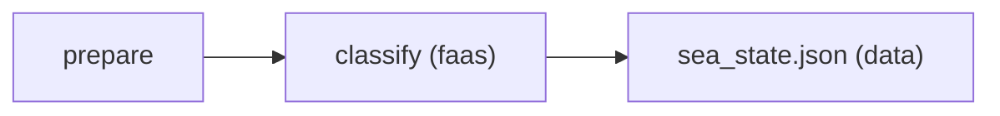

# 29. FaaS tasks

*Invoking already-deployed cloud functions: the FaaS contract, a CloudEvents envelope, file descriptors and exactly-once results*

Workflows in Practice with DAGonStar - Part 3: Task models for AI–HPC. Slides: [29-DAGonStar-FaaS_tasks.pptx](../lectures/29-DAGonStar-FaaS_tasks.pptx). Examples: [examples/29-faas](../../examples/29-faas/).

## 2. Today's lecture

**Outline**

1. Functions as a service
2. The FAAS task contract
3. The invocation envelope
4. Files as descriptors
5. Hands-on: a mock sea-state classifier
6. Completed invocations are never repeated

**After this lecture you can**

- Write a FAAS task with inputs, outputs and a retry policy
- Read the request, response and metadata records
- Explain why a completed function is not invoked again

## 3. Functions as a service

*Small, stateless functions deployed once and invoked on demand, billed per call.*

## 4. Why FaaS in science

- **Elastic** - Thousands of concurrent invocations without a cluster.
- **Event-driven** - Run when a file arrives or a sensor reports.
- **Shared** - One deployed classifier used by many workflows.
- **Cheap when idle** - No servers to keep running between campaigns.

> **DAGonStar does not deploy functions** it invokes functions that already exist, through a provider adapter.

## 5. Providers

| provider | Calls | Needs |
|---|---|---|
| `mock` | Nothing: returns a configured response | Nothing (tests, teaching) |
| `http, knative` | POST to an HTTP endpoint | An endpoint URL |
| `aws` | AWS Lambda through boto3 | pip extra faas-aws |
| `azure` | Azure Functions over HTTP | Token or azure-identity |
| `gcp` | Google Cloud Functions over HTTP | Token or google-auth |

> **Lazy imports** cloud SDKs are imported only when their provider is used (lecture 30).

## 6. The contract

*Inputs, outputs, invocation mode, timeout and retry: everything declared, nothing hidden in code.*

## 7. A FAAS task

[`examples/29-faas/faas_mock.py`](../../examples/29-faas/faas_mock.py)

```python
classify = DagonTask(
    TaskType.FAAS, "classify", provider="mock", function="sea-state",
    inputs={"request": {"document": "workflow:///prepare/outputs/request.json"},
            "threshold": 7.0},
    outputs={"result": "sea_state.json"},
    retry={"max_attempts": 3, "backoff": "exponential"},
    provider_options={"mock": {"response": {
        "status": "succeeded", "outputs": {"result": {"beaufort": 4}}}}})
```

- inputs mix a file document (a reference) and a value; outputs name the result file
- retry: up to 3 attempts, exponential back-off; mock returns Beaufort 4

## 8. Specification keys

| Key | Meaning |
|---|---|
| `provider, function` | Adapter name and deployed function name |
| `profile` | Section [faas.<provider>.<profile>] with options |
| `inputs` | Values and {"document": workflow://...} files |
| `outputs` | Name → file below outputs/ |
| `invocation` | sync (default) or async |
| `timeout` | Seconds per attempt |
| `retry` | max_attempts, backoff, initial_delay_seconds, retry_on |
| `provider_options` | Per-provider options; secrets only as *_env names |

## 9. Retry policy

- **max_attempts** 1 by default: no retry
- **backoff** none, fixed or exponential
- **initial_delay_seconds** base delay; doubled per attempt when exponential
- **retry_on** throttled, provider_unavailable, transport_error
- **Never retried** function_error, invalid_response, authentication

> *Transient only*
>
> A function that raises is a permanent error: retrying would repeat it.

## 10. How a FAAS task runs

1. **Check** - Completed with this spec? Skip.
2. **Stage** - Files into the folder, as descriptors.
3. **Envelope** - Write the request record.
4. **Invoke** - Call the provider, retry if transient.
5. **Outputs** - Write the declared outputs.

## 11. The envelope

*Every invocation sends a CloudEvents-style JSON envelope that identifies workflow, task and attempt.*

## 12. faas_request.json

```
{"specversion": "1.0",
 "type": "org.dagonstar.task.invoke",
 "source": "workflow://FaaS29",
 "id": "<sha256 of workflow, task, spec>",
 "subject": "classify",
 "data": {
   "workflow": {"name": "FaaS29"},
   "task": {"name": "classify", "attempt": 1},
   "inputs": {"request": {"document": {...descriptor...}},
              "threshold": 7.0},
   "outputs": {...}}}
```

- CloudEvents fields
- id: an idempotency key
- attempt counts retries
- inputs with descriptors

## 13. The idempotency key

- **Computed** sha256 of workflow name, task name and specification
- **Same on every attempt** the function can recognise a retry
- **Same on every resume** of the same task with the same spec
- **Function side** store results by id and return them for a repeated id
- **Effect** retries cannot double-count or double-charge

> *Stable identity*
>
> Changes only when the request changes.

```
id = sha256(wf + "\0"
  + task + "\0"
  + spec)
```

## 14. Files as descriptors

*A function cannot read your scratch: a file input is described, not passed as a path.*

## 15. A file descriptor

| Field | Meaning |
|---|---|
| `kind` | file |
| `reference` | The original workflow:// URL |
| `path` | Staged path inside the task folder |
| `size_bytes, media_type` | Size and type |
| `checksum` | sha256 of the content |
| `transport` | How the function can obtain it: local-file here |

## 16. Recorded output

Recorded output of `python examples/29-faas/faas_mock.py`:

```text
type: FaaSTask | after: ['prepare']
result: {'beaufort': 4}
the file travels as a descriptor: ['checksum', 'kind', 'media_type', 'path', 'reference', 'size_bytes', 'transport']
records: ['faas_provider_metadata.json', 'faas_request.json', 'faas_response.json', 'faas_spec.json']
provider calls on re-execution: 0
```

- A FaaSTask after prepare
- The mock's result: Beaufort 4
- Seven descriptor fields
- Four faas_* records
- No second invocation

## 17. Records of a FAAS task

| File | Content |
|---|---|
| `.dagon/faas_spec.json` | The portable specification |
| `.dagon/faas_request.json` | The envelope of the last attempt |
| `.dagon/faas_response.json` | The response, sanitised |
| `.dagon/faas_provider_metadata.json` | Service metadata, sanitised |
| `outputs/sea_state.json` | The declared output |

## 18. Outputs from the response

- **The response** {status, outputs: {name: value}}
- **Declared names** each declared output is looked up by name
- **Values** written as JSON into outputs/<file>
- **File outputs** a value with path is copied; with sha256 it is verified
- **Missing required output** output_missing: the task fails

> *The mock's response*
>
> result becomes outputs/sea_state.json.

```
{"status": "succeeded",
 "outputs": {"result":
   {"beaufort": 4}}}
```

## 19. Exactly-once results

*A finished invocation is recorded with a hash of its specification and is never repeated.*

## 20. Re-executing a completed task

[`examples/29-faas/faas_mock.py`](../../examples/29-faas/faas_mock.py)

```python
with mock.patch("dagon.faas.get_provider", return_value=get_provider("mock")) as factory:
    classify.execute()                     # completed: not invoked again
print("provider calls on re-execution:", factory.call_count)
check(factory.call_count == 0, "a completed invocation is never repeated")
```

- The provider factory is replaced by a counting mock
- execute() finds a completed record with the same spec hash: zero calls

## 21. The reuse rule for FaaS

```
checkpoint = self.workflow.checkpoints.get(key, {})
if checkpoint.get("code") == 0 and \
   checkpoint.get("spec_sha256") == sha256(self.command) and \
   Path(checkpoint.get("working_dir", "")).is_dir():
    self.working_dir = checkpoint["working_dir"]
    return                       # not invoked again
```

- Like lecture 15, plus a spec hash
- A changed spec is invoked again
- No stale-name trap here

## 22. Checkpoints: batch and FaaS

**BATCH, NATIVE**

- Key: workflow.task
- Reused if code 0 and folder exists
- Changed command still reused
- Lecture 24's trap

**FAAS**

- Key: workflow.task
- Also needs the same spec_sha256
- Changed spec is invoked again
- Paid calls are not repeated by accident

## 23. Run and change

**Steps**

1. Run the example
2. Change threshold to 8.0 and re-execute classify
3. The spec hash changes: one provider call
4. Restore 7.0

**Run it**

```bash
python examples/\
  29-faas/\
  faas_mock.py
```

**Watch for:** Zero calls for the same specification, one call after any change to it.

## 24. The graph



Solid arrows: data dependencies (`workflow://`); dotted arrows: control dependencies.

- The reference inside inputs makes the edge
- The function never sees the scratch
- The output is written by DAGonStar from the response

## 25. Secrets and FaaS

- **Refused** any provider option whose name contains a secret word
- **Allowed** names ending in _env: token_env, header_env
- **Profiles** [faas.<provider>.<profile>] in the configuration
- **Sanitised** response and metadata are cleaned before writing
- **Same rule** as web and LLM tasks

> **_env** - *The only way in*
>
> Values stay in the environment.

## 26. Error codes

| Code | Transient | Typical cause |
|---|---|---|
| `throttled` | yes | Too many requests |
| `provider_unavailable` | yes | 5xx from the service |
| `transport_error` | yes | Network or timeout |
| `function_error` | no | The function raised |
| `invalid_response` | no | Not JSON, wrong shape |
| `output_missing` | no | A required output absent |

## 27. This lecture's example

- **1** - Invocation
- **4** - Beaufort, the mock's sea state
- **0** - Calls when re-executed

## 28. Exercise

A. Make the mock return beaufort 6 when threshold is 5.0
B. Add a second FAAS task for CAP
C. Run, then re-execute both tasks
D. Count provider calls before and after changing one spec

**Deliverable:** A table of calls per task for the first run, the re-execution and the changed specification.

## 29. Check your understanding

1. What does DAGonStar do to deploy a function?
2. How does a function receive a file input?
3. Why is the idempotency key the same on every attempt?
4. When is a completed FAAS task invoked again?

<details><summary>Answers</summary>

1. Nothing: FAAS tasks invoke already-deployed functions.
2. As a descriptor with path, checksum, size, type and transport.
3. So the function can recognise retries and avoid duplicate effects.
4. Only when its specification hash changes, its record failed or its folder is gone.

</details>

## 30. Key takeaways

1. FAAS tasks invoke deployed functions through providers
2. A CloudEvents envelope carries inputs and an idempotency key
3. Files travel as descriptors with checksums
4. Completed invocations with the same spec are never repeated

*Next: the same contract against an HTTP function*

---

Raffaele Montella. CC0 1.0. Generated from `src/lectures/29.js`.
