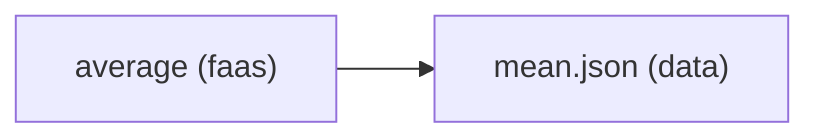

# 30. FaaS over HTTP

*The same FaaS contract against a real HTTP function, provider registration, lazy SDKs and profiles*

DAGonStar in Practice - Part 3: Task models for AI–HPC. Slides: [30-DAGonStar-FaaS_over_HTTP.pptx](../lectures/30-DAGonStar-FaaS_over_HTTP.pptx). Examples: [examples/30-faas-http](../../examples/30-faas-http/).

## 2. Today's lecture

**Outline**

1. From the mock to an HTTP function
2. The HTTP provider
3. Hands-on: averaging the station means
4. Unknown providers and lazy SDKs
5. Profiles in the configuration
6. Cloud providers and portability

**After this lecture you can**

- Invoke an HTTP function with a FAAS task
- Configure a provider through a profile
- Explain why cloud SDKs are not imported by default

## 3. An HTTP function

*Many platforms expose functions as HTTPS endpoints: Knative, OpenFaaS, Azure, Google, your own server.*

## 4. The function

[`examples/common/services.py`](../../examples/common/services.py)

```python
class FunctionService(_Handler):
    """POST /invoke: a 'serverless' function that averages a list of values."""

    def do_POST(self):
        self.calls.append(("POST", self.path))
        envelope = json.loads(self.body())
        values = envelope["data"]["inputs"]["values"]
        mean = round(sum(values) / len(values), 3)
        return self.reply(200, {"status": "succeeded",
                                "outputs": {"result": {"mean": mean, "n": len(values)}}})
```

- Reads the envelope's data.inputs.values
- Answers with the FaaS response shape: status and outputs.result

## 5. The HTTP provider

- **POST** the envelope as JSON to provider_options.http.endpoint
- **Headers** Content-Type, plus header_env: name → environment variable
- **CloudEvents** optional ce-* headers with cloudevents: true
- **Transient** 408, 429, 500, 502, 503, 504 and network errors
- **Permanent** any other HTTP error: function_error

> *One option*
>
> The endpoint of the deployed function.

```
provider="http"
provider_options={"http":
 {"endpoint": url
   + "/invoke"}}
```

## 6. Hands-on

*The three station means of lecture 02, averaged by a function.*

## 7. The FAAS task

[`examples/30-faas-http/faas_http.py`](../../examples/30-faas-http/faas_http.py)

```python
average = DagonTask(
    TaskType.FAAS, "average", provider="http", function="mean-of-values",
    inputs={"values": [15.5, 16.75, 15.75]},
    outputs={"result": "mean.json"},
    timeout=10,
    provider_options={"http": {"endpoint": url + "/invoke"}})
```

- Values inline: no files
- timeout 10 s per attempt
- Same contract as lecture 29
- Only provider and options changed

## 8. Recorded output

Recorded output of `python examples/30-faas-http/faas_http.py`:

```text
status: FINISHED | result: {'mean': 16.0, 'n': 3}
provider metadata keys: ['service', 'status_code']
HTTP calls served: [('POST', '/invoke')]
rejected: Unknown FaaS provider: lambda-typo
cloud SDKs imported: none
```

- Mean of 15.5, 16.75, 15.75: 16.0
- Metadata: service and status code
- One POST served
- An unknown provider rejected
- No cloud SDK imported

## 9. Checking 16.0

- **Inputs** the station means of lecture 02
- **Sum** 15.5 + 16.75 + 15.75 = 48.0
- **Mean** 48.0 / 3 = 16.0
- **Same** as the mean of all twelve records, because each station has four
- **Check** the example compares the whole result: {mean: 16.0, n: 3}

> **16.0** - *Twice*
>
> Mean of the means equals the overall mean when groups have equal size.

## 10. Mock and HTTP side by side

| Aspect | Lecture 29: mock | Lecture 30: http |
|---|---|---|
| Invocation | None: a configured reply | POST to an endpoint |
| Inputs | A file and a value | A list of values |
| Metadata | Mock metadata | service http, status_code 200 |
| Network | None | 127.0.0.1 only |
| Contract | Same | Same |

## 11. The graph



Solid arrows: data dependencies (`workflow://`); dotted arrows: control dependencies.

- A single source task
- Inputs are values: no references, no edges
- Its output could feed a report task

## 12. Reading metadata

[`examples/30-faas-http/faas_http.py`](../../examples/30-faas-http/faas_http.py)

```python
print("status:", average.status.name, "| result:", load(average, "outputs/mean.json"))
meta = load(average, ".dagon/faas_provider_metadata.json")
print("provider metadata keys:", sorted(meta))
print("HTTP calls served:", FunctionService.calls)
check(load(average, "outputs/mean.json") == {"mean": 16.0, "n": 3}, "mean")
```

- Provider metadata is sanitised before it is written
- FunctionService.calls proves exactly one POST was made

## 13. Providers

*A registry maps names to adapter classes; unknown names fail immediately.*

## 14. Unknown provider, lazy SDKs

[`examples/30-faas-http/faas_http.py`](../../examples/30-faas-http/faas_http.py)

```python
try:
    get_provider("lambda-typo")
except ValueError as error:
    print("rejected:", error)
print("cloud SDKs imported:", [m for m in SDKS if m in sys.modules] or "none")
check(not any(m in sys.modules for m in SDKS), "optional SDKs load lazily")
```

- get_provider raises ValueError for unknown names
- boto3, azure and google are not imported by this script

## 15. The registry

```
_PROVIDERS = {p.name: p for p in (MockProvider, HTTPProvider,
              AWSLambdaProvider, AzureProvider, GoogleProvider)}
_PROVIDERS["knative"] = HTTPProvider

def register_provider(name, provider):
    _PROVIDERS[name.lower()] = provider

def get_provider(name):
    try:
        return _PROVIDERS[name.lower()]()
    except KeyError:
        raise ValueError("Unknown FaaS provider: " + name)
```

- Six names, five classes
- Your own adapter: register_provider
- Names are case-insensitive

## 16. Lazy SDK imports

- **AWS** boto3 is imported inside invoke(), only for provider aws
- **Azure, Google** azure-identity or google-auth, only without token_env
- **Missing SDK** unsupported_capability with the pip extra to install
- **Benefit** a laptop without cloud SDKs runs every other task
- **Proof** the example checks sys.modules after running

> *Recorded output*
>
> Nothing loaded that was not needed.

```
cloud SDKs imported:
  none
```

## 17. Profiles

*Keep endpoints and credential names in the configuration; the workflow names a profile.*

## 18. A profile

```
[faas.http.stations]
endpoint = https://functions.example.org/invoke
cloudevents = true

# in the workflow
DagonTask(TaskType.FAAS, "average",
    provider="http", profile="stations",
    function="mean-of-values",
    inputs={"values": [15.5, 16.75, 15.75]},
    outputs={"result": "mean.json"})
```

- Section [faas.<provider>.<profile>]
- provider_options override it
- A missing section is an error

## 19. Authentication

- **header_env** {"X-Functions-Key": "FUNC_KEY"}: header from a variable
- **token_env** Azure and Google bearer tokens from a variable
- **Default credentials** azure-identity or google-auth when no token_env
- **Refused** literal keys named token, secret, password, api_key...
- **Lambda** boto3 credentials: profile and region options

> *Same rule again*
>
> Names in the workflow, values in the environment.

## 20. Portability

*The contract is the same for every provider: switching cloud is a configuration change.*

## 21. From laptop to cloud

1. **mock** - Develop and test offline.
2. **portable** - Emulation forces the mock.
3. **http** - A local or lab endpoint.
4. **cloud** - aws, azure or gcp profile.

## 22. Portable emulation and FaaS

- **portable_emulation=True** the mock provider is used whatever the task says
- **Options** profile options are not read
- **Result** the default mock reply has no outputs: required outputs fail
- **Rehearsals** declare outputs as {"path": ..., "required": false}
- **Then** switch the flag off to call the real function

> *In execute()*
>
> One line decides.

```
get_provider("mock" if
 portable else
 self.provider)
```

## 23. FaaS task or web task

**FAAS task**

- Envelope, idempotency key, descriptors
- Retry policy by error code
- Exactly-once with spec hash
- Provider adapters for clouds

**WEB task**

- Any HTTP request
- Retry by status code
- Name-based checkpoint
- Generic, no function contract

## 24. Break the endpoint

**Steps**

1. Run the example
2. Point the endpoint at http://127.0.0.1:9, a closed port
3. Run again and read the task status
4. Add retry max_attempts 3 and count the attempts

**Run it**

```bash
python examples/\
  30-faas-http/\
  faas_http.py
```

**Watch for:** A refused connection is a transport_error: transient, so with max_attempts 3 it is tried three times before FAILED.

## 25. Output descriptors

- **String** "mean.json": a required output at outputs/mean.json
- **Mapping** {"path": "mean.json", "required": false}
- **media_type** optional, recorded with the output
- **Required and missing** output_missing: the task fails
- **Optional and missing** skipped: the task can still finish

> *An optional output*
>
> Useful for rehearsals and partial results.

```
outputs={"result":
  {"path": "mean.json",
   "required": False}}
```

## 26. This lecture's example

- **1** - HTTP call
- **16.0** - Mean of the three station means
- **0** - Cloud SDKs imported

## 27. Which provider for what

| Situation | Provider |
|---|---|
| Tests, CI, teaching | mock |
| Self-hosted or Knative function | http / knative |
| AWS Lambda | aws |
| Azure Functions | azure |
| Google Cloud Functions | gcp |
| Something else | register_provider |

## 28. Exercise

A. Add retry with max_attempts 3 and fixed back-off
B. Make FunctionService fail once with 503, then succeed
C. Run and read the attempt records
D. Move the endpoint into a [faas.http.course] profile

**Deliverable:** The modified service and task, and the attempt records showing one failure and one success.

## 29. Check your understanding

1. What changes between the mock and the HTTP version of a FAAS task?
2. When is boto3 imported?
3. Where does a profile's configuration live?
4. Which provider does portable emulation use?

<details><summary>Answers</summary>

1. Only provider and provider_options; the contract is the same.
2. Only when an aws provider invokes a function.
3. In the [faas.<provider>.<profile>] section of the configuration.
4. Always the mock provider.

</details>

## 30. Key takeaways

1. The HTTP provider POSTs the envelope to an endpoint
2. Providers come from a registry; unknown names fail early
3. Cloud SDKs load only when their provider runs
4. Profiles keep endpoints and credential names in the config

*Next: IoT observation tasks*

---

Raffaele Montella. CC0 1.0. Generated from `src/lectures/30.js`.
