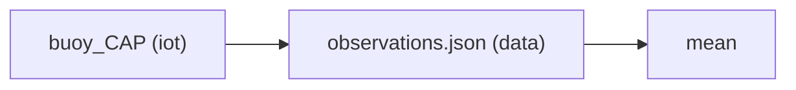

# 31. IoT observation tasks

*Bounded observations from devices: targets, resources, completion modes, provenance and output-checked checkpoints*

DAGonStar in Practice - Part 3: Task models for AI–HPC. Slides: [31-DAGonStar-IoT_observation_tasks.pptx](../lectures/31-DAGonStar-IoT_observation_tasks.pptx). Examples: [examples/31-iot-observe](../../examples/31-iot-observe/).

## 2. Today's lecture

**Outline**

1. Sensors in scientific workflows
2. The IOT task and its four operations
3. Bounded completion: why and how
4. Hands-on: a buoy off Capri
5. Provenance of an observation
6. Checkpoints that verify outputs

**After this lecture you can**

- Write a bounded IoT observation task
- Choose a completion mode
- Explain when an observation is reused

## 3. Sensors

*Buoys, weather stations and gauges stream readings forever; a workflow step must take a finite piece.*

## 4. The edge in environmental science

- **Buoys** - Sea temperature, waves and currents off Capri and Ischia.
- **Stations** - Wind and air temperature at the harbour.
- **Gauges** - Sea level and river discharge.
- **Actuators** - Sirens, gates and sampling controls (lecture 32).

> **Streams are infinite** a task must end, so every observation states when it is complete.

## 5. Four operations

| operation | Does | Lecture |
|---|---|---|
| `observe` | Read a bounded set of events from a resource | 31 |
| `configure` | Set desired state, wait for the reported state | 32 |
| `actuate` | Perform a physical action, at most once | 32 |
| `compute` | Run an artifact at the edge | 36 |

## 6. The IOT task

*Target, resource, request and completion: a declarative description of one interaction with a device.*

## 7. An observation

[`examples/31-iot-observe/iot_observe.py`](../../examples/31-iot-observe/iot_observe.py)

```python
buoy = DagonTask(
    TaskType.IOT, "buoy_CAP", operation="observe", provider="mock",
    target={"device_id": "buoy-capri-01"}, resource="sea_temperature",
    request={"events": READINGS},
    completion={"mode": "sample_count", "count": 3, "timeout_seconds": 10},
    outputs={"observations": "outputs/observations.json"})
```

- provider mock: no device needed
- target: which device
- resource: what to read
- completion: stop after 3 samples

## 8. Main arguments

| Argument | Meaning |
|---|---|
| `operation` | observe, configure, actuate or compute |
| `provider` | Adapter: mock, or one you register |
| `target` | Device selector: device_id, group, location |
| `resource, action` | What to read, or what to do |
| `request` | Operation payload; the mock takes events here |
| `completion` | When the operation is complete (required) |
| `outputs` | Name → relative file |
| `delivery, placement` | Retries and where to run (lectures 32, 36) |

## 9. How an IOT task runs

1. **Reuse?** - Checkpoint with intact outputs: skip.
2. **Request** - Write the request record.
3. **Resolve** - Stage referenced inputs.
4. **Invoke** - Provider invoke, then poll to completion.
5. **Record** - Outputs, result, provenance, checkpoint.

## 10. Bounded completion

*Every IOT task must say when it ends; an unbounded observation is rejected when it is built.*

## 11. Completion modes

| mode | Ends when | Also needs |
|---|---|---|
| `first_event` | One event arrived | - |
| `sample_count` | count events arrived | count ≥ 1 |
| `duration` | A time window elapsed | the window |
| `condition` | A predicate holds | timeout_seconds |
| `acknowledged` | The device acknowledges | timeout_seconds |
| `reported_state` | Reported equals desired | timeout_seconds |
| `job` | A device job finished | timeout_seconds |

## 12. An unbounded observation

[`examples/31-iot-observe/iot_observe.py`](../../examples/31-iot-observe/iot_observe.py)

```python
try:
    DagonTask(TaskType.IOT, "forever", operation="observe", completion={})
except ValueError as error:
    print("unbounded observation rejected:", error)
```

- An empty completion has no mode: IoTValidationError at construction
- Nothing connects to any device

## 13. Why bounds are mandatory

- **Termination** a DAG needs every task to end
- **Reproducibility** three samples is a definition; until stopped is not
- **Cost** devices on batteries and metered links
- **Timeouts** modes that wait for something need timeout_seconds
- **Clear failures** a silent device fails the task instead of hanging

> **3** - *Samples in this lecture*
>
> completion: sample_count, count 3, timeout 10 s.

## 14. Hands-on

*Five readings are offered; the task keeps three; a batch task averages them.*

## 15. The mock provider

- **Deterministic** no device, no network, no credentials
- **observe** replays request.events, cut by the completion mode
- **configure** reports the desired state as reached
- **actuate** acknowledged unless provider_options.unknown_outcome
- **Registry** mock is the only built-in; real ones via register_provider

> *Loaded lazily*
>
> Module and class are imported only when used.

```
get_provider("mock")
→ MockIoTProvider
```

## 16. The readings and the consumer

[`examples/31-iot-observe/iot_observe.py`](../../examples/31-iot-observe/iot_observe.py)

```python
READINGS = [{"sequence": n, "value": v, "unit": "Cel"}
            for n, v in enumerate((16.0, 16.5, 17.0, 17.5, 18.0), start=1)]
```

- Five readings with sequence numbers and SenML-style units (Cel)
- The mock provider replays them as events

## 17. The graph



Solid arrows: data dependencies (`workflow://`); dotted arrows: control dependencies.

- An IoT producer
- A BATCH consumer reads the events
- Sample mean of 16.0, 16.5, 17.0

## 18. Recorded output

Recorded output of `python examples/31-iot-observe/iot_observe.py`:

```text
unbounded observation rejected: IoT completion must select a supported bounded mode
kept sequences: [1, 2, 3] of 5
mean of the sample: 16.5
provenance: ['migration_history', 'outcome_certainty', 'placement', 'protocol_metadata', 'requested_target', 'selected_target']
checkpoint reusable: True
after deleting the output: False
```

- Unbounded: rejected
- Sequences 1-3 of 5 kept
- Mean 16.5
- Six provenance fields
- Reusable until the output is deleted

## 19. Files of an IOT task

| File | Content |
|---|---|
| `.dagon/iot_request.json` | The portable specification |
| `.dagon/iot_resolved.json` | The spec with inputs staged |
| `.dagon/iot_result.json` | The provider's full result |
| `.dagon/iot_provenance.json` | Six provenance fields |
| `outputs/result.json` | The result, always written |
| `outputs/observations.json` | The declared output (the payload) |

> **Secrets are redacted** every record passes through redact() before it is written.

## 20. Provenance

*Where an observation came from matters as much as its value.*

## 21. iot_provenance.json

| Field | Meaning |
|---|---|
| `requested_target` | The device the task asked for |
| `selected_target` | The device that answered |
| `placement` | Where the operation ran |
| `migration_history` | Moves between edge nodes, if any |
| `protocol_metadata` | Protocol details from the provider |
| `outcome_certainty` | known or unknown (lecture 32) |

## 22. Requested and selected

- **Groups** a task may target any buoy of a group
- **Selected** the record says which one answered
- **Failover** a spare device may replace a broken one
- **Science** a reading from buoy-02 is not one from buoy-01
- **Keep** provenance with the data, always

> *Observations are not interchangeable*
>
> The selected target goes into the metadata of the product.

## 23. Checkpoints

*An observation is reused only if its output files are still there and unchanged.*

## 24. The IoT reuse rule

```
def reuse_checkpoint(self):
    cp = self.workflow.checkpoints.get(self.checkpoint_key(), {})
    if cp.get("task_type") != "iot" or cp.get("code") != 0:
        return False
    if not Path(cp["working_dir"]).is_dir():
        return False
    for d in cp.get("outputs", []):
        out = Path(cp["working_dir"], d["path"])
        if not out.is_file() or d["sha256"] != sha256(out):
            return False
    return True
```

- Output checksums recorded
- A deleted or edited output: not reused
- The example deletes the file and asks again

## 25. Why stricter than BATCH

**BATCH reuse**

- Folder exists, code 0
- Outputs can be rebuilt by rerunning
- Rerunning is cheap and repeatable

**IoT reuse**

- Plus every output's sha256
- An observation cannot be repeated: time has passed
- Re-observing gives different data

## 26. Run and vary

**Steps**

1. Run the example
2. Change count to 5: the mean becomes 17.0
3. Use first_event: one reading
4. Use mode condition without timeout_seconds: must be bounded by a timeout

**Run it**

```bash
python examples/\
  31-iot-observe/\
  iot_observe.py
```

**Watch for:** Every change to the bound changes the sample, and therefore the result: the bound is part of the experiment.

## 27. This lecture's example

- **5** - Readings offered
- **3** - Kept by sample_count
- **16.5** - °C, mean of the sample

## 28. Exercise

A. Add a second buoy at Ischia with other readings
B. Average both buoys in one native task
C. Record both selected targets in the output
D. Delete one output and check which task is reused

**Deliverable:** A three-task workflow and the list of tasks reused on a resume after deleting one output.

## 29. Check your understanding

1. Why must every IoT task declare a completion mode?
2. Which modes require timeout_seconds for an observation?
3. What does selected_target record?
4. Why are IoT outputs checked with sha256 before reuse?

<details><summary>Answers</summary>

1. A task must end; streams are infinite, so the bound defines the sample.
2. condition, acknowledged, reported_state and job (all but first_event, sample_count, duration).
3. The device that actually answered, which may differ from the requested one.
4. Observations cannot be repeated: only intact recorded outputs may stand in for them.

</details>

## 30. Key takeaways

1. IOT tasks observe, configure, actuate or compute
2. Every operation is bounded by a completion mode
3. Provenance records requested and selected devices
4. Observations are reused only with intact outputs

*Next: configuration and actuation*

---

Raffaele Montella. CC0 1.0. Generated from `src/lectures/31.js`.
