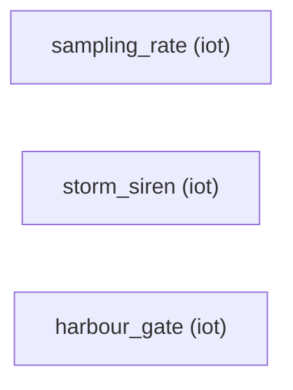
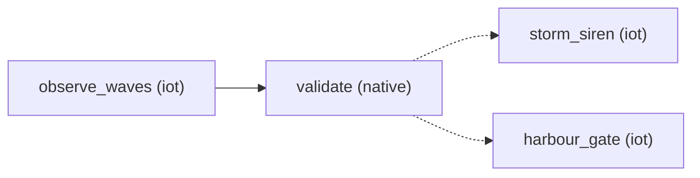

# 32. IoT configuration and actuation

*Desired state, acknowledged actions, at-most-once delivery and outcomes that are never replayed automatically*

Workflows in Practice with DAGonStar - Part 3: Task models for AI–HPC. Slides: [32-DAGonStar-IoT_configuration_and_actuation.pptx](../lectures/32-DAGonStar-IoT_configuration_and_actuation.pptx). Examples: [examples/32-iot-actuate](../../examples/32-iot-actuate/).

## 2. Today's lecture

**Outline**

1. When a workflow changes the world
2. configure: desired and reported state
3. actuate: acknowledged actions
4. Delivery: at most once by default
5. Hands-on: buoy, siren and harbour gate
6. Unknown outcomes and resumes

**After this lecture you can**

- Write configure and actuate tasks
- Explain why actuations are not retried by default
- Handle an actuation whose outcome is unknown

## 3. Changing the world

*Observing is safe to repeat; setting a sampling rate or closing a gate is not.*

## 4. Effects at the edge

- **Configure** - Set a buoy to sample every 60 s.
- **Alert** - Sound the storm siren at Marina Grande.
- **Protect** - Close the harbour gate before a surge.
- **Repeat?** - Twice may be harmless, wasteful or dangerous.

> **A physical action has no undo** the workflow must know whether it happened.

## 5. Observe versus act

**observe**

- Reads data
- Repeatable at a cost
- Reuse needs intact outputs
- Retries are harmless

**configure, actuate**

- Changes a device
- May not be repeatable
- Outcome must be acknowledged
- Retries need explicit idempotency

## 6. configure

*Ask for a desired state; complete when the device acknowledges or reports it.*

## 7. A configure task

[`examples/32-iot-actuate/iot_actuate.py`](../../examples/32-iot-actuate/iot_actuate.py)

```python
configure = DagonTask(
    TaskType.IOT, "sampling_rate", operation="configure", provider="mock",
    target={"device_id": "buoy-capri-01"},
    request={"sampling_seconds": 60},
    completion={"mode": "acknowledged", "timeout_seconds": 5},
    outputs={"state": "outputs/state.json"})
```

- request: the desired state
- completion: acknowledged
- timeout 5 s
- state.json: desired and reported

## 8. Desired and reported state

- **desired** what the workflow asked for
- **reported** what the device says it now has
- **Equal** configuration took effect
- **Different** the device refused, clamped or has not yet applied it
- **reported_state mode** complete only when they match, with a timeout

> *Recorded output*
>
> The mock reports what was asked.

```
desired:
  sampling_seconds 60
reported:
  sampling_seconds 60
```

## 9. Completion modes for effects

| mode | Complete when | Use for |
|---|---|---|
| `acknowledged` | The device acknowledges | Commands, alarms |
| `reported_state` | Reported equals desired | Configuration |
| `job` | A device job finishes | Firmware, long actions |
| `condition` | A predicate holds | Gate position reached |

> **Always with timeout_seconds** a silent device must end the task.

## 10. actuate

*An action on a device, delivered at most once unless you declare it idempotent.*

## 11. Two actuations

[`examples/32-iot-actuate/iot_actuate.py`](../../examples/32-iot-actuate/iot_actuate.py)

```python
siren = DagonTask(
    TaskType.IOT, "storm_siren", operation="actuate", provider="mock",
    target={"device_id": "siren-marina-grande"}, action="sound",
    completion={"mode": "acknowledged", "timeout_seconds": 5},
    delivery={"max_attempts": 1})
gate = DagonTask(
    TaskType.IOT, "harbour_gate", operation="actuate", provider="mock",
    target={"device_id": "gate-02"}, action="close",
    completion={"mode": "acknowledged", "timeout_seconds": 2},
    delivery={"max_attempts": 1},
    provider_options={"unknown_outcome": True})   # the ack never arrives
```

- action names what to do; delivery max_attempts 1 means one try
- unknown_outcome makes the mock never acknowledge the gate: the outcome is unknown

## 12. Delivery rules

- **Default** max_attempts 1: an actuation is sent at most once
- **Retries** max_attempts > 1 needs delivery idempotent: true
- **Otherwise** IoTValidationError at construction
- **Idempotent** close the gate: closing twice leaves it closed
- **Not idempotent** open the valve for 10 s, add 5 L of reagent

> *Explicit, never assumed*
>
> Physical actuation retries require explicit idempotency.

```
delivery={"max_attempts": 3,
  "idempotent": True}
```

## 13. The rule in the source

```
if self.operation == "actuate":
    attempts = self.delivery.get("max_attempts", 1)
    if attempts != 1 and not self.delivery.get("idempotent"):
        raise IoTValidationError(
            "Physical actuation retries require explicit idempotency")
    self.delivery.setdefault("max_attempts", 1)
```

- Checked when the task is built
- Before any device is contacted
- Default written into the spec

## 14. Hands-on

*Three effect tasks: one configuration and two actuations, one of which is never acknowledged.*

## 15. The graph



Solid arrows: data dependencies (`workflow://`); dotted arrows: control dependencies.

- Three independent sources
- They run in parallel
- The gate fails; the others finish

## 16. Recorded output

Recorded output of `python examples/32-iot-actuate/iot_actuate.py`:

```text
configure: {'desired': {'sampling_seconds': 60}, 'reported': {'sampling_seconds': 60}}
sampling_rate FINISHED certainty=known
storm_siren   FINISHED certainty=known
harbour_gate  FAILED   certainty=unknown
gate reusable from checkpoint: False
```

- Configuration reached
- Siren acknowledged
- Gate FAILED, certainty unknown
- Not reusable on resume

## 17. A failure among siblings

- **Independent** the three tasks have no edges between them
- **Parallel** they run in their own threads
- **Gate fails** only its consumers are affected; it has none
- **Others** configure and siren finish and are checkpointed
- **Resume** only the gate is considered again

> *Recorded output*
>
> A failure is local to its subgraph (lecture 16).

```
sampling_rate FINISHED
storm_siren   FINISHED
harbour_gate  FAILED
```

## 18. Reading the checkpoints

[`examples/32-iot-actuate/iot_actuate.py`](../../examples/32-iot-actuate/iot_actuate.py)

```python
print("configure:", load(configure, "outputs/state.json"))
for task in (configure, siren, gate):
    record = wf.checkpoints["IoT32." + task.name]
    print("%-13s %-8s certainty=%s" % (task.name, task.status.name,
                                      record.get("outcome_certainty")))
print("gate reusable from checkpoint:", gate.reuse_checkpoint())
check(wf.checkpoints["IoT32.harbour_gate"]["outcome_certainty"] == "unknown",
      "an unacknowledged actuation is recorded as unknown")
```

- Every IoT checkpoint records outcome_certainty, known or unknown
- The check proves that the gate's uncertainty was recorded

## 19. Unknown outcomes

*No acknowledgement does not mean the action did not happen.*

## 20. What happens to the gate

1. **Invoke** - The close command is sent.
2. **Wait** - No ack arrives.
3. **Record** - Checkpoint: certainty unknown.
4. **Fail** - The task raises and fails.
5. **Human** - Someone checks the gate.

## 21. The unknown branch

```
result = provider.poll(invocation, context)
if self.operation == "actuate" and \
   result.outcome_certainty == "unknown":
    checkpoint["outcome_certainty"] = "unknown"
    raise IoTUnknownOutcomeError(
        "Physical actuation outcome is unknown; "
        "automatic replay is disabled")
```

- Recorded before failing
- No outputs written
- code never becomes 0

## 22. Why not just retry

- **The command may have arrived** and the ack was lost
- **A second close** harmless here, but not for every action
- **The workflow cannot tell** so it must not guess
- **Not reusable** code is not 0, so a resume does not count it as done
- **Decision** a person inspects the device and acts

> **?** - *Outcome certainty*
>
> known or unknown, recorded for every IoT task.

## 23. Resuming after an unknown outcome

- **Checkpoint** status WAITING with the invocation_id
- **Reattach** providers that support it reattach to that invocation
- **No new command** the provider is polled, not invoked again
- **No reattach** the operator decides before resuming
- **Mock** supports reattach

> *Reattach, not replay*
>
> Ask what happened to the first command instead of sending a second.

## 24. Operating effect tasks

- **Dry run first** - Portable emulation uses the mock: no device moves.
- **Guard** - Only actuate after a validated observation.
- **Human gate** - Agentic guardrails for risky actions (lecture 34).
- **Record** - Who, what, when and certainty, in the checkpoint.

## 25. A storm-response pattern



Solid arrows: data dependencies (`workflow://`); dotted arrows: control dependencies.

- Observe a bounded sample
- Validate before acting
- Actuate only on a verdict
- Both actions at most once

## 26. Run and vary

**Steps**

1. Run the example
2. Remove unknown_outcome: the gate finishes
3. Set max_attempts 3 on the siren and read the error
4. Add idempotent: true and run again

**Run it**

```bash
python examples/\
  32-iot-actuate/\
  iot_actuate.py
```

**Watch for:** Retries are refused at construction until you state that repeating the action is safe.

## 27. This lecture's example

- **3** - Effect tasks
- **2** - Acknowledged
- **1** - Unknown outcome, not replayed

## 28. Exercise

A. Add an observe task for wave height before the siren
B. Make the siren depend on a native task that checks a threshold
C. Give the gate delivery idempotent: true and max_attempts 2
D. Explain in one sentence why the siren must not get the same

**Deliverable:** The four-task workflow, its output and the sentence on idempotency.

## 29. Check your understanding

1. What does configure record in its output?
2. When may an actuation be retried?
3. What happens when an actuation is not acknowledged?
4. Why is a failed actuation not reused on resume?

<details><summary>Answers</summary>

1. The desired state and the reported state.
2. Only when delivery declares idempotent: true.
3. Its certainty is recorded as unknown and the task fails with IoTUnknownOutcomeError.
4. Its checkpoint code is not 0; a reattaching provider is polled instead of re-invoked.

</details>

## 30. Key takeaways

1. configure compares desired and reported state
2. Actuations are at most once by default
3. Retries need explicit idempotency
4. Unknown outcomes are recorded and never replayed

*Next: the agentic task contract*

---

Raffaele Montella. CC0 1.0. Generated from `src/lectures/32.js`.
