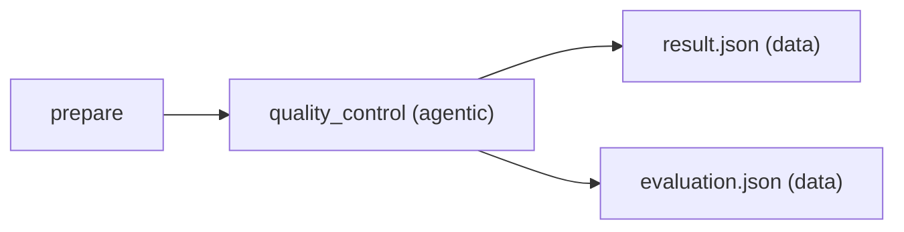

# 33. The agentic task contract

*Agents as supervised workflow steps: profiles in dagon.ini, a declared contract, a bounded loop and independent evaluation*

Workflows in Practice with DAGonStar - Part 3: Task models for AI–HPC. Slides: [33-DAGonStar-The_agentic_task_contract.pptx](../lectures/33-DAGonStar-The_agentic_task_contract.pptx). Examples: [examples/33-agentic-contract](../../examples/33-agentic-contract/).

## 2. Today's lecture

**Outline**

1. Why agents need a contract
2. Profiles: the maximum authority
3. The contract: specification, inputs, requirements
4. The bounded loop
5. Hands-on: quality control of a table
6. Configurations rejected before running

**After this lecture you can**

- Write an AGENTIC task against a profile
- Explain what a task may narrow and never widen
- Read an evaluation report

## 3. Agents in workflows

*An agent proposes actions and results; the workflow decides what runs and what is accepted.*

## 4. What can go wrong

- **Unbounded** - An agent that never stops, or spends without limit.
- **Over-powered** - Tools it was never meant to use.
- **Self-graded** - "My answer scores 1.0": not evidence.
- **Unpublishable** - A half-written result read by the next task.

> **DAGonStar's answer** a declared contract, a named profile, a bounded loop, independent evaluators and atomic publication.

## 5. Who decides what

| Decision | Made by | Where |
|---|---|---|
| Model, endpoint, key | Administrator | [agent_provider.*], [llm.*] |
| Tools, budgets, guardrails | Administrator | [agent.<profile>] |
| Objective, inputs, requirements | Workflow author | The AGENTIC task |
| Next action, candidate | The agent | At run time |
| Accepted or not | Evaluators | Never the agent |

## 6. Profiles

*A profile in dagon.ini is the maximum authority an agentic task can have.*

## 7. Providers in dagon.ini

[`examples/common/agentic.py`](../../examples/common/agentic.py)

```python
[agent_provider.fixture]
implementation = mock

[agent_provider.adversarial]
implementation = mock
scenario = undeclared_tool
```

- [agent_provider.<name>]
- implementation: a registered adapter
- mock: deterministic, offline
- scenario: scripted misbehaviour

## 8. A profile in dagon.ini

[`examples/common/agentic.py`](../../examples/common/agentic.py)

```python
[agent.quality-local]
provider = fixture
strategy = bounded_iterative
tools = inspect_records, repair_records
guardrails = preserve_record_ids
max_steps = 8
max_tool_calls = 8
timeout_seconds = 60
max_tokens = 4096
max_tool_output_bytes = 65536
max_trace_bytes = 262144
```

- Provider and strategy
- Two tools, one guardrail
- Finite budgets
- The authority ceiling

## 9. Profile keys

| Key | Meaning |
|---|---|
| `provider` | An [agent_provider.<name>] section |
| `llm_provider` | An [llm.<name>] section, for live-model adapters |
| `strategy` | bounded_iterative (the only one) |
| `tools, guardrails` | Registered names, comma-separated |
| `max_steps, timeout_seconds` | Required: finite and positive |
| `max_tool_calls, max_tokens` | Defaults 8 and 4096 |
| `max_attempts` | Defaults to max_steps |

## 10. Narrow, never widen

- **tools=None** inherit the profile's tools
- **tools=[]** no tools at all
- **tools=[subset]** only those, if the profile has them
- **budgets** may only lower the profile's values
- **guardrails** are added to the profile's, never removed

> *Task < profile*
>
> A workflow author cannot grant an agent more than the administrator allowed.

## 11. The contract

*What to produce, from which inputs, judged by which requirements.*

## 12. The quality-control task

[`examples/common/agentic.py`](../../examples/common/agentic.py)

```python
options = dict(
    agent="quality-local",
    specification={"schema_version": 1,
                   "objective": "Produce a complete, validated observation table",
                   "context": "Gulf of Naples stations, 2 Nov 2026",
                   "output_schema": {"type": "object", "required": ["observations"]}},
    inputs={"source": SOURCE},
    requirements=[{"id": "completeness", "description": "All four records are present",
                   "evaluator": "record_coverage", "expected": {"count": 4},
                   "weight": 1.0, "mandatory": True, "minimum_score": 1.0}],
    evaluation={"aggregation": "weighted_mean", "threshold": 1.0},
    outputs={"result": "outputs/result.json", "evaluation": "outputs/evaluation.json"},
```

- specification: objective, context and an output schema; inputs: workflow:// references
- requirements: evaluator record_coverage, 4 records, mandatory; threshold 1.0

## 13. Contract fields

| Field | Content |
|---|---|
| `agent` | The profile name |
| `specification` | schema_version 1, objective, context, output_schema |
| `inputs` | Name → workflow:// reference (edges inferred) |
| `requirements` | id, evaluator, expected, weight, mandatory |
| `evaluation` | aggregation weighted_mean, threshold |
| `outputs` | result, evaluation, trace (defaults in outputs/) |

> **No endpoints, models, keys or code** the contract is portable and safe to export.

## 14. Built-in evaluators

| Evaluator | Score |
|---|---|
| `record_coverage` | Unique records matched / max(expected, produced) |
| `exact_match` | Value at options.path equals expected |
| `numeric_error` | max(0, 1 - \|observed - expected\| / scale) |
| `schema_conformance` | Candidate conforms to a JSON Schema subset |
| `reference_match` | Equals a value in a declared reference artifact |

## 15. The bounded loop

*Propose, act, observe, evaluate, revise or accept: every turn counted against a budget.*

## 16. One agentic task

1. **Validate** - Profile, contract, inputs.
2. **Propose** - The agent: tool or submit.
3. **Check** - Guardrails before acting.
4. **Evaluate** - Independent scores.
5. **Publish** - Only if accepted.

## 17. Budgets end the loop

- **max_steps** proposals the agent may make
- **max_tool_calls** tool executions
- **max_attempts** candidates submitted for evaluation
- **max_tokens** total tokens across the run
- **timeout_seconds** wall clock for the whole task

> **5** - *Hard limits*
>
> Exhausting any one ends the task as not accepted.

## 18. Hands-on

*Five records, one duplicated: the agent must return the four unique ones.*

## 19. The input table

[`examples/common/agentic.py`](../../examples/common/agentic.py)

```python
OBSERVATIONS = {"observations": [
    {"id": 1, "station": "NAP", "temperature_c": 14.0},
    {"id": 2, "station": "CAP", "temperature_c": 16.0},
    {"id": 2, "station": "CAP", "temperature_c": 16.0},
    {"id": 3, "station": "ISC", "temperature_c": 15.0},
    {"id": 4, "station": "ISC", "temperature_c": 15.5},
]}
SOURCE = "workflow:///prepare/outputs/observations.json"
```

- id 2 appears twice
- Four unique records
- The producer writes this JSON
- The agent must remove one

## 20. The example

[`examples/33-agentic-contract/agentic_contract.py`](../../examples/33-agentic-contract/agentic_contract.py)

```python
wf = workflow("Agentic33", base)
wf.add_task(producer())
agent = quality_control(tools=[])       # no tools, although the profile has two
wf.add_task(agent)
profile = agent.resolve_profile()
print("profile:", profile.name, "| tools:", profile.tools)
wf.run()

report = load(agent, "outputs/evaluation.json")
print("accepted:", report["accepted"])
print("fit per attempt:", [a["result_fit"] for a in report["attempts"]])
print("tool calls:", report["usage"]["tool_calls"],
      "| determinism:", report["execution"]["determinism"])
print("records kept:", len(load(agent, "outputs/result.json")["observations"]))
```

- tools=[] narrows the profile to no tools: the agent must revise on its own
- The report gives the fit of every attempt, usage and determinism

## 21. The graph



Solid arrows: data dependencies (`workflow://`); dotted arrows: control dependencies.

- The input reference makes the edge
- Three outputs: result, evaluation, trace
- result only if accepted

## 22. Recorded output

Recorded output of `python examples/33-agentic-contract/agentic_contract.py`:

```text
profile: quality-local | tools: ()
accepted: True
fit per attempt: [0.8, 1.0]
tool calls: 0 | determinism: deterministic_fixture
records kept: 4
rejected before execution: {'missing_profile': 'invalid_configuration', 'budget_above_profile': 'invalid_configuration', 'unknown_tool': 'invalid_contract', 'no_requirements': 'invalid_contract'}
```

- No tools after narrowing
- Fit 0.8, then 1.0
- Mock adapter: deterministic
- Four records kept
- Four refusals before running

## 23. Reading the two attempts

- **Attempt 1** the table unchanged: 4 unique of 5 produced
- **Fit** 4 / max(4, 5) = 0.8, below threshold 1.0
- **Feedback** the failed requirement is sent back to the agent
- **Attempt 2** duplicates removed: 4 / 4 = 1.0
- **Accepted** published as result.json

> *Recorded output*
>
> Scored by record_coverage, not by the agent.

```
fit per attempt:
  [0.8, 1.0]
```

## 24. Refusals

*Bad configurations fail before any adapter, tool or transfer is started.*

## 25. Four refusals

[`examples/33-agentic-contract/agentic_contract.py`](../../examples/33-agentic-contract/agentic_contract.py)

```python
rejected = {}
for label, options in (("missing_profile", {"agent": "missing"}),
                       ("budget_above_profile", {"budgets": {"max_steps": 99}}),
                       ("unknown_tool", {"tools": ["shell"]}),
                       ("no_requirements", {"requirements": []})):
    try:
        task = quality_control(name=label, **options)
        wf.add_task(task)
        task.resolve_profile()
    except (AgenticConfigurationError, AgenticValidationError) as error:
        rejected[label] = error.code
```

- Profile errors are invalid_configuration; contract errors are invalid_contract
- resolve_profile is the preflight; it is also the first step of execute()

## 26. Why each was refused

| Case | Code | Reason |
|---|---|---|
| missing_profile | `invalid_configuration` | No [agent.missing] |
| budget_above_profile | `invalid_configuration` | 99 > max_steps 8 |
| unknown_tool | `invalid_contract` | shell is not registered |
| no_requirements | `invalid_contract` | requirements must be non-empty |

## 27. Run and vary

**Steps**

1. Run the example
2. Remove tools=[]: the agent inspects and repairs with tools
3. Set threshold 0.8: the first attempt is accepted
4. Lower max_steps to 1 in the profile and read the report

**Run it**

```bash
python examples/\
  33-agentic-contract/\
  agentic_contract.py
```

**Watch for:** With threshold 0.8 the duplicate survives: the threshold is a scientific decision, not a technical one.

## 28. Exercise

A. Add a requirement with schema_conformance on the output schema
B. Give it weight 0.5 and mandatory false
C. Add a profile quality-strict with max_steps 3
D. Run the task against both profiles

**Deliverable:** Both evaluation reports and a sentence on which profile you would use in production.

## 29. Check your understanding

1. What may a task change about its profile?
2. Which component decides whether a result is accepted?
3. Why was the first attempt's fit 0.8?
4. When are configuration errors detected?

<details><summary>Answers</summary>

1. Narrow tools, lower budgets and add guardrails; never widen.
2. The independent evaluators with the threshold, never the agent.
3. Four unique records out of five produced: 4 / max(4, 5).
4. Before any adapter, tool or transfer: at resolve_profile and contract normalisation.

</details>

## 30. Key takeaways

1. Profiles in dagon.ini set the maximum authority
2. The contract declares objective, inputs and requirements
3. A bounded loop proposes, evaluates and revises
4. Bad configurations are refused before running

*Next: tools and guardrails*

---

Raffaele Montella. CC0 1.0. Generated from `src/lectures/33.js`.
