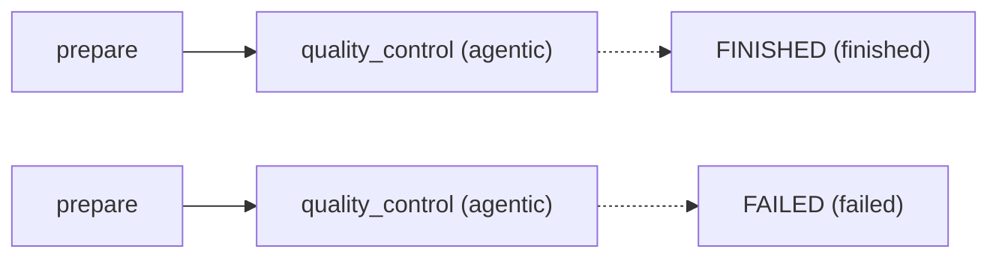

# 34. Agentic tools and guardrails

*Declared tools, runtime invariants checked before every action, repairable and blocking violations, and nothing published on failure*

DAGonStar in Practice - Part 3: Task models for AI–HPC. Slides: [34-DAGonStar-Agentic_tools_and_guardrails.pptx](../lectures/34-DAGonStar-Agentic_tools_and_guardrails.pptx). Examples: [examples/34-agentic-guardrails](../../examples/34-agentic-guardrails/).

## 2. Today's lecture

**Outline**

1. Tools: what an agent may do
2. The tool registry
3. Runtime invariants before every action
4. Guardrails on inputs and results
5. Hands-on: a cooperative and an adversarial agent
6. Failure publishes nothing

**After this lecture you can**

- Declare the tools an agent may use
- Explain which checks run outside the agent
- Read a trace and a blocked report

## 3. Tools

*An agent acts only through registered tools, with declared arguments and side effects.*

## 4. Built-in tools

| Tool | Does | Side effect |
|---|---|---|
| `inspect_records` | Count, unique count, duplicate ids, fields, nulls | `read` |
| `repair_records` | Remove duplicate ids, sort by id | `read` |

> **Read-only by design** a tool returns data to the agent; it never writes the published result.

## 5. A tool specification

- **id, version** recorded in the checkpoint identity
- **function** module:function, resolved by the registry
- **arguments_schema** JSON Schema for the arguments
- **result_schema** what the tool must return
- **side_effect, timeout_seconds** declared limits

> *Registered once*
>
> Profiles and tasks refer to it by id.

```
ToolSpec(
 id="inspect_records",
 version="1.0.0",
 side_effect="read",
 timeout_seconds=20.0)
```

## 6. From profile to permitted tools

1. **Registry** - All registered tools.
2. **Profile** - tools = inspect, repair.
3. **Task** - None, [] or a subset.
4. **Effective** - What the agent sees.

## 7. Runtime invariants

*Every proposed action is checked by DAGonStar before anything executes.*

## 8. check_action

```
if tool not in allowed or tool not in registry.tools:
    return Violation(..., "undeclared_tool", ...)
if not isinstance(arguments, dict):
    return Violation(..., "invalid_arguments", retryable=True)
for text in _strings(arguments):
    if "workflow://" in text:
        return Violation(..., "workflow_uri_injection", ...)
    if _unsafe_path(text):
        return Violation(..., "path_escape", ...)
errors = validate_schema(arguments, tool.arguments_schema)
```

- Permitted and registered
- Arguments are an object
- No new references
- No absolute or ../ paths
- Schema-valid arguments

## 9. Four actions checked

[`examples/34-agentic-guardrails/agentic_guardrails.py`](../../examples/34-agentic-guardrails/agentic_guardrails.py)

```python
registry = default_registry()
allowed = ["inspect_records"]
verdicts = {}
for label, tool, arguments in (
        ("declared", "inspect_records", {"input": "source"}),
        ("undeclared", "repair_records", {"input": "source"}),
        ("escape", "inspect_records", {"input": "../../etc/passwd"}),
        ("uri", "inspect_records", {"input": "workflow:///other/secret.json"})):
    violation = check_action(tool, arguments, allowed, registry)
    verdicts[label] = violation.code if violation else "allowed"
print("action checks:", verdicts)
```

- check_action is called directly, outside any workflow: a pure function
- Only inspect_records is allowed in this check

## 10. The verdicts

| Proposed action | Verdict | Why |
|---|---|---|
| inspect_records(source) | `allowed` | Permitted, safe arguments |
| repair_records(source) | `undeclared_tool` | Not in the allowed list |
| inspect_records(../../etc/passwd) | `path_escape` | Parent-directory path |
| inspect_records(workflow:///...) | `workflow_uri_injection` | New reference |

## 11. Why no workflow:// in actions

- **References make edges** they are fixed when the graph is built
- **An agent adding one** would read another task's files
- **Inputs** only those declared in the contract are staged
- **Candidates** may not introduce new references either
- **Result** the data an agent sees is decided by the author

> *The graph is not negotiable*
>
> Agents act inside it, never on it.

## 12. Guardrails

*Named checks on inputs, actions and results, from the registry and the profile.*

## 13. Built-in guardrails

| Guardrail | Stage | Repairable |
|---|---|---|
| `preserve_record_ids` | result | yes: feedback to the agent |
| `non_empty_result` | result | yes |
| `read_only_tools` | pre_action | no: blocks the task |

> **Runtime invariants are always on** guardrails are added by profile and task.

## 14. Repairable and blocking

**Repairable violation**

- Recorded in the trace
- Sent back as feedback
- The agent may try again
- Counts against max_attempts

**Blocking violation**

- Recorded in the trace
- termination_reason guardrail_blocked
- The task FAILS at once
- No result published

## 15. Handling a violation

```
def _violation(self, violation):
    self._event("guardrail", **violation.as_dict())
    if not violation.retryable:
        self.termination_reason = "guardrail_blocked"
        raise AgenticGuardrailViolation(...)
    self.feedback = [{"kind": "guardrail",
                      "code": violation.code,
                      "reason": violation.reason}]
```

- Always traced
- Not retryable: fail
- Retryable: feedback

## 16. Hands-on

*The same contract with two profiles: one cooperative, one that tries a shell command.*

## 17. Cooperative run

[`examples/34-agentic-guardrails/agentic_guardrails.py`](../../examples/34-agentic-guardrails/agentic_guardrails.py)

```python
wf = workflow("Guarded34", base)
wf.add_task(producer())
agent = quality_control()
wf.add_task(agent)
wf.run()
trace = load(agent, "outputs/trace.json")
tools = [e.get("tool") for e in trace["entries"] if e["event"] == "tool"]
print("tools used:", tools, "| accepted:", load(agent, "outputs/evaluation.json")["accepted"])
```

- The profile's two tools are inherited: the mock inspects, sees id 2 twice, repairs
- The trace lists every tool event

## 18. Adversarial run

[`examples/34-agentic-guardrails/agentic_guardrails.py`](../../examples/34-agentic-guardrails/agentic_guardrails.py)

```python
wf = workflow("Blocked34", base)
wf.add_task(producer())
rogue = quality_control(agent="quality-adversarial")
wf.add_task(rogue)
wf.run()
report = load(rogue, "outputs/evaluation.json")
print("adversarial:", rogue.status.name, "|", report["termination_reason"],
      "| tool calls:", report["usage"]["tool_calls"])
published = Path(rogue.working_dir, "outputs/result.json").exists()
print("result published:", published)
check(rogue.status is Status.FAILED and not published, "blocked, nothing published")
```

- quality-adversarial: the mock scenario undeclared_tool proposes shell rm -rf .
- Blocked before execution: zero tool calls, nothing published

## 19. Recorded output

Recorded output of `python examples/34-agentic-guardrails/agentic_guardrails.py`:

```text
action checks: {'declared': 'allowed', 'undeclared': 'undeclared_tool', 'escape': 'path_escape', 'uri': 'workflow_uri_injection'}
tools used: ['inspect_records', 'repair_records'] | accepted: True
adversarial: FAILED | guardrail_blocked | tool calls: 0
result published: False
```

- Four verdicts
- Inspect, then repair: accepted
- Adversarial: blocked
- Zero tool calls
- No result file

## 20. Two workflows



Solid arrows: data dependencies (`workflow://`); dotted arrows: control dependencies.

- Guarded34: cooperative
- Blocked34: adversarial
- Same contract, different profile

## 21. Nothing on failure

*A result exists only with a commit manifest, written last.*

## 22. Publication protocol

1. **Clean** - Remove old outputs.
2. **Attempts** - Candidates in private folders.
3. **Write** - Result, trace, evaluation.
4. **Commit** - commit.json, last.

## 23. What a failed task leaves

- **evaluation.json** accepted false, termination_reason, usage
- **trace.json** bounded event log for diagnosis
- **result.json** absent: removed if a previous run left one
- **commit.json** absent: no reusable checkpoint
- **Consumers** do not run

> *Recorded output*
>
> The adversarial run leaves only diagnostics.

```
result published:
  False
```

## 24. Mock scenarios for testing

| scenario | The mock... |
|---|---|
| `undeclared_tool` | Proposes a shell command |
| `path_escape` | Reads ../../secrets.json |
| `workflow_uri` | Submits a new workflow:// reference |
| `malformed` | Replies with prose instead of JSON |
| `self_reported_score` | Claims score 1.0 (ignored) |
| `drop_records` | Drops a record on the first attempt |

## 25. Self-assessment is ignored

- **Fields** score, accepted, self_score, result_fit, confidence
- **In a reply** dropped and logged as self_assessment_ignored
- **Why** an agent grading itself is not evidence
- **Instead** registered evaluators score every candidate
- **Lecture 35** how scores become acceptance

> **0** - *Weight of the agent's opinion*
>
> Only evaluators count.

## 26. This lecture's example

- **4** - Actions checked
- **2** - Tool calls, cooperative run
- **0** - Tool calls, adversarial run

## 27. Try the scenarios

**Steps**

1. Run the example
2. Change the adversarial scenario to path_escape
3. Then to self_reported_score
4. Read termination_reason and the trace each time

**Run it**

```bash
python examples/\
  34-agentic-guardrails/\
  agentic_guardrails.py
```

**Watch for:** self_reported_score is not blocked: the score field is ignored and the evaluators decide.

## 28. Exercise

A. Add read_only_tools to the quality-local guardrails
B. Add a profile quality-drop with scenario drop_records
C. Run quality_control against it
D. Explain from the trace how preserve_record_ids helped

**Deliverable:** The new profile, the evaluation report and the trace excerpt with the guardrail event.

## 29. Check your understanding

1. Which four checks does check_action make?
2. What is the difference between a repairable and a blocking violation?
3. Why may an action not contain workflow://?
4. What tells a consumer that a result was published?

<details><summary>Answers</summary>

1. Permitted tool, object arguments, no workflow:// or unsafe paths, schema-valid arguments.
2. Repairable gives feedback and another attempt; blocking fails the task at once.
3. References define graph edges and staging; an agent must not add data access.
4. The commit manifest, written last, plus task success.

</details>

## 30. Key takeaways

1. Agents act only through registered, permitted tools
2. Every action is checked before it executes
3. Repairable violations give feedback; others block
4. Without a commit manifest, nothing is published

*Next: evaluation, acceptance and checkpoints*

---

Raffaele Montella. CC0 1.0. Generated from `src/lectures/34.js`.
