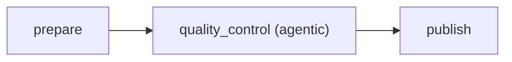

# 35. Agentic evaluation and checkpoints

*Result fit, mandatory gates and thresholds; publication only when accepted; reuse only when contract, profile and inputs are unchanged*

DAGonStar in Practice - Part 3: Task models for AI–HPC. Slides: [35-DAGonStar-Agentic_evaluation_and_checkpoints.pptx](../lectures/35-DAGonStar-Agentic_evaluation_and_checkpoints.pptx). Examples: [examples/35-agentic-evaluation](../../examples/35-agentic-evaluation/).

## 2. Today's lecture

**Outline**

1. From scores to acceptance
2. The result fit F
3. Mandatory gates and hard checks
4. Hands-on: a gate that never opens
5. Checkpoint identity by content
6. Reading reports

**After this lecture you can**

- Compute a result fit by hand
- Predict whether a candidate is accepted
- Explain when an agentic task is reused

## 3. Scores

*Every requirement is scored by an evaluator between 0 and 1; the agent never scores itself.*

## 4. A requirement

| Field | Meaning |
|---|---|
| `id` | Unique name in the report |
| `evaluator` | A registered evaluator |
| `expected, options` | What the evaluator compares against |
| `weight` | Share in the result fit (≥ 0) |
| `mandatory, minimum_score` | A gate: below the minimum, never accepted |
| `hard` | A pass/fail check that must pass |

## 5. Result fit

*A weighted mean of the scores, compared with the threshold.*

## 6. aggregate

```
fit = fsum(w * score for each requirement with w > 0) \
      / fsum(w for each requirement with w > 0)
accepted = (no evaluator errors
            and every hard check passed
            and fit >= threshold
            and no mandatory failures)
```

- F in [0, 1]
- Four conditions, all needed
- Evaluator error: no fit

## 7. A golden example

[`examples/35-agentic-evaluation/agentic_evaluation.py`](../../examples/35-agentic-evaluation/agentic_evaluation.py)

```python
golden = aggregate([
    {"id": "completeness", "status": "pass", "score": 1.0, "weight": 2.0,
     "mandatory": False, "minimum_score": None, "hard": False},
    {"id": "stations", "status": "fail", "score": 0.0, "weight": 1.0,
     "mandatory": True, "minimum_score": 1.0, "hard": False}], threshold=0.6)
print("F = %.4f | accepted: %s | gate failures: %s"
      % (golden["result_fit"], golden["accepted"], golden["mandatory_failures"]))
```

- completeness passes with weight 2; stations fails with weight 1 and is mandatory
- F = (2 × 1 + 1 × 0) / 3 = 0.667, above the threshold 0.6

## 8. Above the threshold, not accepted

- **Fit** 0.667 ≥ 0.6
- **Gate** stations is mandatory and scored 0 < 1.0
- **Verdict** accepted False
- **Why gates** some properties are not negotiable
- **Weights** express how much the rest matters

> *Recorded output*
>
> The gate wins over the mean.

```
F = 0.6667 | accepted:
 False | gate failures:
 ['stations']
```

## 9. Weights and gates

**Weights**

- Trade one property against another
- A good mean can hide a bad score
- Tuned with the threshold
- For quality

**Gates**

- Never traded
- One failure rejects the candidate
- minimum_score per requirement
- For correctness and safety

## 10. Choosing a threshold

- **1.0** every weighted requirement fully met: strict
- **Below 1.0** accept partial quality, by an amount you can justify
- **Write it down** the threshold is part of the method
- **It is in the contract** changing it changes the identity
- **Gates** for what must never be traded

> *A scientific decision*
>
> Report the threshold with the results.

## 11. Hands-on: the gate

*A mandatory requirement that no candidate can meet: five stations in a four-record table.*

## 12. An impossible gate

[`examples/35-agentic-evaluation/agentic_evaluation.py`](../../examples/35-agentic-evaluation/agentic_evaluation.py)

```python
agent = quality_control(tools=[], budgets={"max_attempts": 2}, requirements=[
    {"id": "completeness", "evaluator": "record_coverage",
     "expected": {"count": 4}, "weight": 2.0},
    {"id": "stations", "evaluator": "exact_match", "expected": 5,
     "weight": 1.0, "mandatory": True, "options": {"path": "station_count"}}],
    evaluation={"threshold": 0.6})
publish = DagonTask(TaskType.BATCH, "publish",
                    "cp workflow:///quality_control/outputs/result.json table.json")
wf.add_task(agent)
wf.add_task(publish)
wf.run()
```

- max_attempts lowered to 2; stations expects station_count 5, which no candidate has
- publish copies the result: it runs only if the agent finishes

## 13. The graph



Solid arrows: data dependencies (`workflow://`); dotted arrows: control dependencies.

- publish consumes result.json
- The agent fails after two attempts
- publish never runs

## 14. What happens

1. **Attempt 1** - Gate fails: feedback.
2. **Attempt 2** - Gate fails again.
3. **Budget** - max_attempts exhausted.
4. **Not accepted** - Diagnostics only.
5. **Skip** - publish never runs.

## 15. Recorded output

Recorded output of `python examples/35-agentic-evaluation/agentic_evaluation.py`:

```text
F = 0.6667 | accepted: False | gate failures: ['stations']
gated run: FAILED | publish ran: False | result exists: False
reused, same contract: True
reused, new threshold: False
reused, new input content: False
```

- Golden: 0.667, rejected
- Gated run FAILED
- publish did not run
- No result file
- Reuse depends on content

## 16. When evaluation itself fails

- **Evaluator error** no fit is computed: evaluator_error
- **The task** fails: an unscored result is never published
- **Transient** evaluator_transient_error for retryable causes
- **Budgets** max_attempts limits revisions after feedback
- **Exhausted** budget_exhausted, reported as not_accepted

> *No score, no result*
>
> Uncertainty about quality is treated as failure.

## 17. Checkpoints

*An accepted run is reused only if everything that defined it is unchanged.*

## 18. The checkpoint identity

| Part | Changes when |
|---|---|
| `contract_digest` | Specification, requirements, threshold, outputs change |
| `profile_digest` | Tools, budgets, guardrails, provider change |
| `versions` | A tool, guardrail, evaluator or adapter version changes |
| `inputs` | The sha256 of any referenced input changes |
| `task` | Workflow, task or profile name changes |

> **identity_digest** sha256 of all of the above, stored in the commit manifest.

## 19. Three resumes

[`examples/35-agentic-evaluation/agentic_evaluation.py`](../../examples/35-agentic-evaluation/agentic_evaluation.py)

```python
first = run()
print("reused, same contract:", run().fair_checkpoint_reused)
print("reused, new threshold:", run(threshold=0.95).fair_checkpoint_reused)
table = Path(first.prevs[0].working_dir, "outputs", "observations.json")
table.write_text(json.dumps({"observations": OBSERVATIONS["observations"][:2]
                             + OBSERVATIONS["observations"][3:]}))
print("reused, new input content:", run(threshold=0.95).fair_checkpoint_reused)
```

- Same contract: reused; threshold 0.95: a new contract digest, so run again
- The table is rewritten without the duplicate: new input hash, so run again

## 20. Reuse decisions

| Resume | Reused | Because |
|---|---|---|
| Same contract | yes | Identity and output hashes verify |
| Threshold 1.0 → 0.95 | no | Contract digest changed |
| Input table rewritten | no | Input sha256 changed |

## 21. Three reuse rules

**BATCH, NATIVE**

- Name-based
- Code 0 and folder exists
- Changed command still reused
- The stale trap (lecture 24)

**FAAS, IOT, AGENTIC**

- Content-based
- Spec hash or output hashes
- Agentic: contract, profile, versions, inputs
- A change reruns the task

## 22. Reuse also verifies outputs

- **Manifest** commit.json must exist and be accepted
- **Identity** recomputed and compared with the manifest
- **Outputs** result, trace and evaluation re-hashed
- **Any mismatch** logged: agentic checkpoint not reused
- **Then** the task runs again from scratch

> *Never trust a folder alone*
>
> Verification is cheap; a wrong reuse is not.

## 23. Reports

*evaluation.json is the scientific record of the agentic step.*

## 24. evaluation.json

| Field | Content |
|---|---|
| `accepted, result_fit` | Final verdict and fit |
| `attempts` | Per attempt: fit, failed requirements, guard violations |
| `selected_attempt` | The attempt that was published |
| `usage` | steps, tool_calls, attempts, tokens |
| `termination_reason` | accepted, guardrail_blocked, budget_exhausted... |
| `execution.determinism` | deterministic_fixture or nondeterministic_live_model |

## 25. Live models

- **Adapter builtin** an OpenAI-compatible model through [llm.<name>]
- **Determinism** reported as nondeterministic_live_model
- **Checkpoints** keep the accepted result: no second call on resume
- **Evaluation** the same independent evaluators
- **Rehearse** with the mock adapter first

> *Switching to a model*
>
> Only configuration changes.

```
[agent_provider.lab]
implementation = builtin

[agent.qc-live]
provider = lab
llm_provider = lab
```

## 26. Run and vary

**Steps**

1. Run the example
2. Make stations expect 3 (the true station count)
3. Read the feedback the agent got in trace.json
4. Lower the threshold to 0.5 and keep the gate

**Run it**

```bash
python examples/\
  35-agentic-evaluation/\
  agentic_evaluation.py
```

**Watch for:** Lowering the threshold never opens a mandatory gate: only a candidate that meets it does.

## 27. This lecture's example

- **0.667** - Fit of the golden case
- **2** - Attempts before giving up
- **1** - Resume that reused the result

## 28. Exercise

A. Write two requirements: record_coverage (weight 3) and schema_conformance (weight 1)
B. Compute F by hand for scores 0.75 and 1.0
C. Choose a threshold that accepts it
D. Check with aggregate()

**Deliverable:** The hand computation, the threshold and the aggregate() output.

## 29. Check your understanding

1. What is the result fit F?
2. Can a candidate above the threshold be rejected?
3. Name three things that make an agentic checkpoint unusable.
4. What does evaluation.json record for each attempt?

<details><summary>Answers</summary>

1. The weighted mean of requirement scores, over requirements with positive weight.
2. Yes: a mandatory failure, a failed hard check or an evaluator error.
3. A changed contract, profile or tool version; changed input content; altered outputs.
4. Its fit, failed requirements and guard violations.

</details>

## 30. Key takeaways

1. F is a weighted mean; acceptance also needs every gate
2. A task without an accepted result publishes nothing
3. Agentic reuse is by content: contract, profile, versions, inputs
4. evaluation.json is the scientific record of the step

*Next: one graph across the continuum*

---

Raffaele Montella. CC0 1.0. Generated from `src/lectures/35.js`.
