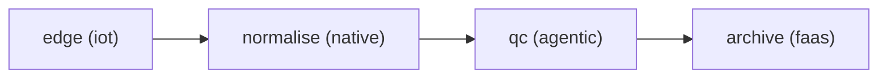

# 36. One graph across the continuum

*Edge, fog, HPC and cloud in one DAG: IoT observation, native normalisation, agentic quality control and a FaaS archive*

Workflows in Practice with DAGonStar - Part 3: Task models for AI–HPC. Slides: [36-DAGonStar-One_graph_across_the_continuum.pptx](../lectures/36-DAGonStar-One_graph_across_the_continuum.pptx). Examples: [examples/36-continuum](../../examples/36-continuum/).

## 2. Today's lecture

**Outline**

1. The computing continuum
2. Where each task type runs
3. Edge compute and placement
4. Hands-on: from a gateway to an archive
5. References across task types
6. Designing continuum workflows

**After this lecture you can**

- Combine five task types in one graph
- Choose where each step should run
- Trace data from the edge to the cloud

## 3. The continuum

*Sensors, gateways, clusters and clouds: one experiment, many places.*

## 4. Four tiers

- **Edge** - Buoys, gauges, gateways: data born here.
- **Fog** - Local servers near the sensors: filter and reduce.
- **HPC** - Clusters for models and ensembles (Part 4).
- **Cloud** - Functions, storage and services on demand.

> **One DAG, many places** each task type knows how to reach its tier; the graph stays the same.

## 5. Task types and tiers

| Task type | Typical tier | Lectures |
|---|---|---|
| `IOT` | Edge devices and gateways | 31, 32 |
| `BATCH, NATIVE` | Local, fog server | 06, 18 |
| `SLURM, containers` | HPC cluster | 37-41 |
| `AGENTIC, LLM` | Wherever the profile points | 27, 33-35 |
| `FAAS, WEB` | Cloud functions and services | 25, 29 |

## 6. Edge compute

*Some computation belongs next to the sensor: compute operations and placement.*

## 7. IoT compute

- **operation compute** run an artifact, action or executable at the edge
- **artifact** what to run, e.g. a container or a model file
- **runtime** the environment it needs
- **placement** preferences for where it runs
- **Bounded** completion and timeout, like any IoT task

> *Required*
>
> compute needs an artifact, action or executable.

```
operation="compute",
artifact={...},
placement={...},
completion={"mode":
  "job", ...}
```

## 8. Placement in provenance

- **placement** where the operation ran, as recorded
- **selectedTier** the tier the provider chose
- **migration_history** moves between nodes during the operation
- **Mock** records them from provider_options
- **Science** a result computed at the edge says so

> *Where is part of what*
>
> Results carry the place they were computed.

## 9. Hands-on

*Four tasks, four task types, one chain from a gateway at Pozzuoli to an archive.*

## 10. The continuum graph



Solid arrows: data dependencies (`workflow://`); dotted arrows: control dependencies.

- Edge: a bounded observation
- Fog: a native function
- Quality: an agent with gates
- Cloud: a function stores it

## 11. Edge and normalisation

[`examples/36-continuum/continuum.py`](../../examples/36-continuum/continuum.py)

```python
edge = DagonTask(TaskType.IOT, "edge", operation="observe", provider="mock",
                 target={"device_id": "gateway-pozzuoli"}, resource="temperature",
                 request={"events": EVENTS},
                 completion={"mode": "sample_count", "count": 4, "timeout_seconds": 10},
                 outputs={"observations": "outputs/observations.json"})
normalise = DagonTask(TaskType.NATIVE, "normalise",
                      "common.weather:events_to_observations",
                      inputs={"input_file": "workflow:///edge/outputs/observations.json"},
                      outputs={"output_file": "observations.json"})
```

- Four events from a gateway, sample_count 4
- A native function turns the IoT envelope into a record table

## 12. The native function

[`examples/common/weather.py`](../../examples/common/weather.py)

```python
def events_to_observations(input_file, output_file):
    """Normalise an IoT observation envelope into a record table."""
    with open(input_file, encoding="utf-8") as source:
        events = json.load(source)["events"]
    keys = ("id", "station", "temperature_c")
    records = [{key: event[key] for key in keys if key in event} for event in events]
    with open(output_file, "w", encoding="utf-8") as destination:
        json.dump({"observations": records}, destination, sort_keys=True)
    return {"count": len(records)}
```

- Reads the events of the IoT envelope and keeps id, station and temperature_c
- Returns a count: the native result recorded in .dagon/native_result.json

## 13. Quality and archive

[`examples/36-continuum/continuum.py`](../../examples/36-continuum/continuum.py)

```python
qc = quality_control("qc", tools=[],
                     inputs={"source": "workflow:///normalise/outputs/observations.json"})
archive = DagonTask(TaskType.FAAS, "archive", provider="mock", function="archive",
                    inputs={"table": {"document": "workflow:///qc/outputs/result.json"}},
                    outputs={"receipt": "receipt.json"},
                    provider_options={"mock": {"response": {
                        "status": "succeeded", "outputs": {"receipt": {"stored": True}}}}})
for task in (edge, normalise, qc, archive):
```

- The course's quality-control contract, with its input pointed at normalise
- The archive function receives qc's result as a file descriptor

## 14. Recorded output

Recorded output of `python examples/36-continuum/continuum.py`:

```text
graph: edge(IoTTask) -> normalise(NativeTask) -> qc(AgenticTask) -> archive(FaaSTask)
states: {'edge': 'FINISHED', 'normalise': 'FINISHED', 'qc': 'FINISHED', 'archive': 'FINISHED'}
QC accepted: True | records: 4
receipt: {'stored': True}
```

- Four classes in one chain
- All FINISHED
- Accepted, four records
- The receipt from the function

## 15. References

*workflow:// works the same in every task type: the graph is built from them.*

## 16. Where the references are

| Task | Reference in | Points to |
|---|---|---|
| `normalise` | `inputs.input_file` | edge/outputs/observations.json |
| `qc` | `inputs.source` | normalise/outputs/observations.json |
| `archive` | `inputs.table.document` | qc/outputs/result.json |

## 17. One mechanism, five places

- **BATCH** in the command string
- **NATIVE** in inputs bindings
- **IOT, FAAS** anywhere in the specification
- **AGENTIC** in contract inputs and references
- **All** a dependency, a reference count, staging

> *The same URL*
>
> Whatever the consumer type.

```
workflow:///edge/
  outputs/
  observations.json
```

## 18. Data through the continuum

1. **Device** - events
2. **Gateway** - event file
3. **Fog** - record table
4. **Agent** - validated table
5. **Cloud** - receipt

## 19. From mock to real

| Task | Teaching | Production |
|---|---|---|
| `edge` | provider mock | A provider added with register_provider |
| `normalise` | Local Python | Same, or executor slurm |
| `qc` | mock adapter | builtin adapter with [llm.<name>] |
| `archive` | provider mock | http, aws, azure or gcp |

> **The graph does not change** only providers, profiles and configuration.

## 20. Adding a real IoT provider

- **Registry** module and class name, imported lazily
- **register_provider** (name, module, class_name)
- **Contract** prepare, invoke, poll, capabilities
- **reattach** optional, for resuming after interruptions
- **Unknown name** Unknown IoT provider at construction

> *Your adapter*
>
> Then provider="mqtt" in the task.

```
register_provider(
 "mqtt",
 "lab.iot.mqtt",
 "MqttProvider")
```

## 21. Design

*Put each step where its data and its constraints are.*

## 22. Near the data or near the compute

**Near the data (edge, fog)**

- Reduce before sending
- Low latency for alarms
- Limited power and memory
- Intermittent links

**Near the compute (HPC, cloud)**

- Large models and ensembles
- Elastic capacity
- Data must travel there
- Cost per hour or per call

## 23. Checkpoint rules along the chain

| Task | Reused when |
|---|---|
| `edge` | Output sha256 values match |
| `normalise` | Name-based: code 0 and folder exists |
| `qc` | Identity digest and output hashes verify |
| `archive` | Same spec_sha256 |

> **Mixed rules** one resume applies the rule of each task's type.

## 24. Failures along the chain

- **Edge silent** timeout: the edge task fails, nothing downstream runs
- **Bad table** qc not accepted: archive never runs
- **Function down** transient errors retried by the FaaS policy
- **Resume** finished steps are reused by their own rule
- **Unknown actuation** never replayed (lecture 32)

> *Local failures*
>
> Each type fails in its own way; the graph contains it.

## 25. Rehearsing the whole chain

- **IoT** - The mock provider replays events.
- **Agentic** - The mock adapter is deterministic.
- **FaaS** - The mock returns a configured receipt.
- **Portable** - portable_emulation forces mocks for IoT and FaaS.

> **This example runs anywhere** no device, no model, no cloud account.

## 26. Run and break

**Steps**

1. Run the example
2. Duplicate one event in EVENTS with count 5
3. Run again: qc must deduplicate
4. Set threshold 1.0 and a mandatory gate that fails: archive is skipped

**Run it**

```bash
python examples/\
  36-continuum/\
  continuum.py
```

**Watch for:** Data errors at the edge are caught by the agentic gate before anything reaches the archive.

## 27. This lecture's example

- **4** - Task types in one chain
- **4** - Records accepted
- **0** - Devices, models or clouds needed

## 28. Exercise

A. Add a WEB task that posts the qc result to the local service of lecture 25
B. Make it depend on qc with a reference
C. Add an LLM summary of the accepted table
D. Draw the six-task graph

**Deliverable:** The six-task workflow, its output and the graph with each task's tier.

## 29. Check your understanding

1. Which task type would you use at the edge, and which in the cloud?
2. How does qc know where its input comes from?
3. Why can this example run without any device or account?
4. Why do checkpoint rules differ along the chain?

<details><summary>Answers</summary>

1. IOT at the edge; FAAS or WEB in the cloud.
2. From the workflow:// reference in its contract inputs, which creates the edge.
3. IoT, agentic and FaaS tasks all use deterministic mock providers or adapters.
4. Each type has its own reuse rule: content-based for IOT, AGENTIC, FAAS; name-based for NATIVE.

</details>

## 30. Key takeaways

1. The continuum: edge, fog, HPC and cloud
2. Every task type joins the same graph by references
3. Placement and provenance record where work ran
4. Mocks rehearse the whole chain offline

*Part 4: containers, clusters and data*

---

Raffaele Montella. CC0 1.0. Generated from `src/lectures/36.js`.
