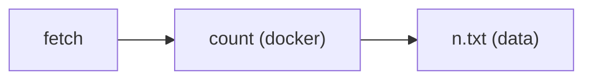

# 37. Docker tasks

*Running a task inside a container: images, the docker exec wrapper, volumes, remote daemons over SSH and testing without a daemon*

DAGonStar in Practice - Part 4: Infrastructure, FAIR and applications. Slides: [37-DAGonStar-Docker_tasks.pptx](../lectures/37-DAGonStar-Docker_tasks.pptx). Examples: [examples/37-docker](../../examples/37-docker/).

## 2. Today's lecture

**Outline**

1. Why containers for scientific software
2. The DOCKER task
3. How the command is wrapped
4. Volumes and the scratch directory
5. Remote daemons over SSH
6. Testing without a daemon

**After this lecture you can**

- Run a step in a pinned image
- Read the docker exec wrapper
- Explain how DAGonStar talks to a remote Docker daemon

## 3. Containers

*The environment of a step, frozen in an image: same libraries on a laptop, a server or a cloud VM.*

## 4. Why containers

- **Reproducible** - Pinned versions of Python, NetCDF, compilers.
- **Portable** - The same image on every host with Docker.
- **Isolated** - No conflicts between steps' dependencies.
- **Shareable** - An image name in a paper is a method.

> **Pin the tag** python:3.12-slim, not python:latest.

## 5. Container task types

| TaskType | Runtime | Lecture |
|---|---|---|
| `DOCKER` | Docker daemon, local or over SSH | 37 |
| `APPTAINER` | Apptainer/Singularity, no daemon | 38 |
| `KUBERNETES` | A pod in a cluster | 39 |
| `NOMAD` | A job on a Nomad cluster | 39 |

## 6. The DOCKER task

*A BATCH task whose command runs inside a container.*

## 7. Creating a Docker task

[`examples/37-docker/docker_task.py`](../../examples/37-docker/docker_task.py)

```python
task = DagonTask(TaskType.DOCKER, "regrid", "python regrid.py",
                 image="python:3.12-slim", working_dir="/work dir", remove=True)
print("type:", type(task).__name__, "| client created:", from_env.called)
```

- image: the environment; working_dir: a path with a space, to test quoting
- remove: delete the container when collected; the Docker client is created at once

## 8. Arguments

| Argument | Meaning |
|---|---|
| `image` | Image to run, pulled if pull=True |
| `container_id` | Reuse an already-running container |
| `volume` | host_path[:container_path] to mount |
| `devices` | Devices to pass through, e.g. GPUs |
| `remove` | Remove the container on garbage collection |
| `pull` | Pull the image first (default True) |
| `ip, ssh_username, keypath` | A remote daemon: DockerRemoteTask |

## 9. Lifecycle

1. **Pull** - The image, if pull.
2. **Run** - A detached container.
3. **Exec** - The launcher inside it.
4. **Stop** - When collected.
5. **Remove** - If remove=True.

## 10. The wrapper

*The usual launcher body runs through docker exec, with careful quoting.*

## 11. include_command

```
status = quote(self.working_dir + "/.dagon/command_status")
body = (join_command(("cd", self.working_dir)) + "; { "
        + body.strip()
        + "\necho $? > " + status
        + "; } | tee " + quote(self.stdout_path())
        + "; exit \"$(cat " + status + " 2>/dev/null || echo 1)\"")
return join_command(("docker", "exec", "-t",
                     self.container.id, "sh", "-c", body))
```

- sh has no PIPESTATUS
- Status saved to a file
- Exit with the command's status
- Every path quoted

## 12. Recorded output

Recorded output of `python examples/37-docker/docker_task.py`:

```text
type: DockerTask | client created: True
wrapped: docker exec -t c0ffee sh -c 'cd '"'"'/work dir'"'"'; { python regrid.py
remote endpoint: ssh://student@192.0.2.10:2200 | pull: False
live run skipped (set DAGON_LIVE_DOCKER=1 with a running daemon)
```

- DockerTask; client created
- exec into container c0ffee
- '/work dir' safely quoted
- Remote: ssh:// endpoint
- No live run without a daemon

## 13. Why the status file

- **Pipeline** the command's output goes through tee into the log
- **Bash** would use PIPESTATUS (lecture 10)
- **sh in images** slim images often have no bash
- **So** echo $? into .dagon/command_status, then exit with it
- **Missing file** exit 1: a crash is never a success

> *Exit codes matter*
>
> A failure inside the container must fail the task.

## 14. Volumes

*The container sees the workflow's scratch at the same path as the host.*

## 15. Mounts

- **Scratch base** always mounted read-write at the same path
- **Effect** workflow:// paths are valid inside the container
- **volume** an extra host_path or host_path:container_path
- **devices** e.g. /dev/nvidia0 for a GPU
- **Same path rule** no path translation needed in commands

> *In create_container*
>
> Host path = container path.

```
volumes[scratch_base] =
 {"bind": scratch_base,
  "mode": "rw"}
```

## 16. A containerised step



Solid arrows: data dependencies (`workflow://`); dotted arrows: control dependencies.

- fetch on the host
- count in busybox:1.36
- Same scratch, same paths

## 17. The live run

[`examples/37-docker/docker_task.py`](../../examples/37-docker/docker_task.py)

```python
if os.environ.get("DAGON_LIVE_DOCKER") == "1":
    with scratch("37") as base:
        wf = workflow("Docker37", base)
        wf.add_task(DagonTask(TaskType.BATCH, "fetch", fetch_observations()))
        count = DagonTask(TaskType.DOCKER, "count", "wc -l workflow:///fetch/"
                          "outputs/observations.csv > n.txt", image="busybox:1.36")
        wf.add_task(count)
        wf.run()
        print("live container:", count.status.name, text(count, "n.txt").split()[0])
```

- Runs only with DAGON_LIVE_DOCKER=1 and a running daemon
- The reference is resolved to a host path, which is also valid in the container

## 18. Remote daemons

*Pass ip and the task talks to a Docker daemon on another host over SSH.*

## 19. DockerRemoteTask

[`examples/37-docker/docker_task.py`](../../examples/37-docker/docker_task.py)

```python
    remote = DockerRemoteTask("regrid_hpc", "python regrid.py",
                              image="python:3.12-slim", ip="192.0.2.10",
                              ssh_username="student", keypath="/tmp/key",
                              working_dir="/home/student/work", ssh_port=2200, pull=False)
print("remote endpoint:", client.call_args.kwargs["base_url"], "| pull:", remote.pull)
check(client.call_args.kwargs["base_url"] == "ssh://student@192.0.2.10:2200", "ssh")
```

- The Docker client connects to ssh://user@host:port
- pull=False: use an image already on the remote host

## 20. Local or remote

- **No ip** DockerTask: the local daemon (docker.from_env)
- **ip given** DagonTask returns DockerRemoteTask
- **Endpoint** ssh://ssh_username@ip:ssh_port
- **Staging** from other hosts by SCP or GridFTP (lecture 44)
- **Keys** keypath: never a password in the workflow

> *Recorded output*
>
> 192.0.2.10 is a documentation address.

```
remote endpoint:
 ssh://student@
 192.0.2.10:2200
```

## 21. Containers and garbage collection

- **on_garbage** first the usual folder handling (lecture 14)
- **Then** the container is stopped
- **remove=True** and removed
- **remove=False** kept for inspection with docker logs
- **Long workflows** remove=True to avoid piles of stopped containers

> *remove_container*
>
> Called by on_garbage.

```
container.stop()
if self.remove:
    container.remove()
```

## 22. Images for this course

| Image | Use |
|---|---|
| `python:3.12-slim` | Python steps, NumPy via pip in the image |
| `busybox:1.36` | Shell utilities: wc, cut, sort |
| `Your own Dockerfile` | NetCDF, CDO, NCO, compiled models |
| `A registry tag with a digest` | The most reproducible reference |

## 23. Testing

*unittest.mock replaces the Docker client: the example runs on any machine.*

## 24. Mocked and live

**Mocked (default)**

- docker.from_env replaced
- Checks the wrapper text
- Runs in CI and on laptops
- No image, no daemon

**Live (DAGON_LIVE_DOCKER=1)**

- Real daemon and image
- Runs the container
- Checks the result file
- Needs Docker installed

## 25. Run it live

**Steps**

1. Run the example as is
2. Start Docker Desktop or dockerd
3. Run with DAGON_LIVE_DOCKER=1
4. Change the image tag and run again

**Run it**

```bash
DAGON_LIVE_DOCKER=1 \
 python examples/\
  37-docker/\
  docker_task.py
```

**Watch for:** The live run prints the record count computed inside busybox, read from the host scratch.

## 26. Troubleshooting

| Symptom | Likely cause |
|---|---|
| Cannot connect to the Docker daemon | Daemon not running |
| Image pull fails | Name, tag or network; try pull=False |
| File not found inside | Path outside the scratch: add a volume |
| Task FAILED, empty log | Command missing from the image |
| Remote: permission denied | User not in the docker group |

## 27. This lecture's example

- **1** - Docker client created
- **2200** - SSH port of the remote daemon
- **0** - Daemons needed by default

## 28. Exercise

A. Write a DOCKER task that computes station means with python:3.12-slim
B. Feed it the fetch output by reference
C. Run live if you have Docker
D. Otherwise check the wrapper with a mocked container

**Deliverable:** The task, and either the live result or the wrapped command.

## 29. Check your understanding

1. Why does the Docker wrapper write the exit status to a file?
2. Which host path is always mounted in the container?
3. What changes when you pass ip to a Docker task?
4. Why pin an image tag?

<details><summary>Answers</summary>

1. sh has no PIPESTATUS; tee would otherwise hide the command's status.
2. The workflow's scratch base, at the same path.
3. It becomes a DockerRemoteTask talking to ssh://user@ip:port.
4. A tag such as latest changes over time; a pinned tag keeps results reproducible.

</details>

## 30. Key takeaways

1. DOCKER tasks run the launcher in a container
2. The wrapper preserves exit status and quotes paths
3. The scratch is mounted at the same path
4. ip switches to a remote daemon over SSH

*Next: Apptainer on HPC*

---

Raffaele Montella. CC0 1.0. Generated from `src/lectures/37.js`.
