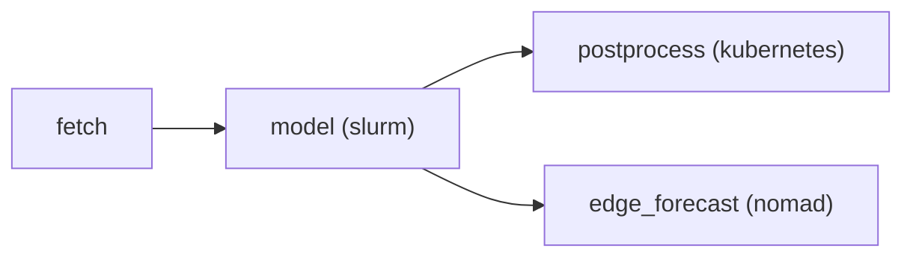

# 39. Kubernetes and Nomad

*Workflow steps on container orchestrators: long-lived pods with exec, batch jobs with resources, logs and purge*

DAGonStar in Practice - Part 4: Infrastructure, FAIR and applications. Slides: [39-DAGonStar-Kubernetes_and_Nomad.pptx](../lectures/39-DAGonStar-Kubernetes_and_Nomad.pptx). Examples: [examples/39-orchestrators](../../examples/39-orchestrators/).

## 2. Today's lecture

**Outline**

1. Orchestrators and workflows
2. KUBERNETES: a pod per task
3. NOMAD: a batch job per task
4. Hands-on: two lifecycles with mocked APIs
5. Resources, logs and cleanup
6. Choosing an execution back end

**After this lecture you can**

- Write KUBERNETES and NOMAD tasks
- Trace each task's lifecycle
- Choose an orchestrator for a step

## 3. Orchestrators

*Clusters of container hosts with an API: you ask for a container, they find a place for it.*

## 4. What an orchestrator gives

- **Placement** - Picks a node with free CPU and memory.
- **Isolation** - Namespaces, quotas and network policies.
- **Recovery** - Restarts or fails containers by policy.
- **One API** - The same calls on a laptop, a lab or a cloud.

> **DAGonStar keeps the graph** the orchestrator only runs each step's container.

## 5. Kubernetes and Nomad

**Kubernetes**

- Pods in namespaces
- Python client: kubernetes
- Config from ~/.kube/config
- Dominant in clouds

**Nomad**

- Jobs in datacenters and regions
- HTTP API on port 4646
- Light, single binary
- Popular at the edge and on premises

## 6. KUBERNETES

*One pod per task, kept alive with sleep infinity, commands run inside with exec.*

## 7. A Kubernetes task

[`examples/39-orchestrators/kubernetes_nomad.py`](../../examples/39-orchestrators/kubernetes_nomad.py)

```python
pod = DagonTask(TaskType.KUBERNETES, "postprocess", "python plot.py",
                image="python:3.12-slim", namespace="meteo", remove=True)
```

- image of the main container
- namespace: meteo
- remove: delete the pod after
- Config from load_kube_config

## 8. Arguments

| Argument | Meaning |
|---|---|
| `image` | Image of the pod's main container |
| `namespace` | Kubernetes namespace (default default) |
| `volumes, devices` | Mounts and devices for the container |
| `privileged` | Run privileged (avoid unless needed) |
| `remove` | Delete the pod when collected |
| `cleanup_timeout` | Seconds to wait for deletion (default 30) |
| `ip, ssh_username, keypath` | Remote variant using kubectl over SSH |

## 9. Pod lifecycle

1. **Create** - Pod with sleep infinity.
2. **Wait** - Until phase Running.
3. **Stage** - Copy inputs into the pod.
4. **Exec** - bash -c the command.
5. **Delete** - If remove=True.

## 10. Exec in the pod

- **API** connect_get_namespaced_pod_exec on container main
- **Command** ["/bin/bash", "-c", command]
- **References** resolved by pre_process_command first
- **Output** returned as JSON {"result": ...}
- **Once** a second execute returns the stored result

> *Check exit codes yourself*
>
> The pod task records code 0 after exec; end commands with a check that prints a failure clearly.

## 11. NOMAD

*One batch job per task: submit, poll, read the allocation, fetch logs, purge.*

## 12. A Nomad task

[`examples/39-orchestrators/kubernetes_nomad.py`](../../examples/39-orchestrators/kubernetes_nomad.py)

```python
job = DagonTask(TaskType.NOMAD, "edge_forecast", "python forecast.py",
                image="python:3.12-slim", nomad_address="http://nomad.invalid:4646",
                cpu=500, memory=1024, datacenter="campania-edge")
```

- nomad_address: the HTTP API (nomad.invalid: never resolved); cpu in MHz, memory in MB
- datacenter: where the job may run; defaults dc1 and region global

## 13. Nomad arguments

| Argument | Meaning |
|---|---|
| `image` | Docker image for the job (default ubuntu:22.04) |
| `nomad_address` | Nomad HTTP API (default localhost:4646) |
| `cpu, memory` | MHz and MB (defaults 100 and 256) |
| `datacenter, region` | Where the job may run |
| `volume` | host_path[:container_path] |
| `network_mode` | Docker network mode (default bridge) |

## 14. The job specification

```
{"Job": {"ID": "dagon-<name>-<8 hex>", "Type": "batch",
  "Datacenters": [datacenter], "Region": region,
  "TaskGroups": [{"Name": "dagon-group", "Count": 1,
    "RestartPolicy": {"Attempts": 0, "Mode": "fail"},
    "Tasks": [{"Driver": "docker",
      "Config": {"image": image, "command": "/bin/bash",
                 "args": ["-c", command]},
      "Resources": {"CPU": cpu, "MemoryMB": memory}}]}]}}
```

- A batch job
- No restarts: fail once
- Docker driver
- Declared resources

## 15. Job lifecycle

1. **Submit** - POST the job.
2. **Poll** - Until status dead.
3. **Allocation** - Read the exit code.
4. **Logs** - Fetch stdout.
5. **Purge** - DELETE ?purge=true.

## 16. Why RestartPolicy Attempts 0

- **Orchestrators** restart failed containers by default
- **Workflows** need to know that a step failed
- **Mode fail** the allocation fails instead of looping
- **DAGonStar** marks the task FAILED; consumers do not run
- **Retries** belong to the workflow design, not hidden in Nomad

> *Failures must surface*
>
> One attempt; the graph decides what happens next.

## 17. Hands-on

*Both APIs are mocked: we drive each lifecycle step by step and inspect the calls.*

## 18. Driving the pod

[`examples/39-orchestrators/kubernetes_nomad.py`](../../examples/39-orchestrators/kubernetes_nomad.py)

```python
running = mock.Mock()
running.status.phase, running.status.pod_ip = "Running", "10.0.0.5"
api.read_namespaced_pod.return_value = running
with redirect_stdout(io.StringIO()):        # the backend reports progress
    pod.create_pod()
    ip = pod.info["ip"]
    pod.remove_pod()
call = api.create_namespaced_pod.call_args
namespace = call.kwargs.get("namespace", call.args[0] if call.args else None)
```

- The mocked API reports phase Running with a pod IP
- create_pod, read info, remove_pod: the calls are recorded

## 19. Driving the job

[`examples/39-orchestrators/kubernetes_nomad.py`](../../examples/39-orchestrators/kubernetes_nomad.py)

```python
allocations = [{"ID": "alloc-1", "TaskStates": {"dagon-task": {
    "State": "dead", "Events": [{"Type": "Terminated", "ExitCode": 0}]}}}]
with mock.patch("dagon.nomad_task.requests.post", return_value=Reply({"EvalID": "e1"})) as post, \
        mock.patch("dagon.nomad_task.requests.get", side_effect=[
            Reply({"Status": "running"}), Reply({"Status": "dead"}), Reply(allocations),
            Reply(text="forecast done\n")]), \
        mock.patch("dagon.nomad_task.requests.delete", return_value=Reply()) as delete, \
        mock.patch("dagon.nomad_task.time.sleep"):
    job._submit_job()
    spec = post.call_args.kwargs["json"]["Job"]
    result = job._wait_for_completion(timeout=30)
    logs = job._get_logs()
    job._cleanup_job()
```

- Mocked replies: running, dead, an allocation with ExitCode 0, the logs
- time.sleep is patched so polling is instant

## 20. Recorded output

Recorded output of `python examples/39-orchestrators/kubernetes_nomad.py`:

```text
kubernetes: KubernetesTask | namespace: meteo | ip: 10.0.0.5 | deleted: True
nomad: NomadTask | datacenters: ['campania-edge'] | resources: {'CPU': 500, 'MemoryMB': 1024}
exit: 0 | logs: forecast done | purged: True
```

- Pod in meteo, IP, deleted
- Job in campania-edge
- 500 MHz, 1024 MB
- Exit 0, logs, purged

## 21. Calls observed

| Step | Kubernetes | Nomad |
|---|---|---|
| Start | `create_namespaced_pod` | `POST /v1/jobs` |
| Wait | `read_namespaced_pod` | `GET job status` |
| Result | `exec output` | `GET allocations` |
| Logs | `exec output` | `GET logs` |
| Cleanup | `delete_namespaced_pod` | `DELETE ?purge=true` |

## 22. Data

*Containers on another node do not share your laptop's scratch.*

## 23. Getting data in and out

- **Kubernetes** stage_in copies referenced files into the pod
- **Volumes** a shared persistent volume avoids copies
- **Nomad** volume host_path:container_path on the client node
- **Shared storage** NFS or a parallel file system on all nodes
- **Large data** keep it where it is; move the computation (lecture 42)

> *Plan the data path*
>
> An orchestrator schedules containers, not files.

## 24. A mixed workflow



Solid arrows: data dependencies (`workflow://`); dotted arrows: control dependencies.

- HPC for the model
- Kubernetes for plots
- Nomad at the edge
- One DAG

## 25. Choosing a back end

| Need | Choose |
|---|---|
| Many cores, MPI, GPUs on a cluster | SLURM (lecture 41) |
| Container on a cloud or lab cluster | KUBERNETES |
| Light jobs on edge or on-premise nodes | NOMAD |
| A container on one host | DOCKER |
| A container on HPC without root | APPTAINER |

## 26. Run and inspect

**Steps**

1. Run the example
2. Print spec["TaskGroups"][0]["RestartPolicy"]
3. Change cpu and memory and run again
4. Print api.method_calls for the pod

**Run it**

```bash
python examples/\
  39-orchestrators/\
  kubernetes_nomad.py
```

**Watch for:** Every API call DAGonStar makes is visible in the mock: a precise picture of the lifecycle.

## 27. This lecture's example

- **2** - Orchestrators
- **5** - Lifecycle steps each
- **0** - Clusters needed

## 28. Exercise

A. Make the mocked allocation end with ExitCode 2
B. Run _wait_for_completion and read the code
C. Make the pod phase stay Pending; what happens?
D. Write a sentence on testing with mocks

**Deliverable:** Both results and the sentence.

## 29. Check your understanding

1. Why does the Kubernetes pod run sleep infinity?
2. What does RestartPolicy Attempts 0, Mode fail achieve?
3. How are a Nomad job's resources declared?
4. Which cleanup does each back end perform?

<details><summary>Answers</summary>

1. To keep the pod alive so commands can be executed in it with exec.
2. A failed step fails once and visibly, instead of being restarted.
3. Resources CPU (MHz) and MemoryMB, from cpu and memory.
4. Kubernetes deletes the pod (remove=True); Nomad purges the job.

</details>

## 30. Key takeaways

1. KUBERNETES: a pod, exec, delete
2. NOMAD: a batch job, poll, logs, purge
3. Failures must surface: no hidden restarts
4. Pick the back end by resources and location

*Next: SSH and cloud tasks*

---

Raffaele Montella. CC0 1.0. Generated from `src/lectures/39.js`.
