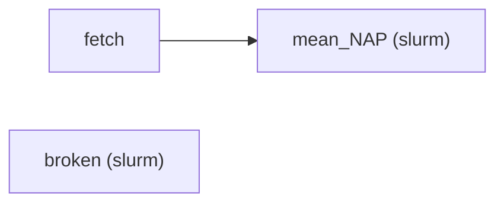

# 41. Slurm tasks

*Submitting workflow steps to an HPC scheduler: sbatch options, waiting with -W, exit codes and testing without a cluster*

DAGonStar in Practice - Part 4: Infrastructure, FAIR and applications. Slides: [41-DAGonStar-Slurm_tasks.pptx](../lectures/41-DAGonStar-Slurm_tasks.pptx). Examples: [examples/41-slurm](../../examples/41-slurm/).

## 2. Today's lecture

**Outline**

1. Schedulers and workflows
2. The SLURM task
3. The generated sbatch command
4. Hands-on: two jobs through a stand-in
5. Exit codes and failures
6. Running on a real cluster

**After this lecture you can**

- Write SLURM tasks with resources
- Read the sbatch command DAGonStar builds
- Test a Slurm workflow on a laptop

## 3. Schedulers

*An HPC cluster is shared: jobs wait in queues until resources are free.*

## 4. Slurm in one slide

- **Partitions** - Queues of nodes: debug, compute, gpu.
- **Resources** - Tasks, nodes, memory, time limit.
- **sbatch** - Submit a script; returns a job id.
- **Accounting** - Every job recorded with its usage.

> **The workflow decides the order** Slurm decides when and where each submitted step runs.

## 5. The SLURM task

*A BATCH task whose launcher is submitted with sbatch and awaited with -W.*

## 6. Arguments

| Argument | sbatch option |
|---|---|
| `partition` | `--partition=` |
| `ntasks` | `--ntasks=` |
| `memory` | `--mem= (MB per node)` |
| `time` | `--time= (HH:MM:SS)` |
| `nodes, ntasks_per_node` | `--nodes=, --ntasks-per-node=` |
| `nodelist` | `--nodelist=` |
| `comment` | `--comment= (site features, e.g. BeeOND)` |
| `sbatch_options` | `Extra options, appended as given` |

## 7. generate_command

```
options.extend("--comment=" + c for c in comments)
if self.partition is not None:
    options.append("--partition=" + self.partition)
if self.ntasks is not None:
    options.append("--ntasks=" + str(self.ntasks))
...
options.extend(self.sbatch_options)
return join_command(["sbatch", *options, "-J", self.name,
    "-D", self.working_dir,
    "-W", self.working_dir + "/.dagon/" + script_name])
```

- Only options you set
- -J: the task name
- -D: the task folder
- -W: wait for the end

## 8. Why -W

- **sbatch** normally returns at once with a job id
- **-W** waits until the job ends
- **Exit status** sbatch exits with the job's status
- **DAGonStar** one thread per task waits; the graph moves on
- **Effect** dependencies are respected without Slurm dependencies

> **-W** - *Wait*
>
> The task finishes when the job finishes.

## 9. The command

*The first part of the example prints the command for hostile values.*

## 10. Building a command

[`examples/41-slurm/slurm_tasks.py`](../../examples/41-slurm/slurm_tasks.py)

```python
command = Slurm("wrf; touch pwned", "echo ok", partition="debug queue", ntasks=4,
                memory=2048, time="01:00:00", nodes=1,
                working_dir="/scratch/work dir").generate_command("launcher.sh")
print("sbatch:", command.replace(" -W ", "\n       -W "))
```

- A task name containing ; touch pwned, a partition and a folder with spaces
- generate_command builds the string; nothing is submitted

## 11. Recorded output

Recorded output of `python examples/41-slurm/slurm_tasks.py`:

```text
sbatch: sbatch '--partition=debug queue' --ntasks=4 --mem=2048 --time=01:00:00 --nodes=1 -J 'wrf; touch pwned' -D '/scratch/work dir'
       -W '/scratch/work dir/.dagon/launcher.sh'
jobs submitted: ['broken', 'mean_NAP']
mean_NAP: FINISHED NAP 15.50
broken: FAILED
```

- Quoted partition, name and folder
- Resources as options
- Two jobs submitted
- NAP mean 15.50
- The broken job FAILED

## 12. Reading the command

- **'--partition=debug queue'** one argument despite the space
- **-J 'wrf; touch pwned'** a name, not a second command
- **-D '/scratch/work dir'** the job runs in the task folder
- **-W '.../.dagon/launcher.sh'** the launcher of lecture 10
- **Lesson** quoting again, as in lecture 40

> *Hostile values, safe command*
>
> Every value goes through join_command.

## 13. Hands-on

*mock_sbatch replaces sbatch with a local stand-in: the job script runs at once with bash.*

## 14. Two Slurm tasks

[`examples/41-slurm/slurm_tasks.py`](../../examples/41-slurm/slurm_tasks.py)

```python
model = DagonTask(TaskType.SLURM, "mean_NAP", station_mean(
    "NAP", "workflow:///fetch/outputs/observations.csv", "outputs/mean.txt"),
    partition="compute", ntasks=2, time="00:05:00")
broken = DagonTask(TaskType.SLURM, "broken", "sh -c 'exit 3'")
wf.add_task(model)
wf.add_task(broken)
with mock_sbatch(log):
    wf.run()
```

- mean_NAP: the station mean of lecture 06, on partition compute with 2 tasks
- broken exits with 3; the stand-in records every submission in a log

## 15. The graph



Solid arrows: data dependencies (`workflow://`); dotted arrows: control dependencies.

- fetch runs locally
- mean_NAP waits for fetch
- broken is independent
- Two submissions

## 16. The stand-in scheduler

- **Replaces** only the sbatch command DAGonStar builds
- **Runs** the job script with local bash, in the -D folder
- **Exits** with the script's status, like sbatch -W
- **Records** each submission with time and options
- **Is not** a Slurm emulator: no queue, no resources

> *examples/common/mock_scheduler.py*
>
> Copied from the DAGonStar examples.

```
with mock_sbatch(log):
    wf.run()
```

## 17. Exit codes

*A job's failure must become the task's failure.*

## 18. From exit 3 to FAILED

1. **Script** - sh -c 'exit 3'.
2. **Launcher** - exit $code.
3. **sbatch -W** - Exits with 3.
4. **DAGonStar** - code != 0.
5. **Task** - FAILED.

## 19. Slurm failures you will meet

- **Exit code** the command failed: read .dagon/stdout.txt
- **TIMEOUT** time too short: raise --time
- **OUT_OF_MEMORY** raise --mem
- **Rejected** invalid partition or limits: sbatch fails at once
- **Preempted** the job was cancelled: resume (lecture 15)

> *Read sacct*
>
> sacct -j <id> shows state, exit code and usage.

## 20. Native tasks on Slurm

- **executor="slurm"** a NATIVE task submitted like a SLURM task
- **resources** a mapping of sbatch options for the function
- **Same runner** python -m dagon.native_runner in the job
- **Bindings** validated before submission (lecture 19)
- **Use** Python steps that need a compute node

> *Lecture 18*
>
> Functions, not shell commands.

```
DagonTask(TaskType.NATIVE,
 "stats", "lab.stats:run",
 executor="slurm", ...)
```

## 21. Useful Slurm commands

| Command | Shows |
|---|---|
| `squeue -u $USER` | Your queued and running jobs |
| `sacct -j <id>` | State, exit code, elapsed time, memory |
| `scancel <id>` | Cancels a job (its task fails) |
| `sinfo` | Partitions and node states |

## 22. On a real cluster

*Run DAGonStar on the login node; tasks become jobs on compute nodes.*

## 23. Practical setup

- **Login node** - The workflow script runs here, lightly.
- **Shared scratch** - scratch_dir_base on a file system all nodes see.
- **Modules** - module load in the command, or in a container.
- **Limits** - Many small tasks: group them or use PARALLEL staging.

## 24. A cluster configuration

```
[batch]
scratch_dir_base = /scratch/student/dagon
remove_dir = True

# in the workflow script
DagonTask(TaskType.SLURM, "wrf", "srun ./wrf.exe",
          partition="compute", ntasks=64, nodes=2,
          time="02:00:00")
```

- Shared scratch
- Resources per task
- srun for MPI

## 25. Where steps should run

| Step | Where |
|---|---|
| Download, small text processing | BATCH on the login node |
| Model run, MPI | SLURM with nodes and ntasks |
| Many short independent jobs | SLURM, or group them in one task |
| GPU inference | SLURM on a gpu partition |
| Containerised model | SLURM with apptainer exec |

## 26. Run and vary

**Steps**

1. Run the example
2. Add memory=1024 to mean_NAP and read the submission log
3. Change broken to exit 0
4. On a cluster: remove mock_sbatch and run

**Run it**

```bash
python examples/\
  41-slurm/\
  slurm_tasks.py
```

**Watch for:** The submission log shows every option; on a real cluster sacct shows the same jobs.

## 27. This lecture's example

- **2** - Jobs submitted
- **15.50** - °C, NAP mean computed in a job
- **0** - Clusters needed

## 28. Exercise

A. Add mean tasks for CAP and ISC on partition compute
B. Add a SLURM task that combines the three means
C. Read the submission log: in what order were they submitted?
D. Explain the order from the graph

**Deliverable:** The workflow, the log and the explanation.

## 29. Check your understanding

1. What does sbatch -W do for DAGonStar?
2. How is a failing job turned into a FAILED task?
3. Why is the name 'wrf; touch pwned' harmless?
4. What does mock_sbatch not emulate?

<details><summary>Answers</summary>

1. It waits for the job to end and exits with its status, so the task thread knows the outcome.
2. The launcher exits with the command's code; sbatch -W returns it; non-zero means FAILED.
3. It is quoted as a single argument to -J.
4. Queues, allocations and resource accounting: it just runs the script.

</details>

## 30. Key takeaways

1. SLURM tasks submit the launcher with sbatch -W
2. Resources map to sbatch options; all values quoted
3. Exit codes flow from the job to the task
4. A stand-in sbatch tests workflows without a cluster

*Next: BeeOND job-local storage*

---

Raffaele Montella. CC0 1.0. Generated from `src/lectures/41.js`.
