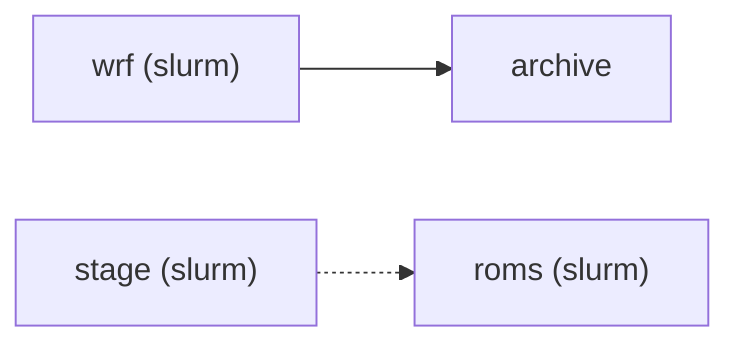

# 42. BeeOND job-local storage

*Fast BeeGFS-on-demand volumes for Slurm tasks: task and workflow scopes, persistence and validated configuration*

DAGonStar in Practice - Part 4: Infrastructure, FAIR and applications. Slides: [42-DAGonStar-BeeOND_job_local_storage.pptx](../lectures/42-DAGonStar-BeeOND_job_local_storage.pptx). Examples: [examples/42-beeond](../../examples/42-beeond/).

## 2. Today's lecture

**Outline**

1. Why job-local storage
2. BeeOND in Slurm
3. Task-scope volumes
4. Workflow-scope volumes
5. Hands-on: write, persist, share
6. Safe configuration

**After this lecture you can**

- Request a BeeOND volume for a Slurm task
- Choose between task and workflow scope
- Explain how data survives the volume

## 3. I/O on clusters

*Thousands of small files on a shared parallel file system slow everyone down.*

## 4. The problem

- **Shared** - One file system for all users and jobs.
- **Metadata** - Creating many files is slow.
- **Temporaries** - Model output read once, then deleted.
- **Contention** - Your I/O affects other jobs.

> **Job-local storage** a private, fast file system on the nodes of your allocation, gone when the job ends.

## 5. BeeOND

- **BeeGFS On Demand** a parallel file system created per job
- **Requested** with a site-specific --comment, e.g. beeond-fs
- **Mounted** on every node of the allocation
- **Default mount** /mnt/beeond_${SLURM_JOB_USER}-jobid_${SLURM_JOB_ID}
- **Destroyed** when the job ends: copy out what you need

> *How commands find it*
>
> An environment variable set by the launcher.

```
$DAGON_BEEOND
```

## 6. Configuration

*BeeONDConfig: from the [beeond] section, overridden per task or volume, validated at once.*

## 7. Defaults and refusals

[`examples/42-beeond/beeond.py`](../../examples/42-beeond/beeond.py)

```python
defaults = BeeONDConfig()
print("defaults: scope=%s persist=%s comment=%s"
      % (defaults.scope, defaults.persist, defaults.comment))
rejected = []
for options in ({"scope": "cluster"}, {"mount_template": "/mnt/$(id)"}, {"volume": "a b"}):
    try:
        BeeONDConfig(**options)
    except ValueError:
        rejected.append(next(iter(options)))
print("rejected options:", rejected)
```

- Defaults: task scope, persist True, comment beeond-fs
- Three bad values are refused: unknown scope, command substitution, a space in a name

## 8. Main options

| Option | Default | Meaning |
|---|---|---|
| `scope` | `task` | task or workflow |
| `comment` | `beeond-fs` | --comment asking for the volume |
| `mount_template` | `/mnt/beeond_...` | Mount point; $VAR allowed, $(...) not |
| `persist` | `True` | Copy out before teardown |
| `persist_dir` | `<working_dir>/beeond` | Where to copy |
| `verify` | `list` | none, list or checksum |
| `signal_grace` | `None` | Seconds before the limit to persist |

## 9. Recorded output

Recorded output of `python examples/42-beeond/beeond.py`:

```text
defaults: scope=task persist=True comment=beeond-fs
rejected options: ['scope', 'mount_template', 'volume']
comment flags: 1 | nodes: True
task volume persisted: wrfout d01
workflow volume shared: boundary
```

- Defaults
- Three refusals
- One --comment, --nodes 2
- Task volume persisted
- Workflow volume shared

## 10. Why validate

- **mount_template** expanded by bash on the compute node
- **$(id)** would run a command: refused
- **Volume names** become paths and job names: no spaces
- **scope** only task or workflow
- **When** at construction, before any submission

> *Recorded output*
>
> ValueError for each.

```
rejected options:
 ['scope',
  'mount_template',
  'volume']
```

## 11. The sbatch fragment

[`examples/42-beeond/beeond.py`](../../examples/42-beeond/beeond.py)

```python
command = Slurm("wrf", "run", comment="beeond-fs", nodes=2, nodelist="wn[01-02]",
                beeond="task", working_dir="/scratch/w").generate_command("launcher.sh")
print("comment flags:", command.count("--comment=beeond-fs"), "| nodes:", "--nodes=2" in command)
```

- The task asks for beeond-fs twice (comment and beeond=task): it appears once
- nodes and nodelist describe the allocation the volume spans

## 12. Task scope

*Each Slurm task gets its own volume for the life of its job.*

## 13. A task-scope volume

1. **Submit** - With --comment.
2. **Mount** - Wait until writable.
3. **Run** - Write to $DAGON_BEEOND.
4. **Persist** - Copy to working_dir/beeond.
5. **Verify** - Compare file lists.

## 14. Reading persisted data

- **Persisted to** <working_dir>/beeond by default
- **Reference** workflow:///wrf/beeond/wrfout.txt
- **Consumers** ordinary tasks, any type
- **On failure** persisted too (persist_on_failure True)
- **Time limit** signal_grace sends USR1 to persist in time

> *Recorded output*
>
> archive read it after the volume was gone.

```
task volume persisted:
  wrfout d01
```

## 15. Workflow scope

*One holder job keeps the volume; tasks run as steps inside its allocation.*

## 16. A workflow-scope volume

1. **Holder** - One job allocates nodes.
2. **Steps** - srun --jobid=<holder>.
3. **Share** - Same $DAGON_BEEOND.
4. **End** - Persist, release.

## 17. Workflow volumes

- **Create** wf.create_beeond_volume("forcing", time=...)
- **Attach** beeond="workflow:forcing" on Slurm tasks
- **Started** by the first task that uses it
- **Released** when run() ends, after persistence
- **restore** copy a persisted volume back when resuming

> *One allocation*
>
> No queue wait between steps that share it.

## 18. Persistence options

| Option | Effect |
|---|---|
| `persist_tool` | auto (rsync if present, else cp -a), rsync or cp |
| `verify` | none, list (every file exists) or checksum |
| `persist_on_failure` | Also copy out when the command failed |
| `persist_each_task` | Workflow scope: copy after every step |
| `restore` | Workflow scope: copy back when resuming |

## 19. The [beeond] section

- **Site defaults** comment, mount_template, verify, signal_grace
- **Holder defaults** partition, nodelist, ntasks_per_node, time
- **Override** per task with beeond={...}
- **Override** per volume with create_beeond_volume(..., **options)
- **Validated** whatever the source, at construction

> *In dagon.ini*
>
> Ask your site which comment it uses.

```
[beeond]
comment = beeond-fs
verify = list
signal_grace = 300
```

## 20. When BeeOND pays off

- **Many small files** - Model output split per time step.
- **Scratch-heavy steps** - Write, read once, discard.
- **Coupled steps** - Atmosphere writes, ocean reads, same nodes.
- **Not for** - Final products: they belong on persistent storage.

## 21. Hands-on

*Portable emulation: no cluster, the same commands, folders standing in for the volumes.*

## 22. Four tasks, two volumes

[`examples/42-beeond/beeond.py`](../../examples/42-beeond/beeond.py)

```python
wf.create_beeond_volume("forcing", time="00:10:00")
write = DagonTask(TaskType.SLURM, "wrf", 'echo "wrfout d01" > "$DAGON_BEEOND/wrfout.txt"',
                  beeond="task")
read = DagonTask(TaskType.BATCH, "archive", "cp workflow:///wrf/beeond/wrfout.txt kept.txt")
stage = DagonTask(TaskType.SLURM, "stage", 'echo "boundary" > "$DAGON_BEEOND/bc.txt"',
                  beeond="workflow:forcing")
use = DagonTask(TaskType.SLURM, "roms", 'cat "$DAGON_BEEOND/bc.txt" > used.txt',
                beeond="workflow:forcing")
for task in (write, read, stage, use):
    wf.add_task(task)
wf.make_dependencies()
use.add_dependency_to(stage)          # shared volume: order by hand
```

- wrf writes to a task volume; archive reads the persisted copy by reference
- stage and roms share the workflow volume: no reference, so the order is set by hand

## 23. The graph



Solid arrows: data dependencies (`workflow://`); dotted arrows: control dependencies.

- Data edge via beeond/
- Control edge by hand
- Inside a volume, no references

## 24. Why order by hand

- **References** point to persistent folders, not volumes
- **Shared volume** roms reads $DAGON_BEEOND/bc.txt directly
- **No workflow:// in the command** so no edge is inferred
- **Without the edge** roms might start before stage
- **add_dependency_to** makes the order explicit (lecture 07)

> *Recorded output*
>
> roms read what stage wrote.

```
workflow volume shared:
  boundary
```

## 25. Task or workflow scope

**Task scope**

- One volume per job
- Data shared via persisted copies
- Simple, independent jobs
- Queue wait for each task

**Workflow scope**

- One volume for many steps
- Data shared in place
- Steps inside one allocation
- Order by hand; holder must fit the time limit

## 26. Run and vary

**Steps**

1. Run the example
2. Remove use.add_dependency_to(stage) and run a few times
3. Set verify to checksum on the task volume
4. Read the persisted folder of wrf

**Run it**

```bash
python examples/\
  42-beeond/\
  beeond.py
```

**Watch for:** Without the explicit edge the result depends on thread timing: a race, not a bug in DAGonStar.

## 27. This lecture's example

- **2** - Volumes: task and workflow
- **3** - Unsafe options refused
- **1** - Edge added by hand

## 28. Exercise

A. Add a second step that appends to bc.txt in the forcing volume
B. Order the three steps by hand
C. Set persist_dir for the workflow volume
D. Read the persisted copy after the run

**Deliverable:** The workflow, the persisted file and a note on the order.

## 29. Check your understanding

1. How does a command find its BeeOND volume?
2. Where is a task volume persisted by default?
3. Why must tasks sharing a workflow volume be ordered by hand?
4. Why is $(id) refused in mount_template?

<details><summary>Answers</summary>

1. Through the DAGON_BEEOND environment variable.
2. In <working_dir>/beeond, readable as workflow:///<task>/beeond/...
3. They share files without workflow:// references, so no edge is inferred.
4. The template is expanded by bash; command substitution would run code.

</details>

## 30. Key takeaways

1. BeeOND gives jobs a private parallel file system
2. Task scope: one volume per job, persisted afterwards
3. Workflow scope: one holder, steps share the volume
4. Options are validated; shared volumes need explicit order

*Next: pre-staging inputs before submission*

---

Raffaele Montella. CC0 1.0. Generated from `src/lectures/42.js`.
