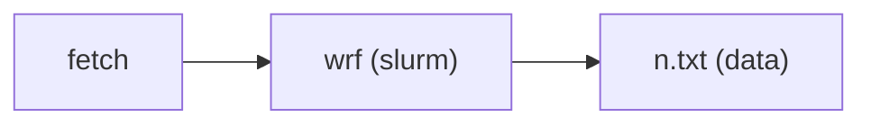

# 43. Pre-staging scheduler inputs

*Moving inputs before sbatch: no allocated cores wait for transfers, verified inputs, and no job when staging fails*

Workflows in Practice with DAGonStar - Part 4: Infrastructure, FAIR and applications. Slides: [43-DAGonStar-Pre_staging_scheduler_inputs.pptx](../lectures/43-DAGonStar-Pre_staging_scheduler_inputs.pptx). Examples: [examples/43-prestage](../../examples/43-prestage/).

## 2. Today's lecture

**Outline**

1. The cost of staging inside a job
2. The pre-staged lifecycle
3. Who may pre-stage
4. Hands-on: a verified run and a refused submission
5. Markers, identities and re-checks
6. Metadata and savings

**After this lecture you can**

- Enable pre-staging for Slurm tasks
- Explain why a failed stage-in submits nothing
- Read pre-staging metadata

## 3. The problem

*In the legacy lifecycle, inputs are copied after the allocation starts: cores wait for files.*

## 4. Legacy lifecycle

1. **Launcher** - Staging + command.
2. **sbatch** - Wait in queue.
3. **Allocate** - Cores reserved.
4. **Stage in** - Cores idle.
5. **Compute** - Finally.

## 5. What idle cores cost

- **64 cores** waiting 15 minutes for a transfer
- **Cost** 64 × 0.25 h = 16 core-hours, for nothing
- **Worse** a missing input is found after the queue wait
- **Then** the job fails, the allocation is wasted
- **Fix** move inputs before asking for cores

> **16** - *Core-hours lost*
>
> For one 15-minute staging on 64 cores.

## 6. Pre-staging

*Stage on the submission host, verify, write a marker, then submit a compute-only job.*

## 7. Pre-staged lifecycle

1. **Stage plan** - Inputs to copy.
2. **Stage** - On the login node.
3. **Verify** - Content identity.
4. **Marker** - Written last.
5. **sbatch** - Compute only.

## 8. Enabling it

- **Workflow** Workflow(..., pre_stage=True)
- **Task** Slurm(..., pre_stage=True) overrides
- **Values** only True, False or None: "true" is refused
- **Eligible** tasks whose backend is pre_stage_capable
- **Status** the task stays RUNNING while staging and queued

> *One flag*
>
> Eligible tasks pre-stage; others keep the legacy lifecycle.

```
Workflow("PreStage43",
  config=cfg,
  pre_stage=True)
```

## 9. Legacy and pre-staged

**Legacy**

- Launcher stages, then computes
- Cores held during transfers
- Missing input found after the queue
- One script

**Pre-staged**

- stage_in.sh, then a compute launcher
- Cores held only for compute
- Missing input found before sbatch
- Marker and identities recorded

## 10. Phases inside RUNNING

- **PREPARING** plan built
- **STAGING** stage_in.sh running on the submission host
- **STAGED** verified, marker written
- **SUBMITTED** queued and running: sbatch -W returns at the end
- **COMPLETED or FAILED** the outcome

> *Status is unchanged*
>
> The task is RUNNING throughout, as a legacy Slurm task is.

## 11. Eligibility

*Asking for pre-staging where it cannot work is an error, not a silent fallback.*

## 12. Two refusals

[`examples/43-prestage/prestage.py`](../../examples/43-prestage/prestage.py)

```python
refused = []
plain = Batch("b", "true")
plain.pre_stage = True               # requested on a backend without the capability
for label, task in (("batch", plain), ("beeond", Slurm("s", "true", beeond="task",
                                                        pre_stage=True))):
    try:
        workflow("eligibility-" + label, tempfile.gettempdir()).add_task(task)
    except PreStageConfigurationError:
        refused.append(label)
print("ineligible requests refused:", refused)
```

- A plain Batch task has no scheduler: pre_stage=True is refused
- A Slurm task with a task-scope BeeOND volume is refused too

## 13. Who may pre-stage

| Task | pre_stage=True |
|---|---|
| SLURM | Allowed |
| SLURM with beeond="task" | Refused: inputs belong in the job's volume |
| BATCH, local tasks | Refused: nothing to submit |
| Workflow-level True | Applied to eligible tasks |

> **PreStageConfigurationError** raised by add_task, before anything runs.

## 14. Hands-on

*The same Slurm task twice: with a valid reference, then with a missing file.*

## 15. The workflow

[`examples/43-prestage/prestage.py`](../../examples/43-prestage/prestage.py)

```python
def run(base, reference):
    log = str(base / "sbatch.jsonl")
    wf = workflow("PreStage43", base, pre_stage=True)
    wf.add_task(DagonTask(TaskType.BATCH, "fetch", fetch_observations()))
    model = DagonTask(TaskType.SLURM, "wrf", "wc -l < " + reference + " > n.txt", ntasks=8)
    wf.add_task(model)
    with mock_sbatch(log):
        wf.run()
    return model, submission_for(log, "wrf")
```

- pre_stage=True on the workflow; the Slurm task reads a fetch output
- The stand-in sbatch records whether the marker existed at submission

## 16. The graph



Solid arrows: data dependencies (`workflow://`); dotted arrows: control dependencies.

- fetch on the host
- wrf stages first
- then submits

## 17. Recorded output

Recorded output of `python examples/43-prestage/prestage.py`:

```text
ineligible requests refused: ['batch', 'beeond']
ok run: FINISHED | marker before sbatch: True | verified inputs: 1
metadata is path-free: True
bad run: FAILED | phase: staging | sbatch called: False
```

- Two refusals
- Marker before sbatch
- One verified input
- No paths in metadata
- Bad input: no sbatch

## 18. The bad run

- **Reference** workflow:///fetch/outputs/missing.csv
- **Stage-in** fails on the submission host
- **Error** StageInFailedError, phase staging
- **sbatch** never called: no queue wait, no allocation
- **Status** FAILED, failure_phase "staging"

> *Recorded output*
>
> The failure costs zero core-hours.

```
bad run: FAILED
| phase: staging
| sbatch called:
  False
```

## 19. Failure phases

| Phase | Error | Job submitted? |
|---|---|---|
| `configuration` | `PreStageConfigurationError` | no |
| `staging` | `StageInFailedError` | no |
| `submission` | `SchedulerSubmissionError` | rejected |
| `execution` | `ScheduledExecutionError` | yes, it failed |

## 20. Verification

*Inputs are checked when staged and again when the allocation starts.*

## 21. Files in .dagon

| File | Content |
|---|---|
| `stage_in.sh` | The generated stage-in script |
| `stage-in-identity.txt` | Content identity of each source |
| `stage-in-destinations.txt` | Listing of each staged destination |
| `stage-in-complete.json` | The marker, written last |
| `allocation_started_at` | Written when the job starts |

## 22. The re-check

- **At job start** the launcher recomputes the destination listing
- **Changed** the job refuses to run
- **Why** time passes in the queue; files can change
- **Cost** a short read inside the allocation
- **Recorded** recheck time in the metadata

> *Trust, then verify*
>
> Staged early, checked again at the last moment.

## 23. Metadata

*get_execution_metadata()["pre_stage"] records what happened, without host paths.*

## 24. What is recorded

- **Phases** timestamps of staging, submission, start
- **Inputs** count of inputs whose content was verified
- **Policy** PRE_STAGE_POLICY_VERSION
- **Path-free** no scratch paths: safe to publish
- **Estimate** core-hours saved

> *Recorded output*
>
> The example searches it for the scratch path.

```
metadata is path-free:
  True
```

## 25. Core-hours saved

```
def estimated_core_hours_saved(cores, staging_seconds,
                               recheck_seconds=None):
    # cores * (staging - recheck) / 3600
    return round(cores * (staging_seconds
                          - (recheck_seconds or 0)) / 3600.0, 6)
```

- An estimate
- Upper bound in practice
- Negative if re-check cost more

## 26. Run and inspect

**Steps**

1. Run the example
2. Print model.get_execution_metadata()["pre_stage"]
3. Read .dagon/stage_in.sh of wrf
4. Set pre_stage="true" (a string) and read the error

**Run it**

```bash
python examples/\
  43-prestage/\
  prestage.py
```

**Watch for:** Only booleans are accepted: a typo can never silently change where data is staged.

## 27. This lecture's example

- **2** - Ineligible requests refused
- **1** - Input verified before sbatch
- **0** - Jobs submitted after a failed stage-in

## 28. Exercise

A. Add a second input to wrf from another task
B. Run with pre_stage True and False
C. Compare the submission logs: marker present?
D. Compute the core-hours saved for 64 cores and 10 minutes

**Deliverable:** Both logs, the metadata and the computation.

## 29. Check your understanding

1. Why does staging inside a job waste resources?
2. What happens if pre-staging fails?
3. Why is a task-scope BeeOND volume ineligible?
4. What is re-checked when the job starts?

<details><summary>Answers</summary>

1. Allocated cores wait idle while files are copied.
2. StageInFailedError; sbatch is never called; the task FAILS in phase staging.
3. Its inputs must be written into the job's own volume, which exists only inside the job.
4. The listing of staged destinations; the job refuses to run if it changed.

</details>

## 30. Key takeaways

1. Pre-staging moves inputs before sbatch
2. Eligibility is checked when tasks are added
3. A failed stage-in submits nothing
4. Inputs are verified twice and recorded without paths

*Next: data movers*

---

Raffaele Montella. CC0 1.0. Generated from `src/lectures/43.js`.
