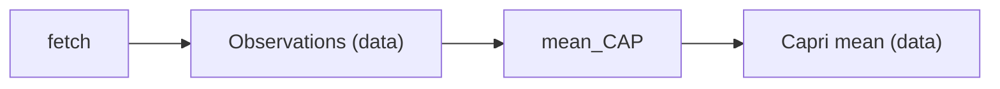

# 45. FAIR workflows

*Findable, accessible, interoperable and reusable runs: profiles, declared artifacts, RO-Crate and PROV, and no secrets in metadata*

Workflows in Practice with DAGonStar - Part 4: Infrastructure, FAIR and applications. Slides: [45-DAGonStar-FAIR_workflows.pptx](../lectures/45-DAGonStar-FAIR_workflows.pptx). Examples: [examples/45-fair](../../examples/45-fair/).

## 2. Today's lecture

**Outline**

1. FAIR principles for workflow runs
2. Opting in: enable_fair and a profile
3. Declaring artifacts
4. Hands-on: a metadata bundle
5. What is in the bundle
6. Secrets and redaction

**After this lecture you can**

- Enable FAIR metadata for a workflow
- Declare outputs with names, types and licences
- Read an RO-Crate produced by a run

## 3. FAIR

*Results others can find, obtain, understand and reuse: metadata written while the workflow runs.*

## 4. The four principles

- **Findable** - Identifiers, titles, keywords.
- **Accessible** - Clear access policy for metadata and data.
- **Interoperable** - Standard formats: RO-Crate, PROV, DataCite.
- **Reusable** - Licences, provenance, checksums.

> **Captured, not reconstructed** the recorder listens to workflow events (lecture 17) and writes as it goes.

## 5. Why at run time

- **Afterwards** memory fades, folders are cleaned, versions change
- **During the run** commands, timing, staging and outputs are known
- **Checksums** computed when files are fresh
- **Provenance** which task used and generated what
- **Cost** a few JSON files per run

> *Metadata as a by-product*
>
> No extra step for the scientist.

## 6. Opting in

*FAIR metadata is off by default; a profile turns it on.*

## 7. FairProfile

| Field | Meaning |
|---|---|
| `title, description` | What the run produced |
| `creators` | Agent(name, orcid, ror, affiliation, ...) |
| `license` | Default licence, e.g. CC-BY-4.0 |
| `keywords` | Subjects for search |
| `access_policy` | AccessPolicy(metadata, data, embargo_until, access_url) |
| `strict` | Turn warnings into errors |
| `export` | ro-crate, prov-json, html by default |
| `redact_patterns` | Extra patterns removed from metadata |

## 8. Enabling FAIR

[`examples/45-fair/fair.py`](../../examples/45-fair/fair.py)

```python
wf.enable_fair(FairProfile(
    title="Capri mean temperature, 2 Nov 2026",
    description="Station mean computed from the course dataset.",
    creators=[Agent(name="Course participant")], license="CC-BY-4.0",
    keywords=["meteorology", "Gulf of Naples"],
    access_policy=AccessPolicy(metadata="public", data="local")))
```

- A title, a description, one creator, a licence and keywords
- Metadata public, data kept local: the bundle describes files without publishing them

## 9. Artifacts

*Declare the outputs that matter: name, type, licence; checksums are computed.*

## 10. Declaring outputs

[`examples/45-fair/fair.py`](../../examples/45-fair/fair.py)

```python
fetch = DagonTask(TaskType.BATCH, "fetch", fetch_observations()).declare_outputs(
    Artifact("outputs/observations.csv", name="Observations", media_type="text/csv",
             license="CC-BY-4.0"))
mean = DagonTask(TaskType.BATCH, "mean_CAP", station_mean(
    "CAP", "workflow:///fetch/outputs/observations.csv", "outputs/mean.txt"))
mean.declare_outputs(Artifact("outputs/mean.txt", name="Capri mean",
                              media_type="text/plain", license="CC-BY-4.0"))
```

- declare_outputs returns the task, so it can be chained
- Each Artifact: a relative path, a name, a media type and a licence

## 11. Artifact fields

| Field | Filled by |
|---|---|
| `path, name, description` | You |
| `media_type, license` | You |
| `identifier, semantic_type` | You, optionally (e.g. a DOI) |
| `checksum, size_bytes` | The recorder (sha256) |
| `generated_by, used_by` | The recorder, from the graph |

## 12. Hands-on

*A plain run and a FAIR run of the same tasks, with a fake key in the configuration.*

## 13. A plain run first

[`examples/45-fair/fair.py`](../../examples/45-fair/fair.py)

```python
plain = workflow("Plain45", base)
plain.add_task(DagonTask(TaskType.BATCH, "fetch", fetch_observations()))
plain.run()
print("FAIR folder without enable_fair:", Path(base, ".dagon", "fair").exists())
```

- Without enable_fair no .dagon/fair folder is created
- Opt-in means zero cost for workflows that do not need it

## 14. The FAIR run



Solid arrows: data dependencies (`workflow://`); dotted arrows: control dependencies.

- Two declared artifacts
- used_by and generated_by
- from the graph

## 15. Recorded output

Recorded output of `python examples/45-fair/fair.py`:

```text
FAIR folder without enable_fair: False
bundle: ['checksums.sha256', 'codemeta.json', 'datacite.json', 'fairness-report.json', 'prov.json', 'report.html', 'report.md', 'ro-crate-metadata.json', 'run.json']
secret in the bundle: False
files described in the RO-Crate: ['Capri mean', 'Observations']
```

- No folder without opt-in
- Nine files in the bundle
- The fake key is absent
- Two files in the RO-Crate

## 16. The bundle

*.dagon/fair/<workflow>/<run>/: one folder per run.*

## 17. Bundle files

| File | Standard and content |
|---|---|
| `ro-crate-metadata.json` | RO-Crate 1.2: dataset, files, actions |
| `prov.json` | W3C PROV: activities, entities, agents |
| `datacite.json` | DataCite: titles, creators, rights |
| `codemeta.json` | CodeMeta: the software used |
| `run.json` | DAGonStar's own run record |
| `fairness-report.json` | Checks: status and warnings |
| `checksums.sha256` | sha256 of every bundle file |
| `report.md, report.html` | Human-readable summary |

## 18. An RO-Crate file entity

```
{"@id": "urn:dagonstar:run:...:artifact:mean_CAP/outputs/mean.txt",
 "@type": "File",
 "name": "Capri mean",
 "sha256": "sha256:...",
 "contentSize": 9,
 "encodingFormat": "text/plain"}
```

- A run-scoped identifier
- Your name for it
- Checksum and size
- Media type

## 19. Provenance

- **Activities** one per task, with start and end times
- **Entities** the declared artifacts
- **used** mean_CAP used Observations
- **wasGeneratedBy** Capri mean by mean_CAP
- **Agents** the creators of the profile

> *W3C PROV*
>
> Who did what, with which data, when.

## 20. FAIRness checks

| Check | Passes when |
|---|---|
| `F1` | run_id and workflow_id present |
| `F2` | title, description and creators present |
| `A1` | An access policy is declared |
| `I1, I2` | RO-Crate and PROV exports available |
| `R1.1` | A licence is declared |

> **Status** passed, passed-with-warnings or failed, in fairness-report.json.

## 21. Environment capture

- **capture_environment** names of variables to record, e.g. ["OMP_NUM_THREADS"]
- **Default** empty: nothing from the environment is recorded
- **Filter** names containing TOKEN, SECRET, PASSWORD, PRIVATE_KEY, AWS_, GCP_, AZURE_ are skipped
- **redact_patterns** replace or extend that list
- **Use** record settings that change results

> *Opt-in, filtered*
>
> Values only for names you list.

```
capture_environment=[
 "OMP_NUM_THREADS"]
```

## 22. Publishing a bundle

- **Zenodo** - Deposit the bundle with the data; get a DOI.
- **WorkflowHub** - Register the workflow and its RO-Crate.
- **Your repository** - Bundle in the project's results folder.
- **Check first** - report.md and checksums.sha256.

## 23. Secrets

*Metadata is meant to be shared: configuration secrets must never reach it.*

## 24. What the example proves

- **Configuration** [llm] api_key = sk-course-sentinel-0000
- **Bundle** every file read as text
- **Search** for the sentinel value
- **Result** secret in the bundle: False
- **Also** commands are recorded with their sha256

> *Nothing to redact*
>
> The recorder never reads the configuration; environment capture is opt-in and filtered.

## 25. Metadata and data access

**metadata="public"**

- Bundle can be published
- Describes files, checksums, licences
- Points to where data live
- Findable

**data="local"**

- Files stay on your storage
- Access on request or later
- embargo_until for a date
- access_url for a repository

## 26. Run and explore

**Steps**

1. Run the example
2. Open report.html in a browser
3. Open ro-crate-metadata.json and find the two File entities
4. Declare an output that is never written and read fairness-report.json

**Run it**

```bash
python examples/\
  45-fair/\
  fair.py
```

**Watch for:** A declared output that is missing is a warning; with strict=True it is an error and the status is failed.

## 27. This lecture's example

- **9** - Files in the bundle
- **2** - Declared artifacts
- **0** - Secrets exported

## 28. Exercise

A. Enable FAIR for the station pipeline (lecture 12)
B. Declare the three station means and the report
C. Add your ORCID to the creator
D. Check the RO-Crate lists four files with checksums

**Deliverable:** The profile, the declarations and the File entities of the RO-Crate.

## 29. Check your understanding

1. How do you turn FAIR metadata on?
2. Which fields of an Artifact are filled by the recorder?
3. Which standards does the bundle use?
4. How does the example show that secrets are not exported?

<details><summary>Answers</summary>

1. wf.enable_fair(FairProfile(...)); it is off by default.
2. checksum, size_bytes, generated_by and used_by.
3. RO-Crate, W3C PROV, DataCite and CodeMeta.
4. It puts a fake key in the configuration and searches every bundle file for it.

</details>

## 30. Key takeaways

1. FAIR metadata is opt-in through a profile
2. Declared artifacts get checksums and provenance
3. The bundle uses RO-Crate, PROV, DataCite, CodeMeta
4. Secrets are redacted; access policies are explicit

*Next: exporting to CWL*

---

Raffaele Montella. CC0 1.0. Generated from `src/lectures/45.js`.
