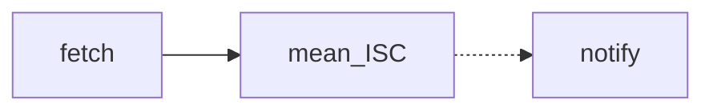

# 46. Exporting to CWL

*A deterministic CWL v1.2 document from a DAGonStar workflow: steps, ordering by completion flags, containers and validation with cwltool*

DAGonStar in Practice - Part 4: Infrastructure, FAIR and applications. Slides: [46-DAGonStar-Exporting_to_CWL.pptx](../lectures/46-DAGonStar-Exporting_to_CWL.pptx). Examples: [examples/46-cwl](../../examples/46-cwl/).

## 2. Today's lecture

**Outline**

1. Why a standard workflow language
2. CWL in brief
3. saveAsCWL
4. Hands-on: export, compare, validate
5. How edges become CWL inputs
6. Limits of the export

**After this lecture you can**

- Export a workflow to CWL
- Read the steps and their inputs
- Validate the export with cwltool

## 3. Standards

*A workflow in a standard language can be run, reviewed and archived without DAGonStar.*

## 4. Why export

- **Interoperability** - Run on any CWL engine: cwltool, Toil, Arvados.
- **Review** - Reviewers read a standard document.
- **Archive** - Deposit it with the data (lecture 45).
- **Comparison** - Same graph, different engines.

> **DAGonStar stays the authoring tool** CWL is an exchange format for the graph.

## 5. CWL in brief

- **Workflow** steps connected by inputs and outputs
- **CommandLineTool** one command with declared inputs and outputs
- **Step inputs** source = another step's output
- **Requirements** InlineJavascript, Docker, InitialWorkDir
- **v1.2** the version DAGonStar writes

> *JSON form*
>
> YAML and JSON are both valid CWL.

```
cwlVersion: v1.2
class: Workflow
steps: {...}
```

## 6. saveAsCWL

*One call writes a self-contained document with one embedded tool per task.*

## 7. The workflow

[`examples/46-cwl/cwl_export.py`](../../examples/46-cwl/cwl_export.py)

```python
def build(base):
    wf = workflow("Cwl46", base)
    wf.add_task(DagonTask(TaskType.BATCH, "fetch", fetch_observations()))
    wf.add_task(DagonTask(TaskType.BATCH, "mean_ISC", station_mean(
        "ISC", "workflow:///fetch/outputs/observations.csv", "outputs/mean.txt")))
    notify = DagonTask(TaskType.BATCH, "notify", "echo done > done.txt")
    wf.add_task(notify)
    notify.add_dependency_to(wf.find_task_by_name("Cwl46", "mean_ISC"))  # order only
    return wf
```

- fetch, then mean_ISC by reference; notify only after mean_ISC, by an explicit edge
- build() is called twice to check that the export is deterministic

## 8. Exporting and checking

[`examples/46-cwl/cwl_export.py`](../../examples/46-cwl/cwl_export.py)

```python
first, second = base / "a.cwl", base / "b.cwl"
build(base).saveAsCWL(str(first))
build(base).saveAsCWL(str(second))
document = json.loads(first.read_text())
print("cwlVersion:", document["cwlVersion"], "| class:", document["class"])
print("steps:", sorted(document["steps"]))
print("deterministic:", first.read_text() == second.read_text(),
      "| scratch path exported:", str(base) in first.read_text())
print("mean_ISC inputs:", sorted(document["steps"]["mean_ISC"]["in"]))
print("notify inputs:", sorted(document["steps"]["notify"]["in"]))
```

- Two exports of two separately built workflows are byte-identical
- No scratch path appears in the document

## 9. Recorded output

Recorded output of `python examples/46-cwl/cwl_export.py`:

```text
cwlVersion: v1.2 | class: Workflow
steps: ['fetch', 'mean_ISC', 'notify']
deterministic: True | scratch path exported: False
mean_ISC inputs: ['after_fetch']
notify inputs: ['after_mean_ISC']
cwltool --validate: ok
```

- v1.2 Workflow
- Three steps
- Deterministic, path-free
- after_ inputs
- Valid for cwltool

## 10. Edges

*Every DAGonStar edge becomes a boolean completion input of the consumer step.*

## 11. A generated tool

```
{"class": "CommandLineTool",
 "label": "mean_ISC",
 "baseCommand": ["/bin/sh", "-c", "<command>"],
 "inputs": {"after_fetch": "boolean"},
 "outputs": {"completed": {"type": "boolean",
   "outputBinding": {
     "outputEval": "$(runtime.exitCode === 0)"}}}}
```

- The command via sh -c
- One input per predecessor
- completed: exit code 0

## 12. Ordering by completion flags

- **Each step** outputs completed = (exit code 0)
- **Each consumer** has an input after_<producer>
- **Source** <producer>/completed
- **Both kinds of edge** workflow:// and add_dependency_to
- **No invented files** the export does not guess file outputs

> *Recorded output*
>
> A data edge and a control edge look the same.

```
mean_ISC inputs:
 ['after_fetch']
notify inputs:
 ['after_mean_ISC']
```

## 13. The exported graph



Solid arrows: data dependencies (`workflow://`); dotted arrows: control dependencies.

- after_fetch
- after_mean_ISC
- Both via completed

## 14. From DAGonStar to CWL

| DAGonStar | CWL |
|---|---|
| Workflow name | Workflow document |
| Task | Step with an embedded CommandLineTool |
| Command | baseCommand /bin/sh -c |
| Edge | after_<producer> ← <producer>/completed |
| image of a container task | hints DockerRequirement dockerPull |
| FAAS task | python -m dagon.faas_runner with the spec |

## 15. Determinism

*The same workflow always gives the same bytes: diffs show real changes.*

## 16. Why determinism matters

- **Version control** commit the .cwl; diffs are meaningful
- **Review** a change in the graph is a change in the file
- **Caching** engines can reuse results by content
- **No paths** scratch folders differ per run and per machine
- **Identifiers** task names made CWL-safe, unique

> *Recorded output*
>
> Two exports, one result.

```
deterministic: True
scratch path
 exported: False
```

## 17. Validation

*cwltool --validate checks the document without running it.*

## 18. Validating

[`examples/46-cwl/cwl_export.py`](../../examples/46-cwl/cwl_export.py)

```python
if shutil.which("cwltool"):
    done = subprocess.run(["cwltool", "--validate", str(first)],
                          capture_output=True, text=True)
    print("cwltool --validate:", "ok" if done.returncode == 0 else done.stderr[-300:])
    check(done.returncode == 0, "the export is valid CWL")
else:
    print("cwltool not installed: validation skipped (pip install cwltool)")
```

- Runs only if cwltool is installed: pip install cwltool
- The recorded output shows ok

## 19. Running the export

- **cwltool a.cwl** runs the three steps in temporary folders
- **Data** file references are rewritten only in portable mode
- **Default export** steps run in their own folders: data edges are ordering only
- **Portable emulation** after_ inputs become Directories, references become paths
- **Agentic tasks** exported with declared File outputs

> *Validate first*
>
> Then run with care.

```
cwltool --validate
 a.cwl
```

## 20. Containers in the export

- **Container tasks** have an image attribute
- **Export** hints: DockerRequirement dockerPull <image>
- **Hints** engines may use them; requirements would force them
- **Apptainer** CWL engines can run Docker images with Singularity
- **Portable mode** no Docker hints

> *For a DOCKER task*
>
> The image travels with the step.

```
"hints": {
 "DockerRequirement": {
  "dockerPull":
   "busybox:1.36"}}
```

## 21. CWL engines

| Engine | Use |
|---|---|
| cwltool | Reference implementation; validation and local runs |
| Toil | Clusters and clouds, large workflows |
| Arvados | Data management platform with CWL |
| StreamFlow | Hybrid HPC and cloud deployments |

## 22. Before depositing a CWL file

- **Validate** cwltool --validate
- **Deterministic** export twice and diff
- **No paths** search for your scratch base
- **Images** pinned tags in DockerRequirement
- **With FAIR** deposit the CWL next to the RO-Crate

> **5** - *Checks*
>
> Each takes seconds.

## 23. Limits

*Some tasks have no shell command CWL can run.*

## 24. What exports and what does not

| Task type | Export |
|---|---|
| BATCH, SLURM, containers | sh -c command; image as Docker hint |
| FAAS | dagon.faas_runner with the portable spec |
| AGENTIC | dagon-agent-runner with File inputs |
| Producers in other workflows | ValueError: outside workflow |
| A task without a command | ValueError: no shell command |

## 25. DAGonStar run and CWL run

**DAGonStar**

- Staging between hosts
- Checkpoints and resume
- Events, FAIR, garbage collection
- Schedulers and clouds

**CWL engine**

- Its own staging and folders
- Its own caching
- Standard, portable description
- Wide ecosystem

## 26. Export your pipeline

**Steps**

1. Run the example
2. Export the station pipeline of lecture 12
3. Validate it with cwltool --validate
4. Draw the steps from the after_ inputs

**Run it**

```bash
python examples/\
  46-cwl/\
  cwl_export.py
```

**Watch for:** The graph you draw from the CWL file is the graph DAGonStar built: no edge lost, none invented.

## 27. This lecture's example

- **3** - Steps
- **2** - Completion edges
- **0** - Scratch paths exported

## 28. Exercise

A. Add a DOCKER task with image busybox:1.36 to the workflow
B. Export again
C. Find its DockerRequirement hint
D. Change one command and diff the two exports

**Deliverable:** The hint and the diff.

## 29. Check your understanding

1. How does saveAsCWL represent a dependency?
2. Why is the export deterministic?
3. What does cwltool --validate check?
4. Which tasks cannot be exported?

<details><summary>Answers</summary>

1. As a boolean input after_<producer> fed by <producer>/completed.
2. Fixed ordering and identifiers, and no run-specific paths.
3. That the document is valid CWL v1.2, without running it.
4. Tasks with no shell command, and tasks depending on another workflow.

</details>

## 30. Key takeaways

1. saveAsCWL writes a self-contained CWL v1.2 document
2. Each task is a step with an embedded tool
3. Edges become completion flags, never invented files
4. The export is deterministic and validates with cwltool

*Next: operating workflows*

---

Raffaele Montella. CC0 1.0. Generated from `src/lectures/46.js`.
