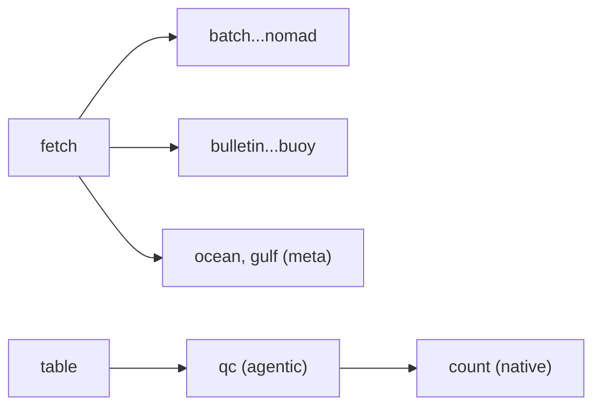

# 48. Capstone

*Every task type in one checkpointed, FAIR-recorded graph under portable emulation, with an accepted agentic step and a CWL export*

DAGonStar in Practice - Part 4: Infrastructure, FAIR and applications. Slides: [48-DAGonStar-Capstone.pptx](../lectures/48-DAGonStar-Capstone.pptx). Examples: [examples/48-capstone](../../examples/48-capstone/).

## 2. Today's lecture

**Outline**

1. What the course built
2. The capstone graph
3. Sixteen task types, one workflow
4. Hands-on: run, verify, export
5. The checklist
6. Where to go next

**After this lecture you can**

- Combine the course's mechanisms in one workflow
- Verify a run with evidence, not impressions
- Plan your own workflow

## 3. The course

*Forty-seven lectures, one idea: a workflow is a graph of declared, recorded, recoverable steps.*

## 4. Four parts

| Part | Lectures | Core idea |
|---|---|---|
| Foundations | 01-12 | Tasks, references, graphs, launchers |
| Execution, data, recovery | 13-24 | Staging, collection, checkpoints, native, ensembles |
| Services, AI, continuum | 25-36 | Web, LLM, FaaS, IoT, agentic |
| Infrastructure, FAIR | 37-48 | Containers, schedulers, data, FAIR, CWL |

## 5. The graph

*Two producers feed sixteen consumers, one per task type.*

## 6. The capstone graph



Solid arrows: data dependencies (`workflow://`); dotted arrows: control dependencies.

- fetch: the CSV most types read
- table: a JSON with a duplicate
- qc must deduplicate to be accepted
- count checks what qc published: 4 records

## 7. Execution task types

[`examples/48-capstone/capstone.py`](../../examples/48-capstone/capstone.py)

```python
TaskType.CHECKPOINT: DagonTask(TaskType.CHECKPOINT, "checkpoint", REF),
TaskType.BATCH: DagonTask(TaskType.BATCH, "batch", "wc -l " + REF),
TaskType.SLURM: DagonTask(TaskType.SLURM, "wrf", "wc -l " + REF, ntasks=64),
TaskType.CLOUD: DagonTask(TaskType.CLOUD, "cloud", "wc -l " + REF, provider="mock",
                          ssh_username="user", key_options={"key_path": "/tmp/key"},
                          instance_id="instance"),
TaskType.DOCKER: DagonTask(TaskType.DOCKER, "docker", "wc -l " + REF,
```

- CHECKPOINT, BATCH, SLURM and CLOUD all read the same CSV by reference
- CLOUD uses an existing instance id; nothing is provisioned under emulation

## 8. Container task types

[`examples/48-capstone/capstone.py`](../../examples/48-capstone/capstone.py)

```python
TaskType.DOCKER: DagonTask(TaskType.DOCKER, "docker", "wc -l " + REF,
                           image="busybox:1.36", pull=False),
TaskType.KUBERNETES: DagonTask(TaskType.KUBERNETES, "kubernetes", "wc -l " + REF,
                               image="busybox:1.36"),
TaskType.APPTAINER: DagonTask(TaskType.APPTAINER, "roms", "wc -l " + REF,
                              image="roms.sif"),
TaskType.NOMAD: DagonTask(TaskType.NOMAD, "nomad", "wc -l " + REF, image="busybox:1.36"),
TaskType.LLM: DagonTask(TaskType.LLM, "bulletin",
```

- DOCKER, KUBERNETES, APPTAINER and NOMAD with small images
- Client libraries are mocked at construction: no daemon, no cluster

## 9. Service task types

[`examples/48-capstone/capstone.py`](../../examples/48-capstone/capstone.py)

```python
TaskType.LLM: DagonTask(TaskType.LLM, "bulletin",
                        {"messages": [{"role": "user", "content": REF}]},
                        provider="mock"),
TaskType.NATIVE: DagonTask(TaskType.NATIVE, "count", "common.weather:count_records",
                           inputs={"input_file": "workflow:///qc/outputs/result.json"},
                           outputs={"output_file": "count.json"}),
TaskType.WEB: DagonTask(TaskType.WEB, "publish", {
    "method": "POST", "url": "http://example.invalid", "json": {"text": REF}}),
TaskType.FAAS: DagonTask(TaskType.FAAS, "archive", provider="mock", function="echo",
                         inputs={"document": REF}),
TaskType.IOT: DagonTask(TaskType.IOT, "buoy", operation="observe", provider="mock",
```

- LLM, NATIVE, WEB and FAAS, each consuming a reference
- The native count reads the agent's accepted result

## 10. Edge and agent task types

[`examples/48-capstone/capstone.py`](../../examples/48-capstone/capstone.py)

```python
TaskType.IOT: DagonTask(TaskType.IOT, "buoy", operation="observe", provider="mock",
                        request={"events": [{"source": REF}]},
                        completion={"mode": "first_event"},
                        outputs={"observations": "outputs/observations.json"}),
TaskType.AGENTIC: DagonTask(TaskType.AGENTIC, "qc", agent="quality-local",
                            specification={"objective": "Deduplicate the table",
                                           "output_schema": {"type": "object",
                                                             "required": ["observations"]}},
                            inputs={"source": TABLE},
                            requirements=[{"id": "complete", "evaluator": "record_coverage",
                                           "expected": {"count": 4}, "mandatory": True}]),
```

- IOT: a bounded first_event observation from the mock provider
- AGENTIC: the quality-local profile, one mandatory requirement on the table

## 11. Meta and volume task types

[`examples/48-capstone/capstone.py`](../../examples/48-capstone/capstone.py)

```python
TaskType.META: DagonTask(TaskType.META, "ocean", engine="nextflow", workflow="nextflow-io/hello",
                         inputs={"observations": REF},
                         outputs={"summary": "results/summary.json"}),
TaskType.VOLUME: DagonTask(TaskType.VOLUME, "gulf", provider="dagonfs", volume="gulf",
                           stage_in={"observations.csv": REF}),
```

- META: a Nextflow pipeline, run by the mock engine under emulation (Appendix A3)
- VOLUME: a DAGonFS volume, a local folder under emulation (Appendix A2)

## 12. The run

*Portable emulation, a checkpoint file, FAIR recording, and two guards that forbid live calls.*

## 13. Running safely

[`examples/48-capstone/capstone.py`](../../examples/48-capstone/capstone.py)

```python
with mock.patch("dagon.agentic.providers.OpenAICompatibleAdapter.propose", side_effect=forbidden), \
        mock.patch("urllib.request.urlopen", side_effect=forbidden):
    wf = Workflow("Capstone48", config=read_config(str(write_ini(base))),
                  portable_emulation=True, checkpoint_file=checkpoint)
    wf.enable_fair(FairProfile(title="Gulf of Naples capstone",
                               description="Every task type under portable emulation.",
                               creators=[Agent(name="Course participant")],
                               license="CC-BY-4.0", output_dir=fair_dir))
    wf.add_task(DagonTask(TaskType.BATCH, "fetch", fetch_observations()))
    wf.add_task(DagonTask(TaskType.BATCH, "table", "mkdir -p outputs; printf '%s' '"
                          + table + "' > outputs/observations.json"))
    tasks = every_task_type()
    check(set(tasks) == set(TaskType), "every registered TaskType is present")
    for task in tasks.values():
        wf.add_task(task)
    wf.run()
```

- Any live model call or urlopen raises: the run proves it is offline
- check(set(tasks) == set(TaskType)): every registered type is present

## 14. What portable emulation does here

| Task types | Under emulation |
|---|---|
| BATCH, SLURM, containers, CLOUD | bash -c on the portable command, local paths |
| LLM | Echoes the rendered request |
| FAAS, IOT | Mock provider |
| WEB | Placeholder outputs, no request sent |
| NATIVE | Runs locally, whatever the executor |
| AGENTIC | Runs with the profile's mock adapter |
| META, VOLUME | Mock engine; a folder stands in for the volume |

## 15. Recorded output

Recorded output of `python examples/48-capstone/capstone.py`:

```text
tasks: 18 | failed: []
agent accepted: True | records after QC: 4
FAIR run covers every task: True
CWL steps: 18 | scratch path in CWL: False
{"CWL exported": true, "agent accepted": true, "checkpoint written": true, "live adapters invoked": 0, "task types": 16}
```

- 18 tasks, none failed
- Accepted, 4 records
- FAIR covers every task
- 18 CWL steps, path-free
- The checklist

## 16. Evidence

*Each claim about the run is checked by reading a file the run wrote.*

## 17. Claims and evidence

| Claim | Evidence |
|---|---|
| Every task finished | Status of every task: failed = [] |
| The agent was accepted | qc/outputs/evaluation.json |
| Quality control worked | count/outputs/count.json = {count: 4} |
| Provenance is complete | FAIR run.json lists all 18 tasks |
| Resumable | checkpoint.json exists |
| Portable | CWL with 18 steps, no scratch path |

## 18. The checklist

[`examples/48-capstone/capstone.py`](../../examples/48-capstone/capstone.py)

```python
checklist = {"task types": len(TaskType), "agent accepted": evaluation["accepted"],
             "checkpoint written": Path(checkpoint).is_file(), "CWL exported": True,
             "live adapters invoked": 0}
print(json.dumps(checklist, sort_keys=True))
```

- Built from the run's own records, printed as sorted JSON
- live adapters invoked: 0 is guaranteed by the forbidden() guards

## 19. Reading the checklist

- **task types 16** every registered TaskType
- **agent accepted true** independent evaluation passed
- **checkpoint written true** a resume would reuse the work
- **CWL exported true** the graph exists outside DAGonStar
- **live adapters invoked 0** no model, no network, no account

> **16** - *Task types*
>
> One workflow, all of them.

## 20. From capstone to real

*Switch emulation off one task type at a time.*

## 21. Going live, step by step

1. **Emulate** - Everything portable.
2. **Local** - BATCH, NATIVE real.
3. **Services** - WEB, LLM, FAAS real.
4. **HPC** - SLURM, containers.
5. **Edge** - IOT real.

## 22. Rules that held all course

- **References** make edges and staging (lecture 08)
- **Exit codes** decide success (lecture 10)
- **Checkpoints** by name or by content (lectures 15, 24, 29, 31, 35)
- **Secrets** only *_env names (lectures 26, 28, 29)
- **Bounds** on agents and devices (lectures 31, 33)

> *Five rules*
>
> Most bugs in real workflows break one of them.

## 23. Designing your workflow

- **Draw the graph** - Tasks, references, explicit edges.
- **Choose types** - Where each step must run.
- **Plan recovery** - Checkpoints, idempotency, unknown outcomes.
- **Record** - FAIR profile, CWL export, logs.

## 24. Next steps

*The capstone runs anywhere; your workflow will run somewhere specific.*

## 25. Where to go next

| Topic | Resource |
|---|---|
| DAGonStar source and docs | github.com/DagOnStar/dagonstar |
| Workflow standards | CWL, RO-Crate, W3C PROV |
| Job-local storage | BeeOND and your site's documentation |
| Distributed file systems | DAGonFS (Appendix A1) |
| Volumes, meta-tasks, web GUI | Appendices A2, A3, A4 |

## 26. Run the capstone

**Steps**

1. Run the example
2. Delete count's folder and run again with the checkpoint
3. Turn portable emulation off for BATCH only (your own fork)
4. Open the FAIR report and the CWL file

**Run it**

```bash
python examples/\
  48-capstone/\
  capstone.py
```

**Watch for:** A second run with the checkpoint reuses every task whose folder and records are intact.

## 27. The capstone

- **18** - Tasks
- **16** - Task types
- **0** - Live calls

## 28. Final project

A. Design a workflow for a question in your own field
B. Use at least five task types and one explicit edge
C. Run it under emulation, then make two task types live
D. Deliver: script, graph, checkpoint, FAIR bundle, CWL

**Deliverable:** A repository with the five deliverables and a one-page description of the design choices.

## 29. Check your understanding

1. How does the capstone prove that no live call was made?
2. Which file shows that the agentic step was accepted?
3. Why does count.json matter for quality control?
4. What would you switch off first when going live?

<details><summary>Answers</summary>

1. Live adapter and urlopen calls are patched to raise; the run finished without errors.
2. qc/outputs/evaluation.json with accepted true.
3. It counts the agent's published result: 4 records means the duplicate was removed.
4. Portable emulation for local BATCH and NATIVE tasks, before services and infrastructure.

</details>

## 30. Key takeaways

1. Sixteen task types in one graph
2. Every claim checked against a recorded file
3. Portable emulation makes the whole graph rehearsable
4. Go live one task type at a time

*Appendix A1: DAGonFS*

---

Raffaele Montella. CC0 1.0. Generated from `src/lectures/48.js`.
