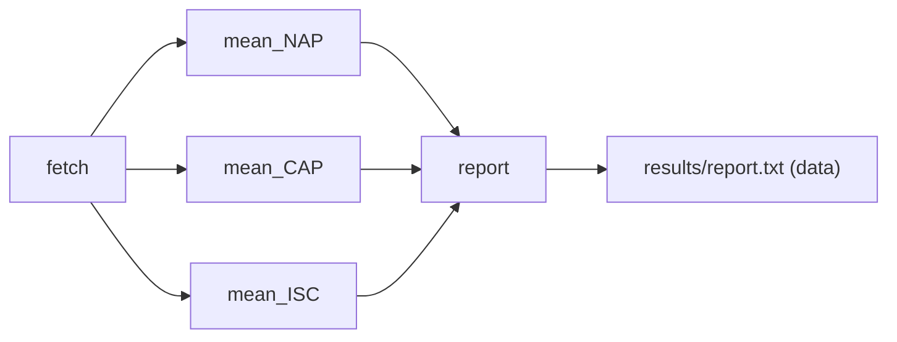

# A1. DAGonFS

*An ad-hoc, in-memory, MPI-distributed file system for workflow scratch data, and how DAGonStar uses it*

Workflows in Practice with DAGonStar - Appendix. Slides: [A1-DAGonStar-DAGonFS.pptx](../lectures/A1-DAGonStar-DAGonFS.pptx). Examples: [examples/A1-dagonfs](../../examples/A1-dagonfs/).

## 2. Today's lecture

**Outline**

1. Scratch data in workflows
2. What DAGonFS is
3. Two deployment models
4. The data plane: blocks over ranks
5. Hands-on: the block layout and a workflow on a volume
6. Performance and limits

**After this lecture you can**

- Explain when DAGonFS helps a workflow
- Compute which rank holds which block
- Run a DAGonStar workflow with its scratch on a volume

## 3. Scratch data

*Most files a workflow writes are read once by the next task and then discarded.*

## 4. The cost of durable scratch

- **Metadata** - Creating thousands of small files on NFS or Lustre.
- **Durability** - Paid for files nobody keeps.
- **Sharing** - Your scratch slows other users.
- **Locality** - Data crosses the network to be read on the same node.

> **workflow:// data is scratch** produced, consumed, collected (lectures 08, 14).

## 5. DAGonFS in one sentence

- **Ad hoc** created for a workflow, destroyed after it
- **In memory** file contents in the RAM of MPI processes
- **Distributed** blocks spread over the ranks of an allocation
- **FUSE** an ordinary POSIX directory for tasks
- **Not durable** stage results out before unmounting

> **RAM** - *Of the whole allocation*
>
> Capacity grows with the number of ranks.

## 6. Who does what

| Responsibility | DAGonStar | DAGonFS |
|---|---|---|
| Scheduling the graph | yes | no |
| Resolving workflow:// references | yes | no |
| Checkpoints | yes | no |
| POSIX operations in the mount | no | yes |
| Staging final outputs | yes | no |

## 7. Models

*One binary, dagonfs; the model is chosen per volume at run time.*

## 8. Client-server and peer-to-peer

**client-server (default)**

- One mount point, on rank 0
- Rank 0 holds the namespace
- Ranks 1..P-1 store blocks
- Tasks on the node of rank 0

**peer-to-peer**

- One mount per rank: <root>/<rank>
- Every peer serves its mount
- Namespace changes replicated
- Tasks on several nodes

## 9. Creating a volume

```
# command line
mpirun -np 4 build/dagonfs --model client-server -f /tmp/dagonfs
mpirun -np 4 build/dagonfs --model peer-to-peer  -f /tmp/dagonfs

# Python, from a workflow script
from dagonfs import Volume
with Volume("/tmp/dagonfs", model="client-server", ranks=4) as volume:
    scratch = volume.mountpoint(0)    # unmounted when the block ends

# stop by hand
fusermount3 -u /tmp/dagonfs
```

- --model per volume
- Volume: start, wait, stop
- Unmount ends it

## 10. Requirements

- **Build** CMake ≥ 3.20, a C++23 compiler
- **MPI** Open MPI ≥ 4.1; MPI_THREAD_MULTIPLE for peer-to-peer
- **FUSE** libfuse ≥ 3.3 with fusermount3
- **Platform** Linux nodes
- **Alternatives** --frontend native or preload without FUSE

> *Build*
>
> ctest --test-dir build to check.

```
cmake -S . -B build \
 -DUSE_MPI=ON
cmake --build build
```

## 11. The data plane

*Files are divided into 128 KiB blocks laid out contiguously and deterministically over the ranks.*

## 12. The layout rule

```
B = 131072                         # 128 KiB
N = ceil(S / B)                    # blocks of a file of S bytes
c[r] = N // P + (1 if r < N % P else 0)   # blocks owned by rank r
d[r] = c[0] + ... + c[r-1]         # first block of rank r
```

- Only S and P needed
- Balanced within one block
- Contiguous per rank
- No addresses exchanged

## 13. Why deterministic

- **Readers** compute every block's owner from the file size
- **No directory of blocks** nothing to look up or keep consistent
- **No pointers** no memory address leaves its process
- **Balance** counts differ by at most one block
- **Rank 0 first** it holds at least as many blocks as any rank

> *Arithmetic, not lookup*
>
> The layout is a function of (S, P).

## 14. The layout in Python

[`examples/A1-dagonfs/block_layout.py`](../../examples/A1-dagonfs/block_layout.py)

```python
def layout(size, ranks):
    blocks = -(-size // B)                      # ceil without floats
    counts = [blocks // ranks + (1 if r < blocks % ranks else 0) for r in range(ranks)]
    starts = [sum(counts[:r]) for r in range(ranks)]
    return blocks, counts, starts
```

- -(-size // B) is ceil without floats; counts and starts follow the rule
- The script checks four properties for five (S, P) cases

## 15. Recorded layouts

Recorded output of `python examples/A1-dagonfs/block_layout.py`:

```text
S=564        P=4  N=1    c=[1, 0, 0, 0] d=[0, 1, 1, 1]
S=1000000    P=4  N=8    c=[2, 2, 2, 2] d=[0, 2, 4, 6]
S=655361     P=4  N=6    c=[2, 2, 1, 1] d=[0, 2, 4, 5]
S=134217728  P=4  N=1024 c=[256, 256, 256, 256] d=[0, 256, 512, 768]
S=0          P=4  N=0    c=[0, 0, 0, 0] d=[0, 0, 0, 0]
```

- 564 bytes: one block on rank 0
- 1 MB: 2 blocks each
- 5 blocks + 1 byte: 2, 2, 1, 1
- 128 MiB: 256 each
- Empty file: no blocks

## 16. Close-to-open consistency

1. **open** - Load slices into a buffer.
2. **read/write** - On the buffer.
3. **close** - Send each rank its slice.
4. **ACK** - From every rank.
5. **Return** - Visible to all.

## 17. With DAGonStar

*Point scratch_dir_base at the mount; tasks and references work unchanged.*

## 18. A workflow on a volume

[`examples/A1-dagonfs/dagonfs_workflow.py`](../../examples/A1-dagonfs/dagonfs_workflow.py)

```python
with scratch("A1") as base:
    persistent = base / "results"                       # durable storage
    with scratch_space(base) as (kind, mount):
        mount.mkdir(parents=True, exist_ok=True)
        wf = workflow("DAGonFS_A1", mount)               # scratch_dir_base = mount
        wf.add_task(DagonTask(TaskType.BATCH, "fetch", fetch_observations()))
        for s in STATIONS:
            wf.add_task(DagonTask(TaskType.BATCH, "mean_" + s, station_mean(
                s, "workflow:///fetch/outputs/observations.csv", "outputs/mean.txt")))
        parts = " ".join("workflow:///mean_%s/outputs/mean.txt" % s for s in STATIONS)
        report = DagonTask(TaskType.BATCH, "report", "cat %s > report.txt" % parts)
        wf.add_task(report)
        wf.run()
        persistent.mkdir()
        shutil.copy(Path(report.working_dir, "report.txt"), persistent)   # stage-out
        print("scratch:", kind)
```

- The station pipeline of lecture 12 with its scratch on the mount
- report.txt is copied to persistent storage before the volume goes away

## 19. Live or fallback

[`examples/A1-dagonfs/dagonfs_workflow.py`](../../examples/A1-dagonfs/dagonfs_workflow.py)

```python
@contextmanager
def scratch_space(base):
    live = (Volume is not None and platform.system() == "Linux"
            and shutil.which(os.environ.get("DAGONFS", "dagonfs")))
    if live:
        with Volume(base / "dagonfs", model="client-server", ranks=4) as volume:
            yield "DAGonFS client-server, 4 ranks", volume.mountpoint(0)
    else:
        if Volume is not None:
            plan = Volume(base / "dagonfs", model="client-server", ranks=4,
                          executable="dagonfs").command()
            print("would launch:", " ".join(plan).replace(str(base), "<base>"))
        yield "local directory (no DAGonFS on this host)", base / "fallback"
```

- On Linux with dagonfs on PATH: a 4-rank client-server volume
- Elsewhere: the same workflow on a local folder, and the launch command printed

## 20. Recorded output

Recorded output of `python examples/A1-dagonfs/dagonfs_workflow.py`:

```text
would launch: mpirun -np 4 dagonfs --model client-server -f <base>/dagonfs
scratch: local directory (no DAGonFS on this host)
task folders on the scratch: 5
kept after the volume is gone: ['NAP', '15.50', 'CAP', '16.75', 'ISC', '15.75']
```

- mpirun -np 4 dagonfs ...
- Fallback on this host
- Five task folders
- The report survives

## 21. The graph on the volume



Solid arrows: data dependencies (`workflow://`); dotted arrows: control dependencies.

> **All folders on the mount** report.txt is staged out to durable storage before the volume is unmounted.

## 22. Integration rules

- **Whole scratch** mount first, then scratch_dir_base inside it (this example)
- **Built-in provider** since DAGonStar 3.0: create_adhoc_filesystem("dagonfs", ranks=4)
- **Volume task** TaskType.VOLUME, provider="dagonfs" (Appendix A2)
- **Frontends** fuse3 (posix), native (client), preload
- **Stage out** copy results to persistent storage before unmounting

> *Volatile by design*
>
> Anything not staged out is lost with the volume.

## 23. Performance

*Measured with real DAGonStar workflows on a Slurm cluster, November 2026 (DAGonFS docs).*

## 24. One node, median

| Workload | NFS | DAGonFS c-s | DAGonFS p2p |
|---|---|---|---|
| File creation (ops/s) | 67 | 25,532 | 26,943 |
| 4 KiB files (files/s) | 96 | 5,923 | 7,946 |
| 8 × 128 MiB, shell tasks (s) | 64.4 | 33.9 | 34.8 |
| 2000 × 8 KiB (s) | 257.6 | 24.7 | 28.2 |

> **Small files win most** about 10× faster than NFS for the 2000-file dataflow.

## 25. DAGonStar workflows versus NFS

- **1.9×** - Large-file dataflow
- **2.0×** - With Python tasks
- **10.4×** - Small-file dataflow

## 26. DAGonFS, tmpfs and BeeOND

**DAGonFS**

- One namespace across nodes
- Capacity: RAM of the allocation
- Runs as your MPI job
- No site support needed

**tmpfs / BeeOND**

- tmpfs: one node, fastest
- BeeOND: site-provided, on disks or SSDs
- BeeOND: requested via --comment (lecture 42)
- Both: volatile too

## 27. Run it

**Steps**

1. Run block_layout.py and check the five cases by hand
2. Run dagonfs_workflow.py anywhere: fallback
3. On a Linux node with MPI and FUSE: build DAGonFS
4. Set DAGONFS_PYTHON and DAGONFS and run again

**Run it**

```bash
python examples/\
  A1-dagonfs/\
  dagonfs_workflow.py
```

**Watch for:** The live run prints the DAGonFS scratch kind; the report is identical, because the workflow did not change.

## 28. Exercise

A. Compute N, c and d for S = 3 MiB + 5 bytes and P = 3
B. Check with layout()
C. Change the workflow to a peer-to-peer volume with 2 ranks
D. Which mountpoint must each task use?

**Deliverable:** The computation, the layout() output and the answer about mount points.

## 29. Check your understanding

1. What problem does DAGonFS solve for workflows?
2. How does a reader find the rank that holds block k?
3. When must a task use mountpoint(r) instead of mountpoint(0)?
4. What must happen before the volume is unmounted?

<details><summary>Answers</summary>

1. Slow, durable shared storage used for short-lived scratch data.
2. From S and P alone: the layout rule gives c and d for every rank.
3. In peer-to-peer mode, when the task runs on the node of rank r.
4. Final outputs must be staged out to persistent storage.

</details>

## 30. Key takeaways

1. DAGonFS keeps scratch data in the memory of an MPI job
2. Client-server or peer-to-peer, chosen per volume
3. Blocks are placed by arithmetic on size and ranks
4. DAGonStar runs unchanged on the mount; stage out at the end

*Next: Appendix A2, volume tasks; details in the textbook's Appendix E*

---

Raffaele Montella. CC0 1.0. Generated from `src/lectures/A1.js`.
