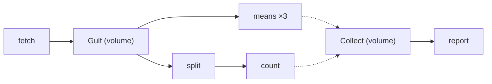

# A2. Ad-hoc volumes and streams

*DAGonStar 3.0: one interface for DAGonFS, BeeOND, Hercules, CAPIO and DynoStore, volume tasks that share data through workflow://, and streams between running tasks*

DAGonStar in Practice - Appendix. Slides: [A2-DAGonStar-Ad_hoc_volumes_and_streams.pptx](../lectures/A2-DAGonStar-Ad_hoc_volumes_and_streams.pptx). Examples: [examples/A2-volumes](../../examples/A2-volumes/).

## 2. Today's lecture

**Outline**

1. Why ad-hoc storage needs an interface
2. Adapters, access modes and scopes
3. Volume tasks: create, share, destroy
4. Streams between running tasks
5. Hands-on: the station means on a volume
6. Release, checkpoints and limits

**After this lecture you can**

- Bind tasks to a workflow- or task-scope volume
- Share a volume through workflow:///<task>/<volume>/...
- Explain when a volume is released

## 3. One interface

*DAGonStar starts, checks and stops the storage system; the storage software stays separately installed.*

## 4. Five built-in providers

- **dagonfs** - In-memory MPI file system (Appendix A1); fuse3, native or preload frontend.
- **beeond** - BeeGFS on demand inside a Slurm allocation (lecture 42).
- **hercules** - Ad-hoc file system reached through a preload library.
- **capio** - Cross-application I/O, also through preload.
- **dynostore** - An object store addressed by keys in a catalog.

> **Built-in names are protected** register_provider("dagonfs", ..., replace=True) raises ValueError in 3.0.

## 5. Access modes

| Mode | How a task reaches the data | Providers |
|---|---|---|
| `posix` | an ordinary mounted directory | DAGonFS fuse3, BeeOND |
| `preload` | paths intercepted by an LD_PRELOAD library | Hercules, CAPIO, DAGonFS preload |
| `client` | a client protocol, no path to open | DAGonFS native |
| `object` | keys in a catalog | DynoStore |

> **Preload intercepts programs, not shell redirections** write through cp, tee or a program.

## 6. What a bound task receives

- **DAGON_ADHOC_PATH** where the task reaches the data
- **DAGON_ADHOC_ACCESS** posix, preload, client or object
- **DAGON_ADHOC_<NAME>_PATH** one variable per named resource
- **DAGON_ADHOC_NAMES** all bound names, when there are several
- **export="GULF"** the path under a name you choose

> **0** - *Credentials in the environment*
>
> Variables that look like tokens or passwords are refused.

## 7. Three scopes

| Scope | Created with | Lives |
|---|---|---|
| `workflow` | wf.create_adhoc_filesystem(...) | from the first task to the last |
| `task` | task.create_adhoc_filesystem(...) | around that one task, also on failure |
| `volume` | DagonTask(TaskType.VOLUME, ...) | until a destroy task or the last reference |

## 8. An adapter

*A new storage system is one class and one register_provider call; neither DAGonStar nor the software changes.*

## 9. A local-directory adapter

[`examples/A2-volumes/local_directory.py`](../../examples/A2-volumes/local_directory.py)

```python
class LocalDirectory(AdHocFileSystem):
    """A directory created when the resource starts and removed when it stops."""

    provider = "local-directory"
    access = "posix"                 # tasks open its paths with ordinary file calls
    supports_streaming = True        # so the provider-neutral stream store works on it

    def __init__(self, workflow, name="default", path=None):
        super().__init__(workflow, name)
        self.path = path or os.path.join(workflow.get_scratch_dir_base(), ".volume-" + name)

    @property
    def task_path(self):
        return self.path             # becomes $DAGON_ADHOC_<NAME>_PATH in bound tasks
```

- provider, access and supports_streaming declare what tasks may do
- task_path is what bound tasks see as $DAGON_ADHOC_<NAME>_PATH

## 10. Lifecycle and registration

[`examples/A2-volumes/local_directory.py`](../../examples/A2-volumes/local_directory.py)

```python
def start(self):
    if self.started or self.workflow.portable_emulation:
        return
    os.makedirs(self.path, exist_ok=True)
    self._started = True

def is_ready(self):
    return self.started and os.path.isdir(self.path)

def stop(self):
    if not self.started:
        return None
    self._started = False
    shutil.rmtree(self.path, ignore_errors=True)
    return 0
```

- start, is_ready and stop are the whole lifecycle; stop also runs after a failure
- Then one call: register_provider("local-directory", LocalDirectory)

## 11. Two scopes in one workflow

[`examples/A2-volumes/local_directory.py`](../../examples/A2-volumes/local_directory.py)

```python
mean.add_dependency_to(fetch)                  # no workflow:// reference: say the order
shared = wf.create_adhoc_filesystem("local-directory", name="gulf", export="GULF")
shared.bind(fetch)
shared.bind(mean)
private = mean.create_adhoc_filesystem("local-directory", name="tmp")
wf.run()
```

- gulf: workflow scope, bound to two tasks, exported as $GULF
- tmp: task scope, started and stopped around mean_CAP

## 12. Recorded output

Recorded output of `python examples/A2-volumes/local_directory.py`:

```text
scopes: workflow and task
mean_CAP bound to: gulf,tmp
result: CAP 16.75
after the run: gulf exists = False | tmp exists = False
```

- workflow and task
- Both bound to mean_CAP
- Capri mean from the volume
- Both directories gone

## 13. Volume tasks

*TaskType.VOLUME makes the volume a node of the graph, shared through the ordinary workflow:// schema.*

## 14. workflow:///Gulf/gulf/...

- **Gulf** the volume task that created the volume
- **gulf** the volume, seen in Gulf's folder under its own name
- **Rest** a path inside the volume
- **Commands** the reference is rewritten to the volume: nothing is copied
- **Siblings** several tasks may read and write the same volume

> *Same schema*
>
> Only the transfer changes.

```
workflow:///Gulf/gulf/
  means/CAP.txt
```

## 15. Create, share, destroy

[`examples/A2-volumes/volume_task.py`](../../examples/A2-volumes/volume_task.py)

```python
gulf = DagonTask(TaskType.VOLUME, "Gulf", provider=provider, volume="gulf",
                 stage_in={"inputs/observations.csv": "workflow:///fetch/outputs/observations.csv",
                           "means": {"path": "workflow:///fetch/means", "type": "directory"}})
tasks = [fetch, gulf] + [DagonTask(TaskType.BATCH, "mean_" + s, MEAN.format(s=s)) for s in STATIONS]
tasks += [DagonTask(TaskType.BATCH, "split", SPLIT), DagonTask(TaskType.BATCH, "count", COUNT)]
if destroy:
    tasks.append(DagonTask(TaskType.VOLUME, "Collect", action="destroy", volume=VOLUME,
                           stage_out={"means": {"path": VOLUME + "/means", "type": "directory"}}))
    source = "workflow:///Collect/means"
```

- stage_in copies fetch's files into the volume and makes the edge
- Collect waits for every user, stages out means/ and releases the volume

## 16. The graph



Solid arrows: data dependencies (`workflow://`); dotted arrows: control dependencies.

- Means written into the volume
- count streams from split
- Collect after every user

## 17. Streams

*A consumer reads items while the producer is still running, through a volume that supports streaming.*

## 18. Publish and read

[`examples/A2-volumes/volume_task.py`](../../examples/A2-volumes/volume_task.py)

```python
SPLIT = ("for s in NAP CAP ISC; do grep ^$s " + VOLUME + "/inputs/observations.csv > $s.csv; "
         '"$DAGON_PYTHON" -m dagon.adhoc stream publish "$DAGON_STREAM_OUT" $s.csv; done')
COUNT = ('n=0; for item in $("$DAGON_PYTHON" -m dagon.adhoc stream items '
         "workflow:///split/stations?stream=gulf --into got); do "
         'n=$((n + $(wc -l < "$item"))); done; echo $n > records.txt')
```

- split publishes one file per station to $DAGON_STREAM_OUT
- ?stream=gulf names the volume; count and split run concurrently

## 19. The stream protocol

1. **Bind** - Both tasks to gulf.
2. **Start** - Together, not in order.
3. **Publish** - Item, then a marker.
4. **Read** - Each item once.
5. **End** - Producer finishes.

> **Rename-free** a verified marker protocol, the same for every provider that supports streaming.

## 20. Recorded output

Recorded output of `python examples/A2-volumes/volume_task.py`:

```text
Gulf after: ['fetch']
Collect after: ['Gulf', 'count', 'mean_CAP', 'mean_ISC', 'mean_NAP', 'split']
bound to gulf: ['Collect', 'Gulf', 'count', 'mean_CAP', 'mean_ISC', 'mean_NAP', 'split']
report: NAP 15.50 | CAP 16.75 | ISC 15.75
count read 12 records while split ran; streams from: ['split']
volume gulf: destroyed by Collect
emulated dagonfs report: NAP 15.50 | CAP 16.75 | ISC 15.75
volume gulf: no task refers to it
```

- Collect waits for all users
- Means: hand-checkable
- 12 records streamed
- Destroyed by Collect
- Emulated dagonfs: same result, reference counting

## 21. Release

*A volume does not survive the process: it is released as soon as no task needs it.*

## 22. How a volume ends

| Way | When | Data |
|---|---|---|
| Destroy task | after every user has finished | stage_out into its folder |
| Reference count | the last user finished | lost unless copied |
| release="end" | at the end of the workflow | lost unless copied |
| Failure | a user failed: kept to the end | released after the run |

## 23. Order inside a volume

- **A reference into the volume** makes an edge to the volume task
- **Not to the writer** mean_CAP writing CAP.txt is invisible to the graph
- **With Collect** its dependency on every user orders report
- **Without it** order report by hand with add_dependency_to
- **Same lesson** as BeeOND workflow volumes (lecture 42)

> *A race otherwise*
>
> Without the edges, report can read the means before they exist.

## 24. Checkpoints, CWL, FAIR

| Feature | Volume tasks |
|---|---|
| Checkpoint | create reused only with the same spec and complete users |
| Destroy | reused only after its staged outputs' SHA-256 match |
| JSON | both actions survive as_json() and load_json() |
| CWL | the volume becomes a Directory; a dagon:Volume hint |
| FAIR | edges served by a volume carry transfer: volume |

## 25. Live or emulated

**Live provider**

- dagonfs needs MPI and FUSE3 on Linux
- BeeOND only inside a Slurm allocation
- Volume tasks refuse beeond
- Evidence: the provider ran

**Portable emulation**

- A local folder stands in
- No provider is started
- Same graph, same references
- Not evidence that the provider ran

## 26. Run it

**Steps**

1. Run local_directory.py and read the two scopes
2. Run volume_task.py and compare the means by hand
3. Remove the stage_out of Collect and run again
4. Change the emulated provider to capio

**Run it**

```bash
python examples/\
  A2-volumes/\
  volume_task.py
```

**Watch for:** count finishes with 12 while split still publishes; the volume is reported destroyed by Collect.

## 27. This appendix's examples

- **3** - Scopes
- **1** - Volume shared by 6 tasks
- **12** - Records streamed

## 28. Exercise

A. Add a mean_wind task that writes into the volume
B. Make report include it
C. Run once with Collect and once without
D. Explain the edges each version needs

**Deliverable:** The two workflows and a sketch of their graphs.

## 29. Check your understanding

1. What does workflow:///Gulf/gulf/means/CAP.txt name?
2. Why can a command not open a path in a DynoStore volume?
3. When is a volume without a destroy task released?
4. Why did report need explicit edges without Collect?

<details><summary>Answers</summary>

1. means/CAP.txt inside the volume gulf created by the volume task Gulf.
2. Its access mode is object: there is no path, only keys; use stage_in, stage_out or a stream.
3. When the last task that refers to it has finished (reference counting).
4. References into the volume make edges to Gulf, not to the tasks that wrote the files.

</details>

## 30. Key takeaways

1. One adapter interface for five providers and your own
2. Workflow, task and volume scopes
3. Volumes shared through workflow:///<task>/<volume>/...
4. Destroy task or reference counting releases them

*Next: Appendix A3, workflows of other engines as meta-tasks*

---

Raffaele Montella. CC0 1.0. Generated from `src/lectures/A2.js`.
