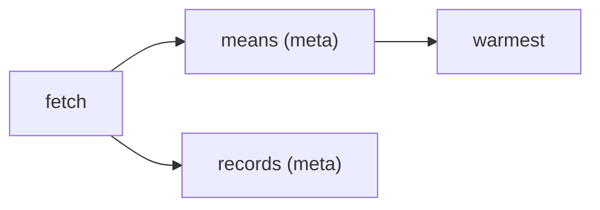

# A3. Meta-tasks

*DAGonStar 3.0: Nextflow, Snakemake, Parsl, StreamFlow, CWL or any command-line workflow, unmodified, as one task of a DAGonStar graph*

Workflows in Practice with DAGonStar - Appendix. Slides: [A3-DAGonStar-Meta_tasks.pptx](../lectures/A3-DAGonStar-Meta_tasks.pptx). Examples: [examples/A3-meta](../../examples/A3-meta/).

## 2. Today's lecture

**Outline**

1. Why run other engines' workflows
2. TaskType.META and its adapters
3. Inputs, outputs and the scratch layout
4. Hands-on: an engine, a CWL tool, an emulated Nextflow
5. Checkpoints and evidence
6. Limits

**After this lecture you can**

- Wrap an external workflow as a meta-task
- Declare its inputs and outputs with workflow://
- Explain when a meta-task is reused

## 3. Other engines

*Your colleagues' pipelines are already written, tested and published in another engine.*

## 4. Why not rewrite

- **Validated** - A published Nextflow or Snakemake pipeline has users and tests.
- **Owned** - Another team maintains it.
- **Specialised** - The engine's own features: profiles, executors, resume.
- **Composition** - DAGonStar adds the steps around it: HPC, AI, IoT, FAIR.

> **Lecture 22 composed DAGonStar workflows with DAG_TPS** a meta-task composes a workflow of another engine.

## 5. Two properties by construction

- **Never modified** DAGonStar runs the engine's documented command line
- **Native parameters** it writes -params-file, --configfile, a CWL job document
- **Adapters** every engine detail lives in one class in dagon.meta.adapters
- **Shared** staging, outputs, checkpoints, FAIR, JSON and CWL behave the same
- **A node** the external workflow is one task of the graph

> **1** - *Task per external workflow*
>
> However many steps it runs inside.

## 6. Built-in adapters

| engine | What runs | Inputs reach it as |
|---|---|---|
| `nextflow` | nextflow run ... -params-file | params.<name> |
| `snakemake` | snakemake --configfile ... | config["<name>"] |
| `parsl` | a Python function or script | keyword arguments |
| `streamflow` | streamflow run (CWL + deployments) | a CWL job document |
| `cwl` | cwltool or another CWL runner | a CWL job document |
| `command` | any argument vector | a JSON parameter file |
| `mock` | no process | placeholders (emulation) |

## 7. Engine notes

- **Nextflow** runs in run/, so publishDir paths land where source is read; pin remote pipelines with revision
- **Snakemake** relative rule outputs resolve against --directory run
- **Parsl** function mode: the module must not call parsl.load() at import
- **StreamFlow** a derived StreamFlow file in .dagon/; the original is untouched
- **Executables** engine_options executable, or [meta.<engine>] in dagon.ini

> *Unknown options*
>
> An option the adapter does not declare is rejected.

## 8. The task

*engine, workflow, inputs, outputs: the rest is adapter options.*

## 9. Arguments

| Argument | Meaning |
|---|---|
| `engine` | a registered adapter name |
| `workflow` | a local file or directory, or a remote name (nextflow-io/hello) |
| `inputs` | name -> workflow:// file, or any JSON value |
| `outputs` | name -> path below outputs/, or {path, source, engine_output} |
| `engine_options` | adapter options; credential-like keys refused |
| `timeout, staging` | seconds; copy (default) or symlink |

## 10. A command-line engine

[`examples/A3-meta/meta_task.py`](../../examples/A3-meta/meta_task.py)

```python
TaskType.META, "means", engine="command",
workflow=str(ENGINES / "station_engine.py"),
inputs={"observations": OBS, "stations": ["NAP", "CAP", "ISC"]},
outputs={"means": {"path": "means.csv",
                   "source": "results/means.csv"}},
engine_options={"command": [sys.executable, "{workflow}",
                            "{parameters_file}"]}))
```

- The observations are a staged file; the stations a plain JSON value
- source: where the engine writes; path: where downstream tasks read

## 11. The engine itself

[`examples/A3-meta/engines/station_engine.py`](../../examples/A3-meta/engines/station_engine.py)

```python
with open(sys.argv[1], encoding="utf-8") as f:
    parameters = json.load(f)
with open(parameters["observations"], encoding="utf-8") as f:
    rows = list(csv.DictReader(f))
os.makedirs("results", exist_ok=True)
with open("results/means.csv", "w", encoding="utf-8") as out:
    out.write("station,mean_c\n")
    for station in parameters["stations"]:
        values = [float(r["temperature_c"])
                  for r in rows if r["station"] == station]
        mean = sum(values) / len(values)
        out.write("%s,%.2f\n" % (station, mean))
```

- It knows nothing about DAGonStar: it reads a JSON document and writes a CSV
- Any program with a command line can be driven this way

## 12. Lifecycle

1. **Depend** - An edge per workflow:// input.
2. **Stage** - inputs/<name>/...
3. **Invoke** - The engine in run/.
4. **Collect** - run/<source> to outputs/.
5. **Record** - Digests, duration.

> **No shell** the argument vector runs directly, with the task timeout.

## 13. Inside a meta-task folder

| Path | Content |
|---|---|
| `.dagon/meta_spec.json` | the effective specification |
| `.dagon/meta_invocation.json` | argument vector, environment names only |
| `.dagon/meta_result.json` | engine, digests, duration |
| `inputs/<name>/` | staged inputs |
| `run/` | the engine's working directory |
| `outputs/<path>` | collected, hashed, read downstream |

## 14. Hands-on

*A stand-in engine, a real CWL tool run by cwltool, and an emulated Nextflow pipeline.*

## 15. The graph



Solid arrows: data dependencies (`workflow://`); dotted arrows: control dependencies.

- means: command adapter
- records: cwl adapter, cwltool
- warmest reads outputs/means.csv

## 16. A CWL tool as a meta-task

[`examples/A3-meta/meta_task.py`](../../examples/A3-meta/meta_task.py)

```python
if shutil.which("cwltool"):
    wf.add_task(DagonTask(
        TaskType.META, "records", engine="cwl",
        workflow=str(ENGINES / "count_records.cwl"),
        inputs={"observations": OBS},
        outputs={"records": {"path": "records.txt",
                             "engine_output": "records"}}))
```

- engine_output takes the file from the CWL output object cwltool prints
- Skipped, and said so, where cwltool is not installed

## 17. The CWL tool

[`examples/A3-meta/engines/count_records.cwl`](../../examples/A3-meta/engines/count_records.cwl)

```yaml
cwlVersion: v1.2
class: CommandLineTool
baseCommand: [awk, "END {print NR - 1}"]
inputs:
  observations:
    type: File
    inputBinding: {position: 1}
stdout: records.txt
outputs:
  records:
    type: File
    outputBinding: {glob: records.txt}
```

- Counts the data records: every line but the header
- 12 = 3 stations × 4 hours, checkable in the dataset

## 18. Recorded output

Recorded output of `python examples/A3-meta/meta_task.py`:

```text
engine: command
outputs: ['outputs/means.csv']
means.csv:
  station,mean_c
  NAP,15.50
  CAP,16.75
  ISC,15.75
warmest: CAP,16.75
cwltool counted 12 records
second run reused means: True
refused: MetaValidationError
emulated: True | placeholder for: nextflow
```

- Collected means.csv
- Capri is warmest
- cwltool: 12 records
- Reused on the second run
- A token in engine_options refused
- Nextflow emulated

## 19. Checkpoints and evidence

*A successful folder is never enough: every digest is checked again.*

## 20. When a meta-task is reused

- **Specification** same SHA-256
- **Workflow** local, same digest (a remote one always runs again)
- **Inputs** re-read from the producers' current folders, same digests
- **Outputs** still there, same digests
- **Mode** emulated and real checkpoints are never mixed

> *Recorded output*
>
> fair_checkpoint_reused is True.

```
second run reused
  means: True
```

## 21. Reuse and refusal

[`examples/A3-meta/meta_task.py`](../../examples/A3-meta/meta_task.py)

```python
second = build(base, checkpoint)
second.run(checkpoint)
reused = second.find_task_by_name("Meta", "means")
print("second run reused means:", bool(reused.fair_checkpoint_reused))
check(reused.fair_checkpoint_reused
      and reused.working_dir == means.working_dir, "verified reuse")

try:
    DagonTask(TaskType.META, "leaky", engine="nextflow",
              workflow="nextflow-io/hello",
              engine_options={"api_token": "secret"})
except MetaValidationError as error:
    print("refused:", type(error).__name__)
```

- The same checkpoint file: the same working directory is reused
- MetaValidationError at construction, before any side effect

## 22. Failure phases

| failure_phase | Cause |
|---|---|
| `validation` | a bad specification |
| `engine` | executable or library not installed |
| `staging` | an input could not be staged |
| `execution` | non-zero exit or timeout |
| `outputs` | a required output missing or outside scratch |

> **A failed meta-task fails its dependants** as every other task type does.

## 23. Portable emulation

[`examples/A3-meta/meta_task.py`](../../examples/A3-meta/meta_task.py)

```python
emulated = workflow("MetaEmulated", base / "emulated",
                    portable_emulation=True)
emulated.add_task(DagonTask(TaskType.BATCH, "fetch",
                            fetch_observations()))
emulated.add_task(DagonTask(
    TaskType.META, "ocean", engine="nextflow",
    workflow="nextflow-io/hello", inputs={"observations": OBS},
    outputs={"summary": "results/summary.json"}))
emulated.run()
ocean = emulated.find_task_by_name("MetaEmulated", "ocean")
summary = json.loads(text(ocean, "outputs/results/summary.json"))
print("emulated:", ocean.meta_result["emulated"],
```

- The mock adapter writes one JSON placeholder per declared output
- Nothing is downloaded: nextflow-io/hello is never fetched

## 24. Beyond the run

*FAIR records and CWL export treat the external workflow as an instrument.*

## 25. FAIR and CWL

**FAIR provenance**

- Each output: an artifact with SHA-256
- The engine and workflow digest: the instrument
- emulated flag recorded
- Engine-internal provenance stays in scratch

**CWL export**

- A CommandLineTool running dagon-meta-runner
- Inputs bound to producer steps
- A dagon:MetaTask hint
- Engine must exist on the CWL host

## 26. Site defaults in dagon.ini

```
[meta.nextflow]
executable = /opt/nextflow/bin/nextflow

[meta.parsl]
python = /opt/parsl-env/bin/python
```

- Task options take precedence
- The effective values are part of the checkpoint identity

## 27. Run it

**Steps**

1. Run meta_task.py and open the means folder
2. Read .dagon/meta_result.json
3. Change stations to ["NAP"] and run with the same checkpoint
4. Remove cwltool from PATH and run again

**Run it**

```bash
python examples/\
  A3-meta/\
  meta_task.py
```

**Watch for:** With a changed input the specification digest changes: the meta-task runs again instead of being reused.

## 28. Exercise

A. Add a wind output to station_engine.py
B. Declare it as a second output
C. Read it in a new batch task
D. Predict which tasks a rerun with the checkpoint reuses

**Deliverable:** The changed engine, the workflow and your prediction, checked by a run.

## 29. Check your understanding

1. Why does a meta-task never modify the external workflow?
2. What is the difference between path and source in an output?
3. Why is a remote Nextflow workflow never reused from a checkpoint?
4. What does the mock adapter do?

<details><summary>Answers</summary>

1. It runs the engine's documented command line and writes the engine's own parameter files.
2. source is where the engine writes in run/; path is where it is collected below outputs/.
3. Its definition cannot be re-verified locally, so its digest cannot be checked.
4. Under portable emulation it writes a JSON placeholder per declared output without starting any engine.

</details>

## 30. Key takeaways

1. TaskType.META runs other engines' workflows unmodified
2. Adapters for Nextflow, Snakemake, Parsl, StreamFlow, CWL and any command
3. Data in and out through workflow:// references
4. Reuse only after every digest is verified

*Next: Appendix A4, DAGonWeb*

---

Raffaele Montella. CC0 1.0. Generated from `src/lectures/A3.js`.
