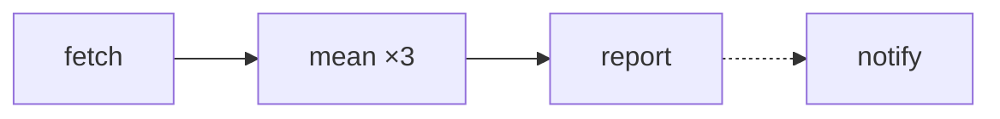

# A4. DAGonWeb

*A web GUI for DAGonStar: draw a workflow, save it as a DAGonStar document, run it on a server or an HPC cluster, follow it live and export it*

DAGonStar in Practice - Appendix. Slides: [A4-DAGonStar-DAGonWeb.pptx](../lectures/A4-DAGonStar-DAGonWeb.pptx). Examples: [examples/A4-dagonweb](../../examples/A4-dagonweb/).

## 2. Today's lecture

**Outline**

1. What DAGonWeb is
2. The workflow document
3. What happens when you press Run
4. Hands-on: a DAGonWeb document run by DAGonStar
5. Editor, interactive tasks, assistant, exports
6. Deploying it: server or cluster

**After this lecture you can**

- Read and write a DAGonWeb document
- Explain how the editor's links become DAGonStar edges
- Run, resume and export a workflow without the browser

## 3. A web GUI

*Draw on a canvas; DAGonStar runs what you drew, on the server, exactly as a script would.*

## 4. DAGonWeb in one slide

- **Flask and Bootstrap** a Progressive Web App, installable, light and dark themes
- **Canvas** tasks from a palette, links drawn between connectors
- **Document** saved as a standard DAGonStar task-map JSON
- **Runtime** DAGonStar launch() and wait() on the server, one scratch folder per run
- **Results** live graph, logs, file browser with previews

> **JSON** - *The contract*
>
> What the editor saves, DAGonStar loads with load_json.

## 5. Who uses it

- **Students** - Build and run a workflow without writing Python first.
- **Scientists** - Run templates, upload inputs, read tables and charts.
- **Developers** - Import a Python program, export it back, commented.
- **Operators** - Roles, SSO, retention, audit log, a cluster back-end.

## 6. The palette

| Category | Task types |
|---|---|
| Shell & HPC | Batch, Slurm, Checkpoint |
| Containers | Docker, Kubernetes, Apptainer, Nomad |
| Cloud, web, devices | Cloud, FaaS, Web, IoT |
| Python & AI | Native, LLM, Agentic |
| DAGonWeb interactive | Upload, Form, Table, Chart, Download |

> **Generated from one registry** app/task_specs.py builds the palette, the forms and each DagonTask.

## 7. Versions

- **DAGonWeb pins** DAGonStar 2.9.4 (commit a7e633f) in its requirements.txt
- **So the palette has** the 14 task types of 2.9.4
- **Not yet in it** TaskType.META and TaskType.VOLUME of 3.0 (Appendices A2, A3)
- **Its documents** load and run with DAGonStar 3.0.0: this appendix's example
- **Check** the pins of both projects before deploying

> *The code is the reference*
>
> Read the DAGonWeb repository at the commit you deploy.

## 8. The document

*The DAGonStar task map, unchanged, plus additive dagonweb keys for the editor.*

## 9. What DAGonWeb adds

- **tasks.<t>.dagonweb** canvas position x, y and the form values
- **dagonweb.runtime** max_threads, portable_emulation, pre_stage
- **Ignored on import** prevs and nexts: edges are always rebuilt
- **Data edges** from workflow:/// references in the commands
- **Explicit edges** from explicit_prevs: order without data

> *Still DAGonStar*
>
> Extra keys are ignored by load_json.

```
Workflow(...,
  jsonload=doc)
```

## 10. A task as DAGonWeb stores it

[`examples/A4-dagonweb/dagonweb_document.py`](../../examples/A4-dagonweb/dagonweb_document.py)

```python
def task(name, script, inputs=None, explicit=(), x=0, y=0):
    """One task as DAGonWeb stores it: command plus editor state."""
    inputs = inputs or {}
    assign = "".join("%s=%s ;\n" % item for item in inputs.items())
    return {"name": name, "type": "batch",
            "command": assign + script,
            "explicit_prevs": list(explicit), "prevs": [], "nexts": [],
            "dagonweb": {"x": x, "y": y,
                         "config": {"command": script,
                                    "inputs": inputs}}}
```

- Named inputs are prepended to the command as shell assignments
- The editor keeps the bare script and the inputs in dagonweb.config

## 11. A named input

Recorded output of `python examples/A4-dagonweb/dagonweb_document.py`:

```text
mean_CAP command (awk program elided):
  obs=workflow:///fetch/outputs/observations.csv ;
  awk -F, -v s=CAP '...' $obs > CAP.txt
```

## 12. Two kinds of link

**Data link (solid)**

- name = workflow:///producer/file
- The file is staged into the consumer
- The edge is inferred by DAGonStar
- Lecture 08

**Explicit dependency (dashed)**

- The producer in explicit_prevs
- No data moves
- add_dependency_to on load
- Lecture 07

## 13. Run

*The server builds a runtime Workflow from the saved document and runs it in a thread or on a worker.*

## 14. What Run does

1. **Create** - A run row and run_<id>/.
2. **Dispatch** - Thread or Redis worker.
3. **Build** - DagonTask per task.
4. **Link** - Explicit edges, references.
5. **Launch** - launch(), then wait().

> **scratch_dir_base is forced to the run folder** a per-workflow dagon.ini cannot write outside the scratch root.

## 15. The executor, in a few lines

[`examples/A4-dagonweb/dagonweb_document.py`](../../examples/A4-dagonweb/dagonweb_document.py)

```python
def run(doc, base, checkpoint, resume=False):
    """What DAGonWeb's executor does with a saved document."""
    runtime = doc["dagonweb"]["runtime"]
    wf = Workflow(doc["name"], config=config(base),
                  max_threads=runtime["max_threads"],
                  portable_emulation=runtime["portable_emulation"],
                  checkpoint_file=checkpoint, jsonload=doc)
    wf.make_dependencies()
    wf.run(resume_checkpoint_file=checkpoint if resume else None)
    return wf, {t.name: t for t in wf.tasks}
```

- The runtime options of the document become Workflow arguments
- Every run has a checkpoint file: Resume passes it back

## 16. The example graph



Solid arrows: data dependencies (`workflow://`); dotted arrows: control dependencies.

- Means via named input obs
- report reads the three files
- notify: explicit only

## 17. Recorded output

Recorded output of `python examples/A4-dagonweb/dagonweb_document.py`:

```text
report after: mean_CAP mean_ISC mean_NAP
notify after: report (explicit)
run 1 failed: ['report', 'notify']
run 2 failed: []
reused: fetch mean_CAP mean_ISC mean_NAP
report: NAP 15.50 | CAP 16.75 | ISC 15.75
as_json explicit_prevs: ['report']
```

- Three data edges, one explicit
- Run 1: a typo fails report and notify
- Run 2: Resume reuses four tasks
- as_json keeps explicit_prevs

## 18. Resume and Run again

- **Every run** writes run_<id>/_dagonweb/checkpoint.json
- **Resume** same folder and checkpoint: finished tasks are skipped
- **Run again** always a fresh run
- **Failure** a non-zero exit status fails the task and its dependants (DAGonStar 3.0)
- **Logs** the captured error is shown on the failed task

> *Recorded output*
>
> Only report and notify ran again.

```
reused: fetch
  mean_CAP mean_ISC
  mean_NAP
```

## 19. In the browser

*Everything the editor offers ends up in the same document.*

## 20. The editor

- **Monaco** - Every multi-line field, with highlighting.
- **Completion** - workflow:/// task names, then their files.
- **Rename** - Rewrites references and explicit_prevs.
- **Organize, Fit** - Layers by dependency; zoom to all.
- **Autosave** - Debounced, with a status indicator.
- **Keyboard** - Shortcuts and alternatives to drag and drop.

## 21. Interactive tasks

| Type | Does | Headless |
|---|---|---|
| Upload | pauses the run until files arrive | --input TASK=FILE |
| Form | pauses for validated answers | --form TASK=FILE |
| Table | CSV or JSON as a table | files only |
| Chart | bar, line, scatter or pie | chart.json, chart.svg |
| Download | files or one ZIP as buttons | files only |

> **Stored as plain batch tasks** a POSIX shell + Python script; the kind is kept in dagonweb.task_type.

## 22. Assistant and dry run

- **Assistant** an LLM agent with tools edits a draft from plain language
- **Endpoint** OpenAI or any compatible server, e.g. vLLM or Ollama
- **Apply** nothing changes on the canvas until you press it
- **Dry run** graph, references, bash -n, compile, portable emulation
- **Guest playground** try templates without an account; nothing is executed

> *Privacy*
>
> The document and your messages go to the endpoint; run files never do.

## 23. Exports

| Format | Content |
|---|---|
| Headless ZIP | Python program, JSON, CWL, sanitised dagon.ini, run.sh |
| Python program | needs only DAGonStar; --resume, --input, --form |
| DAGonWeb JSON | the document with the editor state |
| DAGonStar JSON | the same without editor state |
| CWL v1.2 | DAGonStar's saveAsCWL |

> **Import works too** JSON, a ZIP, or a Python program read by static analysis, never executed.

## 24. Deployment

*A container on a laptop, a service for a group, or the login node of a cluster.*

## 25. Server or cluster

**Server**

- docker compose up --build, port 8000
- SQLite, PostgreSQL or MySQL
- Thread pool, or Redis + workers
- Runs as the service account

**HPC cluster**

- On the login node, behind TLS
- Each run as the user's own Unix account
- SSH key restricted to dagonweb-runner
- Slurm jobs submitted as the user

## 26. Accounts and safety

- **Roles** permissions such as workflows.run and assistant.use
- **Sign-in** local accounts or SSO: Google, Microsoft Entra ID, OpenID Connect
- **Files** every path checked against the run folder
- **Secrets** removed from exported dagon.ini files
- **GDPR and WCAG 2.1 AA** consent, data export, erasure, accessibility

> *On a cluster*
>
> Nothing executes inside the DAGonWeb container.

## 27. Run it

**Steps**

1. Run dagonweb_document.py: no server needed
2. Copy stations.json out of the scratch folder before it is removed
3. Start DAGonWeb with Docker and import the document
4. Run it in the browser and press Resume after a failure

**Run it**

```bash
python examples/\
  A4-dagonweb/\
  dagonweb_document.py
```

**Watch for:** Run 1 fails on catt; run 2 reuses fetch and the three means, exactly as the Resume button does.

## 28. Exercise

A. Add a mean_wind task with a named input
B. Link notify to it with an explicit dependency
C. Run the document with DAGonStar
D. Import it in DAGonWeb and compare the canvas

**Deliverable:** The document, the run output and a screenshot of the imported canvas.

## 29. Check your understanding

1. Why does a DAGonWeb document load with plain DAGonStar?
2. How does a named input reach a batch command?
3. What is the difference between Resume and Run again?
4. Who does a cluster run execute as?

<details><summary>Answers</summary>

1. It is a DAGonStar task map; editor state lives only in additive dagonweb keys, which load_json ignores.
2. As a shell assignment prepended to the command: obs=workflow:///... ; then $obs.
3. Resume reuses the run folder and checkpoint, so finished tasks are skipped; Run again starts fresh.
4. As the Unix account of the user who started it, through a restricted SSH key.

</details>

## 30. Key takeaways

1. DAGonWeb draws, runs and monitors DAGonStar workflows
2. Its document is a DAGonStar task map plus dagonweb keys
3. Run builds a Workflow, links it, launches and records a checkpoint
4. Exports give back a program that needs only DAGonStar

*github.com/DagOnStar/DAGonWeb*

---

Raffaele Montella. CC0 1.0. Generated from `src/lectures/A4.js`.
